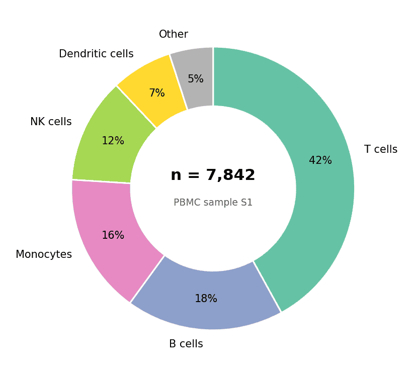

A pie chart shows part-of-whole composition as angular slices; a donut chart replaces the center with an annotation slot. In biomedical research they appear for sample/cohort composition summaries — with the standing caveat that readers judge angles poorly, so pies should stay under ~5 categories and precise comparisons belong in bars. `matplotlib` builds both from `pie()`.

## Example

{fig-align="center" width="80%"}

## Setup

- System Requirements: Cross-platform (Linux/MacOS/Windows)
- Programming Language: **Python**
- Dependencies: `matplotlib`, `pandas`, `numpy`

```{python}
#| label: packages-setup
#| output: false
import matplotlib.pyplot as plt
import pandas as pd
import numpy as np
```

## Data Preparation

We summarize the cell-type composition of one PBMC sample, ordered by abundance — always sort slices before drawing so the chart reads by rank.

```{python}
#| label: data-prep
composition = pd.Series(
    {'T cells': 0.42, 'B cells': 0.18, 'Monocytes': 0.16,
     'NK cells': 0.12, 'Dendritic cells': 0.07, 'Other': 0.05}
).sort_values(ascending=False)
colors = ['#66c2a5', '#8da0cb', '#e78ac3', '#a6d854', '#ffd92f', '#b3b3b3']
```

## Visualization

### Basic Pie Chart

`autopct` prints each share; `startangle=90` and counterclock=False give the conventional clockwise-from-noon layout.

```{python}
#| label: fig-py-pie-basic
#| fig-cap: "Cell-type composition of a PBMC sample as a pie chart"
#| width: 65%
#| fig-align: center
fig, ax = plt.subplots(figsize=(5.5, 5))
ax.pie(composition, labels=composition.index, colors=colors,
       autopct='%.0f%%', startangle=90, counterclock=False,
       wedgeprops=dict(edgecolor='white', linewidth=1.5),
       textprops=dict(fontsize=10))
ax.set_aspect('equal')
plt.tight_layout()
plt.show()
```

### Donut Chart with Center Annotation

`wedgeprops=dict(width=...)` cuts the hole; the freed center is the natural place for the total (e.g., n cells or n patients).

```{python}
#| label: fig-py-donut-center
#| fig-cap: "Donut chart with the sample total annotated in the center"
#| width: 65%
#| fig-align: center
fig, ax = plt.subplots(figsize=(5.5, 5))
wedges, texts, autotexts = ax.pie(
    composition, labels=composition.index, colors=colors,
    autopct='%.0f%%', pctdistance=0.78, startangle=90, counterclock=False,
    wedgeprops=dict(width=0.42, edgecolor='white', linewidth=1.5),
    textprops=dict(fontsize=10))
ax.text(0, 0.06, 'n = 7,842', ha='center', fontsize=15, fontweight='bold')
ax.text(0, -0.12, 'PBMC sample S1', ha='center', fontsize=9, color='0.35')
ax.set_aspect('equal')
plt.tight_layout()
plt.show()
```

### Highlighted Slice

`explode` offsets one wedge — the standard emphasis device when the message is a single category ("dendritic cells expand after vaccination").

```{python}
#| label: fig-py-pie-highlight
#| fig-cap: "Donut chart highlighting one expanded cell type"
#| width: 65%
#| fig-align: center
explode = [0.08 if c == 'Dendritic cells' else 0 for c in composition.index]
shade = ['#b3dee8' if c == 'Dendritic cells' else '#d9d9d9'
         for c in composition.index]

fig, ax = plt.subplots(figsize=(5.5, 5))
ax.pie(composition, explode=explode, colors=shade,
       autopct='%.0f%%', pctdistance=0.75, startangle=90, counterclock=False,
       wedgeprops=dict(width=0.42, edgecolor='white', linewidth=1.5),
       textprops=dict(fontsize=10))
ax.legend(wedges, composition.index, frameon=False,
          loc='center left', bbox_to_anchor=(1.0, 0.5))
ax.set_aspect('equal')
plt.tight_layout()
plt.show()
```

## Application: Donut Table for Cohort Balancing

The FigureYapy edition turns a grid of donuts into a **randomisation check-table**: rows = treatment arms, columns = baseline clinical features, each cell a donut of that feature's category shares within the arm, and a bottom row of Fisher (2×2) / chi-square (larger tables) p-values \[1\]. One glance shows whether the arms are balanced — the figure replaces a wall of per-feature bar charts in CONSORT-style flow reports.

```{python}
#| label: fig-py-donut-table
#| fig-cap: "Cohort balancing table: each cell donuts one baseline feature within an arm; the bottom row gives the Fisher/chi-square p-value per feature"
#| out-width: "100%"
#| fig-width: 8
#| fig-height: 5
rng = np.random.default_rng(196)
features = ['Sex', 'Stage', 'ECOG']
cats = {'Sex': ['Male', 'Female'], 'Stage': ['I-II', 'III-IV'],
        'ECOG': ['0', '>=1']}
n_arm = {'Arm A': 120, 'Arm B': 120}
# Arm B is slightly sicker: shift Stage/ECOG mixes
probs = {'Arm A': {'Stage': [0.65, 0.35], 'ECOG': [0.5, 0.5]},
         'Arm B': {'Stage': [0.5, 0.5], 'ECOG': [0.6, 0.4]}}
pat = pd.DataFrame([
    (arm, rng.choice(cats['Sex'], p=[0.55, 0.45]),
     rng.choice(cats['Stage'], p=probs[arm]['Stage']),
     rng.choice(cats['ECOG'], p=probs[arm]['ECOG']))
    for arm in n_arm for _ in range(n_arm[arm])],
    columns=['Arm'] + features)

from scipy.stats import chi2_contingency, fisher_exact
arms = list(n_arm)
fig, axes = plt.subplots(2, 3, figsize=(8, 5),
                         subplot_kw=dict(aspect='equal'),
                         gridspec_kw=dict(wspace=0.5, hspace=0.75))
col_colors = {'Sex': ['#8da0cb', '#e78ac3'],
              'Stage': ['#66c2a5', '#fc8d62'],
              'ECOG': ['#a6d854', '#ffd92f']}
for j, f in enumerate(features):
    axes[0, j].set_title(f, fontsize=10, fontweight='bold')
    for i, arm in enumerate(arms):
        shares = pat.loc[pat.Arm == arm, f].value_counts(
            normalize=True).reindex(cats[f], fill_value=0)
        axes[i, j].pie(shares, labels=cats[f],
                       colors=col_colors[f], labeldistance=1.18,
                       autopct='%.0f%%', pctdistance=0.76,
                       startangle=90, counterclock=False,
                       wedgeprops=dict(width=0.45, edgecolor='white', linewidth=2),
                       textprops=dict(fontsize=7.5))
        axes[i, j].text(0, 0, f'{arm}\nn = {n_arm[arm]}', ha='center',
                        va='center', fontsize=8)
        tbl = pd.crosstab(pat.Arm, pat[f])[cats[f]].values
        p = (fisher_exact(tbl)[1] if tbl.shape == (2, 2)
             else chi2_contingency(tbl).pvalue)
        axes[1, j].text(0, -1.55, f'p = {p:.2e}', ha='center',
                        fontsize=9, fontweight='bold')
plt.show()
```

The reference keeps the layout by hand (`GridSpec` + manual legend axes); the p-value row uses `scipy.stats` directly — Fisher for 2×2, chi-square beyond. Remember pies compare angles poorly: this figure works because each donut carries at most 3 categories and the reader is comparing *balance*, not estimating shares.

## References

1. Hunter, J. D. (2007). Matplotlib: A 2D graphics environment. *Computing in Science & Engineering*, 9(3), 90-95.
2. From Data to Viz. Pie chart. https://www.data-to-viz.com/caveat/pie.html
3. FigureYapy. FigureYa196Plus_PanPie_py. https://github.com/ying-ge/FigureYapy/tree/main/FigureYa196Plus_PanPie_py
