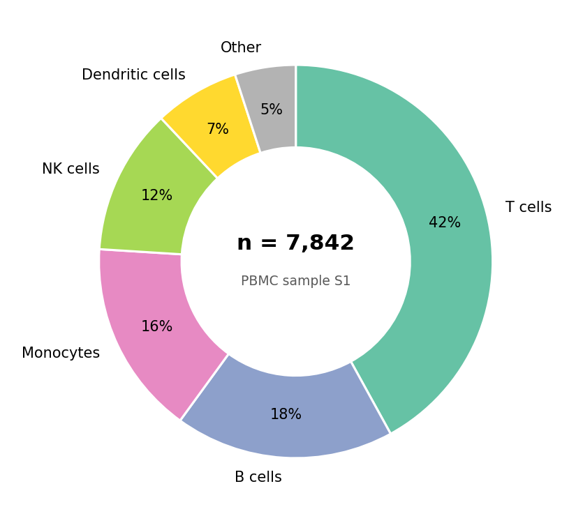

饼图以扇形角度展示整体构成；环形图把圆心留作注释区。在生物医学研究中，它们常用于样本/队列构成汇总——但需谨记读者对角度的判断很差，饼图类别应控制在 5 个左右，精确比较请用条形图。`matplotlib` 的 `pie()` 可绘制两者。

## 示例

{fig-align="center" width="80%"}

## 环境配置

- 系统要求：跨平台（Linux/MacOS/Windows）
- 编程语言：**Python**
- 依赖包：`matplotlib`、`pandas`、`numpy`

```{python}
#| label: packages-setup
#| output: false
import matplotlib.pyplot as plt
import pandas as pd
import numpy as np
```

## 数据准备

我们汇总一份 PBMC 样本的细胞类型构成，并按丰度排序——绘图前务必排序，使图形按名次可读。

```{python}
#| label: data-prep
composition = pd.Series(
    {'T cells': 0.42, 'B cells': 0.18, 'Monocytes': 0.16,
     'NK cells': 0.12, 'Dendritic cells': 0.07, 'Other': 0.05}
).sort_values(ascending=False)
colors = ['#66c2a5', '#8da0cb', '#e78ac3', '#a6d854', '#ffd92f', '#b3b3b3']
```

## 可视化

### 基础饼图

`autopct` 打印每份占比；`startangle=90` 加 `counterclock=False` 给出常规的从正午顺时针布局。

```{python}
#| label: fig-py-pie-basic
#| fig-cap: "PBMC 样本细胞类型构成饼图"
#| width: 65%
#| fig-align: center
fig, ax = plt.subplots(figsize=(5.5, 5))
ax.pie(composition, labels=composition.index, colors=colors,
       autopct='%.0f%%', startangle=90, counterclock=False,
       wedgeprops=dict(edgecolor='white', linewidth=1.5),
       textprops=dict(fontsize=10))
ax.set_aspect('equal')
plt.tight_layout()
plt.show()
```

### 带中心注释的环形图

`wedgeprops=dict(width=...)` 切出圆孔；腾出的圆心是标注总数（如细胞数或患者数）的最佳位置。

```{python}
#| label: fig-py-donut-center
#| fig-cap: "中心标注样本总数的环形图"
#| width: 65%
#| fig-align: center
fig, ax = plt.subplots(figsize=(5.5, 5))
wedges, texts, autotexts = ax.pie(
    composition, labels=composition.index, colors=colors,
    autopct='%.0f%%', pctdistance=0.78, startangle=90, counterclock=False,
    wedgeprops=dict(width=0.42, edgecolor='white', linewidth=1.5),
    textprops=dict(fontsize=10))
ax.text(0, 0.06, 'n = 7,842', ha='center', fontsize=15, fontweight='bold')
ax.text(0, -0.12, 'PBMC sample S1', ha='center', fontsize=9, color='0.35')
ax.set_aspect('equal')
plt.tight_layout()
plt.show()
```

### 高亮扇区

`explode` 将某一扇区外推——当要传达的信息是单一类别（如「树突状细胞在疫苗接种后扩增」）时，这是标准的强调手段。

```{python}
#| label: fig-py-pie-highlight
#| fig-cap: "高亮扩增细胞类型的环形图"
#| width: 65%
#| fig-align: center
explode = [0.08 if c == 'Dendritic cells' else 0 for c in composition.index]
shade = ['#b3dee8' if c == 'Dendritic cells' else '#d9d9d9'
         for c in composition.index]

fig, ax = plt.subplots(figsize=(5.5, 5))
ax.pie(composition, explode=explode, colors=shade,
       autopct='%.0f%%', pctdistance=0.75, startangle=90, counterclock=False,
       wedgeprops=dict(width=0.42, edgecolor='white', linewidth=1.5),
       textprops=dict(fontsize=10))
ax.legend(wedges, composition.index, frameon=False,
          loc='center left', bbox_to_anchor=(1.0, 0.5))
ax.set_aspect('equal')
plt.tight_layout()
plt.show()
```

## 参考文献

1. Hunter, J. D. (2007). Matplotlib: A 2D graphics environment. *Computing in Science & Engineering*, 9(3), 90-95.
2. From Data to Viz. Pie chart. https://www.data-to-viz.com/caveat/pie.html
