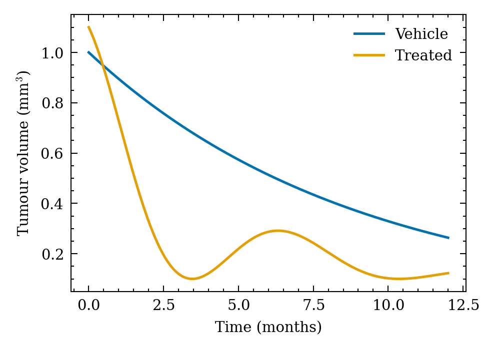

The gap between a working plot and a submission-ready figure is styling and export: consistent font sizes at final print dimensions, restrained spines, colour-blind-safe palettes, and 300+ dpi raster or vector output at the exact column width. `matplotlib`'s `rcParams` encode a house style once; the `SciencePlots` package ships journal-tuned styles (`science`, `nature`, `ieee`) on top.

## Example

{fig-align="center" width="80%"}

## Setup

- System Requirements: Cross-platform (Linux/MacOS/Windows)
- Programming Language: **Python**
- Dependencies: `matplotlib`, `seaborn`, `pandas`, `numpy`, `SciencePlots`

```{python}
#| label: packages-setup
#| output: false
import matplotlib.pyplot as plt
import seaborn as sns
import pandas as pd
import numpy as np
import scienceplots   # noqa: F401  (registers the plt.style entries)
```

## Data Preparation

A small dose-response summary and a colour-blind-safe palette (Okabe–Ito) reused across the demos — palette choice is part of the style, not an afterthought.

```{python}
#| label: data-prep
np.random.seed(221)

groups = ['Vehicle', 'Low', 'Mid', 'High']
summary = pd.DataFrame({
    'Group': pd.Categorical(groups, categories=groups, ordered=True),
    'Mean': [1.0, 1.9, 3.2, 4.4],
    'SEM': [0.28, 0.25, 0.30, 0.26],
})
OKABE_ITO = ['#0072B2', '#E69F00', '#009E73', '#CC79A7']
```

## Visualization

### A House rcParams Block

Set the style once per notebook: font sizes for the final print width (89 mm single column ≈ 3.5 in), thin spines, outward ticks — then every following figure inherits it.

```{python}
#| label: fig-py-style-rcparams
#| fig-cap: "House-style bar plot: 89 mm width, 7 pt fonts, outward ticks"
#| width: 50%
#| fig-align: center
HOUSE = {
    'figure.figsize': (3.5, 2.6),
    'font.size': 7, 'axes.titlesize': 8, 'axes.labelsize': 7,
    'xtick.labelsize': 6.5, 'ytick.labelsize': 6.5, 'legend.fontsize': 6.5,
    'axes.spines.top': False, 'axes.spines.right': False,
    'xtick.direction': 'out', 'ytick.direction': 'out',
    'axes.linewidth': 0.7, 'savefig.dpi': 300,
    'svg.fonttype': 'none',
}

with plt.rc_context(HOUSE):
    fig, ax = plt.subplots()
    ax.bar(summary.Group, summary.Mean, yerr=summary.SEM, capsize=2.5,
           color=OKABE_ITO[0], edgecolor='0.2', linewidth=0.6, width=0.62)
    ax.set_xlabel('Dose group')
    ax.set_ylabel('Response (a.u.)')
    fig.savefig('house_style.png', dpi=300, bbox_inches='tight')
plt.show()
```

### SciencePlots Journal Styles

`plt.style.context(['science', 'nature'])` applies the Nature-tuned rcParams temporarily — no global state leaks between figures; combine with `no-latex` on machines without a LaTeX install.

```{python}
#| label: fig-py-style-scienceplots
#| fig-cap: "The same data under the SciencePlots 'science' + 'nature' styles"
#| width: 55%
#| fig-align: center
x = np.linspace(0, 12, 200)
series = {'Vehicle': 1.0 * np.exp(-x / 9),
          'Treated': 1.0 * np.exp(-x / 4) * np.cos(x / 2.2) ** 2 + 0.1}

with plt.style.context(['science', 'nature', 'no-latex']):
    fig, ax = plt.subplots(figsize=(3.4, 2.4))
    for (name, y), color in zip(series.items(), OKABE_ITO[:2]):
        ax.plot(x, y, label=name, color=color, linewidth=1.2)
    ax.set_xlabel('Time (months)')
    ax.set_ylabel('Tumour volume (mm$^3$)')
    ax.legend(frameon=False)
    fig.savefig('scienceplots_style.svg', bbox_inches='tight')
plt.show()
```

## References

1. SciencePlots: Matplotlib styles for scientific figures. https://github.com/garrettj403/SciencePlots
2. Rougier, N. P., Droettboom, M., & Bourne, P. E. (2014). Ten Simple Rules for Better Figures. *PLoS Computational Biology*, 10(9), e1003833.
