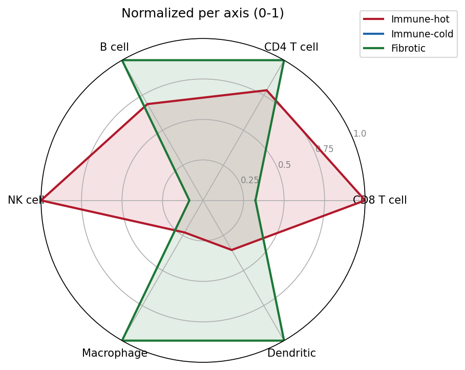
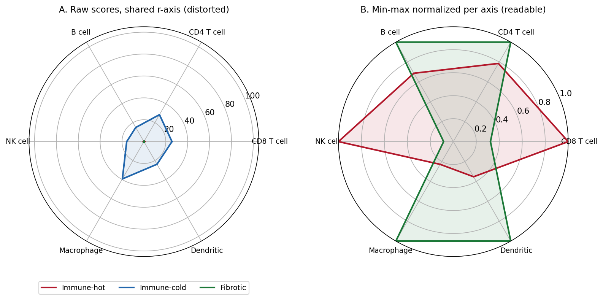

The Python counterpart of [Radar/Spider Plot](../Ranking/Radar.html) — a radar (spider, web) chart draws one or more series as closed polygons over $p$ spokes, one per variable, so multivariate profiles can be compared at a glance. In biomedical work it is the standard summary for immune-signature panels \[1\], tumor functional assessments, and patient-reported outcome profiles, where the *shape* of the profile matters as much as any single value.

matplotlib builds the chart on a polar axis; `plotly.graph_objects` `Scatterpolar` adds an interactive variant for exploratory dashboards \[2\]. The one trap that ruins real analyses: radar axes must share a comparable scale. When variables live on different ranges (a fraction vs a 0-100 score), raw-value polygons distort every shape — normalize per axis first.

This tutorial covers three workflows:

1. A hand-built single-series radar with matplotlib's polar projection;
2. A multi-series radar with per-axis 0-1 normalization;
3. An interactive `plotly` radar for dashboard use.

## Example

{fig-align="center" width="60%"}

## Setup

- System Requirements: Cross-platform (Linux/MacOS/Windows)
- Programming Language: **Python**
- Dependencies: `matplotlib`, `numpy`, `pandas`, `plotly`

```{python}
#| label: packages-setup
#| output: false
import matplotlib.pyplot as plt
import numpy as np
import pandas as pd
import plotly.graph_objects as go
```

## Data Preparation

We simulate an immune-deconvolution panel \[1\]: signature scores (0-1) for six immune cell types across three tumor immune subtypes. Immune-hot tumors score high on adaptive and NK markers, immune-cold tumors score uniformly low, and fibrotic tumors are myeloid-skewed — three distinct shapes a radar should make obvious.

```{python}
#| label: data-prep
rng = np.random.default_rng(42)
cells = ["CD8 T cell", "CD4 T cell", "B cell", "NK cell", "Macrophage", "Dendritic"]
subtypes = ["Immune-hot", "Immune-cold", "Fibrotic"]
base = np.array([
    [0.85, 0.55, 0.30, 0.70, 0.60, 0.45],   # immune-hot: adaptive + NK high
    [0.25, 0.30, 0.15, 0.20, 0.35, 0.20],   # immune-cold: uniformly low
    [0.45, 0.50, 0.40, 0.25, 0.85, 0.70],   # fibrotic: myeloid-skewed
])
scores = pd.DataFrame(base + rng.normal(0, 0.05, base.shape),
                      index=subtypes, columns=cells).clip(lower=0, upper=1)

# Polar scaffolding: one spoke per cell type, polygon closed by repeating
# the first angle/value at the end.
angles = [n / len(cells) * 2 * np.pi for n in range(len(cells))]
angles += angles[:1]
scores.head()
```

## Visualization

### 1. Single-Series Radar

```{python}
#| label: fig-py-radar-basic
#| fig-cap: "Single-series radar of the Immune-hot subtype: the polygon bulges toward CD8 T cell and NK cell, the adaptive/NK-high shape that defines this subtype."
#| fig-align: center

values = scores.loc["Immune-hot"].tolist()
values += values[:1]

fig, ax = plt.subplots(figsize=(5.5, 5.2), subplot_kw={"projection": "polar"})
ax.plot(angles, values, color="#2166AC", linewidth=2)
ax.fill(angles, values, color="#2166AC", alpha=0.25)
ax.set_xticks(angles[:-1]); ax.set_xticklabels(cells, fontsize=10)
ax.set_ylim(0, 1); ax.set_yticks([0.25, 0.5, 0.75, 1.0])
ax.set_yticklabels(["0.25", "0.5", "0.75", "1.0"], fontsize=8, color="grey")
ax.set_title("Immune-hot subtype: signature scores", pad=20)
fig.tight_layout()
plt.show()
```

### 2. Multi-Series Radar with Per-Axis Normalization

Min-max scaling each axis to 0-1 puts all spokes on a common range, so shape comparisons stay honest even when the underlying variables differ in spread.

```{python}
#| label: fig-py-radar-multi
#| fig-cap: "Three immune subtypes on one radar: Immune-hot dominates the CD8/NK side, Fibrotic the macrophage/dendritic side, Immune-cold collapses toward the center."
#| fig-align: center

norm = (scores - scores.min()) / (scores.max() - scores.min())
colors = {"Immune-hot": "#B2182B", "Immune-cold": "#2166AC",
          "Fibrotic": "#1B7837"}
fig, ax = plt.subplots(figsize=(5.8, 5.4), subplot_kw={"projection": "polar"})
for st in subtypes:
    v = norm.loc[st].tolist(); v += v[:1]
    ax.plot(angles, v, color=colors[st], linewidth=2, label=st)
    ax.fill(angles, v, color=colors[st], alpha=0.12)
ax.set_xticks(angles[:-1]); ax.set_xticklabels(cells, fontsize=10)
ax.set_ylim(0, 1); ax.set_yticks([0.25, 0.5, 0.75, 1.0])
ax.set_yticklabels(["0.25", "0.5", "0.75", "1.0"], fontsize=8, color="grey")
ax.legend(loc="upper right", bbox_to_anchor=(1.3, 1.1), fontsize=9)
ax.set_title("Normalized per axis (0-1)", pad=20)
fig.tight_layout()
plt.show()
```

### 3. Interactive Radar with plotly

```{python}
#| label: fig-py-radar-plotly
#| fig-cap: "Interactive plotly radar of the same three subtypes: hover a polygon to read exact scores; click legend entries to isolate a subtype."

fig = go.Figure()
for st in subtypes:
    v = norm.loc[st].tolist(); v += v[:1]
    fig.add_trace(go.Scatterpolar(
        r=v, theta=cells + [cells[0]], fill="toself", name=st,
        line=dict(color=colors[st])))
fig.update_layout(
    polar=dict(radialaxis=dict(range=[0, 1], tickvals=[0.25, 0.5, 0.75, 1.0])),
    width=560, height=480,
    title="Immune signature radar (hover to compare)")
fig
```

::: callout-tip
## Practice tips

-   Always `set_ylim()`: matplotlib's polar default r-limit is data-dependent, so two radars rendered from different subsets are silently incomparable.
-   Never overlay raw values on different scales — a 0-100 score squashes every 0-1 fraction into the center (see the Application panel).
-   More than 3-4 overlaid series makes radar charts unreadable; consider a slope/dumbbell chart or a heatmap of the same matrix.
-   Order spokes to carry meaning (cell lineage order, workflow order) — alphabetical spoke order produces meaningless zigzag polygons.
:::

## Application

The panel below reproduces the most common radar-chart mistake in clinical reports: panel A overlays the three subtypes with one raw-score axis rescaled ×100 on one subtype — the ×100 polygon pins the shared r-limit and every other series collapses into an unreadable center blob. Panel B min-max normalizes per axis and the three profile shapes reappear.

{fig-align="center" width="80%"}

## Reference

\[1\] Becht E, Giraldo NA, Lacroix L, et al. Estimating the abundance of cell populations from deconvolution of immune cell infiltrates. Genome Biol. 2016;17:218. doi:10.1186/s13059-016-1070-5

\[2\] Sievert C. Interactive Web-Based Data Visualization with R, plotly, and shiny. Chapman and Hall/CRC; 2020. doi:10.1201/9780429447273
