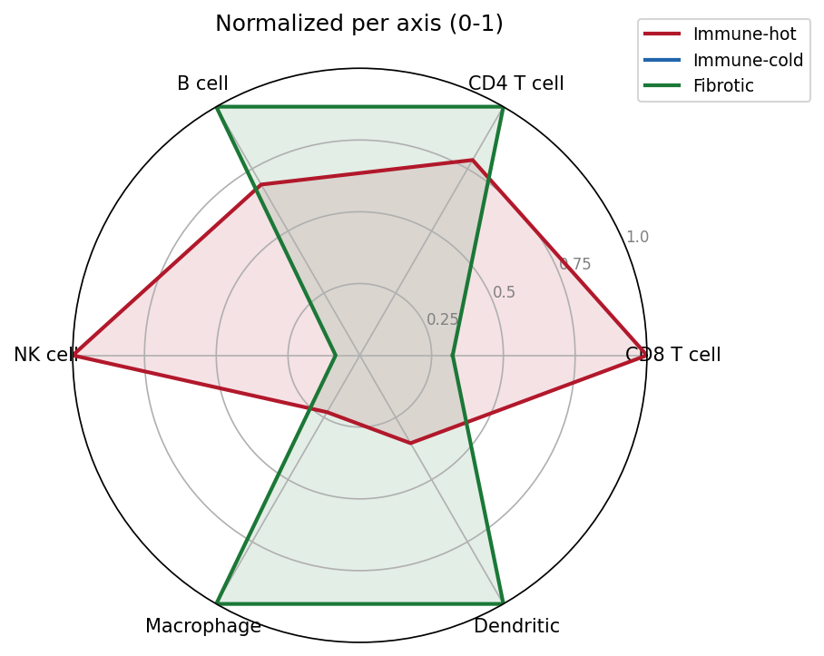
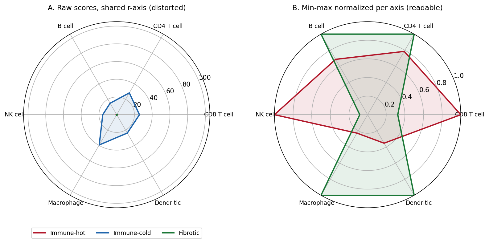

[雷达图](../zh/Ranking/Radar.html)的 Python 对应版本——雷达图（蛛网图、网图）以 $p$ 条辐射轴各代表一个变量，把一条或多条序列画成闭合多边形，从而直观比较多维画像。在生物医学中，它是免疫信号面板 \[1\]、肿瘤功能评估、患者报告结局画像的标准汇总图：画像的*形状*往往与任何单一数值同等重要。

matplotlib 通过极坐标轴构建雷达图；`plotly.graph_objects` 的 `Scatterpolar` 提供适用于探索性仪表盘的交互版本 \[2\]最常见且足以毁掉真实分析的陷阱：雷达各轴必须处于可比较的量纲。当变量取值范围不同（0-1 比例 vs 0-100 评分）时，直接用原始值作图会扭曲每条画像——务必先做逐轴归一化。

本教程涵盖三种工作流：

1. matplotlib 极坐标投影手工构建单序列雷达图；
2. 逐轴 0-1 归一化的多序列雷达图；
3. 面向仪表盘的 `plotly` 交互雷达图。

## Example

{fig-align="center" width="60%"}

## Setup

- 系统要求：跨平台（Linux/MacOS/Windows）
- 编程语言：**Python**
- 依赖包：`matplotlib`、`numpy`、`pandas`、`plotly`

```{python}
#| label: packages-setup
#| output: false
import matplotlib.pyplot as plt
import numpy as np
import pandas as pd
import plotly.graph_objects as go
```

## Data Preparation

我们模拟一个免疫反卷积面板 \[1\]：三种肿瘤免疫亚型在六种免疫细胞类型上的信号评分（0-1）。Immune-hot 亚型在适应性免疫与 NK 标志上得分高，Immune-cold 全面偏低，Fibrotic 呈髓系偏移——三种雷达图应能一眼区分的形状。

```{python}
#| label: data-prep
rng = np.random.default_rng(42)
cells = ["CD8 T cell", "CD4 T cell", "B cell", "NK cell", "Macrophage", "Dendritic"]
subtypes = ["Immune-hot", "Immune-cold", "Fibrotic"]
base = np.array([
    [0.85, 0.55, 0.30, 0.70, 0.60, 0.45],   # immune-hot：适应性 + NK 高
    [0.25, 0.30, 0.15, 0.20, 0.35, 0.20],   # immune-cold：全面偏低
    [0.45, 0.50, 0.40, 0.25, 0.85, 0.70],   # fibrotic：髓系偏移
])
scores = pd.DataFrame(base + rng.normal(0, 0.05, base.shape),
                      index=subtypes, columns=cells).clip(0, 1)

# 极坐标脚手架：每种细胞一条轴，多边形通过在末尾重复第一个角度/取值闭合
angles = [n / len(cells) * 2 * np.pi for n in range(len(cells))]
angles += angles[:1]
scores.head()
```

## Visualization

### 1. 单序列雷达图

```{python}
#| label: fig-py-radar-basic
#| fig-cap: "Immune-hot 亚型的单序列雷达图：多边形向 CD8 T cell 与 NK cell 鼓出，正是定义该亚型的适应性/NK 高表达形状。"
#| fig-align: center

values = scores.loc["Immune-hot"].tolist()
values += values[:1]

fig, ax = plt.subplots(figsize=(5.5, 5.2), subplot_kw={"projection": "polar"})
ax.plot(angles, values, color="#2166AC", linewidth=2)
ax.fill(angles, values, color="#2166AC", alpha=0.25)
ax.set_xticks(angles[:-1]); ax.set_xticklabels(cells, fontsize=10)
ax.set_ylim(0, 1); ax.set_yticks([0.25, 0.5, 0.75, 1.0])
ax.set_yticklabels(["0.25", "0.5", "0.75", "1.0"], fontsize=8, color="grey")
ax.set_title("Immune-hot subtype: signature scores", pad=20)
fig.tight_layout()
plt.show()
```

### 2. 逐轴归一化的多序列雷达图

逐轴 min-max 缩放到 0-1 后，所有轴共用同一量程，即使原始变量离散程度不同，形状比较依然诚实。

```{python}
#| label: fig-py-radar-multi
#| fig-cap: "三种免疫亚型同图对比：Immune-hot 占据 CD8/NK 一侧，Fibrotic 占据巨噬/树突一侧，Immune-cold 收缩到中心。"
#| fig-align: center

norm = (scores - scores.min()) / (scores.max() - scores.min())
colors = {"Immune-hot": "#B2182B", "Immune-cold": "#2166AC",
          "Fibrotic": "#1B7837"}
fig, ax = plt.subplots(figsize=(5.8, 5.4), subplot_kw={"projection": "polar"})
for st in subtypes:
    v = norm.loc[st].tolist(); v += v[:1]
    ax.plot(angles, v, color=colors[st], linewidth=2, label=st)
    ax.fill(angles, v, color=colors[st], alpha=0.12)
ax.set_xticks(angles[:-1]); ax.set_xticklabels(cells, fontsize=10)
ax.set_ylim(0, 1); ax.set_yticks([0.25, 0.5, 0.75, 1.0])
ax.set_yticklabels(["0.25", "0.5", "0.75", "1.0"], fontsize=8, color="grey")
ax.legend(loc="upper right", bbox_to_anchor=(1.3, 1.1), fontsize=9)
ax.set_title("Normalized per axis (0-1)", pad=20)
fig.tight_layout()
plt.show()
```

### 3. plotly 交互雷达图

```{python}
#| label: fig-py-radar-plotly
#| fig-cap: "同三种亚型的 plotly 交互雷达图：悬停多边形读取精确分数；点击图例隔离单个亚型。"

fig = go.Figure()
for st in subtypes:
    v = norm.loc[st].tolist(); v += v[:1]
    fig.add_trace(go.Scatterpolar(
        r=v, theta=cells + [cells[0]], fill="toself", name=st,
        line=dict(color=colors[st])))
fig.update_layout(
    polar=dict(radialaxis=dict(range=[0, 1], tickvals=[0.25, 0.5, 0.75, 1.0])),
    width=560, height=480,
    title="Immune signature radar (hover to compare)")
fig
```

::: callout-tip
## 实践要点

-   一定要 `set_ylim()`：matplotlib 极坐标的 r 轴上限默认随数据变化，来自不同子集的两张雷达图会悄悄失去可比性。
-   严禁在不同量纲上叠加原始值——0-100 的评分会把所有 0-1 的比例压到圆心（见 Application 面板）。
-   叠加超过 3-4 条序列后雷达图将不可读；同一矩阵改用斜率/哑铃图或热图。
-   轴的排布应携带含义（细胞谱系顺序、流程顺序）——按字母排序的轴只会产生无意义的锯齿多边形。
:::

## Application

下面的面板复现了临床报告中最常见的雷达图错误：A 面板直接叠加三条亚型画像，其中一条的原始分数被放大 100 倍——该多边形撑满共享的 r 轴上限，其余序列全部塌缩成中心一团不可读的斑点。B 面板逐轴 min-max 归一化后，三种画像形状重新显现。

{fig-align="center" width="80%"}

## Reference

\[1\] Becht E, Giraldo NA, Lacroix L, et al. Estimating the abundance of cell populations from deconvolution of immune cell infiltrates. Genome Biol. 2016;17:218. doi:10.1186/s13059-016-1070-5

\[2\] Sievert C. Interactive Web-Based Data Visualization with R, plotly, and shiny. Chapman and Hall/CRC; 2020. doi:10.1201/9780429447273
