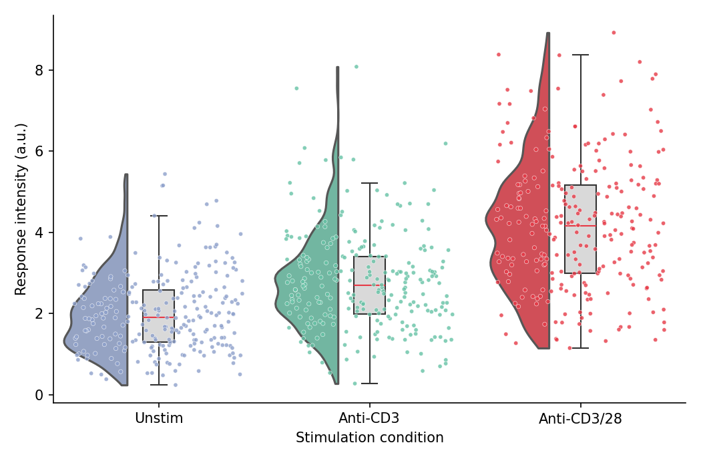

雨云图将半小提琴（「云」）、箱线图与抖动散点（「雨」）组合在一张图中，同时呈现完整分布、汇总统计量与单个观测值。在生物医学研究中，它已成为分组连续型数据条形图的首选替代方案。Python 中 `ptitprince` 包在 `seaborn` 之上组装这三个图层。

## 示例

{fig-align="center" width="80%"}

## 环境配置

- 系统要求：跨平台（Linux/MacOS/Windows）
- 编程语言：**Python**
- 依赖包：`matplotlib`、`seaborn`、`pandas`、`numpy`、`ptitprince`

```{python}
#| label: packages-setup
#| output: false
import matplotlib.pyplot as plt
import seaborn as sns
import pandas as pd
import numpy as np
import ptitprince as pt
```

## 数据准备

我们模拟三种刺激条件下流式检测的响应强度，每个条件足够的细胞数使半小提琴轮廓具有信息量。

```{python}
#| label: data-prep
np.random.seed(41)

conditions = ['Unstim', 'Anti-CD3', 'Anti-CD3/28']
n_cells = 250
df = pd.DataFrame({
    'Condition': np.repeat(conditions, n_cells),
    'Response': np.concatenate([
        np.random.gamma(4.0, 0.5, n_cells),
        np.random.gamma(5.0, 0.55, n_cells),
        np.random.gamma(7.0, 0.6, n_cells),
    ])
})
palette = {'Unstim': '#8da0cb', 'Anti-CD3': '#66c2a5', 'Anti-CD3/28': '#e63946'}
```

## 可视化

### 基础雨云图

三个图层构成云朵：半小提琴位于类别刻度左侧，窄箱线图位于刻度上，抖动散点位于右侧。

```{python}
#| label: fig-py-rain-basic
#| fig-cap: "各刺激条件响应强度的雨云图"
#| width: 80%
#| fig-align: center
dx = 'Condition'; dy = 'Response'; ort = 'v'

fig, ax = plt.subplots(figsize=(7, 4.6))
ax = pt.half_violinplot(x=dx, y=dy, hue=dx, data=df, palette=palette, order=conditions,
                        dodge=False, bw=0.2, cut=0, scale='area', width=0.6,
                        inner=None, orient=ort, ax=ax)
ax = sns.boxplot(x=dx, y=dy, data=df, order=conditions, orient=ort,
                 width=0.15, color='0.85', showcaps=True,
                 boxprops=dict(edgecolor='0.2'),
                 whiskerprops=dict(color='0.2'), capprops=dict(color='0.2'),
                 medianprops=dict(color='#e63946'),
                 showfliers=False, ax=ax)
ax = sns.stripplot(x=dx, y=dy, data=df, hue=dx, order=conditions, orient=ort,
                   palette=palette, legend=False, edgecolor='white', linewidth=0.3,
                   size=3, jitter=0.4, alpha=0.8, ax=ax)
if ax.get_legend() is not None:
    ax.get_legend().remove()
ax.set_xlabel('Stimulation condition')
ax.set_ylabel('Response intensity (a.u.)')
ax.spines[['top', 'right']].set_visible(False)
plt.tight_layout()
plt.show()
```

### 横向雨云图

类别标签较长时，横向布局（`orient='h'`）更易读，云朵悬挂在箱体上方。注意 `ptitprince` 在横向模式下要求 x 为数值变量、y 为类别变量。

```{python}
#| label: fig-py-rain-horizontal
#| fig-cap: "长类别标签的横向雨云图"
#| width: 80%
#| fig-align: center
ort = 'h'

fig, ax = plt.subplots(figsize=(7, 4.6))
# 横向模式下 ptitprince 要求 x 为数值变量
ax = pt.half_violinplot(x=dy, y=dx, hue=dx, data=df, palette=palette, order=conditions,
                        dodge=False, bw=0.2, cut=0, scale='area', width=0.6,
                        inner=None, orient=ort, ax=ax)
ax = sns.boxplot(x=dy, y=dx, data=df, order=conditions, orient=ort,
                 width=0.15, color='0.85',
                 boxprops=dict(edgecolor='0.2'),
                 whiskerprops=dict(color='0.2'), capprops=dict(color='0.2'),
                 medianprops=dict(color='#e63946'),
                 showfliers=False, ax=ax)
ax = sns.stripplot(x=dy, y=dx, data=df, hue=dx, order=conditions, orient=ort,
                   palette=palette, legend=False, edgecolor='white', linewidth=0.3,
                   size=3, jitter=0.4, alpha=0.8, ax=ax)
if ax.get_legend() is not None:
    ax.get_legend().remove()
ax.set_xlabel('Response intensity (a.u.)')
ax.set_ylabel('Stimulation condition')
ax.spines[['top', 'right']].set_visible(False)
plt.tight_layout()
plt.show()
```

### 分组雨云图

将第二个因素映射到 `hue`，把每个云朵拆分为成对的两半，例如每种刺激内的应答与非应答细胞。

```{python}
#| label: fig-py-rain-grouped
#| fig-cap: "按应答亚群拆分的雨云图"
#| width: 80%
#| fig-align: center
ort = 'v'
df2 = df.copy()
df2['Subpopulation'] = np.random.choice(['Responder', 'Non-responder'], len(df2), p=[0.6, 0.4])

fig, ax = plt.subplots(figsize=(7.5, 4.6))
ax = pt.half_violinplot(x=dx, y=dy, hue='Subpopulation', data=df2, order=conditions,
                        hue_order=['Responder', 'Non-responder'],
                        palette=['#457b9d', '#e78ac3'],
                        bw=0.2, cut=0, scale='area', width=0.9,
                        inner=None, orient=ort, dodge=True, ax=ax)
ax = sns.boxplot(x=dx, y=dy, hue='Subpopulation', data=df2, order=conditions,
                 hue_order=['Responder', 'Non-responder'], orient=ort,
                 width=0.3, color='0.88',
                 boxprops=dict(edgecolor='0.2'),
                 whiskerprops=dict(color='0.2'), capprops=dict(color='0.2'),
                 medianprops=dict(color='#e63946'),
                 showfliers=False, dodge=True, ax=ax)
ax = sns.stripplot(x=dx, y=dy, hue='Subpopulation', data=df2, order=conditions,
                   hue_order=['Responder', 'Non-responder'],
                   palette=['#457b9d', '#e78ac3'], dodge=True,
                   edgecolor='white', linewidth=0.3, size=2.5, jitter=0.4,
                   alpha=0.8, ax=ax)
ax.set_xlabel('Stimulation condition')
ax.set_ylabel('Response intensity (a.u.)')
handles, labels = ax.get_legend_handles_labels()
ax.legend(handles[:2], labels[:2], frameon=False, title=None, loc='upper left')
ax.spines[['top', 'right']].set_visible(False)
plt.tight_layout()
plt.show()
```

## 参考文献

1. Allen, M., Poggiali, D., Whitaker, K., et al. (2019). Raincloud plots: a multi-platform tool for robust data visualization. *Wellcome Open Research*, 4, 63.
2. Hunter, J. D. (2007). Matplotlib: A 2D graphics environment. *Computing in Science & Engineering*, 9(3), 90-95.
3. Waskom, M. L. (2021). seaborn: statistical data visualization. *Journal of Open Source Software*, 6(60), 3021.
