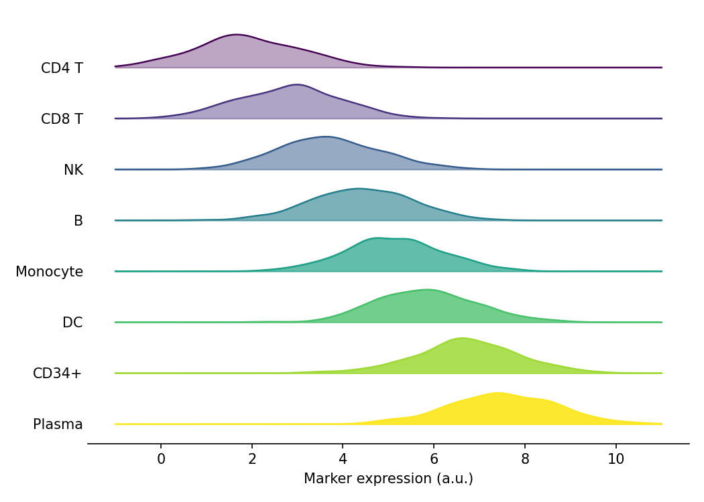

山脊图（joyplot）沿共享 x 轴为每个类别堆叠一条密度曲线，一眼呈现分布在多个分组间的移动。在生物医学研究中，它是比较不同细胞簇的标志物表达分布、或任何令分面直方图不堪重负的多组分布比较的理想选择。Python 中可以用 `scipy.stats.gaussian_kde` 逐组估计核密度，再在共享的 `matplotlib` 坐标轴上分层组合而成。

## 示例

{fig-align="center" width="80%"}

## 环境配置

- 系统要求：跨平台（Linux/MacOS/Windows）
- 编程语言：**Python**
- 依赖包：`matplotlib`、`pandas`、`numpy`、`scipy`

```{python}
#| label: packages-setup
#| output: false
import matplotlib.pyplot as plt
import pandas as pd
import numpy as np
from scipy.stats import gaussian_kde
```

## 数据准备

我们模拟一个表面标志物在八个 PBMC 细胞簇中的表达，各簇均值依次升高，沿堆叠方向形成可见的梯度。

```{python}
#| label: data-prep
np.random.seed(31)

clusters = ['CD4 T', 'CD8 T', 'NK', 'B', 'Monocyte', 'DC', 'CD34+', 'Plasma']
n_per_cluster = 400
base_means = np.linspace(2.0, 7.5, len(clusters))

records = []
for cluster, mu in zip(clusters, base_means):
    records.append(pd.DataFrame({
        'Cluster': cluster,
        'Marker': np.random.normal(mu, 1.1, n_per_cluster)
    }))
marker = pd.concat(records, ignore_index=True)

# 共享的求值网格与山脊间距
xs = np.linspace(-1, 11, 300)
offset = 0.55
```

## 可视化

### 基础山脊图

每个细胞簇贡献一条核密度估计曲线；自下而上绘制，使上层曲线部分覆盖下层。

```{python}
#| label: fig-py-ridge-basic
#| fig-cap: "八个细胞簇的标志物表达分布"
#| width: 80%
#| fig-align: center
n = len(clusters)
fig, ax = plt.subplots(figsize=(7, 5))
for i in reversed(range(n)):                    # 先画底部，最后画顶部
    d = marker.loc[marker['Cluster'] == clusters[i], 'Marker']
    ys = gaussian_kde(d)(xs)
    base = offset * (n - 1 - i)
    ax.plot(xs, base + ys, color='0.3', linewidth=1.1)
    ax.fill_between(xs, base, base + ys, color='#8da0cb', alpha=0.9)
ax.set_yticks([offset * (n - 1 - i) for i in range(n)], labels=clusters)
ax.set_xlabel('Marker expression (a.u.)')
ax.spines[['top', 'right', 'left']].set_visible(False)
ax.tick_params(axis='y', length=0)
plt.tight_layout()
plt.show()
```

### 渐变填充与颜色映射

用颜色映射编码堆叠顺序、并让靠后的填充逐渐变浅，在分组较多、标签难以追踪时很有帮助。

```{python}
#| label: fig-py-ridge-fade
#| fig-cap: "颜色映射编码顺序且填充渐变的山脊图"
#| width: 80%
#| fig-align: center
n = len(clusters)
fig, ax = plt.subplots(figsize=(7, 5))
for i in reversed(range(n)):
    d = marker.loc[marker['Cluster'] == clusters[i], 'Marker']
    ys = gaussian_kde(d)(xs)
    base = offset * (n - 1 - i)
    shade = plt.cm.viridis(i / (n - 1))
    ax.plot(xs, base + ys, color=shade, linewidth=1.1)
    ax.fill_between(xs, base, base + ys, color=shade,
                    alpha=0.35 + 0.6 * i / (n - 1))
ax.set_yticks([offset * (n - 1 - i) for i in range(n)], labels=clusters)
ax.set_xlabel('Marker expression (a.u.)')
ax.spines[['top', 'right', 'left']].set_visible(False)
ax.tick_params(axis='y', length=0)
plt.tight_layout()
plt.show()
```

### 直方图山脊

用逐组直方图替换核密度，在较小样本量下能保留离散抽样的信息。

```{python}
#| label: fig-py-ridge-hist
#| fig-cap: "基于直方图的山脊图（各簇分箱计数）"
#| width: 80%
#| fig-align: center
n = len(clusters)
bins = np.linspace(-1, 11, 25)
fig, ax = plt.subplots(figsize=(7, 5))
for i in reversed(range(n)):
    d = marker.loc[marker['Cluster'] == clusters[i], 'Marker']
    counts, edges = np.histogram(d, bins=bins)
    base = offset * (n - 1 - i)
    ax.bar(edges[:-1], counts, width=np.diff(edges), bottom=base,
           align='edge', color='#66c2a5', edgecolor='0.2', linewidth=0.6)
ax.set_yticks([offset * (n - 1 - i) for i in range(n)], labels=clusters)
ax.set_xlabel('Marker expression (a.u.)')
ax.set_ylabel('Count (offset per cluster)')
ax.spines[['top', 'right', 'left']].set_visible(False)
ax.tick_params(axis='y', length=0)
plt.tight_layout()
plt.show()
```

## 参考文献

1. Hunter, J. D. (2007). Matplotlib: A 2D graphics environment. *Computing in Science & Engineering*, 9(3), 90-95.
2. Virtanen, P., et al. (2020). SciPy 1.0: fundamental algorithms for scientific computing in Python. *Nature Methods*, 17(3), 261-272.
3. From Data to Viz. Ridgeline. https://www.data-to-viz.com/graph/ridgeline.html
