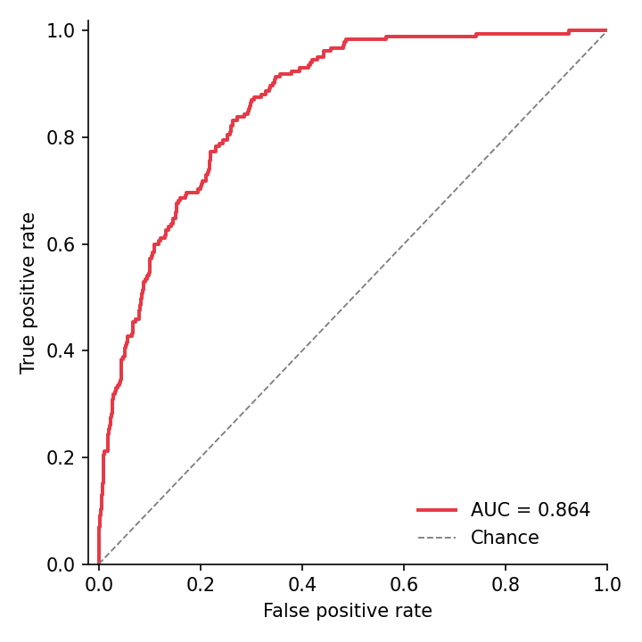

The ROC curve trades sensitivity against (1 − specificity) across every score threshold, summarized by AUC; the precision–recall curve exposes the same ranking from the positive-class perspective and is the honest display under heavy class imbalance. Both are one call from `scikit-learn`'s metric functions and one line of matplotlib styling.

## Example

{fig-align="center" width="80%"}

## Setup

- System Requirements: Cross-platform (Linux/MacOS/Windows)
- Programming Language: **Python**
- Dependencies: `matplotlib`, `seaborn`, `pandas`, `numpy`, `scikit-learn`

```{python}
#| label: packages-setup
#| output: false
import matplotlib.pyplot as plt
import seaborn as sns
import pandas as pd
import numpy as np
from sklearn.metrics import roc_curve, auc, precision_recall_curve, average_precision_score
```

## Data Preparation

We simulate diagnostic scores for 2,000 patients with a 10% prevalence: healthy scores centred at 0, diseased scores shifted upward — a useful-but-not-perfect classifier.

```{python}
#| label: data-prep
np.random.seed(161)

n, prevalence = 2000, 0.10
label = (np.random.random(n) < prevalence).astype(int)
scores = np.where(label == 1,
                  np.random.normal(0.9, 0.55, n),
                  np.random.normal(0.0, 0.65, n))

fpr, tpr, _ = roc_curve(label, scores)
roc_auc = auc(fpr, tpr)
prec, rec, _ = precision_recall_curve(label, scores)
ap = average_precision_score(label, scores)
```

## Visualization

### ROC Curve with AUC

The diagonal is the chance classifier; plotting each candidate model on the same axes turns model selection into one glance.

```{python}
#| label: fig-py-roc
#| fig-cap: "ROC curve with the chance diagonal and AUC"
#| width: 58%
#| fig-align: center
fig, ax = plt.subplots(figsize=(4.8, 4.8))
ax.plot(fpr, tpr, color='#e63946', linewidth=1.9,
        label=f'AUC = {roc_auc:.3f}')
ax.plot([0, 1], [0, 1], color='0.5', linewidth=0.9, linestyle='--',
        label='Chance')
ax.set_xlabel('False positive rate')
ax.set_ylabel('True positive rate')
ax.set_xlim(-0.02, 1.0)
ax.set_ylim(0, 1.02)
ax.legend(frameon=False, loc='lower right')
ax.spines[['top', 'right']].set_visible(False)
plt.tight_layout()
plt.show()
```

### Precision–Recall Curve with Average Precision

With 10% prevalence the chance line sits at 0.10 (dashed) — an AUC that looks flattering on the ROC can look far less so here, which is exactly the point.

```{python}
#| label: fig-py-pr
#| fig-cap: "Precision-recall curve with average precision and prevalence baseline"
#| width: 58%
#| fig-align: center
fig, ax = plt.subplots(figsize=(4.8, 4.8))
ax.plot(rec, prec, color='#457b9d', linewidth=1.9,
        label=f'AP = {ap:.3f}')
ax.axhline(prevalence, color='0.5', linewidth=0.9, linestyle='--',
           label=f'Prevalence = {prevalence:.2f}')
ax.set_xlabel('Recall')
ax.set_ylabel('Precision')
ax.set_xlim(0, 1.0)
ax.set_ylim(0, 1.02)
ax.legend(frameon=False, loc='upper right')
ax.spines[['top', 'right']].set_visible(False)
plt.tight_layout()
plt.show()
```

## References

1. Pedregosa, F., et al. (2011). Scikit-learn: Machine Learning in Python. *Journal of Machine Learning Research*, 12, 2825-2830.
2. Saito, T., & Rehmsmeier, M. (2015). The Precision-Recall Plot Is More Informative than the ROC Plot When Evaluating Binary Classifiers on Imbalanced Datasets. *PLoS ONE*, 10(3), e0118432.
