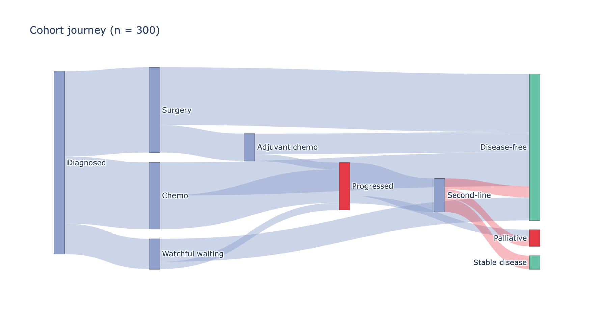

A Sankey diagram routes flow ribbons between staged nodes, with ribbon width proportional to volume — the natural display for patient journeys (screening → treatment → outcome), cell-type transitions, or read-allocation across sequencing lanes. `matplotlib` has no usable Sankey; `plotly`'s `go.Sankey` handles node layout and interactive hover, and quarto embeds the result in standalone HTML.

## Example

{fig-align="center" width="80%"}

## Setup

- System Requirements: Cross-platform (Linux/MacOS/Windows)
- Programming Language: **Python**
- Dependencies: `pandas`, `numpy`, `plotly`

```{python}
#| label: packages-setup
#| output: false
import pandas as pd
import numpy as np
import plotly.graph_objects as go
```

## Data Preparation

We summarize a clinical cohort journey as node-to-node flow volumes: 300 patients move from diagnosis through two treatment stages to outcome. Flows are (source, target, value) triples.

```{python}
#| label: data-prep
flows = pd.DataFrame([
    # stage 1: diagnosis -> first treatment
    ('Diagnosed', 'Surgery', 140),
    ('Diagnosed', 'Chemo', 110),
    ('Diagnosed', 'Watchful waiting', 50),
    # stage 2: first treatment -> outcome
    ('Surgery', 'Disease-free', 95),
    ('Surgery', 'Adjuvant chemo', 45),
    ('Chemo', 'Disease-free', 55),
    ('Chemo', 'Progressed', 55),
    ('Watchful waiting', 'Disease-free', 38),
    ('Watchful waiting', 'Progressed', 12),
    # stage 3: adjuvant/progressed -> final status
    ('Adjuvant chemo', 'Disease-free', 34),
    ('Adjuvant chemo', 'Progressed', 11),
    ('Progressed', 'Second-line', 55),
    ('Progressed', 'Palliative', 12),
    ('Second-line', 'Disease-free', 18),
    ('Second-line', 'Stable disease', 22),
    ('Second-line', 'Palliative', 15),
], columns=['Source', 'Target', 'Value'])

nodes = list(dict.fromkeys(
    flows.Source.tolist() + flows.Target.tolist()))
node_index = {n: i for i, n in enumerate(nodes)}
node_colors = ['#8da0cb' if n in ('Diagnosed', 'Surgery', 'Chemo',
                                 'Watchful waiting', 'Adjuvant chemo',
                                 'Second-line')
               else '#66c2a5' if 'Disease-free' in n or 'Stable' in n
               else '#e63946'
               for n in nodes]
```

## Visualization

### Cohort Journey Sankey

Nodes are declared once, then every flow references them by index; assigning each ribbon its source colour keeps the stages readable.

```{python}
#| label: fig-py-sankey
#| fig-cap: "Patient flow from diagnosis to outcome (n = 300)"
#| width: 88%
#| fig-align: center
fig = go.Figure(data=[go.Sankey(
    node=dict(label=nodes, pad=14, thickness=16,
              color=node_colors),
    link=dict(
        source=[node_index[s] for s, _, _ in flows.itertuples(index=False)],
        target=[node_index[t] for _, t, _ in flows.itertuples(index=False)],
        value=flows.Value,
        color=['rgba(141,160,203,0.45)' if node_index[s] < 6
               else 'rgba(230,57,70,0.35)'
               for s, _, _ in flows.itertuples(index=False)],
    ))])
fig.update_layout(title_text='Cohort journey (n = 300)',
                  font_size=11, width=880, height=480)
fig.show()
```

The rendered figure is interactive: hovering a ribbon shows the exact patient count, hovering a node the total in/outflow.

## References

1. Plotly Technologies Inc. Sankey diagram in Python. https://plotly.com/python/sankey-diagram/
2. Schmidt, M. The Sankey diagram in energy and material flow accounting. *Journal of Industrial Ecology* (2008).
