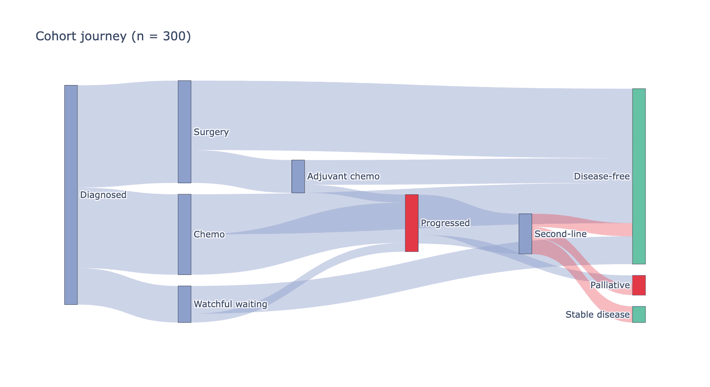

A Sankey diagram routes flow ribbons between staged nodes, with ribbon width proportional to volume — the natural display for patient journeys (screening → treatment → outcome), cell-type transitions, or read-allocation across sequencing lanes. `matplotlib` has no usable Sankey; `plotly`'s `go.Sankey` handles node layout and interactive hover, and quarto embeds the result in standalone HTML.

## Example

{fig-align="center" width="80%"}

## Setup

- System Requirements: Cross-platform (Linux/MacOS/Windows)
- Programming Language: **Python**
- Dependencies: `pandas`, `numpy`, `plotly`

```{python}
#| label: packages-setup
#| output: false
import pandas as pd
import numpy as np
import plotly.graph_objects as go
```

## Data Preparation

We summarize a clinical cohort journey as node-to-node flow volumes: 300 patients move from diagnosis through two treatment stages to outcome. Flows are (source, target, value) triples.

```{python}
#| label: data-prep
flows = pd.DataFrame([
    # stage 1: diagnosis -> first treatment
    ('Diagnosed', 'Surgery', 140),
    ('Diagnosed', 'Chemo', 110),
    ('Diagnosed', 'Watchful waiting', 50),
    # stage 2: first treatment -> outcome
    ('Surgery', 'Disease-free', 95),
    ('Surgery', 'Adjuvant chemo', 45),
    ('Chemo', 'Disease-free', 55),
    ('Chemo', 'Progressed', 55),
    ('Watchful waiting', 'Disease-free', 38),
    ('Watchful waiting', 'Progressed', 12),
    # stage 3: adjuvant/progressed -> final status
    ('Adjuvant chemo', 'Disease-free', 34),
    ('Adjuvant chemo', 'Progressed', 11),
    ('Progressed', 'Second-line', 55),
    ('Progressed', 'Palliative', 12),
    ('Second-line', 'Disease-free', 18),
    ('Second-line', 'Stable disease', 22),
    ('Second-line', 'Palliative', 15),
], columns=['Source', 'Target', 'Value'])

nodes = list(dict.fromkeys(
    flows.Source.tolist() + flows.Target.tolist()))
node_index = {n: i for i, n in enumerate(nodes)}
node_colors = ['#8da0cb' if n in ('Diagnosed', 'Surgery', 'Chemo',
                                 'Watchful waiting', 'Adjuvant chemo',
                                 'Second-line')
               else '#66c2a5' if 'Disease-free' in n or 'Stable' in n
               else '#e63946'
               for n in nodes]
```

## Visualization

### Cohort Journey Sankey

Nodes are declared once, then every flow references them by index; assigning each ribbon its source colour keeps the stages readable.

```{python}
#| label: fig-py-sankey
#| fig-cap: "Patient flow from diagnosis to outcome (n = 300)"
#| width: 88%
#| fig-align: center
fig = go.Figure(data=[go.Sankey(
    node=dict(label=nodes, pad=14, thickness=16,
              color=node_colors),
    link=dict(
        source=[node_index[s] for s, _, _ in flows.itertuples(index=False)],
        target=[node_index[t] for _, t, _ in flows.itertuples(index=False)],
        value=flows.Value,
        color=['rgba(141,160,203,0.45)' if node_index[s] < 6
               else 'rgba(230,57,70,0.35)'
               for s, _, _ in flows.itertuples(index=False)],
    ))])
fig.update_layout(title_text='Cohort journey (n = 300)',
                  font_size=11, width=880, height=480)
fig.show()
```

The rendered figure is interactive: hovering a ribbon shows the exact patient count, hovering a node the total in/outflow.

## Application: Three-Stage Mutation Flow

The FigureYapy edition of the Sankey routes a **long categorical table** (one row per event: gene → mutation class → subtype) through `go.Sankey`, turning `groupby().size()` counts into link values and colouring every ribbon with its source node's colour at 40% alpha \[1\]. That is the natural shape for variant-annotation tables: which mutation classes feed which tumour subtypes, traced back to the genes that carry them.

```{python}
#| label: fig-py-sankey-lnc
#| fig-cap: "Gene → mutation class → subtype flow from a long table: link width = number of events, ribbon colour = source node at 40% alpha"
#| width: 88%
#| fig-align: center
rng = np.random.default_rng(25)
mut_classes = ['missense', 'nonsense', 'frameshift', 'splice-site', 'silent']
subtypes = ['Luminal', 'Basal', 'Her2']
rows = []
for g in [f'LNC{i:02d}' for i in range(1, 13)]:
    for _ in range(int(rng.integers(2, 6))):
        rows.append((g, f'mut: {rng.choice(mut_classes)}',
                     f'sub: {rng.choice(subtypes)}'))
flow_df = pd.DataFrame(rows, columns=['Gene', 'Mutation', 'Subtype'])

def hex_to_rgba(h, a=0.4):
    return f'rgba({int(h[1:3], 16)}, {int(h[3:5], 16)}, {int(h[5:7], 16)}, {a})'

stages = [flow_df[c] for c in flow_df.columns]
stage_nodes = [list(dict.fromkeys(s)) for s in stages]
all_nodes = [n for s in stage_nodes for n in s]
idx = {n: i for i, n in enumerate(all_nodes)}
palette = ['#66c2a5', '#fc8d62', '#8da0cb', '#e78ac3', '#a6d854',
           '#ffd92f', '#b3b3b3', '#e5c494', '#386cb0', '#f0027f',
           '#bf5b17', '#666666']
node_col = {n: palette[i % len(palette)] for i, n in enumerate(all_nodes)}

links = []
for a, b in [(0, 1), (1, 2)]:
    cnt = (flow_df.groupby([flow_df.columns[a], flow_df.columns[b]])
           .size().reset_index(name='n'))
    for r in cnt.itertuples(index=False):
        links.append((idx[getattr(r, flow_df.columns[a])],
                      idx[getattr(r, flow_df.columns[b])], r.n))

fig = go.Figure(data=[go.Sankey(
    node=dict(label=all_nodes, pad=12, thickness=16,
              color=[node_col[n] for n in all_nodes]),
    link=dict(source=[l[0] for l in links],
              target=[l[1] for l in links],
              value=[l[2] for l in links],
              color=[hex_to_rgba(node_col[all_nodes[l[0]]]) for l in links]))])
fig.update_layout(title_text='Mutation events: gene → class → subtype',
                  font_size=10, width=880, height=520)
fig.show()
```

Two pitfalls this edition guards against: an identical label in two stages is merged into **one** node by plotly, so stage prefixes (`mut:`, `sub:`) keep the columns distinct; and node order follows first appearance in the data, so ordering the input table by stage controls the layout.

## References

1. Plotly Technologies Inc. Sankey diagram in Python. https://plotly.com/python/sankey-diagram/
2. Schmidt, M. The Sankey diagram in energy and material flow accounting. *Journal of Industrial Ecology* (2008).
3. FigureYapy. FigureYa25Plus_Sankey_py. https://github.com/ying-ge/FigureYapy/tree/main/FigureYa25Plus_Sankey_py
