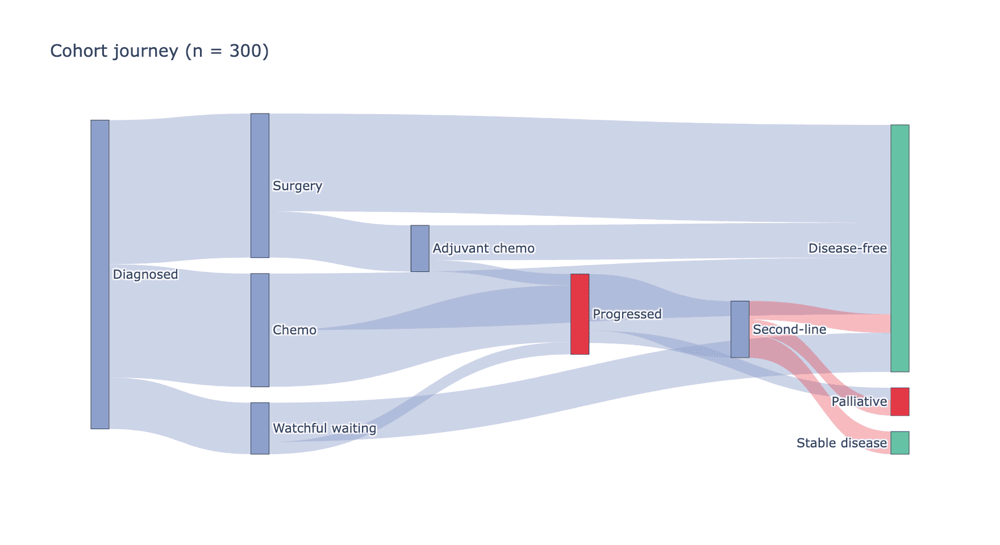

桑基图用宽度正比于流量的弧带在分阶段节点间路由流量——是患者旅程（筛查 → 治疗 → 结局）、细胞类型转换或测序通量分配的自然展示。`matplotlib` 没有可用的桑基实现；`plotly` 的 `go.Sankey` 处理节点布局与交互悬停，quarto 可将结果嵌入独立 HTML。

## 示例

{fig-align="center" width="80%"}

## 环境配置

- 系统要求：跨平台（Linux/MacOS/Windows）
- 编程语言：**Python**
- 依赖包：`pandas`、`numpy`、`plotly`

```{python}
#| label: packages-setup
#| output: false
import pandas as pd
import numpy as np
import plotly.graph_objects as go
```

## 数据准备

我们把临床队列旅程汇总为节点到节点的流量：300 名患者从确诊经两个治疗阶段到结局。流量是（源，目标，数量）三元组。

```{python}
#| label: data-prep
flows = pd.DataFrame([
    # 阶段 1：确诊 -> 初始治疗
    ('Diagnosed', 'Surgery', 140),
    ('Diagnosed', 'Chemo', 110),
    ('Diagnosed', 'Watchful waiting', 50),
    # 阶段 2：初始治疗 -> 结局
    ('Surgery', 'Disease-free', 95),
    ('Surgery', 'Adjuvant chemo', 45),
    ('Chemo', 'Disease-free', 55),
    ('Chemo', 'Progressed', 55),
    ('Watchful waiting', 'Disease-free', 38),
    ('Watchful waiting', 'Progressed', 12),
    # 阶段 3：辅助/进展 -> 最终状态
    ('Adjuvant chemo', 'Disease-free', 34),
    ('Adjuvant chemo', 'Progressed', 11),
    ('Progressed', 'Second-line', 55),
    ('Progressed', 'Palliative', 12),
    ('Second-line', 'Disease-free', 18),
    ('Second-line', 'Stable disease', 22),
    ('Second-line', 'Palliative', 15),
], columns=['Source', 'Target', 'Value'])

nodes = list(dict.fromkeys(
    flows.Source.tolist() + flows.Target.tolist()))
node_index = {n: i for i, n in enumerate(nodes)}
node_colors = ['#8da0cb' if n in ('Diagnosed', 'Surgery', 'Chemo',
                                 'Watchful waiting', 'Adjuvant chemo',
                                 'Second-line')
               else '#66c2a5' if 'Disease-free' in n or 'Stable' in n
               else '#e63946'
               for n in nodes]
```

## 可视化

### 队列旅程桑基图

节点声明一次，之后每条流量按索引引用；给每条弧带分配其源节点颜色可保持阶段可读。

```{python}
#| label: fig-py-sankey
#| fig-cap: "从确诊到结局的患者流（n = 300）"
#| width: 88%
#| fig-align: center
fig = go.Figure(data=[go.Sankey(
    node=dict(label=nodes, pad=14, thickness=16,
              color=node_colors),
    link=dict(
        source=[node_index[s] for s, _, _ in flows.itertuples(index=False)],
        target=[node_index[t] for _, t, _ in flows.itertuples(index=False)],
        value=flows.Value,
        color=['rgba(141,160,203,0.45)' if node_index[s] < 6
               else 'rgba(230,57,70,0.35)'
               for s, _, _ in flows.itertuples(index=False)],
    ))])
fig.update_layout(title_text='Cohort journey (n = 300)',
                  font_size=11, width=880, height=480)
fig.show()
```

渲染结果是交互式的：悬停弧带显示确切患者数，悬停节点显示总入/出流量。

## 应用：三阶段突变流

FigureYapy 版桑基图把**长表分类数据**（每行一个事件：基因 → 突变类别 → 亚型）送入 `go.Sankey`，用 `groupby().size()` 计数生成弧带值，并把每条弧带染成其源节点颜色的 40% 透明版 \[1\]。这正是变异注释表的自然形态：哪些突变类别流向哪些肿瘤亚型，并可回溯到承载它们的基因。

```{python}
#| label: fig-py-sankey-lnc
#| fig-cap: "长表驱动的 基因 → 突变类别 → 亚型 流量：弧带宽度 = 事件数，弧带颜色 = 源节点色 40% 透明"
#| width: 88%
#| fig-align: center
rng = np.random.default_rng(25)
mut_classes = ['missense', 'nonsense', 'frameshift', 'splice-site', 'silent']
subtypes = ['Luminal', 'Basal', 'Her2']
rows = []
for g in [f'LNC{i:02d}' for i in range(1, 13)]:
    for _ in range(int(rng.integers(2, 6))):
        rows.append((g, f'mut: {rng.choice(mut_classes)}',
                     f'sub: {rng.choice(subtypes)}'))
flow_df = pd.DataFrame(rows, columns=['Gene', 'Mutation', 'Subtype'])

def hex_to_rgba(h, a=0.4):
    return f'rgba({int(h[1:3], 16)}, {int(h[3:5], 16)}, {int(h[5:7], 16)}, {a})'

stages = [flow_df[c] for c in flow_df.columns]
stage_nodes = [list(dict.fromkeys(s)) for s in stages]
all_nodes = [n for s in stage_nodes for n in s]
idx = {n: i for i, n in enumerate(all_nodes)}
palette = ['#66c2a5', '#fc8d62', '#8da0cb', '#e78ac3', '#a6d854',
           '#ffd92f', '#b3b3b3', '#e5c494', '#386cb0', '#f0027f',
           '#bf5b17', '#666666']
node_col = {n: palette[i % len(palette)] for i, n in enumerate(all_nodes)}

links = []
for a, b in [(0, 1), (1, 2)]:
    cnt = (flow_df.groupby([flow_df.columns[a], flow_df.columns[b]])
           .size().reset_index(name='n'))
    for r in cnt.itertuples(index=False):
        links.append((idx[getattr(r, flow_df.columns[a])],
                      idx[getattr(r, flow_df.columns[b])], r.n))

fig = go.Figure(data=[go.Sankey(
    node=dict(label=all_nodes, pad=12, thickness=16,
              color=[node_col[n] for n in all_nodes]),
    link=dict(source=[l[0] for l in links],
              target=[l[1] for l in links],
              value=[l[2] for l in links],
              color=[hex_to_rgba(node_col[all_nodes[l[0]]]) for l in links]))])
fig.update_layout(title_text='Mutation events: gene → class → subtype',
                  font_size=10, width=880, height=520)
fig.show()
```

本版需要防住两个坑：plotly 会把两个阶段中的同名标签**合并成一个节点**，所以给阶段加前缀（`mut:`、`sub:`）保持列独立；节点顺序按数据中的首次出现排列，因此按阶段排序输入表即可控制版式。

## 参考文献

1. Plotly Technologies Inc. Sankey diagram in Python. https://plotly.com/python/sankey-diagram/
2. Schmidt, M. The Sankey diagram in energy and material flow accounting. *Journal of Industrial Ecology* (2008).
3. FigureYapy. FigureYa25Plus_Sankey_py. https://github.com/ying-ge/FigureYapy/tree/main/FigureYa25Plus_Sankey_py
