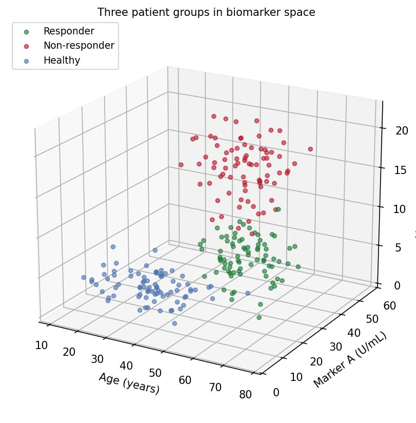
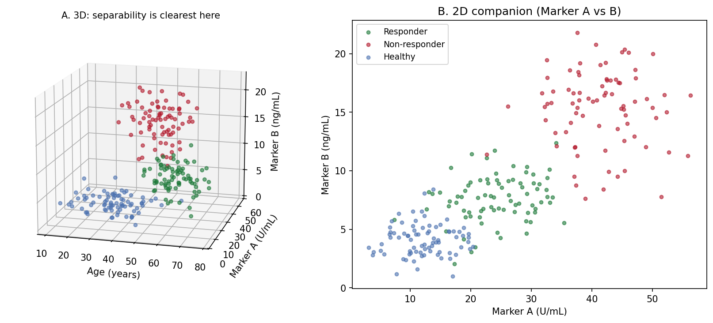

The Python counterpart of [3D Scatter](../Hiplot/159-scatter-3d.html) — a 3D scatter places each subject at $(x, y, z)$ coordinates of three quantitative variables, adding one biomarker dimension to the classic 2D plot. In translational research it helps when group separation genuinely lives in three variables (age x marker x marker, cell size x granularity x intensity) and a static 2D projection visibly flattens it \[1\].

matplotlib's `mplot3d` renders the projection \[2\]. Two properties make 3D scatter plots easy to misread: the *view angle* decides which clusters hide behind which, and *depth* is encoded only by size/alpha shading — a printed 3D plot is a single fixed projection of a 3D object. Both should be treated as parameters to report, like a model.

This tutorial covers two workflows:

1. A default-view 3D scatter of three patient groups;
2. A rotation panel showing how the same data changes its story.

## Example

{fig-align="center" width="65%"}

## Setup

- System Requirements: Cross-platform (Linux/MacOS/Windows)
- Programming Language: **Python**
- Dependencies: `matplotlib`, `numpy`

```{python}
#| label: packages-setup
#| output: false
import matplotlib.pyplot as plt
import numpy as np
from mpl_toolkits.mplot3d import Axes3D  # noqa: F401 (registers 3d projection)
```

## Data Preparation

We simulate 240 subjects in three groups with distinct (age, marker A, marker B) profiles: responders are older with mid-range markers, non-responders have the highest markers, healthy donors the lowest. The separation direction is chosen so some viewpoints separate the groups and others collapse them.

```{python}
#| label: data-prep
rng = np.random.default_rng(21)
groups = {
    "Responder":     (np.array([60, 25, 8]),  np.array([8, 6, 2.2]),
                      "#1B7837"),
    "Non-responder": (np.array([48, 40, 15]), np.array([9, 7, 3.0]),
                      "#B2182B"),
    "Healthy":       (np.array([35, 12, 4]),  np.array([10, 4, 1.4]),
                      "#4C72B0"),
}
n_per = 80
data = []
for g, (mu, sd, color) in groups.items():
    xyz = np.column_stack([rng.normal(m, s, n_per)
                           for m, s in zip(mu, sd)])
    data.append((g, xyz, color))

def draw(ax, elev, azim, title):
    for g, xyz, color in data:
        ax.scatter(xyz[:, 0], xyz[:, 1], xyz[:, 2], s=14, alpha=0.6,
                   color=color, label=g, depthshade=True)
    ax.set_xlabel("Age (years)")
    ax.set_ylabel("Marker A (U/mL)")
    ax.set_zlabel("Marker B (ng/mL)")
    ax.view_init(elev=elev, azim=azim)
    ax.set_title(title, fontsize=10, pad=0)
    ax.set_box_aspect((1, 1, 0.8))
```

## Visualization

### 1. Default View

```{python}
#| label: fig-py-3d-basic
#| fig-cap: "Three patient groups in biomarker space at elev=20, azim=-60: the groups occupy distinct regions of the 3D volume."
#| fig-align: center

fig = plt.figure(figsize=(7.5, 5.6))
ax = fig.add_subplot(111, projection="3d")
draw(ax, elev=20, azim=-60,
     title="Three patient groups in biomarker space")
ax.legend(loc="upper left", fontsize=9)
fig.tight_layout()
plt.show()
```

### 2. Rotation Panel

```{python}
#| label: fig-py-3d-views
#| fig-cap: "The same dataset from two viewpoints: the separability reading at left is not available edge-on at right, where depth order and the reversed axis direction become hard to judge."
#| fig-align: center

fig = plt.figure(figsize=(11.5, 4.8))
for i, (elev, azim, title) in enumerate([
        (20, -60, "View A (elev=20, azim=-60): groups look separable"),
        (2, 55, "View B (elev=2, azim=55): edge-on view obscures depth")]):
    ax = fig.add_subplot(1, 2, i + 1, projection="3d")
    draw(ax, elev=elev, azim=azim, title=title)
fig.suptitle("One dataset, two stories: rotation changes the reading",
             y=1.0)
fig.tight_layout()
plt.show()
```

::: callout-tip
## Practice tips

-   Report `elev`/`azim` in the caption when a claim depends on the viewpoint; a reviewer cannot otherwise reproduce your separation.
-   `alpha` + `depthshade` only *suggest* depth — points still overplot. Lower `alpha` and smaller markers reduce false occlusion judgments.
-   Prefer 2D panels of the variable pairs (Application panel B) for any quantitative comparison; use the 3D view to motivate them.
-   Set `ax.set_box_aspect()` to a physically meaningful ratio, or a 3x range axis will visually dominate a 1x range axis.
-   Interactive rotation (notebook `%matplotlib widget`, plotly `Scatter3d`) is for exploration; export the chosen angle for publication.
:::

## Application

The publication pairing places the chosen 3D view (A) next to its strongest 2D projection (B): the 3D panel motivates the three-group structure, and the 2D panel carries the readable, quantitative comparison that the paper's statistics refer to.

{fig-align="center" width="85%"}

## Reference

\[1\] Li J, Martens JB. Judging correlation from scatterplots: an evaluation of 3D visualizations. IEEE Trans Vis Comput Graph. 2010;16(6):1027-1036.

\[2\] Hunter JD. Matplotlib: a 2D graphics environment. Comput Sci Eng. 2007;9(3):90-95. doi:10.1109/MCSE.2007.55
