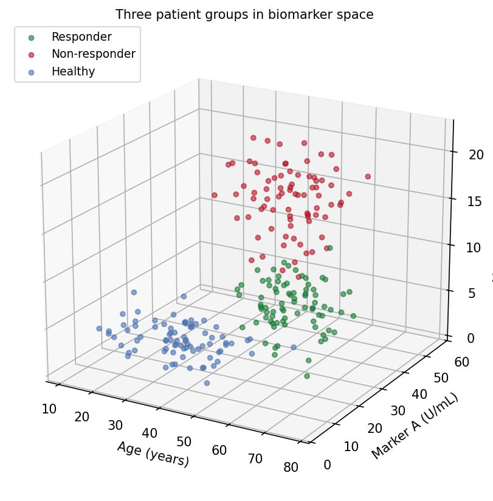
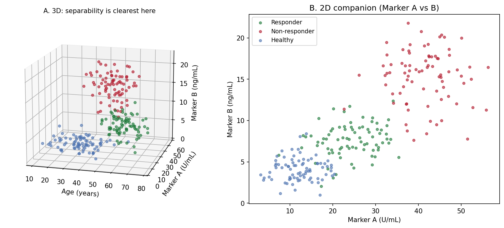

[3D 散点图](../zh/Hiplot/159-scatter-3d.html)的 Python 对应版本——3D 散点图把每个受试者放到三个定量变量的 $(x, y, z)$ 坐标上，在经典二维散点之上再加一维生物标志物。当组间分离确实存在于三个变量（年龄 x 标志物 x 标志物、细胞大小 x 颗粒度 x 荧光强度）、而二维投影明显压平了结构时，转化医学研究可以用它辅助探索 \[1\]。

matplotlib 的 `mplot3d` 负责渲染 \[2\]。3D 散点易被误读的两个原因：*视角*决定哪些簇藏在哪些簇后面；*深度*只靠大小/透明度着色暗示——印刷出来的 3D 图是三维对象的单一固定投影。两者都应作为需要报告的参数对待，就像模型一样。

本教程涵盖两种工作流：

1. 三个患者组的默认视角 3D 散点；
2. 展示同一数据"换角度换结论"的旋转面板。

## Example

{fig-align="center" width="65%"}

## Setup

- 系统要求：跨平台（Linux/MacOS/Windows）
- 编程语言：**Python**
- 依赖包：`matplotlib`、`numpy`

```{python}
#| label: packages-setup
#| output: false
import matplotlib.pyplot as plt
import numpy as np
from mpl_toolkits.mplot3d import Axes3D  # noqa: F401 (注册 3d 投影)
```

## Data Preparation

我们模拟 240 名受试者的三组（年龄, 标志物 A, 标志物 B）轮廓：应答者年龄较大、标志物居中，非应答者标志物最高，健康供者最低。分离方向经过挑选——有些视角能分开三组，有些视角会把它们压扁。

```{python}
#| label: data-prep
rng = np.random.default_rng(21)
groups = {
    "Responder":     (np.array([60, 25, 8]),  np.array([8, 6, 2.2]),
                      "#1B7837"),
    "Non-responder": (np.array([48, 40, 15]), np.array([9, 7, 3.0]),
                      "#B2182B"),
    "Healthy":       (np.array([35, 12, 4]),  np.array([10, 4, 1.4]),
                      "#4C72B0"),
}
n_per = 80
data = []
for g, (mu, sd, color) in groups.items():
    xyz = np.column_stack([rng.normal(m, s, n_per)
                           for m, s in zip(mu, sd)])
    data.append((g, xyz, color))

def draw(ax, elev, azim, title):
    for g, xyz, color in data:
        ax.scatter(xyz[:, 0], xyz[:, 1], xyz[:, 2], s=14, alpha=0.6,
                   color=color, label=g, depthshade=True)
    ax.set_xlabel("Age (years)")
    ax.set_ylabel("Marker A (U/mL)")
    ax.set_zlabel("Marker B (ng/mL)")
    ax.view_init(elev=elev, azim=azim)
    ax.set_title(title, fontsize=10, pad=0)
    ax.set_box_aspect((1, 1, 0.8))
```

## Visualization

### 1. 默认视角

```{python}
#| label: fig-py-3d-basic
#| fig-cap: "elev=20、azim=-60 下的三维生物标志物空间：三组占据体积中的不同区域。"
#| fig-align: center

fig = plt.figure(figsize=(7.5, 5.6))
ax = fig.add_subplot(111, projection="3d")
draw(ax, elev=20, azim=-60,
     title="Three patient groups in biomarker space")
ax.legend(loc="upper left", fontsize=9)
fig.tight_layout()
plt.show()
```

### 2. 旋转面板

```{python}
#| label: fig-py-3d-views
#| fig-cap: "同一数据的两个视角：左图的组间分离在右图的侧视中不可得——深度顺序与反转的轴方向都难以判断。"
#| fig-align: center

fig = plt.figure(figsize=(11.5, 4.8))
for i, (elev, azim, title) in enumerate([
        (20, -60, "View A (elev=20, azim=-60): groups look separable"),
        (2, 55, "View B (elev=2, azim=55): edge-on view obscures depth")]):
    ax = fig.add_subplot(1, 2, i + 1, projection="3d")
    draw(ax, elev=elev, azim=azim, title=title)
fig.suptitle("One dataset, two stories: rotation changes the reading",
             y=1.0)
fig.tight_layout()
plt.show()
```

::: callout-tip
## 实践要点

-   当结论依赖视角时，在图注中报告 `elev`/`azim`；否则审稿人无法复现你的分离结果。
-   `alpha` + `depthshade` 只是*暗示*深度——点仍会互相覆盖。降低 `alpha`、缩小点径可减少错误的遮挡判断。
-   任何定量比较都优先用变量两两的 2D 面板（Application 面板 B）；3D 视图只用来引出它们。
-   用 `ax.set_box_aspect()` 设定有物理含义的比例，否则量程 3x 的轴会在视觉上碾压量程 1x 的轴。
-   交互旋转（notebook 的 `%matplotlib widget`、plotly `Scatter3d`）用于探索；出版导出时固定所选角度。
:::

## Application

出版搭配把选定的 3D 视角（A）与最强的 2D 投影（B）并排：3D 面板引出三组结构，2D 面板承载论文统计所对应的可读、可量化的比较。

{fig-align="center" width="85%"}

## Reference

\[1\] Li J, Martens JB. Judging correlation from scatterplots: an evaluation of 3D visualizations. IEEE Trans Vis Comput Graph. 2010;16(6):1027-1036.

\[2\] Hunter JD. Matplotlib: a 2D graphics environment. Comput Sci Eng. 2007;9(3):90-95. doi:10.1109/MCSE.2007.55
