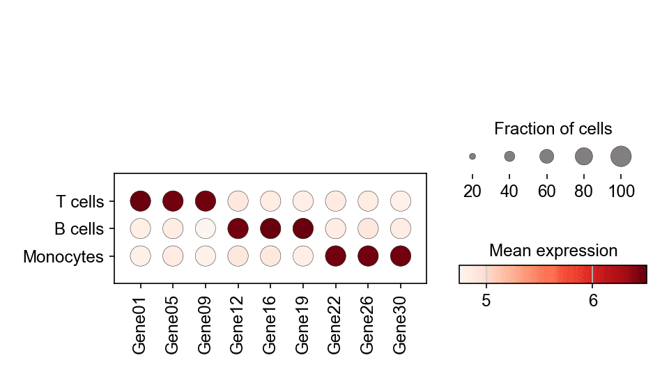

The single-cell dot plot summarizes marker expression across clusters in one dense panel: dot size encodes the fraction of cells expressing the gene, dot colour the mean expression level. It is the standard "which markers define which cluster" summary in scRNA-seq papers. `scanpy.pl.dotplot` computes both encodings from the raw object.

## Example

{fig-align="center" width="80%"}

## Setup

- System Requirements: Cross-platform (Linux/MacOS/Windows)
- Programming Language: **Python**
- Dependencies: `scanpy`, `anndata`, `pandas`, `numpy`, `matplotlib`

```{python}
#| label: packages-setup
#| output: false
import matplotlib.pyplot as plt
import scanpy as sc
import pandas as pd
import numpy as np

sc.settings.verbosity = 0
sc.settings.set_figure_params(dpi=90, facecolor='white')
```

## Data Preparation

We reuse the simulated three-population PBMC dataset and identify each cluster's top markers with `rank_genes_groups`, then keep a curated set spanning all populations.

```{python}
#| label: data-prep
np.random.seed(241)

n_per = 400
genes = [f'Gene{i:02d}' for i in range(1, 31)]
blocks = {'T cells': (0, 10), 'B cells': (10, 20), 'Monocytes': (20, 30)}
counts = np.zeros((n_per * 3, 30))
labels = []
for i, (cell_type, (lo, hi)) in enumerate(blocks.items()):
    sl = slice(i * n_per, (i + 1) * n_per)
    counts[sl] = np.random.negative_binomial(4, 0.3, (n_per, 30))
    counts[sl, lo:hi] += np.random.negative_binomial(8, 0.2, (n_per, hi - lo))
    labels += [cell_type] * n_per

adata = sc.AnnData(counts.astype(np.float32))
adata.var_names = genes
adata.obs['CellType'] = pd.Categorical(labels, categories=blocks)

sc.pp.normalize_total(adata, target_sum=1e4)
sc.pp.log1p(adata)
sc.tl.rank_genes_groups(adata, 'CellType')
marker_genes = ['Gene01', 'Gene05', 'Gene09',
                'Gene12', 'Gene16', 'Gene19',
                'Gene22', 'Gene26', 'Gene30']
```

## Visualization

### Dot Plot of Curated Markers

`var_names` fixes the gene order, `dendrogram=False` keeps the biological grouping explicit, and the size legend explains the fraction encoding.

```{python}
#| label: fig-py-dotplot
#| fig-cap: "Marker expression across populations: size = fraction expressing, colour = mean level"
#| width: 68%
#| fig-align: center
fig, ax = plt.subplots(figsize=(6.4, 3.6))
sc.pl.dotplot(adata, var_names=marker_genes, groupby='CellType',
              ax=ax, show=False, cmap='Reds',
              size_title='Fraction of cells', colorbar_title='Mean expression')
plt.tight_layout()
plt.show()
```

### Ranked Markers per Cluster

Instead of a hand-curated list, feed each cluster's top-3 ranked genes — the quick-look version right after `rank_genes_groups`.

```{python}
#| label: fig-py-dotplot-ranked
#| fig-cap: "Top-3 ranked markers per population"
#| width: 68%
#| fig-align: center
rg = sc.get.rank_genes_groups_df(adata, group=None)
ranked = sorted(set(rg.names.head(9)))
fig, ax = plt.subplots(figsize=(6.4, 3.2))
sc.pl.dotplot(adata, var_names=ranked, groupby='CellType',
              ax=ax, show=False, cmap='Reds',
              size_title='Fraction of cells', colorbar_title='Mean expression')
plt.tight_layout()
plt.show()
```

## Application: Grouped Marker Panels

The FigureYapy edition organises the marker list as a **dict** — one entry per population — so scanpy groups the panel by cell type and draws the separators for you \[1\]. The same dict feeds every member of the family: `matrixplot` swaps the dot for a colour rectangle (mean expression only, size dropped), and `tracksplot` draws per-cell expression lines sorted within each group — the closest static analogue to a per-cell "track" view.

```{python}
#| label: fig-py-matrixplot
#| fig-cap: "matrixplot of dict-grouped markers: rectangle colour = scaled mean expression, one block per population"
#| width: 68%
#| fig-align: center
markers_dict = {'T cells': ['Gene01', 'Gene05'],
                'B cells': ['Gene12', 'Gene16'],
                'Monocytes': ['Gene22', 'Gene26']}
fig, ax = plt.subplots(figsize=(6.4, 2.6))
sc.pl.matrixplot(adata, var_names=markers_dict, groupby='CellType',
                 ax=ax, show=False, cmap='Reds',
                 colorbar_title='Mean expression\nin group')
plt.tight_layout()
plt.show()
```

```{python}
#| label: fig-py-tracksplot
#| fig-cap: "tracksplot of the same dict: per-cell expression lines, cells grouped by population, one row per marker"
#| width: 72%
#| fig-align: center
## tracksplot manages its own Heatmap figure — pass figsize, not ax=
sc.pl.tracksplot(adata, var_names=markers_dict, groupby='CellType',
                 show=False, figsize=(6.4, 3.4))
plt.show()
```

The dict form is the maintenance win: adding a population is one dict entry, and every panel in the family (dotplot, matrixplot, tracksplot, heatmap, stacked violin) inherits the same ordering and separators. Two API caveats: `dotplot`/`matrixplot` accept an external `ax=`, while `tracksplot`/`heatmap` manage their own figure — pass `figsize=`, not `ax=` (an `ax=` call silently renders empty axes); and `tracksplot`/`heatmap` read raw `X`, so on library-normalised log data the per-cell lines are on the log scale, while raw counts would be dominated by library size.

## References

1. Wolf, F. A., Angerer, P., & Theis, F. J. (2018). SCANPY: large-scale single-cell gene expression data analysis. *Genome Biology*, 19, 15.
2. Trapnell, C. (2015). Defining cell types and states with single-cell genomics. *Genome Research*, 25(10), 1491-1498.
3. FigureYapy. FigureYa111markerGene. https://github.com/ying-ge/FigureYapy/tree/main/FigureYa111markerGene
