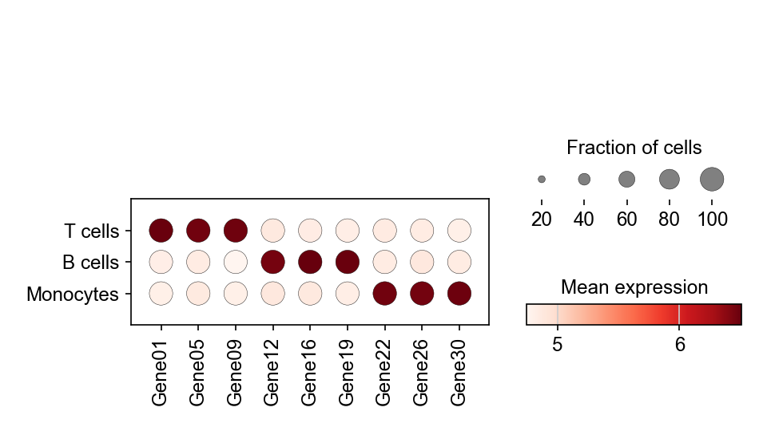

单细胞点图把标志基因在多个 cluster 上的表达概括进一张密集面板：点大小编码表达该基因的细胞比例，点颜色编码平均表达水平。它是 scRNA-seq 论文中「哪些标志基因定义哪个 cluster」的标准汇总。`scanpy.pl.dotplot` 直接从数据对象计算两种编码。

## 示例

{fig-align="center" width="80%"}

## 环境配置

- 系统要求：跨平台（Linux/MacOS/Windows）
- 编程语言：**Python**
- 依赖包：`scanpy`、`anndata`、`pandas`、`numpy`、`matplotlib`

```{python}
#| label: packages-setup
#| output: false
import matplotlib.pyplot as plt
import scanpy as sc
import pandas as pd
import numpy as np

sc.settings.verbosity = 0
sc.settings.set_figure_params(dpi=90, facecolor='white')
```

## 数据准备

我们复用模拟的三群体 PBMC 数据集，用 `rank_genes_groups` 找出每个 cluster 的头部标志基因，再保留一组覆盖全部群体的精选基因。

```{python}
#| label: data-prep
np.random.seed(241)

n_per = 400
genes = [f'Gene{i:02d}' for i in range(1, 31)]
blocks = {'T cells': (0, 10), 'B cells': (10, 20), 'Monocytes': (20, 30)}
counts = np.zeros((n_per * 3, 30))
labels = []
for i, (cell_type, (lo, hi)) in enumerate(blocks.items()):
    sl = slice(i * n_per, (i + 1) * n_per)
    counts[sl] = np.random.negative_binomial(4, 0.3, (n_per, 30))
    counts[sl, lo:hi] += np.random.negative_binomial(8, 0.2, (n_per, hi - lo))
    labels += [cell_type] * n_per

adata = sc.AnnData(counts.astype(np.float32))
adata.var_names = genes
adata.obs['CellType'] = pd.Categorical(labels, categories=blocks)

sc.pp.normalize_total(adata, target_sum=1e4)
sc.pp.log1p(adata)
sc.tl.rank_genes_groups(adata, 'CellType')
marker_genes = ['Gene01', 'Gene05', 'Gene09',
                'Gene12', 'Gene16', 'Gene19',
                'Gene22', 'Gene26', 'Gene30']
```

## 可视化

### 精选标志基因点图

`var_names` 固定基因顺序，`dendrogram=False` 保持生物学分组显式；尺寸图例解释比例编码。

```{python}
#| label: fig-py-dotplot
#| fig-cap: "标志基因跨群体表达：大小 = 表达比例，颜色 = 平均水平"
#| width: 68%
#| fig-align: center
fig, ax = plt.subplots(figsize=(6.4, 3.6))
sc.pl.dotplot(adata, var_names=marker_genes, groupby='CellType',
              ax=ax, show=False, cmap='Reds',
              size_title='Fraction of cells', colorbar_title='Mean expression')
plt.tight_layout()
plt.show()
```

### 逐 cluster 的排序标志基因

不做手工挑选，直接取每个 cluster 排名前三的基因——`rank_genes_groups` 之后的快速浏览版本。

```{python}
#| label: fig-py-dotplot-ranked
#| fig-cap: "各群体排名前三的标志基因"
#| width: 68%
#| fig-align: center
rg = sc.get.rank_genes_groups_df(adata, group=None)
ranked = sorted(set(rg.names.head(9)))
fig, ax = plt.subplots(figsize=(6.4, 3.2))
sc.pl.dotplot(adata, var_names=ranked, groupby='CellType',
              ax=ax, show=False, cmap='Reds',
              size_title='Fraction of cells', colorbar_title='Mean expression')
plt.tight_layout()
plt.show()
```

## 参考文献

1. Wolf, F. A., Angerer, P., & Theis, F. J. (2018). SCANPY: large-scale single-cell gene expression data analysis. *Genome Biology*, 19, 15.
2. Trapnell, C. (2015). Defining cell types and states with single-cell genomics. *Genome Research*, 25(10), 1491-1498.
