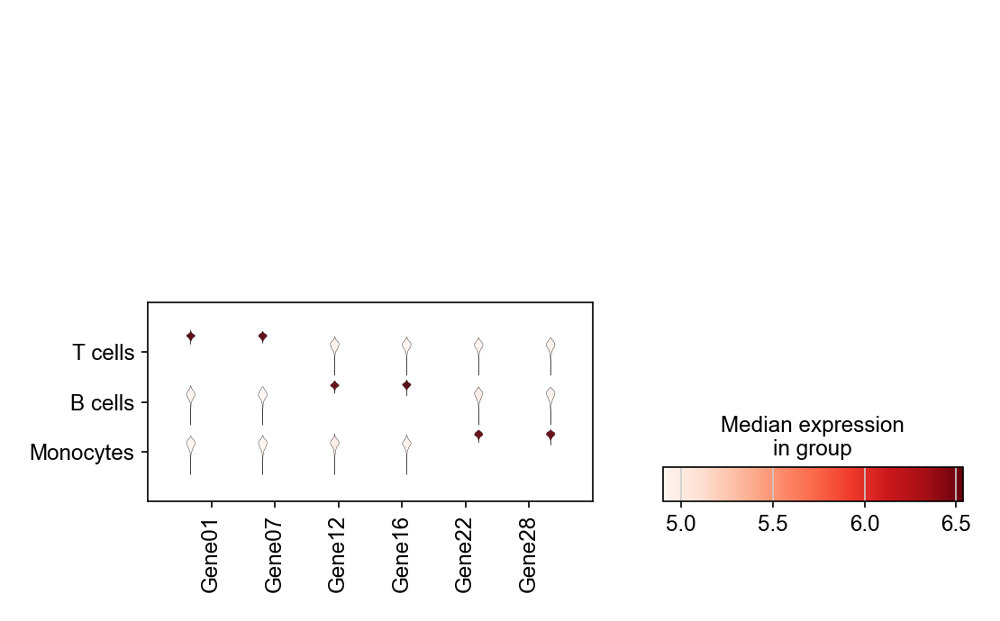

A stacked violin arranges one violin per gene × cluster into a single aligned grid, showing full marker-expression distributions where a dot plot would only show summaries. It is the standard companion figure to the dot plot when reviewers ask for distributions. `scanpy.pl.stacked_violin` lays the grid out and shares styling across all panels.

## Example

{fig-align="center" width="80%"}

## Setup

- System Requirements: Cross-platform (Linux/MacOS/Windows)
- Programming Language: **Python**
- Dependencies: `scanpy`, `anndata`, `pandas`, `numpy`, `matplotlib`

```{python}
#| label: packages-setup
#| output: false
import matplotlib.pyplot as plt
import scanpy as sc
import pandas as pd
import numpy as np

sc.settings.verbosity = 0
sc.settings.set_figure_params(dpi=90, facecolor='white')
```

## Data Preparation

We reuse the simulated three-population PBMC dataset (log-normalized) with a curated six-gene marker set.

```{python}
#| label: data-prep
np.random.seed(241)

n_per = 400
genes = [f'Gene{i:02d}' for i in range(1, 31)]
blocks = {'T cells': (0, 10), 'B cells': (10, 20), 'Monocytes': (20, 30)}
counts = np.zeros((n_per * 3, 30))
labels = []
for i, (cell_type, (lo, hi)) in enumerate(blocks.items()):
    sl = slice(i * n_per, (i + 1) * n_per)
    counts[sl] = np.random.negative_binomial(4, 0.3, (n_per, 30))
    counts[sl, lo:hi] += np.random.negative_binomial(8, 0.2, (n_per, hi - lo))
    labels += [cell_type] * n_per

adata = sc.AnnData(counts.astype(np.float32))
adata.var_names = genes
adata.obs['CellType'] = pd.Categorical(labels, categories=blocks)

sc.pp.normalize_total(adata, target_sum=1e4)
sc.pp.log1p(adata)
marker_genes = ['Gene01', 'Gene07', 'Gene12',
                'Gene16', 'Gene22', 'Gene28']
```

## Visualization

### Stacked Violin with Shared Styling

The grid shares one y-axis per row of violins; rotating gene labels and tightening the layout keeps six panels compact.

```{python}
#| label: fig-py-stacked-violin
#| fig-cap: "Marker expression distributions per population"
#| width: 82%
#| fig-align: center
fig, ax = plt.subplots(figsize=(7.4, 4.6))
sc.pl.stacked_violin(adata, var_names=marker_genes, groupby='CellType',
                     ax=ax, show=False, cmap='Reds',
                     dendrogram=False)
plt.tight_layout()
plt.show()
```

### Swapped Orientation

Swapping groupby and gene order (violin per gene across clusters, drawn row-wise) reads better when gene names are long — the same data, one transposition away.

```{python}
#| label: fig-py-stacked-violin-swap
#| fig-cap: "Transposed layout: violins per gene across populations"
#| width: 82%
#| fig-align: center
fig, ax = plt.subplots(figsize=(6.2, 4.2))
sc.pl.stacked_violin(adata, var_names=marker_genes, groupby='CellType',
                     ax=ax, show=False, cmap='Blues', swap_axes=True,
                     dendrogram=False)
plt.tight_layout()
plt.show()
```

## References

1. Wolf, F. A., Angerer, P., & Theis, F. J. (2018). SCANPY: large-scale single-cell gene expression data analysis. *Genome Biology*, 19, 15.
2. Trapnell, C. (2015). Defining cell types and states with single-cell genomics. *Genome Research*, 25(10), 1491-1498.
