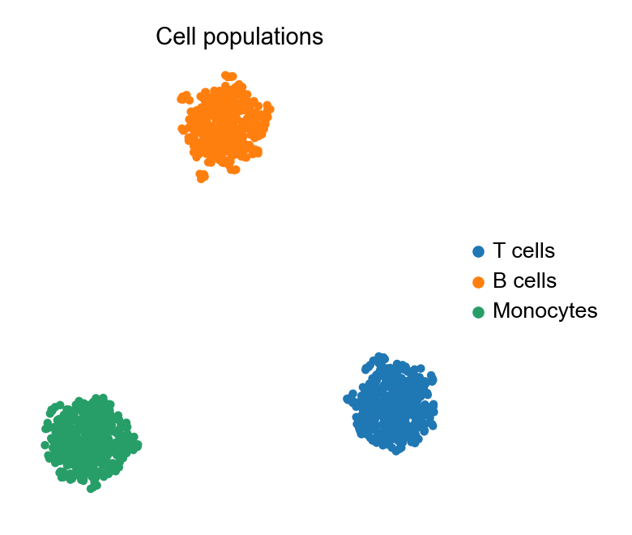

UMAP 嵌入是单细胞图谱的核心图形：数千个细胞投影到二维，按 cluster 或标志基因着色，让细胞群体与状态一目了然。`scanpy` 把预处理链（标准化 → log → 标准化 → PCA → 邻居图 → UMAP）与绘图封装在同一 API 中。

## 示例

{fig-align="center" width="80%"}

## 环境配置

- 系统要求：跨平台（Linux/MacOS/Windows）
- 编程语言：**Python**
- 依赖包：`scanpy`、`anndata`、`pandas`、`numpy`、`umap-learn`、`matplotlib`

```{python}
#| label: packages-setup
#| output: false
import matplotlib.pyplot as plt
import scanpy as sc
import pandas as pd
import numpy as np

sc.settings.verbosity = 0
sc.settings.set_figure_params(dpi=90, facecolor='white')
```

## 数据准备

我们模拟一个 1,200 细胞的 PBMC 风格数据集：30 个基因、三个带专属标志程序的群体，装进 `AnnData`——所有 scanpy 步骤操作的容器。

```{python}
#| label: data-prep
np.random.seed(241)

n_per = 400
genes = [f'Gene{i:02d}' for i in range(1, 31)]
blocks = {
    'T cells':   (0, 10),
    'B cells':   (10, 20),
    'Monocytes': (20, 30),
}
counts = np.zeros((n_per * 3, 30))
labels = []
for i, (cell_type, (lo, hi)) in enumerate(blocks.items()):
    sl = slice(i * n_per, (i + 1) * n_per)
    counts[sl] = np.random.negative_binomial(4, 0.3, (n_per, 30))
    counts[sl, lo:hi] += np.random.negative_binomial(8, 0.2, (n_per, hi - lo))
    labels += [cell_type] * n_per

adata = sc.AnnData(counts.astype(np.float32))
adata.var_names = genes
adata.obs['CellType'] = pd.Categorical(labels, categories=blocks)

sc.pp.normalize_total(adata, target_sum=1e4)
sc.pp.log1p(adata)
sc.pp.scale(adata, max_value=10)
sc.tl.pca(adata, n_comps=15)
sc.pp.neighbors(adata, n_neighbors=15)
sc.tl.umap(adata)
```

## 可视化

### 按 cluster 着色的 UMAP

一次调用完成嵌入与着色；`frameon=False` 加紧凑图例让注意力集中在细胞群体上。

```{python}
#| label: fig-py-umap-clusters
#| fig-cap: "模拟 PBMC 群体的 UMAP（按细胞类型着色）"
#| width: 62%
#| fig-align: center
fig, ax = plt.subplots(figsize=(5.2, 4.4))
sc.pl.umap(adata, color='CellType', ax=ax, show=False,
           frameon=False, title='Cell populations')
plt.tight_layout()
plt.show()
```

### 特征图：标志基因表达投影

同一嵌入按标志基因表达着色，展示该基因「在哪里」表达——是 cluster 视图的标准配套图。

```{python}
#| label: fig-py-umap-feature
#| fig-cap: "按 B 细胞标志 Gene15 表达着色的 UMAP"
#| width: 62%
#| fig-align: center
fig, ax = plt.subplots(figsize=(5.2, 4.4))
sc.pl.umap(adata, color='Gene15', ax=ax, show=False, frameon=False,
           title='Gene15 expression', cmap='magma', vmin=0)
plt.tight_layout()
plt.show()
```

## 参考文献

1. Wolf, F. A., Angerer, P., & Theis, F. J. (2018). SCANPY: large-scale single-cell gene expression data analysis. *Genome Biology*, 19, 15.
2. Becht, E., et al. (2019). Dimensionality reduction for visualizing single-cell data using UMAP. *Nature Biotechnology*, 37(1), 38-44.
