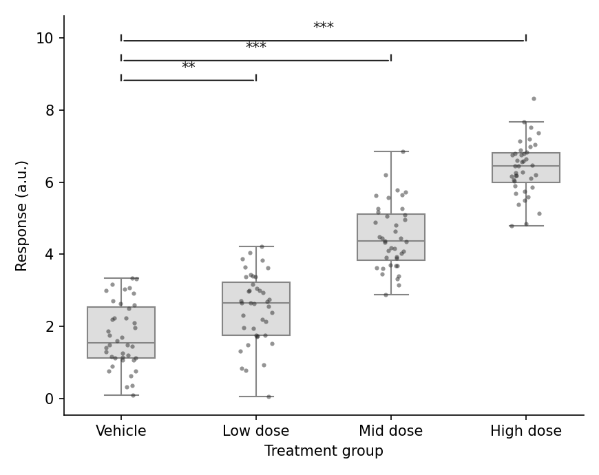

审稿人期望在分布图上直接标注组间显著性——带 p 值或星号的横线括号。`matplotlib` 和 `seaborn` 都没有内置括号图元，本教程用 `annotate` 构建一个可复用的小助手函数，用 Mann–Whitney U 检验两组，并为多组比较叠加 Bonferroni 校正的星号。同一助手可挂在条形图、箱线图或小提琴图上。

## 示例

{fig-align="center" width="80%"}

## 环境配置

- 系统要求：跨平台（Linux/MacOS/Windows）
- 编程语言：**Python**
- 依赖包：`matplotlib`、`seaborn`、`pandas`、`numpy`、`scipy`

```{python}
#| label: packages-setup
#| output: false
import matplotlib.pyplot as plt
import seaborn as sns
import pandas as pd
import numpy as np
from scipy.stats import mannwhitneyu
```

## 数据准备

我们复用药物剂量响应实验：四个分组的原始重复测量，分析时将各剂量组与溶媒对照比较。

```{python}
#| label: data-prep
np.random.seed(41)

groups = ['Vehicle', 'Low dose', 'Mid dose', 'High dose']
raw = pd.DataFrame({
    'Group': pd.Categorical(np.repeat(groups, 40), categories=groups, ordered=True),
    'Response': np.concatenate([
        np.random.normal(2.0, 0.9, 40),
        np.random.normal(2.6, 0.9, 40),
        np.random.normal(4.6, 0.9, 40),
        np.random.normal(6.2, 0.9, 40),
    ])
})

def stars(p):
    return '***' if p < 0.001 else '**' if p < 0.01 else '*' if p < 0.05 else 'ns'
```

## 可视化

### 括号助手与单组比较

助手函数用 `annotate` 在坐标轴坐标中绘制括号；绘制前需通过扩展 y 上限为其预留垂直空间。

```{python}
#| label: fig-py-sig-pair
#| fig-cap: "箱线图上用括号标注一组 Mann–Whitney 比较"
#| width: 62%
#| fig-align: center
def add_p_bracket(ax, x1, x2, y, h, text):
    ax.annotate('', xy=(x1, y), xytext=(x2, y),
                arrowprops=dict(arrowstyle='-', color='0.15', lw=1.1))
    ax.plot([x1, x1], [y, y + h], color='0.15', lw=1.1)
    ax.plot([x2, x2], [y, y + h], color='0.15', lw=1.1)
    ax.text((x1 + x2) / 2, y + h, text, ha='center', va='bottom',
            fontsize=10, color='0.1')

fig, ax = plt.subplots(figsize=(5.4, 4.4))
sns.boxplot(data=raw, x='Group', y='Response', color='#dddddd',
            width=0.5, linewidth=1.0, showfliers=False, ax=ax)
sns.stripplot(data=raw, x='Group', y='Response', color='#2b2b2b',
              size=3, alpha=0.5, jitter=0.12, ax=ax)

u, p = mannwhitneyu(raw.loc[raw.Group == 'Vehicle', 'Response'],
                    raw.loc[raw.Group == 'High dose', 'Response'])
add_p_bracket(ax, 0, 3, raw.Response.max() + 0.4, 0.15, stars(p))
ax.set_ylim(None, raw.Response.max() + 1.1)
ax.set_xlabel('Treatment group')
ax.set_ylabel('Response (a.u.)')
ax.spines[['top', 'right']].set_visible(False)
plt.tight_layout()
plt.show()
```

### 多组 vs 对照

循环各剂量臂，对原始 p 值做 Bonferroni 校正，并把括号按递增高度堆叠以避免重叠。

```{python}
#| label: fig-py-sig-multiple
#| fig-cap: "剂量臂 vs 溶媒的 Bonferroni 校正显著性星号"
#| width: 70%
#| fig-align: center
comparisons = [(0, 1), (0, 2), (0, 3)]
pvals = [mannwhitneyu(raw.loc[raw.Group == groups[a], 'Response'],
                      raw.loc[raw.Group == groups[b], 'Response']).pvalue
         for a, b in comparisons]
padj = np.minimum(np.array(pvals) * len(comparisons), 1.0)

fig, ax = plt.subplots(figsize=(5.8, 4.6))
sns.boxplot(data=raw, x='Group', y='Response', color='#dddddd',
            width=0.5, linewidth=1.0, showfliers=False, ax=ax)
sns.stripplot(data=raw, x='Group', y='Response', color='#2b2b2b',
              size=3, alpha=0.5, jitter=0.12, ax=ax)

y_max = raw.Response.max()
for level, ((a, b), p) in enumerate(zip(comparisons, padj), start=1):
    y = y_max + 0.5 + 0.55 * (level - 1)
    add_p_bracket(ax, a, b, y, 0.15, stars(p))
ax.set_ylim(None, y_max + 2.3)
ax.set_xlabel('Treatment group')
ax.set_ylabel('Response (a.u.)')
ax.spines[['top', 'right']].set_visible(False)
plt.tight_layout()
plt.show()
```

## 参考文献

1. Mann, H. B., & Whitney, D. R. (1947). On a Test of Whether one of Two Random Variables is Stochastically Larger than the Other. *The Annals of Mathematical Statistics*, 18(1), 50-60.
2. Hunter, J. D. (2007). Matplotlib: A 2D graphics environment. *Computing in Science & Engineering*, 9(3), 90-95.
3. Waskom, M. L. (2021). seaborn: statistical data visualization. *Journal of Open Source Software*, 6(60), 3021.
