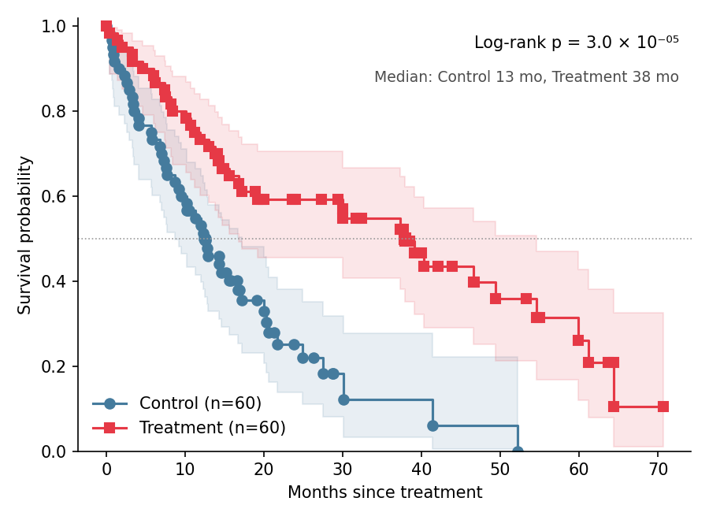

The Kaplan–Meier estimator reads out survival probability over time from right-censored follow-up data, and the log-rank test compares two arms. Survival curves are the core clinical figure — oncology, transplant, device studies — and reviewers expect censoring ticks, confidence bands, and a stated test. `lifelines` provides the estimator, the bands, and the test.

## Example

{fig-align="center" width="80%"}

## Setup

- System Requirements: Cross-platform (Linux/MacOS/Windows)
- Programming Language: **Python**
- Dependencies: `matplotlib`, `seaborn`, `pandas`, `numpy`, `lifelines`

```{python}
#| label: packages-setup
#| output: false
import matplotlib.pyplot as plt
import seaborn as sns
import pandas as pd
import numpy as np
from lifelines import KaplanMeierFitter
from lifelines.statistics import logrank_test
```

## Data Preparation

We simulate 60 patients per arm (Control, Treatment) with exponential survival — median 12 vs 24 months — and uniform administrative censoring between 10 and 72 months, long enough for both arms to pass their medians.

```{python}
#| label: data-prep
np.random.seed(141)

n = 60
def simulate_arm(median):
    true_time = np.random.exponential(median / np.log(2), n)
    censor = np.random.uniform(10, 72, n)
    return pd.DataFrame({
        'Months': np.minimum(true_time, censor),
        'Event': (true_time <= censor).astype(int),
    })

surv = pd.concat([
    simulate_arm(12).assign(Arm='Control'),
    simulate_arm(24).assign(Arm='Treatment'),
], ignore_index=True)

lr = logrank_test(
    surv.loc[surv.Arm == 'Control', 'Months'],
    surv.loc[surv.Arm == 'Treatment', 'Months'],
    event_observed_A=surv.loc[surv.Arm == 'Control', 'Event'],
    event_observed_B=surv.loc[surv.Arm == 'Treatment', 'Event'])
arm_styles = {'Control': ('#457b9d', 'o'), 'Treatment': ('#e63946', 's')}
```

## Visualization

### Kaplan–Meier Curves with Confidence Bands

`plot_survival_function` draws the step curve, its confidence interval, and censoring ticks; stating n per arm belongs in the caption or legend.

```{python}
#| label: fig-py-km-basic
#| fig-cap: "Kaplan–Meier overall survival with 95% confidence bands"
#| width: 68%
#| fig-align: center
fig, ax = plt.subplots(figsize=(6, 4.4))
kmf = KaplanMeierFitter()
for arm, (color, marker) in arm_styles.items():
    sub = surv[surv.Arm == arm]
    kmf.fit(sub.Months, sub.Event, label=f'{arm} (n={len(sub)})')
    kmf.plot_survival_function(ax=ax, ci_show=True, ci_alpha=0.12,
                               color=color, marker=marker,
                               show_censors=True, censor_styles=dict(ms=5, alpha=0.7))
ax.axhline(0.5, color='0.6', linewidth=0.8, linestyle=':')
ax.set_ylim(0, 1.02)
ax.set_xlabel('Months since treatment')
ax.set_ylabel('Survival probability')
ax.legend(frameon=False, loc='lower left')
ax.spines[['top', 'right']].set_visible(False)
plt.tight_layout()
plt.show()
```

### Annotated with Log-Rank Test and Medians

The log-rank p-value and per-arm median survival are the two numbers every reader looks for; place them inside the axes and mark the medians on the 0.5 line.

```{python}
#| label: fig-py-km-annotated
#| fig-cap: "KM curves annotated with medians and the log-rank test"
#| width: 68%
#| fig-align: center
fig, ax = plt.subplots(figsize=(6, 4.4))
medians = {}
for arm, (color, marker) in arm_styles.items():
    sub = surv[surv.Arm == arm]
    kmf.fit(sub.Months, sub.Event, label=f'{arm} (n={len(sub)})')
    kmf.plot_survival_function(ax=ax, ci_show=True, ci_alpha=0.12,
                               color=color, marker=marker,
                               show_censors=True, censor_styles=dict(ms=5, alpha=0.7))
    medians[arm] = kmf.median_survival_time_
    ax.plot([kmf.median_survival_time_], [0.5], marker=marker, color=color,
            markersize=7, clip_on=False)

SUP = str.maketrans('0123456789', '⁰¹²³⁴⁵⁶⁷⁸⁹')
mantissa, exponent = f'{lr.p_value:.1e}'.split('e-')
ax.text(0.98, 0.96, f'Log-rank p = {mantissa} × 10⁻{exponent.translate(SUP)}',
        transform=ax.transAxes, ha='right', va='top', fontsize=10)
ax.text(0.98, 0.88,
        'Median: ' + ', '.join(f'{k} {v:.0f} mo' for k, v in medians.items()),
        transform=ax.transAxes, ha='right', va='top', fontsize=9, color='0.3')
ax.axhline(0.5, color='0.6', linewidth=0.8, linestyle=':')
ax.set_ylim(0, 1.02)
ax.set_xlabel('Months since treatment')
ax.set_ylabel('Survival probability')
ax.legend(frameon=False, loc='lower left')
ax.spines[['top', 'right']].set_visible(False)
plt.tight_layout()
plt.show()
```

## References

1. Kaplan, E. L., & Meier, P. (1958). Nonparametric Estimation from Incomplete Observations. *Journal of the American Statistical Association*, 53(282), 457-481.
2. Davidson-Pilon, C. (2019). lifelines: survival analysis in Python. *Journal of Open Source Software*, 4(40), 1317.
