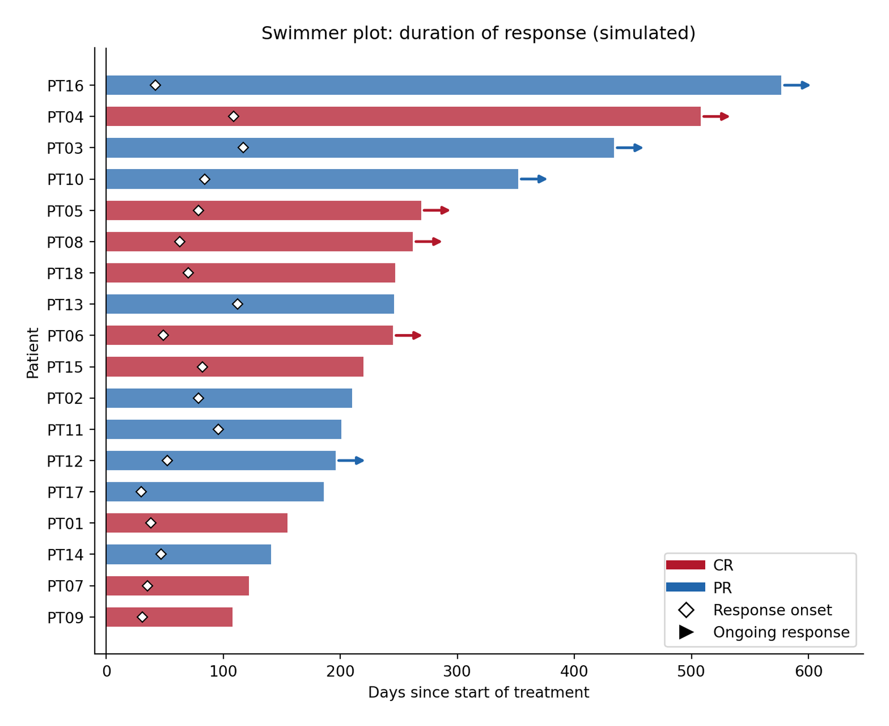
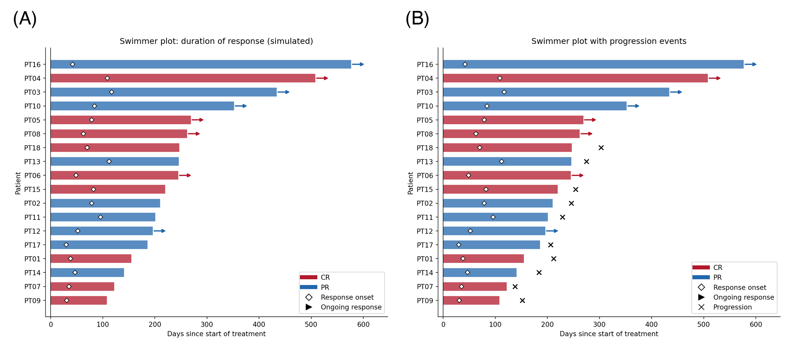

泳道图（swimmer plot）把每位患者的治疗/应答时间线画成一条水平"泳道"：条长 = 研究内时间，颜色 = 最佳疗效，标记 = 应答起点，箭头 = 数据截止时仍在应答 \[1\]。它是肿瘤试验中*缓解持续时间*（DOR）的标准图——Kaplan–Meier 曲线汇总同一队列，却看不出谁还在应答、谁应答得晚、轨迹多么异质。

本教程用 matplotlib 从基本组件构建：`barh` 泳道、应答起点标记、持续应答箭头，数据为模拟的 RECIST 风格队列。图例把三种编码映射清楚后，此图可以一眼读完。

本教程涵盖一种工作流及其三个扩展：

1. 经典泳道图（条 + 起点标记 + 持续箭头）；
2. 按持续时间排序以暴露应答时长模式；
3. 叠加第二类事件标记（如进展或死亡）。

## Example

{fig-align="center" width="60%"}

## Setup

- 系统要求：跨平台（Linux/MacOS/Windows）
- 编程语言：**Python**
- 依赖包：`matplotlib`、`numpy`、`pandas`

```{python}
#| label: packages-setup
#| output: false
import matplotlib.pyplot as plt
from matplotlib.lines import Line2D
import numpy as np
import pandas as pd
```

## Data Preparation

模拟 18 例患者：应答时间（30–120 天）、缓解持续时间、最佳疗效（CR/PR）与数据截止时的持续标志。特意包含一位短应答患者——泳道图正是为了显示他们。

```{python}
#| label: data-prep
rng = np.random.default_rng(251)

n = 18
swim = pd.DataFrame({
    "patient": [f"PT{i:02d}" for i in range(1, n + 1)],
    "respond_day": rng.integers(30, 120, n),
    "response": rng.choice(["CR", "PR"], n, p=[0.4, 0.6]),
    "ongoing": rng.random(n) < 0.45,
})
duration = swim.respond_day + rng.integers(90, 540, n)
# 非持续应答提前结束：时长截断
swim["end_day"] = np.where(swim.ongoing, duration,
                           swim.respond_day + (duration - swim.respond_day) // 3)
swim = swim.sort_values("end_day").reset_index(drop=True)   # 最长的泳道在顶部
swim.head()
```

## Visualization

### 1. 经典泳道图

```{python}
#| label: fig-py-swimmer
#| fig-cap: "缓解持续时间的泳道图：条 = 研究内时间，颜色 = 最佳疗效（CR/PR），白色菱形 = 应答起点，箭头 = 数据截止时仍应答。"
#| fig-width: 8
#| fig-height: 6.5

rc = {"CR": "#B2182B", "PR": "#2166AC"}

fig, ax = plt.subplots(figsize=(8, 6.5))
for _, r in swim.iterrows():
    ax.barh(r.patient, r.end_day, color=rc[r.response], alpha=0.75, height=0.62)
    ax.plot(r.respond_day, r.patient, "D", color="white", markersize=5,
            markeredgecolor="black", markeredgewidth=0.8, zorder=5)
    if r.ongoing:
        ax.annotate("", xy=(r.end_day + 28, r.patient),
                    xytext=(r.end_day, r.patient),
                    arrowprops=dict(arrowstyle="-|>", color=rc[r.response], lw=1.8))

ax.axvline(0, color="black", lw=0.8)
ax.set_xlabel("Days since start of treatment")
ax.set_ylabel("Patient")
ax.set_title("Swimmer plot: duration of response (simulated)")
ax.spines[["top", "right"]].set_visible(False)
ax.set_xlim(-10, swim.end_day.max() + 70)
ax.legend(handles=[
    Line2D([0], [0], color=rc["CR"], lw=6, label="CR"),
    Line2D([0], [0], color=rc["PR"], lw=6, label="PR"),
    Line2D([0], [0], marker="D", color="white", markeredgecolor="black",
           markersize=7, label="Response onset", linestyle="none"),
    Line2D([0], [0], marker=">", color="black", markersize=8,
           linestyle="none", label="Ongoing response")],
    loc="lower right", frameon=True)
fig.tight_layout()
plt.show()
```

### 2. 叠加第二类事件标记

试验还会在泳道上标注进展或死亡；再加一次 scatter 调用（不同 marker）并扩充图例即可。

```{python}
#| label: fig-py-swimmer-events
#| fig-cap: "带进展标记（黑色叉）的泳道图：标记只出现在非持续应答者身上。"
#| fig-width: 8
#| fig-height: 6.5

swim_ev = swim.assign(
    prog_day=np.where(~swim.ongoing, swim.end_day + rng.integers(10, 60, n), np.nan))

fig, ax = plt.subplots(figsize=(8, 6.5))
for _, r in swim_ev.iterrows():
    ax.barh(r.patient, r.end_day, color=rc[r.response], alpha=0.75, height=0.62)
    ax.plot(r.respond_day, r.patient, "D", color="white", markersize=5,
            markeredgecolor="black", markeredgewidth=0.8, zorder=5)
    if r.ongoing:
        ax.annotate("", xy=(r.end_day + 28, r.patient), xytext=(r.end_day, r.patient),
                    arrowprops=dict(arrowstyle="-|>", color=rc[r.response], lw=1.8))
prog = swim_ev.dropna(subset=["prog_day"])
ax.scatter(prog.prog_day, prog.patient, marker="x", color="black", s=45, zorder=6)

ax.axvline(0, color="black", lw=0.8)
ax.set_xlabel("Days since start of treatment")
ax.set_ylabel("Patient")
ax.set_title("Swimmer plot with progression events")
ax.spines[["top", "right"]].set_visible(False)
ax.set_xlim(-10, swim_ev.end_day.max() + 70)
ax.legend(handles=[
    Line2D([0], [0], color=rc["CR"], lw=6, label="CR"),
    Line2D([0], [0], color=rc["PR"], lw=6, label="PR"),
    Line2D([0], [0], marker="D", color="white", markeredgecolor="black",
           markersize=7, label="Response onset", linestyle="none"),
    Line2D([0], [0], marker=">", color="black", markersize=8,
           linestyle="none", label="Ongoing response"),
    Line2D([0], [0], marker="x", color="black", markersize=8,
           linestyle="none", label="Progression")],
    loc="lower right", frameon=True)
fig.tight_layout()
plt.show()
```

::: callout-tip
## 实践要点

-   泳道按持续时间（或应答起点）排序——不排序的泳道图浪费了它最可读的维度。
-   三种编码都必须进图例：条颜色（最佳疗效）、起点标记、持续箭头。任何未标注的元素都会被误读为"治疗时长"。
-   持续箭头指向*数据截止之外*：在最长条之外留出 x 轴余量（`xlim`），否则箭头会被裁掉。
-   删失 ≠ 持续应答：图注写明箭头含义是"截止时仍在应答"还是"删失"；各试验惯例不同。
:::

## Application

泳道图是免疫治疗与 CAR-T 论文的门面图（按最佳疗效的缓解持续时间）、剂量递增安全性报告（按剂量水平的治疗时长）与细胞治疗耐久性图表。下图模拟典型论文版式：(A) 经典图与 (B) 进展标注变体。

{fig-align="center" width="60%"}

## Reference

\[1\] IASLC. What do all those lines and colors mean? A guide to swimmer plots in oncology trials. https://www.iaslc.org

\[2\] Hunter JD. Matplotlib: a 2D graphics environment. Comput Sci Eng. 2007;9(3):90-95. doi:10.1109/MCSE.2007.55
