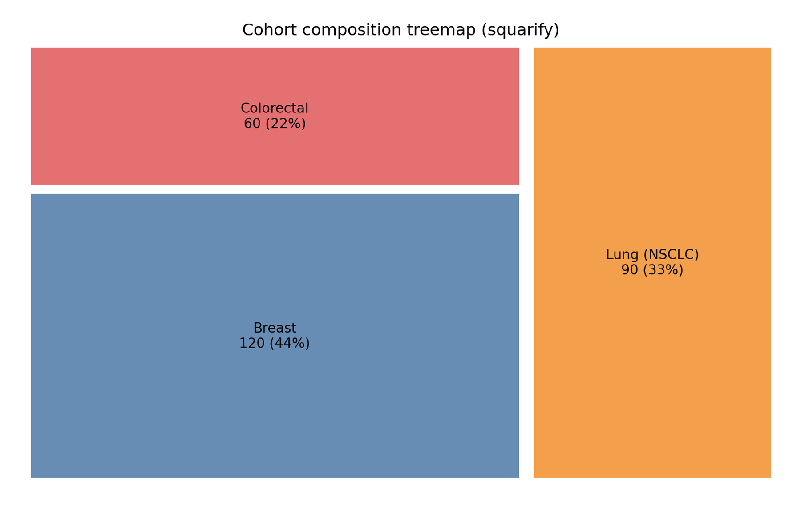
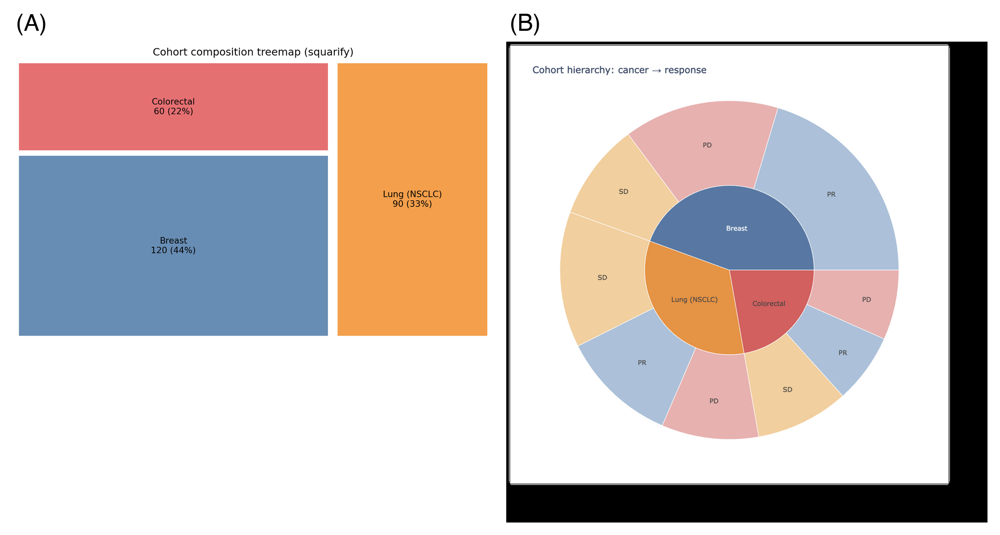

The Python counterpart of [Treemap](../Composition/Treemap.html) and [Sunburst](../Composition/Sunburst.html): two displays for **hierarchical composition**. A treemap nests rectangles whose area encodes a value — the best static overview of one or two hierarchy levels; a sunburst nests rings radially and stays interactive — level structure and click-to-zoom. In clinical data they suit cohorts that decompose naturally (cancer type → response), cost trees, and taxonomic abundance.

This tutorial builds a static treemap with `squarify` \[1\] on matplotlib and an interactive sunburst with `plotly.graph_objects` \[2\], using the same cohort so the two designs can be compared directly.

This tutorial covers two workflows:

1. A static treemap of cohort composition (`squarify`);
2. An interactive two-level sunburst (`plotly`).

## Example

{fig-align="center" width="60%"}

## Setup

- System Requirements: Cross-platform (Linux/MacOS/Windows)
- Programming Language: **Python**
- Dependencies: `matplotlib`, `pandas`, `squarify`, `plotly`

```{python}
#| label: packages-setup
#| output: false
import matplotlib.pyplot as plt
import pandas as pd
import squarify
import plotly.graph_objects as go
```

## Data Preparation

A 270-patient oncology cohort of three cancer types (120/90/60) with three response categories each. For `branchvalues="total"` the parent value must equal the sum of its children — validated programmatically before plotting.

```{python}
#| label: data-prep
counts = {"Breast": (55, 25, 40),          # (PR, SD, PD)
          "Lung (NSCLC)": (30, 35, 25),
          "Colorectal": (18, 24, 18)}
cnt = pd.DataFrame(
    [{"cancer": c, "response": r, "n": n}
     for c, resp in counts.items() for r, n in zip(["PR", "SD", "PD"], resp)])
cnt["id"] = cnt.cancer + "-" + cnt.response

agg = cnt.groupby("cancer", as_index=False)["n"].sum()

# parent values must equal the sum of their children
parents_ok = all(int(agg.loc[agg.cancer == c, "n"].iloc[0])
                 == int(cnt.loc[cnt.cancer == c, "n"].sum())
                 for c in counts)
assert parents_ok
cnt
```

## Visualization

### 1. Static Treemap with squarify

```{python}
#| label: fig-py-treemap
#| fig-cap: "squarify treemap of the cohort: rectangle area encodes patient count; labels carry counts and cohort shares. One hierarchy level per call."
#| fig-width: 8
#| fig-height: 5

colors = {"Breast": "#4E79A7", "Lung (NSCLC)": "#F28E2B", "Colorectal": "#E15759"}
total = agg.n.sum()

fig, ax = plt.subplots(figsize=(8, 5))
squarify.plot(
    sizes=agg.n,
    label=[f"{r.cancer}\n{r.n} ({r.n / total:.0%})" for r in agg.itertuples()],
    color=[colors[r.cancer] for r in agg.itertuples()],
    ax=ax, alpha=0.85, pad=True)
ax.axis("off")
ax.set_title("Cohort composition treemap (squarify)")
fig.tight_layout()
plt.show()
```

`squarify` lays out one flat list of rectangles; to show two levels, draw the parent rectangles first and then each parent's children clipped to the parent's rectangle (or hand the whole hierarchy to plotly's `treemap` trace, which nests automatically).

### 2. Interactive Sunburst with plotly

```{python}
#| label: fig-py-sunburst
#| fig-cap: "Two-level sunburst of the same cohort: inner ring = cancer type, outer = response; hover shows counts, click a segment to zoom into its subtree."

roots = agg.cancer.tolist()          # groupby sorts alphabetically: use ITS order
rcolors = {"Breast": "#4E79A7", "Lung (NSCLC)": "#F28E2B", "Colorectal": "#E15759"}
lcolors = {"PR": "#7fa8cc", "SD": "#f5b767", "PD": "#e98a8a"}

fig = go.Figure(go.Sunburst(
    ids=roots + cnt.id.tolist(),
    labels=roots + cnt.response.tolist(),
    parents=[""] * len(roots) + cnt.cancer.tolist(),
    values=agg.n.tolist() + cnt.n.tolist(),
    branchvalues="total",
    marker=dict(colors=[rcolors[c] for c in roots]
                + [lcolors[r] for r in cnt.response]),
    hovertemplate="%{id}<br>n = %{value}<extra></extra>"))
fig.update_layout(width=800, height=800,
                  title="Cohort hierarchy: cancer → response")
fig
```

::: callout-tip
## Practice tips

-   `branchvalues="total"` requires parent `value` = sum of children — assert it (as in Data Preparation) or plotly draws overlapping wedges; `"remainder"` is the alternative where parents hold only their own value.
-   `squarify` sorts nothing for you: pass `sizes` in decreasing order for the classic large-to-small layout, and `pad=True` so adjacent rectangles stay readable.
-   Sunbursts and treemaps both hide small categories: collapse anything below ~2% into "Other" before plotting.
-   The plotly figure is an HTML widget — the rendered page is interactive; static export for print needs a screenshot (no kaleido in this environment).
:::

## Application

Treemaps and sunbursts appear in cohort-reports (registry composition), cost/utilization decomposition, and metagenomics (phylum → species). The panel below mirrors a typical report layout: (A) the static treemap and (B) the interactive sunburst.

{fig-align="center" width="60%"}

## Reference

\[1\] Lambrechts G. squarify: pure Python implementation of the squarified treemap layout. https://github.com/gregorl/squarify

\[2\] Sievert C. Interactive Web-Based Data Visualization with R, plotly, and shiny. Chapman and Hall/CRC; 2020. doi:10.1201/9780429447273
