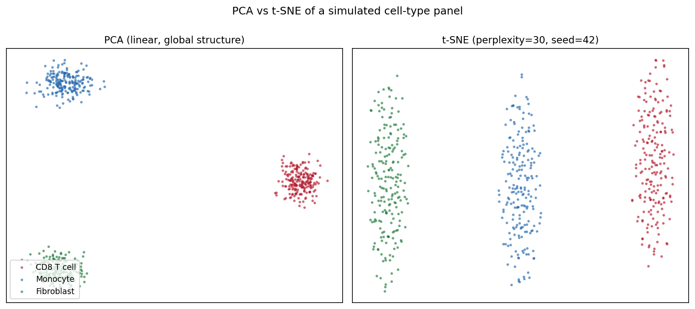
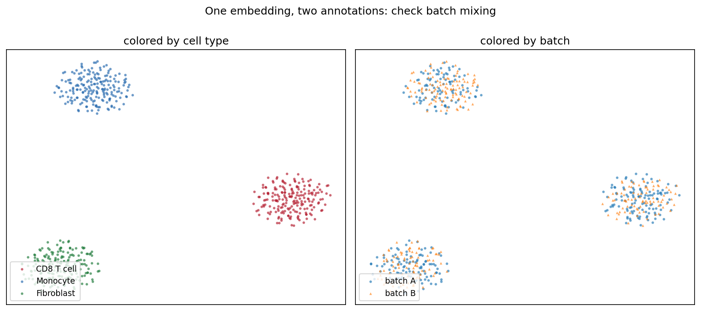

The Python counterpart of [t-SNE Plot](../Correlation/TSNEplot.html) — t-distributed stochastic neighbor embedding (t-SNE) projects high-dimensional data to two dimensions so that points with similar profiles stay close \[1\]. In single-cell genomics it is the standard first look at cell-type structure in expression matrices; in biomedical data science more broadly it visualizes patient or sample clusters that PCA's linear projection may hide.

`scikit-learn` provides `TSNE` \[2\]. Three knobs decide whether the picture is trustworthy: **perplexity** (the effective number of neighbors), **initialization/pre-reduction** (PCA), and the **random seed** — t-SNE is stochastic and different runs land in different local optima. Cluster *shapes, sizes, and inter-cluster distances* in a t-SNE plot are artifacts of the algorithm, not measurements \[3\].

This tutorial covers three workflows:

1. PCA vs t-SNE on the same data;
2. A perplexity sweep showing how the local/global balance changes;
3. PCA pre-reduction (top-50 PCs) before t-SNE.

## Example

{fig-align="center" width="80%"}

## Setup

- System Requirements: Cross-platform (Linux/MacOS/Windows)
- Programming Language: **Python**
- Dependencies: `scikit-learn`, `matplotlib`, `numpy`

```{python}
#| label: packages-setup
#| output: false
import matplotlib.pyplot as plt
import numpy as np
from sklearn.decomposition import PCA
from sklearn.manifold import TSNE
from sklearn.preprocessing import StandardScaler
```

## Data Preparation

We simulate a small single-cell-style panel: 600 cells from three types (CD8 T cell, Monocyte, Fibroblast) over 200 genes, where each type expresses its own marker block. Raw counts are log-normalized and z-scaled — feeding raw counts to t-SNE lets highly expressed genes dominate the neighborhood structure.

```{python}
#| label: data-prep
rng = np.random.default_rng(11)
types = ["CD8 T cell", "Monocyte", "Fibroblast"]
n_per, n_genes = 200, 200
marker_blocks = [(0, 70), (70, 140), (140, 200)]

X = rng.normal(0, 1.0, (n_per * 3, n_genes))
lab = np.repeat(types, n_per)
for i, (lo, hi) in enumerate(marker_blocks):   # type-specific markers
    amp = [2.2, 1.8, 2.0][i]
    sl = slice(i * n_per, (i + 1) * n_per)
    X[sl, lo:hi] += rng.normal(amp, 0.5, (n_per, hi - lo))

Xs = StandardScaler().fit_transform(np.log1p(np.clip(X, 0, None) * 10))
palette = {"CD8 T cell": "#B2182B", "Monocyte": "#2166AC",
           "Fibroblast": "#1B7837"}
```

## Visualization

### 1. PCA vs t-SNE

```{python}
#| label: fig-py-tsne-pca-compare
#| fig-cap: "PCA (linear, preserves global variance) versus t-SNE (perplexity=30, seed=42): both recover the three cell types, but t-SNE's tight, well-separated blobs are an algorithmic artifact, not evidence of stronger separation."
#| fig-align: center

pca_emb = PCA(n_components=2, random_state=0).fit_transform(Xs)
emb = TSNE(n_components=2, random_state=42, perplexity=30,
           init="pca").fit_transform(Xs)

def scatter(ax, e, title, legend=False):
    for t in types:
        m = lab == t
        ax.scatter(e[m, 0], e[m, 1], s=8, alpha=0.65, color=palette[t],
                   label=t, linewidths=0)
    ax.set_title(title, fontsize=11)
    ax.set_xticks([]); ax.set_yticks([])
    if legend:
        ax.legend(loc="lower left", fontsize=9)

fig, axes = plt.subplots(1, 2, figsize=(11, 4.8))
scatter(axes[0], pca_emb, "PCA (linear, global structure)", legend=True)
scatter(axes[1], emb, "t-SNE (perplexity=30, seed=42)")
fig.suptitle("PCA vs t-SNE of a simulated cell-type panel", y=1.0)
fig.tight_layout()
plt.show()
```

### 2. Perplexity Sweep

```{python}
#| label: fig-py-tsne-perplexity
#| fig-cap: "Perplexity 5 fragments each type into artificial subclusters; 30 gives a balanced picture; 100 over-smooths the geometry into dense blobs whose spacing no longer reflects the data."
#| fig-align: center

fig, axes = plt.subplots(1, 3, figsize=(13.5, 4.4))
for ax, perp in zip(axes, [5, 30, 100]):
    e = TSNE(n_components=2, random_state=42, perplexity=perp,
             init="pca").fit_transform(Xs)
    scatter(ax, e, f"perplexity = {perp}")
fig.suptitle("Perplexity controls the local/global balance", y=1.02)
fig.tight_layout()
plt.show()
```

### 3. PCA Pre-Reduction

```{python}
#| label: fig-py-tsne-prereduce
#| fig-cap: "t-SNE on all 200 scaled features versus t-SNE on the top-50 PCs: pre-reduction denoises the input, cleaning up within-type structure without changing the three-cluster conclusion."
#| fig-align: center

pca50 = PCA(n_components=50, random_state=0).fit_transform(Xs)
emb_raw = TSNE(n_components=2, random_state=42, perplexity=30,
               init="pca").fit_transform(Xs)
emb_pca = TSNE(n_components=2, random_state=42, perplexity=30,
               init="pca").fit_transform(pca50)

fig, axes = plt.subplots(1, 2, figsize=(11, 4.8))
scatter(axes[0], emb_raw, "t-SNE on 200 scaled features")
scatter(axes[1], emb_pca, "t-SNE on top-50 PCs (denoised)")
fig.suptitle("PCA pre-reduction removes noise before t-SNE", y=1.0)
fig.tight_layout()
plt.show()
```

::: callout-tip
## Practice tips

-   Always pass `random_state=` (and `init="pca"` for stable runs); an unseeded t-SNE gives a different plot every time you re-render the notebook.
-   Report the perplexity in the caption and keep it below ≈ n/100 — beyond that the estimate of neighbors is meaningless.
-   Never read cluster size, density, or inter-cluster distance from a t-SNE plot; use PCA/UMAP and quantitative tests for those claims.
-   Scale features first: t-SNE's Euclidean neighborhoods are dominated by the largest-variance genes otherwise.
:::

## Application

The typical QC panel re-annotates one embedding twice: by cell type and by sequencing batch. Type separation with well-mixed batches (below) says the structure is biology, not processing artifacts — a claim the plot can support at a glance and the t-SNE coordinates alone cannot.

{fig-align="center" width="80%"}

## Reference

\[1\] van der Maaten L, Hinton G. Visualizing data using t-SNE. J Mach Learn Res. 2008;9:2579-2605.

\[2\] Pedregosa F, Varoquaux G, Gramfort A, et al. Scikit-learn: machine learning in Python. J Mach Learn Res. 2011;12:2825-2830.

\[3\] Wattenberg M, Viégas F, Johnson I. How to use t-SNE effectively. Distill. 2016. doi:10.23915/distill.00002
