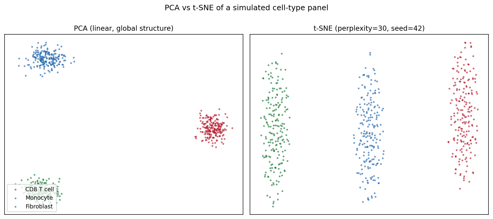
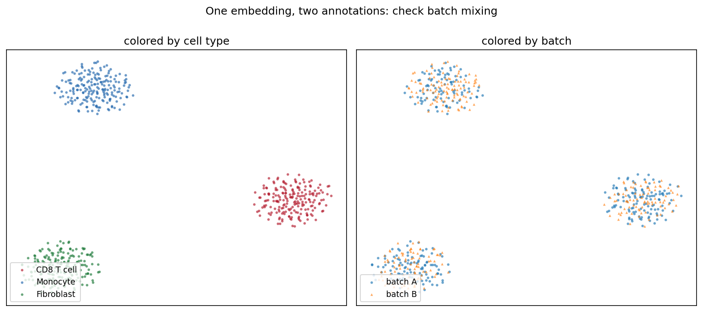

[t-SNE 图](../zh/Correlation/TSNEplot.html)的 Python 对应版本——t 分布随机邻域嵌入（t-SNE）把高维数据投影到二维，使相似样本在图上相互靠近 \[1\]。在单细胞基因组学中，它是观察表达矩阵细胞类型结构的标准第一步；在更广的生物医学数据分析中，它可视化 PCA 线性投影可能掩盖的患者/样本聚类。

`scikit-learn` 提供 `TSNE` 实现 \[2\]。三个参数决定图是否可信：**困惑度**（有效近邻数）、**初始化/预降维**（PCA）、**随机种子**——t-SNE 是随机算法，不同运行会落入不同局部最优。t-SNE 图中的簇*形状、大小与簇间距离*是算法的产物，不是测量值 \[3\]。

本教程涵盖三种工作流：

1. 同一数据的 PCA 与 t-SNE 对照；
2. 困惑度扫描展示局部/全局平衡的变化；
3. t-SNE 前的 PCA 预降维（top-50 主成分）。

## Example

{fig-align="center" width="80%"}

## Setup

- 系统要求：跨平台（Linux/MacOS/Windows）
- 编程语言：**Python**
- 依赖包：`scikit-learn`、`matplotlib`、`numpy`

```{python}
#| label: packages-setup
#| output: false
import matplotlib.pyplot as plt
import numpy as np
from sklearn.decomposition import PCA
from sklearn.manifold import TSNE
from sklearn.preprocessing import StandardScaler
```

## Data Preparation

我们模拟一个小型单细胞风格面板：600 个细胞来自三种类型（CD8 T cell、Monocyte、Fibroblast），200 个基因，每种类型表达自己的标志基因模块。原始计数经过 log 归一化与 z 标准化——直接把原始计数喂给 t-SNE 会让高表达基因主导邻域结构。

```{python}
#| label: data-prep
rng = np.random.default_rng(11)
types = ["CD8 T cell", "Monocyte", "Fibroblast"]
n_per, n_genes = 200, 200
marker_blocks = [(0, 70), (70, 140), (140, 200)]

X = rng.normal(0, 1.0, (n_per * 3, n_genes))
lab = np.repeat(types, n_per)
for i, (lo, hi) in enumerate(marker_blocks):   # 类型特异标志基因
    amp = [2.2, 1.8, 2.0][i]
    sl = slice(i * n_per, (i + 1) * n_per)
    X[sl, lo:hi] += rng.normal(amp, 0.5, (n_per, hi - lo))

Xs = StandardScaler().fit_transform(np.log1p(np.clip(X, 0, None) * 10))
palette = {"CD8 T cell": "#B2182B", "Monocyte": "#2166AC",
           "Fibroblast": "#1B7837"}
```

## Visualization

### 1. PCA 与 t-SNE 对照

```{python}
#| label: fig-py-tsne-pca-compare
#| fig-cap: "PCA（线性、保留全局方差）与 t-SNE（perplexity=30, seed=42）：两者都找回了三种细胞类型，但 t-SNE 紧凑、分离良好的团块是算法产物，并不能证明分离更强。"
#| fig-align: center

pca_emb = PCA(n_components=2, random_state=0).fit_transform(Xs)
emb = TSNE(n_components=2, random_state=42, perplexity=30,
           init="pca").fit_transform(Xs)

def scatter(ax, e, title, legend=False):
    for t in types:
        m = lab == t
        ax.scatter(e[m, 0], e[m, 1], s=8, alpha=0.65, color=palette[t],
                   label=t, linewidths=0)
    ax.set_title(title, fontsize=11)
    ax.set_xticks([]); ax.set_yticks([])
    if legend:
        ax.legend(loc="lower left", fontsize=9)

fig, axes = plt.subplots(1, 2, figsize=(11, 4.8))
scatter(axes[0], pca_emb, "PCA (linear, global structure)", legend=True)
scatter(axes[1], emb, "t-SNE (perplexity=30, seed=42)")
fig.suptitle("PCA vs t-SNE of a simulated cell-type panel", y=1.0)
fig.tight_layout()
plt.show()
```

### 2. 困惑度扫描

```{python}
#| label: fig-py-tsne-perplexity
#| fig-cap: "困惑度 5 把每种类型碎裂成人为的小簇；30 给出平衡的画面；100 把几何过度平滑成致密团块，其间距不再反映数据。"
#| fig-align: center

fig, axes = plt.subplots(1, 3, figsize=(13.5, 4.4))
for ax, perp in zip(axes, [5, 30, 100]):
    e = TSNE(n_components=2, random_state=42, perplexity=perp,
             init="pca").fit_transform(Xs)
    scatter(ax, e, f"perplexity = {perp}")
fig.suptitle("Perplexity controls the local/global balance", y=1.02)
fig.tight_layout()
plt.show()
```

### 3. PCA 预降维

```{python}
#| label: fig-py-tsne-prereduce
#| fig-cap: "在全部 200 个标准化特征上做 t-SNE，与在 top-50 主成分上做 t-SNE 对比：预降维对输入去噪，清理了类型内部结构，但不改变三簇结论。"
#| fig-align: center

pca50 = PCA(n_components=50, random_state=0).fit_transform(Xs)
emb_raw = TSNE(n_components=2, random_state=42, perplexity=30,
               init="pca").fit_transform(Xs)
emb_pca = TSNE(n_components=2, random_state=42, perplexity=30,
               init="pca").fit_transform(pca50)

fig, axes = plt.subplots(1, 2, figsize=(11, 4.8))
scatter(axes[0], emb_raw, "t-SNE on 200 scaled features")
scatter(axes[1], emb_pca, "t-SNE on top-50 PCs (denoised)")
fig.suptitle("PCA pre-reduction removes noise before t-SNE", y=1.0)
fig.tight_layout()
plt.show()
```

::: callout-tip
## 实践要点

-   始终传入 `random_state=`（并配合 `init="pca"` 获得稳定运行）；不给种子的 t-SNE 每次重跑笔记本都会得到不同的图。
-   在图注中报告困惑度，且保持低于约 n/100——再大就失去近邻估计的意义。
-   永远不要从 t-SNE 图读取簇大小、密度或簇间距离；这些结论要用 PCA/UMAP 和定量检验支撑。
-   先做特征标准化：否则 t-SNE 的欧氏邻域会被方差最大的基因主导。
:::

## Application

典型的 QC 面板会把同一嵌入标注两遍：一次按细胞类型、一次按测序批次。类型分离而批次充分混合（下图）说明结构来自生物学而非处理伪影——这一结论一眼可读，仅凭 t-SNE 坐标无法得出。

{fig-align="center" width="80%"}

## Reference

\[1\] van der Maaten L, Hinton G. Visualizing data using t-SNE. J Mach Learn Res. 2008;9:2579-2605.

\[2\] Pedregosa F, Varoquaux G, Gramfort A, et al. Scikit-learn: machine learning in Python. J Mach Learn Res. 2011;12:2825-2830.

\[3\] Wattenberg M, Viégas F, Johnson I. How to use t-SNE effectively. Distill. 2016. doi:10.23915/distill.00002
