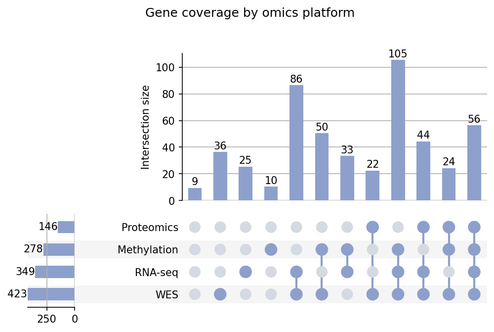

An UpSet plot visualizes the intersections of many sets as a matrix of dots (which sets take part) above a bar chart (how large each intersection is), scaling where Venn diagrams fail beyond three sets. In biomedical research it is the standard view of mutation or gene-list intersections across cohorts, platforms, and subtypes. The `upsetplot` package builds it directly from membership counts.

## Example

{fig-align="center" width="80%"}

## Setup

- System Requirements: Cross-platform (Linux/MacOS/Windows)
- Programming Language: **Python**
- Dependencies: `matplotlib`, `pandas`, `upsetplot`

```{python}
#| label: packages-setup
#| output: false
import matplotlib.pyplot as plt
import pandas as pd
import numpy as np
import upsetplot
```

## Data Preparation

We summarize which of four omics platforms (WES, RNA-seq, methylation array, proteomics) covered each gene in a 500-gene panel, then aggregate to membership counts — the input format `upsetplot` expects is a series indexed by boolean membership tuples.

```{python}
#| label: data-prep
rng = np.random.default_rng(81)

platforms = ['WES', 'RNA-seq', 'Methylation', 'Proteomics']
p_present = [0.85, 0.70, 0.55, 0.35]
n_genes = 500

membership = (rng.random((n_genes, 4)) < p_present)
# make paired platforms correlate a little, like real panel coverage
membership[:, 3] &= membership[:, 0]

counts = pd.Series(1, index=pd.MultiIndex.from_arrays(
    membership.T.tolist(), names=platforms)).groupby(level=list(range(4))).sum()
```

## Visualization

### Basic UpSet Plot

`upsetplot.plot` draws the intersection bars, the membership matrix, and the per-set size bars in one figure; `show_counts` labels the bars.

```{python}
#| label: fig-py-upset-basic
#| fig-cap: "Intersection of gene coverage across four omics platforms"
#| width: 90%
#| fig-align: center
fig = plt.figure(figsize=(9, 5))
upsetplot.plot(counts, fig=fig, show_counts='%d',
               facecolor='#8da0cb', other_dots_color='#d5dae2',
               shading_color='0.96')
plt.suptitle('Gene coverage by omics platform', y=1.02, fontsize=12)
plt.show()
```

### Sorted by Coverage Degree

Pre-sorting the membership index groups intersections by how many platforms they involve, and `show_percentages` turns each bar into a data-completeness statement.

```{python}
#| label: fig-py-upset-degree
#| fig-cap: "UpSet plot sorted by coverage degree with percentage labels"
#| width: 90%
#| fig-align: center
degree = np.asarray(counts.index.to_frame(index=False).sum(axis=1))
order = np.argsort(-degree, kind='stable')
counts_by_degree = counts.iloc[order]

fig = plt.figure(figsize=(9, 5))
upsetplot.plot(counts_by_degree, fig=fig, sort_categories_by='cardinality',
               show_percentages=True, facecolor='#8da0cb',
               other_dots_color='#d5dae2', shading_color='0.96',
               element_size=32)
plt.suptitle('Sorted by coverage degree; percentages = share of panel genes',
             y=1.02, fontsize=12)
plt.show()
```

## References

1. Lex, A., Gehlenborg, N., Strobelt, H., Vuillemot, R., & Pfister, H. (2014). UpSet: Visualization of Intersecting Sets. *IEEE Transactions on Visualization and Computer Graphics*, 20(12), 1983-1992.
2. Mohr, F. upsetplot: Draw Interacting Sets. https://github.com/jnooree/upsetplot
