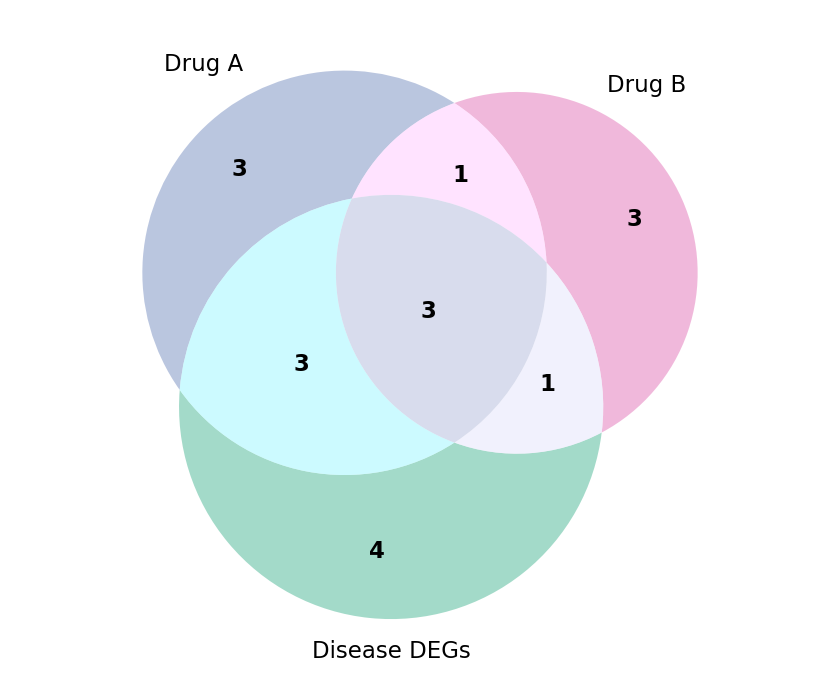

维恩图以相互交叠的圆盘展示两到三个集合的交集，并在每个区域标注成员数。在生物医学研究中，它是药物靶点重叠、通路成员关系和队列交集的默认展示。`matplotlib-venn` 包根据集合大小计算区域面积并在 `matplotlib` 坐标轴上绘制。超过三个集合时，请改用 UpSet 图。

## 示例

{fig-align="center" width="80%"}

## 环境配置

- 系统要求：跨平台（Linux/MacOS/Windows）
- 编程语言：**Python**
- 依赖包：`matplotlib`、`matplotlib-venn`

```{python}
#| label: packages-setup
#| output: false
import matplotlib.pyplot as plt
from matplotlib_venn import venn2, venn3
```

## 数据准备

我们比较三个基因列表：药物 A 靶点、药物 B 靶点，以及疾病队列的差异表达基因。

```{python}
#| label: data-prep
drug_a = {'EGFR', 'ERBB2', 'MET', 'ALK', 'ROS1', 'RET', 'NTRK1', 'BRAF', 'PIK3CA', 'MTOR'}
drug_b = {'ERBB2', 'EGFR', 'RET', 'KRAS', 'NRAS', 'MAP2K1', 'BRAF', 'PTEN'}
disease = {'EGFR', 'KRAS', 'TP53', 'BRAF', 'PIK3CA', 'APC', 'BRCA1', 'ERBB2', 'MET', 'ALK', 'RB1'}
```

## 可视化

### 两集合维恩图

`venn2` 可直接接受集合本身，也可接受 `(ab, a, b)` 的交集与独占计数元组；调整子集标签样式让数字更易读。

```{python}
#| label: fig-py-venn2
#| fig-cap: "药物 A 与药物 B 靶点集合的交集"
#| width: 60%
#| fig-align: center
fig, ax = plt.subplots(figsize=(5, 4.2))
v = venn2([drug_a, drug_b], set_labels=('Drug A targets', 'Drug B targets'),
          set_colors=('#8da0cb', '#e78ac3'), alpha=0.65, ax=ax)
for pid in ('10', '01', '11'):
    if v.get_patch_by_id(pid):
        v.get_patch_by_id(pid).set_edgecolor('white')
        v.get_patch_by_id(pid).set_linewidth(1.5)
    lbl = v.get_label_by_id(pid)
    if lbl:
        lbl.set_fontsize(12)
        lbl.set_fontweight('bold')
ax.set_title(f'|A| = {len(drug_a)}   |B| = {len(drug_b)}', fontsize=10, color='0.35')
plt.tight_layout()
plt.show()
```

### 三集合维恩图

`venn3` 加入第三个圆盘与全部七个区域标签；每个集合着色一次并让透明度混合交集区域，可保持图面清晰。

```{python}
#| label: fig-py-venn3
#| fig-cap: "药物靶点与疾病差异表达基因集的交集"
#| width: 65%
#| fig-align: center
fig, ax = plt.subplots(figsize=(5.6, 4.6))
v = venn3([drug_a, drug_b, disease],
          set_labels=('Drug A', 'Drug B', 'Disease DEGs'),
          set_colors=('#8da0cb', '#e78ac3', '#66c2a5'), alpha=0.6, ax=ax)
for pid in ('100', '010', '001', '110', '101', '011', '111'):
    lbl = v.get_label_by_id(pid)
    if lbl:
        lbl.set_fontsize(11)
        lbl.set_fontweight('bold')
for t in v.set_labels:
    if t:
        t.set_fontsize(11)
plt.tight_layout()
plt.show()
```

## 参考文献

1. Konstantin Kudryavtsev. matplotlib-venn: Venn diagram plotting functions for matplotlib. https://github.com/konstantint/matplotlib-venn
2. Hunter, J. D. (2007). Matplotlib: A 2D graphics environment. *Computing in Science & Engineering*, 9(3), 90-95.
