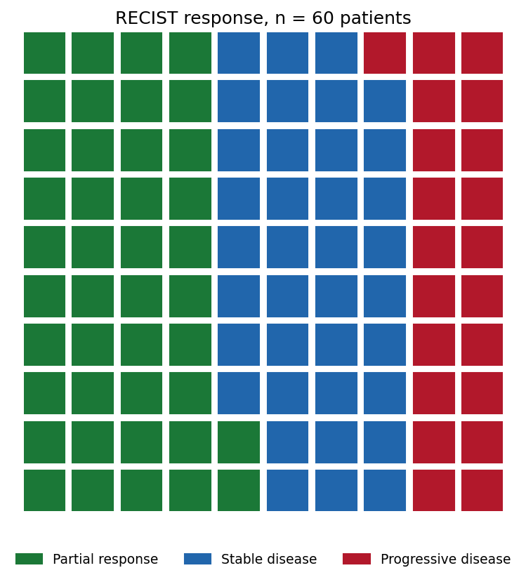
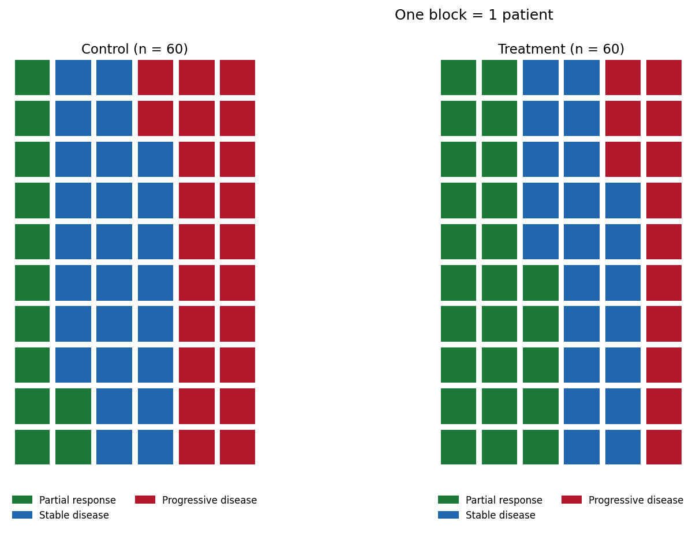

The Python counterpart of [Waffle Chart](../Composition/Waffle.html) — a waffle chart replaces area-encoding pie/donut wedges with a grid of unit blocks, one block per patient (or per 1% of the cohort), so proportions are *counted* rather than angle-estimated. In clinical reporting it is the honest alternative to pies for cohort composition, RECIST response categories, and consent/enrollment breakdowns, because human readers judge counts and lengths far more accurately than angles \[1\].

`pywaffle` provides the `Waffle` figure class on top of matplotlib \[2\]; the same grid is also easy to hand-roll. The two decisions that matter: the block scale (1 block = 1 patient, or 1%) and the rounding rule when counts do not divide into the grid — state both, or the blocks silently misstate the proportions.

This tutorial covers two workflows:

1. A 10 x 10 waffle of RECIST response for one cohort;
2. Two treatment arms side by side with a shared category palette.

## Example

{fig-align="center" width="60%"}

## Setup

- System Requirements: Cross-platform (Linux/MacOS/Windows)
- Programming Language: **Python**
- Dependencies: `matplotlib`, `pywaffle`

```{python}
#| label: packages-setup
#| output: false
import matplotlib.pyplot as plt
from pywaffle import Waffle
```

## Data Preparation

We use a small Phase-II-style cohort: 60 patients assessed by RECIST at week 12 — 25 partial responses, 22 stable disease, 13 progressive disease. A control arm of the same size (12/26/22) motivates the two-panel comparison.

```{python}
#| label: data-prep
treated = {"Partial response": 25, "Stable disease": 22,
           "Progressive disease": 13}
control = {"Partial response": 12, "Stable disease": 26,
           "Progressive disease": 22}
colors = {"Partial response": "#1B7837", "Stable disease": "#2166AC",
          "Progressive disease": "#B2182B"}
assert sum(treated.values()) == sum(control.values()) == 60
```

## Visualization

### 1. Single-Cohort Waffle

```{python}
#| label: fig-py-waffle-basic
#| fig-cap: "RECIST response as a 10 x 10 grid: one block = one patient, so the 13 progressions are countable instead of encoded as a wedge angle."
#| fig-align: center

fig = plt.figure(figsize=(7, 5.6), FigureClass=Waffle,
                 rows=10, columns=10,
                 values=treated, colors=list(colors.values()),
                 block_aspect_ratio=1,
                 title={"label": "RECIST response, n = 60 patients",
                        "fontsize": 12},
                 legend={"loc": "lower center", "bbox_to_anchor": (0.5, -0.14),
                         "ncol": 3, "fontsize": 9, "frameon": False})
fig.tight_layout()
plt.show()
```

### 2. Two Arms Side by Side

```{python}
#| label: fig-py-waffle-arms
#| fig-cap: "Control and treatment waffles share one palette and one block scale, so the extra green blocks in the treatment arm read as a count, not an angle."
#| fig-align: center

legend_spec = {"loc": "lower center", "bbox_to_anchor": (0.5, -0.16),
               "ncol": 2, "fontsize": 8, "frameon": False}
fig = plt.figure(figsize=(11, 6.2), FigureClass=Waffle,
                 plots={
                     121: {"rows": 10, "columns": 6, "values": control,
                           "colors": list(colors.values()),
                           "title": {"label": "Control (n = 60)",
                                     "fontsize": 11},
                           "legend": legend_spec},
                     122: {"rows": 10, "columns": 6, "values": treated,
                           "colors": list(colors.values()),
                           "title": {"label": "Treatment (n = 60)",
                                     "fontsize": 11},
                           "legend": legend_spec},
                 })
fig.suptitle("One block = 1 patient", fontsize=12, y=0.99)
plt.show()
```

::: callout-tip
## Practice tips

-   Fix the block scale first: 1 block = 1 patient below ~200 subjects, 1 block = 1% (100 blocks) above — never let the library auto-scale silently between panels.
-   When converting counts to percentage blocks, round explicitly and state the rule; `round()` can make blocks sum to 99 or 101.
-   Keep one palette and one legend across arms so blocks, not colors, carry the comparison.
-   Waffles show composition only — pair them with counts in the labels when the denominator matters.
-   Ordered categories (RECIST) should keep a consistent color direction across figures; unordered ones should use colorblind-safe hues.
:::

## Application

For a large cohort, switch the block scale to 1 block = 1% and the waffle becomes a direct objective-response-rate statement: the 37 green blocks below are the ORR itself, which is why waffles work well in patient-facing summaries and trial posters.

{fig-align="center" width="60%"}

## Reference

\[1\] Cleveland WS, McGill R. Graphical perception: theory, experimentation, and application to the development of graphical methods. J Am Stat Assoc. 1984;79(387):531-554. doi:10.1080/01621459.1984.10478080

\[2\] Liu G. PyWaffle: waffle charts in matplotlib. 2024. https://github.com/gyli/PyWaffle
