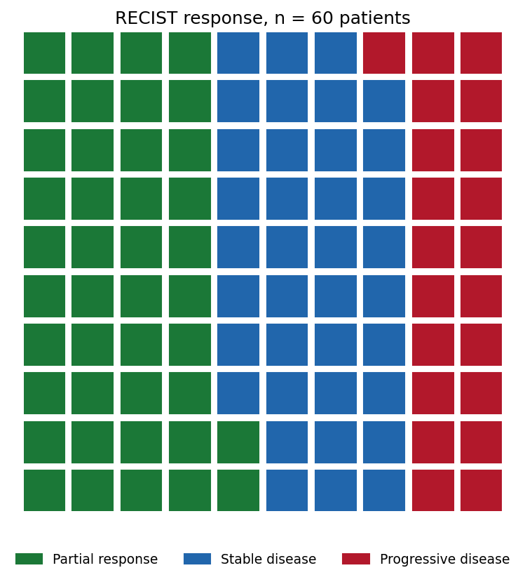
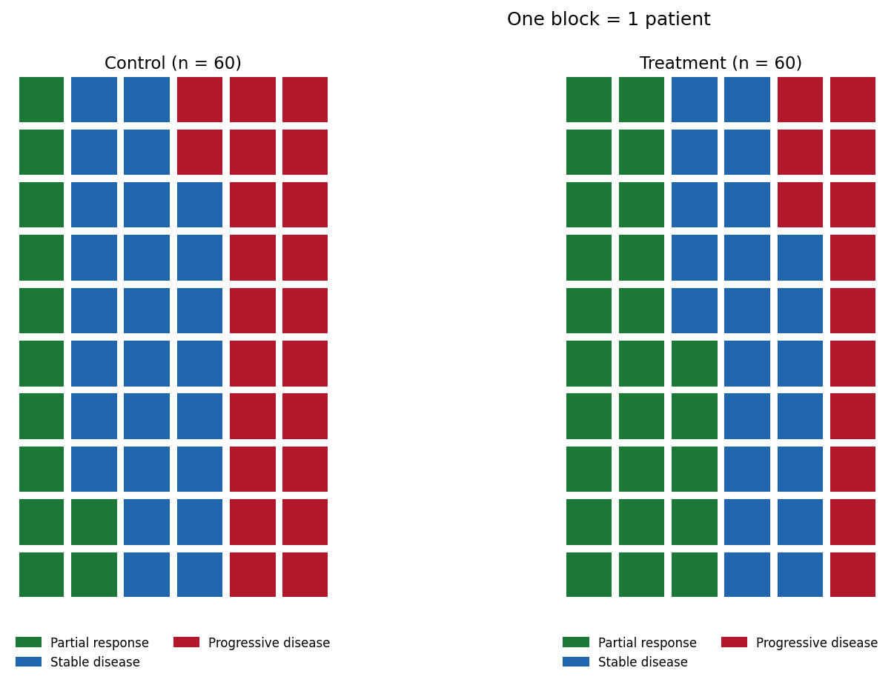

[华夫饼图](../zh/Composition/Waffle.html)的 Python 对应版本——华夫饼图用单位方块网格取代以面积编码的饼图/环形图，一个方块代表一名患者（或 1% 的队列），比例靠*数数*而非估计角度获得。在临床报告中，它是队列构成、RECIST 反应类别、入组/知情同意分布等数据的饼图诚实替代：人类读者对计数和长度的判断远比对角度准确 \[1\]。

`pywaffle` 在 matplotlib 之上提供了 `Waffle` 图形类 \[2\]；同样的网格也完全可以手工绘制。两个关键决定：方块比例（1 方块 = 1 名患者，或 1%）与计数不能整除网格时的取整规则——两者都要注明，否则方块会悄悄歪曲比例。

本教程涵盖两种工作流：

1. 单队列 RECIST 反应的 10 x 10 华夫图；
2. 共享类别配色的两治疗臂并排对比。

## Example

{fig-align="center" width="60%"}

## Setup

- 系统要求：跨平台（Linux/MacOS/Windows）
- 编程语言：**Python**
- 依赖包：`matplotlib`、`pywaffle`

```{python}
#| label: packages-setup
#| output: false
import matplotlib.pyplot as plt
from pywaffle import Waffle
```

## Data Preparation

我们使用一个小型 II 期风格队列：60 名患者在第 12 周接受 RECIST 评估——25 例部分缓解、22 例疾病稳定、13 例疾病进展。另一个同规模对照臂（12/26/22）用于双面板对比。

```{python}
#| label: data-prep
treated = {"Partial response": 25, "Stable disease": 22,
           "Progressive disease": 13}
control = {"Partial response": 12, "Stable disease": 26,
           "Progressive disease": 22}
colors = {"Partial response": "#1B7837", "Stable disease": "#2166AC",
          "Progressive disease": "#B2182B"}
assert sum(treated.values()) == sum(control.values()) == 60
```

## Visualization

### 1. 单队列华夫图

```{python}
#| label: fig-py-waffle-basic
#| fig-cap: "RECIST 反应的 10 x 10 网格：一个方块 = 一名患者，13 例进展可以直接数出来，而不是编码成一个扇形角度。"
#| fig-align: center

fig = plt.figure(figsize=(7, 5.6), FigureClass=Waffle,
                 rows=10, columns=10,
                 values=treated, colors=list(colors.values()),
                 block_aspect_ratio=1,
                 title={"label": "RECIST response, n = 60 patients",
                        "fontsize": 12},
                 legend={"loc": "lower center", "bbox_to_anchor": (0.5, -0.14),
                         "ncol": 3, "fontsize": 9, "frameon": False})
fig.tight_layout()
plt.show()
```

### 2. 两臂并排

```{python}
#| label: fig-py-waffle-arms
#| fig-cap: "对照臂与治疗臂共用同一配色和同一方块比例，治疗臂多出的绿色方块读作计数差异，而非角度差异。"
#| fig-align: center

legend_spec = {"loc": "lower center", "bbox_to_anchor": (0.5, -0.16),
               "ncol": 2, "fontsize": 8, "frameon": False}
fig = plt.figure(figsize=(11, 6.2), FigureClass=Waffle,
                 plots={
                     121: {"rows": 10, "columns": 6, "values": control,
                           "colors": list(colors.values()),
                           "title": {"label": "Control (n = 60)",
                                     "fontsize": 11},
                           "legend": legend_spec},
                     122: {"rows": 10, "columns": 6, "values": treated,
                           "colors": list(colors.values()),
                           "title": {"label": "Treatment (n = 60)",
                                     "fontsize": 11},
                           "legend": legend_spec},
                 })
fig.suptitle("One block = 1 patient", fontsize=12, y=0.99)
plt.show()
```

::: callout-tip
## 实践要点

-   先定方块比例：约 200 例以下用 1 方块 = 1 名患者，以上用 1 方块 = 1%（100 方块）——绝不让库在面板之间悄悄自动缩放。
-   计数转百分比方块时显式取整并注明规则；`round()` 可能让方块总数变成 99 或 101。
-   多臂共用一套配色和图例，让方块而不是颜色承载比较。
-   华夫图只表达构成——分母重要时把计数写进标签。
-   有序类别（RECIST）在多图间保持一致的颜色方向；无序类别使用色盲安全色。
:::

## Application

大队列时把方块比例切换为 1 方块 = 1%，华夫图就变成直接的客观缓解率（ORR）陈述：下图 37 个绿色方块就是 ORR 本身——这也是华夫图在患者沟通材料和研究海报中好用的原因。

{fig-align="center" width="60%"}

## Reference

\[1\] Cleveland WS, McGill R. Graphical perception: theory, experimentation, and application to the development of graphical methods. J Am Stat Assoc. 1984;79(387):531-554. doi:10.1080/01621459.1984.10478080

\[2\] Liu G. PyWaffle: waffle charts in matplotlib. 2024. https://github.com/gyli/PyWaffle
