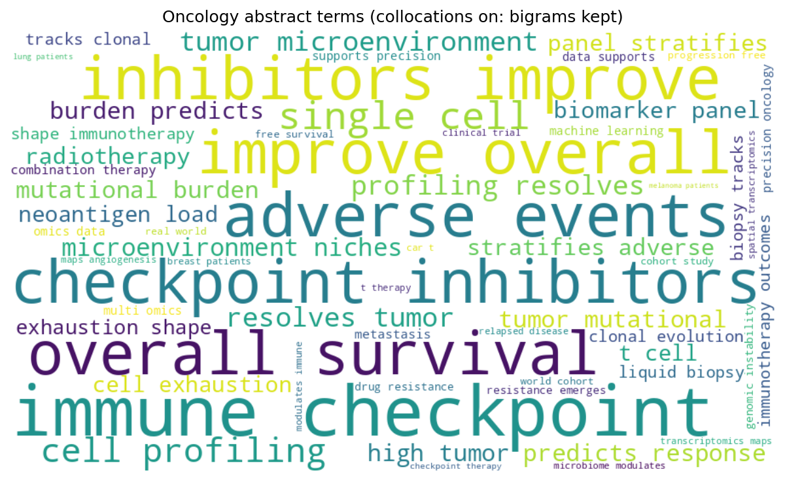
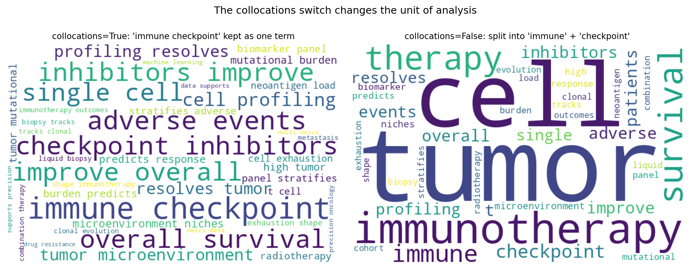

The Python counterpart of [Wordcloud](../Ranking/Wordcloud.html) — a wordcloud sizes terms by frequency, giving an instant overview of the vocabulary of a corpus: research topics in a conference program, patient-reported symptoms in a survey, or indexing terms across a PubMed query. It is an exploratory display, not a measurement — precise comparison belongs in a frequency table or bar chart.

The `wordcloud` package builds the layout \[1\]. Two settings dominate the result: `collocations` (whether adjacent word pairs like "immune checkpoint" are kept as one term) and the input mode (free text vs a precomputed frequency dictionary). Both change the *unit of analysis*, so they must be stated in the caption.

This tutorial covers two workflows:

1. A text-driven cloud with collocations (bigrams) kept;
2. A frequency-driven cloud with a print-friendly sequential palette.

## Example

{fig-align="center" width="70%"}

## Setup

- System Requirements: Cross-platform (Linux/MacOS/Windows)
- Programming Language: **Python**
- Dependencies: `matplotlib`, `numpy`, `wordcloud`

```{python}
#| label: packages-setup
#| output: false
import matplotlib.pyplot as plt
import numpy as np
from collections import Counter
from wordcloud import WordCloud, STOPWORDS
```

## Data Preparation

We assemble a pseudo-corpus of oncology abstract sentences, sampled 600 times with fixed weights so the topic distribution is reproducible. Token frequencies are also counted directly (minus stopwords) for the frequency-driven variant. For Chinese text, tokenize with `jieba` first and pass the token list or frequency dictionary — `wordcloud` splits on whitespace otherwise.

```{python}
#| label: data-prep
rng = np.random.default_rng(13)
templates = [
    "immune checkpoint inhibitors improve overall survival in {d} patients",
    "high tumor mutational burden predicts response to immunotherapy",
    "single-cell profiling resolves tumor microenvironment niches",
    "liquid biopsy tracks clonal evolution during combination therapy",
    "a biomarker panel stratifies adverse events after radiotherapy",
    "neoantigen load and t cell exhaustion shape immunotherapy outcomes",
    "spatial transcriptomics maps angiogenesis in metastasis",
    "machine learning on multi-omics data supports precision oncology",
    "drug resistance emerges through genomic instability",
    "a real world cohort study of progression-free survival",
    "the microbiome modulates immune checkpoint therapy",
    "car-t therapy in relapsed disease: a clinical trial",
    "chronic inflammation accelerates tumor growth and metastasis",
    "quality of life and adverse events in elderly cohorts",
    "pathology review confirmed tumor suppressor loss",
]
weights = np.array([8, 7, 7, 6, 6, 5, 4, 5, 4, 4, 3, 3, 3, 2, 2], float)
picks = rng.choice(len(templates), size=600, p=weights / weights.sum())
text = " ".join(
    templates[i].format(d=rng.choice(["melanoma", "lung", "breast"]))
    for i in picks)

terms = Counter()
for i in picks:
    for tok in templates[i].replace("{d}", "patients").split():
        if tok.lower() not in STOPWORDS and tok.isalpha():
            terms[tok.lower()] += 1
freq = dict(terms)
```

## Visualization

### 1. Text-Driven Cloud with Collocations

```{python}
#| label: fig-py-wc-text
#| fig-cap: "Text-driven cloud with collocations kept: adjacent terms such as 'immune checkpoint' and 'overall survival' stay joined as phrases, preserving the domain vocabulary."
#| fig-align: center

wc = WordCloud(width=900, height=520, background_color="white",
               colormap="viridis", stopwords=STOPWORDS,
               collocations=True, random_state=7, max_words=60)
wc = wc.generate_from_text(text)
fig, ax = plt.subplots(figsize=(8.5, 5))
ax.imshow(wc, interpolation="bilinear")
ax.axis("off")
ax.set_title("Oncology abstract terms (collocations on: bigrams kept)")
fig.tight_layout()
plt.show()
```

### 2. Frequency-Driven Cloud for Print

```{python}
#| label: fig-py-wc-freq
#| fig-cap: "Cloud drawn from a precomputed frequency dictionary (stopwords removed): the top-25 terms use a sequential Blues palette that survives greyscale printing."
#| fig-align: center

from matplotlib.colors import to_hex
blues = plt.get_cmap("Blues")(np.linspace(0.45, 0.95, 256))

def print_blues(*args, **kwargs):
    return to_hex(blues[rng.integers(0, len(blues))])

wc2 = WordCloud(width=900, height=520, background_color="white",
                random_state=7, max_words=25)
wc2.generate_from_frequencies(freq)
wc2.recolor(color_func=print_blues)
fig, ax = plt.subplots(figsize=(8.5, 5))
ax.imshow(wc2, interpolation="bilinear")
ax.axis("off")
ax.set_title("Top-25 terms from frequencies (sequential palette for print)")
fig.tight_layout()
plt.show()
```

::: callout-tip
## Practice tips

-   Always pass `random_state=` — word placement is randomized, and an unseeded cloud changes shape on every rerun.
-   Decide collocations deliberately: `True` keeps multiword concepts, `False` counts single words; never mix the two modes between figures of the same comparison.
-   Remove domain stopwords (patient, study, result) before drawing, or they dominate by mere grammatical frequency.
-   Word area encodes frequency only approximately (layout packing perturbs it); quote exact counts in a companion table for analysis.
-   For Chinese corpora, tokenize with `jieba` and feed frequencies; the default whitespace tokenizer cannot segment Chinese text.
:::

## Application

The collocations switch is the most misused setting: with `True` the corpus keeps "immune checkpoint" as one concept; with `False` the same corpus splits into "immune" and "checkpoint", doubling the apparent frequency of each. Show the two clouds side by side when the unit of analysis matters to your claim.

{fig-align="center" width="85%"}

## Reference

\[1\] Müller A. wordcloud: generate word clouds in Python. 2024. https://github.com/amueller/word_cloud
