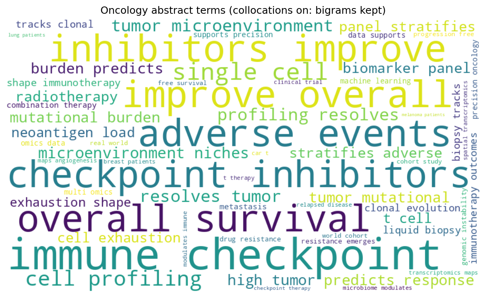
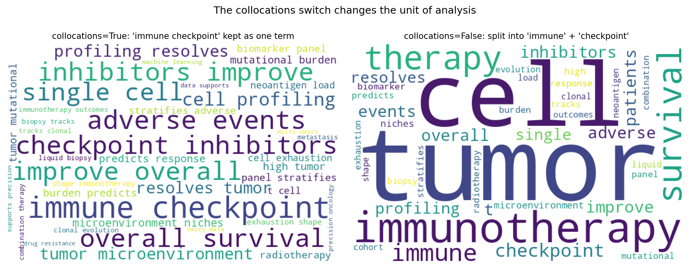

[词云图](../zh/Ranking/Wordcloud.html)的 Python 对应版本——词云图按词频缩放词语大小，一眼呈现语料的词汇概况：会议议题、患者报告症状、PubMed 检索式的索引词。它是探索性展示而非测量工具——精确比较请使用频率表或条形图。

`wordcloud` 包负责布局 \[1\]。两个设置决定结果：`collocations`（相邻词对如 "immune checkpoint" 是否作为一个词保留）与输入模式（自由文本 vs 预计算频率字典）。两者都会改变*分析单元*，因此必须在图注中说明。

本教程涵盖两种工作流：

1. 保留搭配（二元组）的文本驱动词云；
2. 使用印刷友好的顺序调色板的频率驱动词云。

## Example

{fig-align="center" width="70%"}

## Setup

- 系统要求：跨平台（Linux/MacOS/Windows）
- 编程语言：**Python**
- 依赖包：`matplotlib`、`numpy`、`wordcloud`

```{python}
#| label: packages-setup
#| output: false
import matplotlib.pyplot as plt
import numpy as np
from collections import Counter
from wordcloud import WordCloud, STOPWORDS
```

## Data Preparation

我们用肿瘤学摘要句子组装伪语料，按固定权重抽样 600 次，使主题分布可复现。词频同时被直接统计（去除停用词）供频率驱动变体使用。中文文本需先用 `jieba` 分词，再传入词表或频率字典——否则 `wordcloud` 只按空格切分。

```{python}
#| label: data-prep
rng = np.random.default_rng(13)
templates = [
    "immune checkpoint inhibitors improve overall survival in {d} patients",
    "high tumor mutational burden predicts response to immunotherapy",
    "single-cell profiling resolves tumor microenvironment niches",
    "liquid biopsy tracks clonal evolution during combination therapy",
    "a biomarker panel stratifies adverse events after radiotherapy",
    "neoantigen load and t cell exhaustion shape immunotherapy outcomes",
    "spatial transcriptomics maps angiogenesis in metastasis",
    "machine learning on multi-omics data supports precision oncology",
    "drug resistance emerges through genomic instability",
    "a real world cohort study of progression-free survival",
    "the microbiome modulates immune checkpoint therapy",
    "car-t therapy in relapsed disease: a clinical trial",
    "chronic inflammation accelerates tumor growth and metastasis",
    "quality of life and adverse events in elderly cohorts",
    "pathology review confirmed tumor suppressor loss",
]
weights = np.array([8, 7, 7, 6, 6, 5, 4, 5, 4, 4, 3, 3, 3, 2, 2], float)
picks = rng.choice(len(templates), size=600, p=weights / weights.sum())
text = " ".join(
    templates[i].format(d=rng.choice(["melanoma", "lung", "breast"]))
    for i in picks)

terms = Counter()
for i in picks:
    for tok in templates[i].replace("{d}", "patients").split():
        if tok.lower() not in STOPWORDS and tok.isalpha():
            terms[tok.lower()] += 1
freq = dict(terms)
```

## Visualization

### 1. 保留搭配的文本驱动词云

```{python}
#| label: fig-py-wc-text
#| fig-cap: "开启搭配的文本驱动词云：'immune checkpoint'、'overall survival' 等相邻词保持为短语，领域词汇得以保留。"
#| fig-align: center

wc = WordCloud(width=900, height=520, background_color="white",
               colormap="viridis", stopwords=STOPWORDS,
               collocations=True, random_state=7, max_words=60)
wc = wc.generate_from_text(text)
fig, ax = plt.subplots(figsize=(8.5, 5))
ax.imshow(wc, interpolation="bilinear")
ax.axis("off")
ax.set_title("Oncology abstract terms (collocations on: bigrams kept)")
fig.tight_layout()
plt.show()
```

### 2. 面向印刷的频率驱动词云

```{python}
#| label: fig-py-wc-freq
#| fig-cap: "从预计算频率字典（已去除停用词）绘制的词云：前 25 个词使用顺序 Blues 调色板，灰度打印仍可辨识。"
#| fig-align: center

from matplotlib.colors import to_hex
blues = plt.get_cmap("Blues")(np.linspace(0.45, 0.95, 256))

def print_blues(*args, **kwargs):
    return to_hex(blues[rng.integers(0, len(blues))])

wc2 = WordCloud(width=900, height=520, background_color="white",
                random_state=7, max_words=25)
wc2.generate_from_frequencies(freq)
wc2.recolor(color_func=print_blues)
fig, ax = plt.subplots(figsize=(8.5, 5))
ax.imshow(wc2, interpolation="bilinear")
ax.axis("off")
ax.set_title("Top-25 terms from frequencies (sequential palette for print)")
fig.tight_layout()
plt.show()
```

::: callout-tip
## 实践要点

-   始终传入 `random_state=`——词的摆放是随机的，不给种子则每次重跑形状都不同。
-   搭配开关要有意识地选择：`True` 保留多词概念，`False` 按单词计数；同一对比的多张图绝不能混用两种模式。
-   绘制前移除领域停用词（patient、study、result），否则它们会凭语法频率霸占画面。
-   词的面积只是近似编码词频（布局装箱会扰动它）；分析请配合精确计数的表格。
-   中文语料先用 `jieba` 分词再传频率；默认的空白分词无法切分中文。
:::

## Application

搭配开关是最常被误用的设置：`True` 时语料保留 "immune checkpoint" 这一概念；`False` 时同一语料被拆成 "immune" 与 "checkpoint"，两者的表观频率都翻倍。当分析单元影响结论时，把两种词云并排展示。

{fig-align="center" width="85%"}

## Reference

\[1\] Müller A. wordcloud: generate word clouds in Python. 2024. https://github.com/amueller/word_cloud
