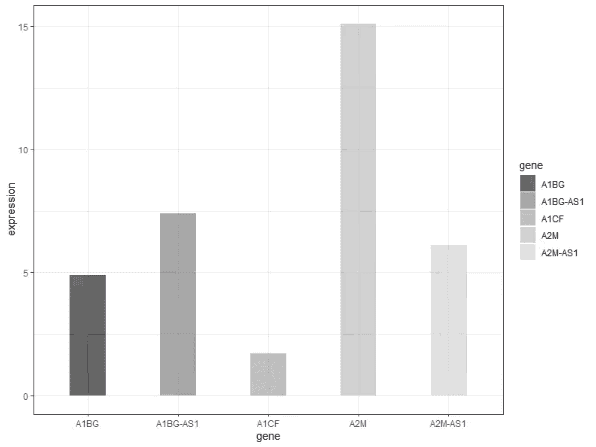
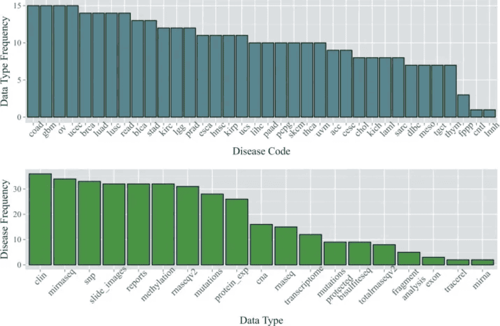
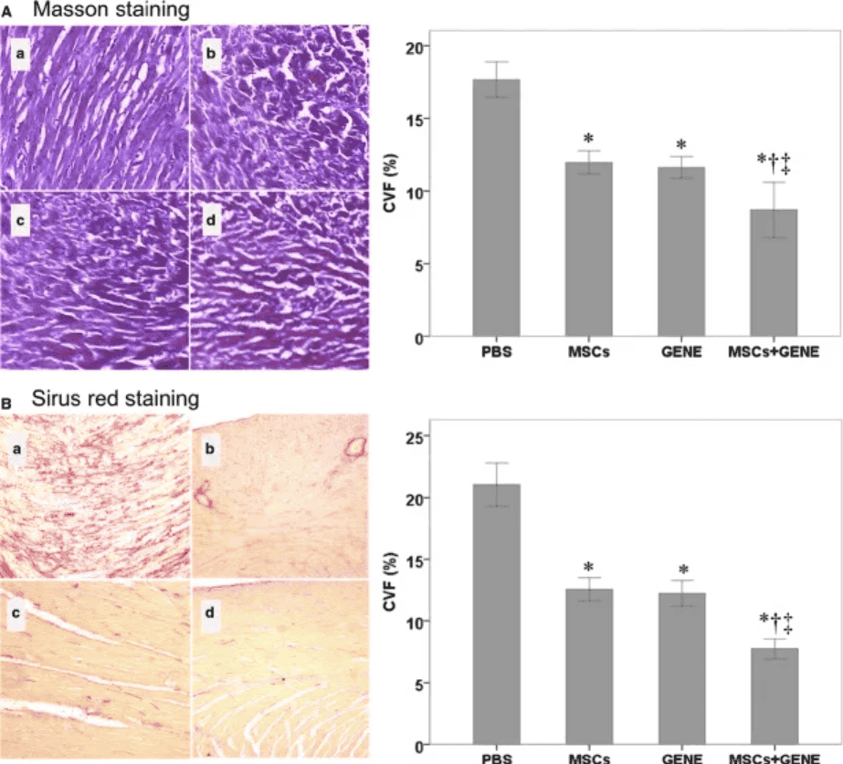
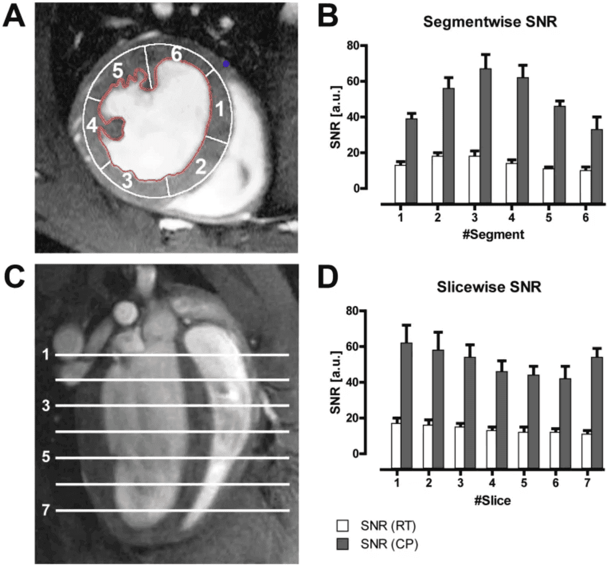

A bar plot is a graph that uses the height or length of the bars to represent the amount of data.

## Example

{fig-alt="Bar Plot DEMO" fig-align="center" width="60%"}

As shown in the figure above, each group of bars reflects the expression of five genes.

## Setup

-   System Requirements: Cross-platform (Linux/MacOS/Windows)

-   Programming Language: R

-   Dependencies: `magrittr`; `tidyr`; `ggplot2`; `cowplot`; `forcats`; `dplyr`; `hrbrthemes`; `ggpattern`; `rstatix`; `ggpubr`

```{r packages setup, message=FALSE, warning=FALSE, output=FALSE}
# Install packages
if (!requireNamespace("magrittr", quietly = TRUE)) {
  install.packages("magrittr")
}
if (!requireNamespace("tidyr", quietly = TRUE)) {
  install.packages("tidyr")
}
if (!requireNamespace("ggplot2", quietly = TRUE)) {
  install.packages("ggplot2")
}
if (!requireNamespace("cowplot", quietly = TRUE)) {
  install.packages("cowplot")
}
if (!requireNamespace("forcats", quietly = TRUE)) {
  install.packages("forcats")
}
if (!requireNamespace("dplyr", quietly = TRUE)) {
  install.packages("dplyr")
}
if (!requireNamespace("hrbrthemes", quietly = TRUE)) {
  install.packages("hrbrthemes")
}
if (!requireNamespace("ggpattern", quietly = TRUE)) {
  install.packages("ggpattern")
}
if (!requireNamespace("ggpubr", quietly = TRUE)) {
  install.packages("ggpubr")
}
if (!requireNamespace("rstatix", quietly = TRUE)) {
  install.packages("rstatix")
}
if (!requireNamespace("palmerpenguins", quietly = TRUE)) {
  install.packages("palmerpenguins")
}

# Load packages
library(magrittr)
library(tidyr)
library(ggplot2)
library(cowplot)
library(forcats)
library(dplyr)
library(hrbrthemes)
library(ggpattern)
library(rstatix)
library(ggpubr)
library(palmerpenguins)
```

```{r}
sessioninfo::session_info("attached")
```

## Data Preparation

The data from `TCGA` and the data sets that come with R are mainly used for drawing.

```{r load data}
#| message: false

data_TCGA <- readr::read_csv("https://bizard-1301043367.cos.ap-guangzhou.myqcloud.com/TCGA-BRCA.htseq_counts_processed.csv")

data_TCGA1 <- data_TCGA[1:5,] %>%
  gather(key = "sample",value = "gene_expression",3:1219)

data_tcga_mean <- aggregate(data_TCGA1$gene_expression, 
                            by=list(data_TCGA1$gene_name), mean) # mean
colnames(data_tcga_mean) <- c("gene","expression")

data_tcga_sd <- aggregate(data_TCGA1$gene_expression, 
                            by=list(data_TCGA1$gene_name), sd)
colnames(data_tcga_sd) <- c("gene","sd")

data_tcga <- merge(data_tcga_mean, data_tcga_sd, by="gene")

data_penguins <- penguins

data_penguins_flipper_length <- aggregate(data_penguins$flipper_length_mm,
                                by=list(data_penguins$species,data_penguins$sex),
                                mean)
colnames(data_penguins_flipper_length) <- c("species","sex","flipper_length_mm")

data_mpg <- mpg
```


## Visualization

### 1. Basic plot

#### 1.1 Basic bar plot

Here we take the `TCGA` database data as an example.

```{r}
#| label: fig-BasicPlot
#| fig-cap: "Basic bar plot"
#| out.width: "95%"
#| warning: false

# Basic bar plot
p <- ggplot(data_tcga_mean, aes(x=gene, y=expression)) + 
  geom_bar(stat = "identity")

p
```

The mean expression of the five gene samples is shown.

#### 1.2 Horizontal bar plot

Use `coord_flip()` to flip the coordinate axes.

```{r}
#| label: fig-coord_flip
#| fig-cap: "Horizontal bar plot"
#| out.width: "95%"
#| warning: false

# Horizontal bar plot
p <- data_tcga_mean %>%
  mutate(gene=fct_reorder(gene,expression)) %>% # fct_reorder order
  ggplot(aes(x=gene, y=expression)) + 
  geom_bar(stat = "identity",width=0.5)+ # adjust width
  coord_flip() # Flip the axes

p
```

#### 1.3 Color settings

`ggplot2` can implement a variety of color settings. Here we provide six examples.

```{r}
#| label: fig-Color
#| fig-cap: "Color settings"
#| out.width: "95%"
#| warning: false
#| fig-width: 10
#| fig-height: 8

# Color settings
p1 <- ggplot(data_tcga_mean, aes(x=gene, y=expression)) + 
  geom_bar(stat = "identity",color="blue", fill=rgb(0.1,0.4,0.5,0.7))+
  labs(title = "Unified Color")+
  theme(plot.title = element_text(hjust = 0.5)) +
  geom_text(aes(label=round(expression,2)),  # Add data labels
            position = position_dodge2(width = 0.9, preserve = 'single'), 
    vjust = -0.2, hjust = 0.5) +
  scale_y_continuous(limits = c(0, 17),breaks = seq(0,17,5))

p2 <- ggplot(data_tcga_mean, aes(x=gene, y=expression, fill=gene)) + 
  geom_bar(stat = "identity")+
  scale_fill_hue(c = 40) +
  labs(title = "Gradient Color")+
  theme(plot.title = element_text(hjust = 0.5),
        legend.position="none") +
  geom_text(aes(label=round(expression,2)),  # Add data labels
            position = position_dodge2(width = 0.9, preserve = 'single'), 
            vjust = -0.2, hjust = 0.5) +
  scale_y_continuous(limits = c(0, 17),breaks = seq(0,17,5))

p3 <- ggplot(data_tcga_mean, aes(x=gene, y=expression, fill=gene)) + 
  geom_bar(stat = "identity")+
  scale_fill_brewer(palette = "Set1")+
  labs(title = "RColorBrewer palette 1")+
  theme(plot.title = element_text(hjust = 0.5),
        legend.position="none") +
  geom_text(aes(label=round(expression,2)),  # Add data labels
            position = position_dodge2(width = 0.9, preserve = 'single'), 
            vjust = -0.2, hjust = 0.5) +
  scale_y_continuous(limits = c(0, 17),breaks = seq(0,17,5))

p4 <- ggplot(data_tcga_mean, aes(x=gene, y=expression, fill=gene)) + 
  geom_bar(stat = "identity")+
  scale_fill_brewer(palette = "Set2") +
  labs(title = "RColorBrewer palette 2")+
  theme(plot.title = element_text(hjust = 0.5),
        legend.position="none") +
  geom_text(aes(label=round(expression,2)),  # Add data labels
            position = position_dodge2(width = 0.9, preserve = 'single'), 
            vjust = -0.2, hjust = 0.5) +
  scale_y_continuous(limits = c(0, 17),breaks = seq(0,17,5))

p5 <- ggplot(data_tcga_mean, aes(x=gene, y=expression, fill=gene)) + 
  geom_bar(stat = "identity")+
  scale_fill_grey(start = 0.25, end = 0.75) +
  labs(title = "Grayscale")+
  theme(plot.title = element_text(hjust = 0.5),
        legend.position="none") +
  geom_text(aes(label=round(expression,2)),  # Add data labels
            position = position_dodge2(width = 0.9, preserve = 'single'), 
            vjust = -0.2, hjust = 0.5) +
  scale_y_continuous(limits = c(0, 17),breaks = seq(0,17,5))


p6 <- ggplot(data_tcga_mean, aes(x=gene, y=expression, fill=gene)) + 
  geom_bar(stat = "identity")+
  scale_fill_manual(values = c("red", "green", "blue","pink","yellow") ) +
  labs(title = "Manual settings")+
  theme(plot.title = element_text(hjust = 0.5),
        legend.position="none") +
  geom_text(aes(label=round(expression,2)),  # Add data labels
            position = position_dodge2(width = 0.9, preserve = 'single'), 
            vjust = -0.2, hjust = 0.5) +
  scale_y_continuous(limits = c(0, 17),breaks = seq(0,17,5))

plot_grid(p1, p2, p3, p4, p5, p6, labels = LETTERS[1:6], ncol = 3)
```

#### 1.4 Grayscale bar plot vs. textured bar plot

Besides handling color settings, `ggplot2` can also draw grayscale bar charts and textured bar charts.

```{r}
#| label: fig-Grey
#| fig-cap: "Grayscale bar plot"
#| out.width: "95%"
#| warning: false

# Grayscale bar plot
p <- 
  ggplot(data_tcga_mean, aes(x=gene, y=expression, fill=gene)) +
  geom_bar(stat="identity", alpha=.6, width=.4) +
  scale_fill_grey(start=0, end=0.8) +  # Set the grayscale range
  theme_bw()
p
```

```{r}
#| label: fig-Pattern
#| fig-cap: "textured bar plot"
#| out.width: "95%"
#| warning: false

# textured bar plot
p <- ggplot(data_tcga_mean, aes(x=gene, y=expression)) +
  geom_col_pattern(
    aes(pattern=gene,
        pattern_angle=gene,
        pattern_spacing=gene
    ), 
    fill            = 'white',
    colour          = 'black', 
    pattern_density = 0.5, 
    pattern_fill    = 'black',
    pattern_colour  = 'darkgrey'
  ) +
  theme_bw()
p
```

::: callout-tip
**Key parameters: **

- `fill`：The base fill color behind the pattern
- `colour`：The border color of the bar
- `pattern_density`：Density of pattern within the bar
- `pattern_fill`：Pattern color
- `pattern_colour`：Secondary color of the pattern
:::

### 2. Variable Width Bar plot

The variable width bar chart visualizes the number of samples, using the width of the bar to represent the number of samples.

```{r}
#| label: fig-Barwidth
#| fig-cap: "Variable Width Bar plot"
#| out.width: "95%"
#| warning: false

# Variable Width Bar plot----
data <- data.frame(
  group=c("A ","B ","C ","D ") , 
  value=c(33,62,56,67) , 
  number_of_obs=c(100,500,459,342)
)

# Set the left and right width limits
data$right <- cumsum(data$number_of_obs) + 30*c(0:(nrow(data)-1))
data$left <- data$right - data$number_of_obs 

# plot
p <- 
  ggplot(data, aes(ymin = 0)) + 
  geom_rect(aes(xmin = left, xmax = right, # Set upper and lower width limits
                ymax = value, 
                colour = group, fill = group),alpha=0.8) +
  xlab("number of obs") + 
  ylab("value") +
  theme_ipsum() +
  scale_fill_brewer(palette = "Set1") +
  theme(legend.position="none") 
p
```

The above graph shows the sample size using bar width.

### 3. Error bar plot

Bar charts allow for error bars to be added, which we can do with `geom_errorbar`.

#### 3.1 Basic error bar plot

```{r}
#| label: fig-BasicErrorbar
#| fig-cap: "Basic error bar plot"
#| out.width: "95%"
#| warning: false

# Basic error bar plot
p <- 
  ggplot(data_tcga) +
  geom_bar( aes(x=gene, y=expression), stat="identity", fill="skyblue", alpha=0.7) +
  geom_errorbar(aes(x=gene, 
                    ymin=expression-sd, ymax=expression+sd), 
                width=0.4, colour="orange", alpha=0.9, size=1) +
  labs(title = "Basic error bar plot") +
  theme(plot.title = element_text(hjust = 0.5))
p
```

The above figure shows the expression level of each gene and adds standard deviation error bars.

#### 3.2 Various types of error bar plot

At the same time, `ggplot2` provides a variety of error bar types, here we provide four examples.

```{r}
#| label: fig-MultiErrorbar
#| fig-cap: "Various types of error bar plot"
#| out.width: "95%"
#| warning: false
#| fig-width: 10
#| fig-height: 10

# Error bar chart (taking standard deviation as an example) ----
## Various types of error bar plot
p1 <- ggplot(data_tcga) +
  geom_bar( aes(x=gene, y=expression), stat="identity", fill="skyblue", alpha=0.7) +
  geom_crossbar( aes(x=gene, y=expression, 
                     ymin=expression-sd, ymax=expression+sd), 
                 width=0.4, colour="orange", alpha=0.9, size=1.3) +
  labs(title = "Box error bar plot")+
  theme(plot.title = element_text(hjust = 0.5))

p2 <- ggplot(data_tcga) +
  geom_bar( aes(x=gene, y=expression), stat="identity", fill="skyblue", alpha=0.7) +
  geom_linerange( aes(x=gene, 
                      ymin=expression-sd, ymax=expression+sd), 
                  colour="orange", alpha=0.9, size=1.3) +
  labs(title = "Linear error bar plot")+
  theme(plot.title = element_text(hjust = 0.5))


p3 <- ggplot(data_tcga) +
  geom_bar( aes(x=gene, y=expression), stat="identity", fill="skyblue", alpha=0.7) +
  geom_pointrange( aes(x=gene, y=expression, 
                       ymin=expression-sd, ymax=expression+sd), 
                   colour="orange", alpha=0.9, size=1) +
  labs(title = "Line + point error bar chart")+
  theme(plot.title = element_text(hjust = 0.5))


p4 <- ggplot(data_tcga) +
  geom_bar( aes(x=gene, y=expression), stat="identity", fill="skyblue", alpha=0.7) +
  geom_errorbar( aes(x=gene, ymin=expression-sd, ymax=expression+sd), 
                 width=0.4, colour="orange", alpha=0.9, size=1.3) +
  coord_flip() +
  labs(title = "Horizontal error bar plot")+
  theme(plot.title = element_text(hjust = 0.5))

plot_grid(p1, p2, p3, p4, labels = LETTERS[1:4], ncol = 2)
```

#### 3.3 Add differential analysis

```{r}
#| label: fig-pvalue
#| fig-cap: "Add differential analysis"
#| out.width: "95%"
#| warning: false

# Add differential analysis
data_tcga_p <- filter(data_TCGA1,
                      gene_name == "A1BG" | gene_name == "A1CF" | gene_name == "A2M")

data_tcga_plot <- filter(data_tcga,
                         gene == "A1BG" | gene == "A1CF" | gene == "A2M")

# Calculation of p-value between groups
df_p_val <- data_tcga_p %>% 
  wilcox_test(formula = gene_expression~gene_name) %>% 
  add_significance(p.col = 'p',cutpoints = c(0,0.001,0.01,0.05,1),symbols = c('***','**','*','ns')) %>% 
  add_xy_position()

p <- 
  ggplot(data_tcga_plot) +
  geom_bar( aes(x=gene, y=expression), stat="identity", fill="skyblue", alpha=0.7) +
  geom_errorbar( aes(x=gene, 
                     ymin=expression-sd, ymax=expression+sd), 
                 width=0.4, colour="orange", alpha=0.9, size=1) +
  stat_pvalue_manual(df_p_val,label = '{p.signif}', # Adding differential analysis lines
                     tip.length = 0.01,
                     y.position = c(15,17,19)) +
  labs(title = "Add differential analysis") +
  theme(plot.title = element_text(hjust = 0.5))
p
```

The above figure adds differential analysis lines of three gene expression data.

### 4. Stacked bar plot

When including within-group grouping, we can choose to plot a stacked bar chart.

Take the `penguins` dataset as an example.

```{r}
#| label: fig-stack
#| fig-cap: "Stacked bar plot"
#| out.width: "95%"
#| warning: false

# Stacked bar plot----
p <- 
  ggplot(data_penguins_flipper_length,aes(x=species,y=flipper_length_mm,fill=sex))+
  geom_bar(stat="identity",  
           position = position_stack(reverse = TRUE))+ # Change stacking order
  guides(fill=guide_legend(reverse = TRUE)) + # Change legend order
  scale_fill_manual(values = c("#87CEFA","#8DB6CD"))
p
```

A stacked bar chart showing the wing length of penguins of different sexes.

### 5. Percentage bar plot

Similarly, when performing ratio analysis, you can also choose to draw a percentage bar chart.

```{r}
#| label: fig-percent
#| fig-cap: "Percentage bar plot"
#| out.width: "95%"
#| warning: false

# Percentage bar plot----
p <- 
  ggplot(data_mpg,aes(class))+
  geom_bar(aes(fill = drv), 
           position = 'fill') + # Draw percentage
  scale_fill_manual(values = c("#87CEFA","#8DB6CD","#84B6BD"))
p
```

The above chart shows the percentage of drive type (four-wheel drive, front-wheel drive, rear-wheel drive) in each model.

### 6. Side-by-side bar plot

When including grouping within groups, we can also draw side-by-side bar plot by setting the `position` parameter.

```{r}
#| label: fig-dodge2
#| fig-cap: "Side-by-side bar plot"
#| out.width: "95%"
#| warning: false

# Side-by-side bar plot----
p <- 
  ggplot(data_mpg,aes(class)) +
  geom_bar(aes(fill = drv), 
           position = position_dodge2(preserve = 'single')) +
  scale_fill_manual(values = c("#87CEFA","#8DB6CD","#84B6BD"))
p
```

### 7. Deformation of bar plot

#### 7.1 Pyramid plot

```{r}
#| label: fig-Pyramid
#| fig-cap: "Pyramid plot"
#| out.width: "95%"
#| warning: false

df <- tibble(
  gene = factor(paste0("gene_", rep(1:16, 2)), levels = paste0("gene_", 16:1)),
  stat = c(seq(-10, -100, -10), seq(-90, -40, 10), seq(10, 100, 10), seq(90, 40, -10)),
  direct = rep(c("down", "up"), each=16)
)

p <- 
  ggplot(df, aes(gene, stat, fill = direct)) + 
  geom_col() +
  coord_flip() + 
  scale_y_continuous(breaks = seq(-100, 100, 20),
                     labels = c(seq(100, 0, -20), seq(20, 100, 20)))
p
```

#### 7.2 Deviation Plot

```{r}
#| label: fig-Deviation
#| fig-cap: "Deviation Plot"
#| out.width: "95%"
#| warning: false

# Deviation Plot
df <- tibble(
  gene = factor(paste0("gene_", 1:20), levels = paste0("gene_", 20:1)),
  stat = c(seq(100, 10, -10), seq(-10, -100, -10)),
  direct = factor(rep(c("up", "down"), each=10), levels = c("up", "down"))
)

p <- 
  ggplot(df, aes(gene, stat, fill = direct)) + 
  geom_col() +
  coord_flip()
p
```

### 8. Multi-Group Bar Chart with Subgroup Gradient

The reference figure encodes **three levels of grouping**: major groups (colours), subgroups within each group (gradient shades), and error bars (mean ± SE) \[13\]. The gradient effect is achieved by assigning lighter shades to subgroup levels within each major-group colour.

```{r}
#| label: fig-8.1SubgroupGradient
#| fig-cap: "Multi-group bar chart with subgroup gradient fills and error bars (mean ± SE)."
#| out.width: "85%"
#| warning: false
#| message: false
#| fig-width: 9
#| fig-height: 5.5

set.seed(2101)
major <- c("Group A", "Group B", "Group C")
subgrp <- list(c("A1", "A2", "A3"), c("B1", "B2"), c("C1", "C2", "C3"))
base_col <- c("Group A" = "#2874C5", "Group B" = "#B2182B", "Group C" = "#4D9342")

df_b <- do.call(rbind, lapply(seq_along(major), function(k) {
  do.call(rbind, lapply(seq_along(subgrp[[k]]), function(j) {
    n <- 25
    val <- rnorm(n, mean = 20 + k * 8 + j * 2, sd = 5)
    data.frame(major = major[k], subgroup = subgrp[[k]][j], value = val)
  }))
}))
summ_b <- df_b |>
  group_by(major, subgroup) |>
  summarise(mean = mean(value), se = sd(value) / sqrt(n()), .groups = "drop")

major_of <- setNames(rep(major, sapply(subgrp, length)), unlist(subgrp))
summ_b$major_col <- base_col[major_of[summ_b$subgroup]]
# lighter shades for subgroup index within each major group
shade_fac <- c(0.5, 0.75, 1.0)
summ_b$idx <- as.integer(factor(summ_b$subgroup, levels = unlist(subgrp)))
summ_b$shade <- shade_fac[summ_b$idx]

subgroup_cols <- c(
  "A1" = "#7BA7D6", "A2" = "#5288CC", "A3" = "#2874C5",
  "B1" = "#CE6B6B", "B2" = "#B2182B",
  "C1" = "#7BC17B", "C2" = "#4D9342", "C3" = "#3D7A35")

ggplot(summ_b, aes(subgroup, mean, fill = subgroup)) +
  geom_col(width = 0.7) +
  geom_errorbar(aes(ymin = mean - se, ymax = mean + se), width = 0.2, linewidth = 0.5) +
  scale_fill_manual(values = subgroup_cols) +
  labs(x = NULL, y = "Mean ± SE") +
  theme_classic(base_size = 11) +
  theme(axis.text.x = element_text(angle = 30, hjust = 1))
```

::: callout-tip
**Practice tips**

-   The gradient shades are derived per subgroup index from the major-group base colour (here hardcoded as explicit hex values; derive your own with `colorRampPalette(c(light, base))(n)` when subgroups are many) — this ties each subgroup visually to its major-group colour.
-   The `se = sd / sqrt(n)` error bar is the standard for mean comparison; some journals require `sd` instead — check the author guidelines.
-   For intra-group comparison brackets, add `ggsignif::geom_signif(comparisons = list(c("A1", "A2")))` on top of the bars.
:::

### 9. Cell-Type Proportion Bars with a Cluster-wise Fisher Post-hoc Test

Single-cell studies routinely summarize composition as the fraction of cells per cluster in each condition. The reference workflow \[13\] draws the stacked proportion bars, tests the whole cluster × condition table with Fisher's exact test, and then asks *which* cluster drives the difference with a one-vs-rest post-hoc: `rstatix::row_wise_fisher_test()` runs one Fisher test per cluster (that cluster vs all others) and BH-adjusts the family of eight p-values.

```{r}
#| label: fig-9.1CellPropSig
#| fig-cap: "Cell-type composition per cluster (WT vs KO, simulated). Stars are BH-adjusted one-vs-rest Fisher tests per cluster; the overall Fisher exact test on the full table gives p < 0.0001 (Monte-Carlo, B = 10^5)."
#| out.width: "95%"
#| warning: false
#| message: false
#| fig-width: 9.5
#| fig-height: 5.5

set.seed(2900)
clusters <- paste0("C", 1:8)
p0 <- c(0.18, 0.16, 0.14, 0.12, 0.11, 0.10, 0.10, 0.09)
# KO proportions: unaffected clusters keep p0 exactly; only C2/C6/C8 are reallocated
p_ko <- p0
p_ko[2] <- 0.05; p_ko[6] <- 0.22; p_ko[8] <- 0.08
stopifnot(abs(sum(p_ko) - 1) < 1e-12)
n_wt <- 900; n_ko <- 900
mk_cells <- function(n, p, grp) {
  data.frame(cluster = sample(clusters, n, replace = TRUE, prob = p),
             group = grp,
             run = sample(c("R1", "R2"), n, replace = TRUE))
}
cellinfo <- rbind(mk_cells(n_wt, p0, "WT"), mk_cells(n_ko, p_ko, "KO"))
cellinfo$cluster <- factor(cellinfo$cluster, levels = clusters)

tbl <- table(cellinfo$cluster, cellinfo$group)
ft <- fisher.test(tbl, simulate.p.value = TRUE, B = 1e5)
post <- rstatix::row_wise_fisher_test(tbl)

cell.col <- c(WT = "#1A63A8", KO = "#FC6910")
prop_df <- as.data.frame(tbl, stringsAsFactors = FALSE)
colnames(prop_df) <- c("cluster", "group", "n")
prop_df$cluster <- factor(prop_df$cluster, levels = clusters)
prop_df$group <- factor(prop_df$group, levels = c("WT", "KO"))
sig_df <- as.data.frame(post)
sig_df$cluster <- factor(sig_df$group, levels = clusters)
sig_df$lab <- ifelse(sig_df$p.adj.signif == "ns", "", sig_df$p.adj.signif)

ggplot(prop_df, aes(cluster, n, fill = group)) +
  geom_col(stat = "identity", position = "fill", width = 0.72,
           colour = "grey25", linewidth = 0.2) +
  geom_text(data = sig_df, aes(x = cluster, y = 1.05, label = lab),
            inherit.aes = FALSE, size = 4.4, colour = "grey10") +
  scale_fill_manual(values = cell.col, name = NULL) +
  scale_y_continuous(breaks = seq(0, 1, 0.25), labels = scales::percent,
                     expand = expansion(mult = c(0, 0.1))) +
  labs(x = "Cluster", y = "Fraction of cells",
       title = "Cell-type composition per cluster (KO vs WT)") +
  theme_classic(base_size = 12) +
  theme(legend.position = "top", plot.title = element_text(size = 11))
```

Faceting by sequencing run (replicate) shows whether the compositional shift is reproducible or an artifact of one library — the layout of the reference figure's first panel \[13\]:

```{r}
#| label: fig-9.2CellPropRep
#| fig-cap: "The same composition faceted by sequencing replicate: the depletion (C2) and enrichment (C6) are consistent across runs."
#| out.width: "100%"
#| warning: false
#| message: false
#| fig-width: 12
#| fig-height: 3.8

# same cells as the chunk above, now split by sequencing run
ggplot(cellinfo, aes(run, fill = group)) +
  geom_bar(position = "fill", width = 0.85, colour = "grey25", linewidth = 0.2) +
  facet_wrap(~cluster, nrow = 1) +
  scale_fill_manual(values = cell.col, name = NULL) +
  scale_y_continuous(breaks = seq(0, 1, 0.5), labels = scales::percent) +
  labs(x = "Replicate", y = "Fraction of cells") +
  theme_classic(base_size = 11) +
  theme(strip.background = element_rect(fill = "grey88", colour = NA),
        strip.text = element_text(face = "bold"),
        legend.position = "top",
        axis.text.x = element_text(angle = 45, hjust = 1))
```

::: callout-tip
**Practice tips**

-   `row_wise_fisher_test()` expects the contingency table with categories as rows and groups as columns; its `group` column holds the row names, and `p.adj`/`p.adj.signif` carry the BH-adjusted result — plot the stars from `p.adj.signif`, not raw p-values.
-   With large N, `fisher.test(..., simulate.p.value = TRUE)` cannot return a p-value smaller than its Monte-Carlo floor `1/(B + 1)`; report such results as `p < 1/(B+1)` (here `p < 0.0001` for B = 10^5) instead of quoting the floor itself.
-   Keep the two condition sizes balanced: with unequal group totals, every unaffected cluster picks up a small systematic shift that the per-cluster tests can flag as significant.
:::

### 10. Gradient-Filled Bars (ggpattern)

Presentation-grade bars sometimes carry an "office" gradient fill instead of a flat colour — the reference figure \[13\] uses a two-tone gradient per segment. `ggpattern::geom_col_pattern()` draws it with `pattern = "gradient"` and the two endpoint colours `pattern_fill` / `pattern_fill2`; `pattern_orientation = "radial"` radiates from the segment centre:

```{r}
#| label: fig-10.1RadialGradient
#| fig-cap: "Radial-gradient bars: the dark metastatic fraction carries white percentage labels; values are simulated prevalence data."
#| out.width: "85%"
#| warning: false
#| message: false
#| fig-width: 7.5
#| fig-height: 5.2

set.seed(2970)
df_d <- data.frame(
  Country = c("Japan", "USA", "England", "S. Korea", "China", "France", "Germany", "Australia"),
  Metastatic = c(19, 24, 28, 33, 36, 31, 22, 27),
  Localized = c(81, 76, 72, 67, 64, 69, 78, 73))
df_d$ID <- seq_len(nrow(df_d))
maxID <- nrow(df_d)

plot.df.all <- reshape2::melt(df_d, id.var = c("Country", "ID"),
                              value.name = "Percentage", variable.name = "Type")
plot.df <- subset(plot.df.all, Type %in% c("Metastatic", "Localized"))
plot.df1 <- subset(plot.df, Type == "Metastatic")
type.color.1 <- c('#dbeffc', '#7bb8e5')   # light segment (Localized)
type.color.2 <- c('#a7d7f3', '#0079bb')   # dark segment (Metastatic)
barwidth <- 0.44

ggplot() +
  geom_col_pattern(data = plot.df, mapping = aes(ID, Percentage),
                   width = barwidth, position = "stack",
                   pattern = 'gradient', pattern_orientation = "radial",
                   pattern_fill = type.color.1[1], pattern_fill2 = type.color.1[2],
                   fill = NA) +
  geom_col_pattern(data = plot.df1, mapping = aes(ID, Percentage),
                   width = barwidth,
                   pattern = 'gradient', pattern_orientation = "radial",
                   pattern_fill = type.color.2[1], pattern_fill2 = type.color.2[2],
                   fill = NA) +
  geom_text(data = plot.df1, mapping = aes(x = ID, y = Percentage * 0.22,
                                           label = paste0(Percentage, " %")),
            size = 2.6, color = "white") +
  scale_x_continuous(breaks = seq(1, maxID, 1),
                     labels = stringr::str_wrap(plot.df1$Country, 9)) +
  scale_y_continuous(limits = c(0, 100), breaks = seq(0, 100, 10), expand = c(0, 0)) +
  labs(x = NULL, y = "Prevalence (%)") +
  theme_bw(base_size = 11) +
  theme(panel.grid.major.x = element_blank(), panel.grid.minor = element_blank(),
        panel.border = element_blank(), axis.line = element_line(colour = 'black'),
        axis.text = element_text(colour = 'black', size = 9))
```

A horizontal gradient needs a trick: ggpattern can only interpolate between two colours along one direction, so the reference draws each bar as left and right halves with mirrored gradients, producing a symmetric light-centre stripe, and adds black borders with `geom_rect()`:

```{r}
#| label: fig-10.2HorizontalGradient
#| fig-cap: "Horizontal-gradient bars assembled from mirrored left/right halves with black segment borders (ggpattern)."
#| out.width: "85%"
#| warning: false
#| message: false
#| fig-width: 7.5
#| fig-height: 5.2

barwidth2 <- 0.22
ggplot() +
  geom_col_pattern(data = plot.df, mapping = aes(ID - barwidth2 / 2 + 0.002, Percentage),
                   width = barwidth2, position = "stack",
                   pattern = 'gradient', pattern_orientation = "horizontal",
                   pattern_fill = type.color.1[2], pattern_fill2 = type.color.1[1], fill = NA) +
  geom_col_pattern(data = plot.df, mapping = aes(ID + barwidth2 / 2 - 0.002, Percentage),
                   width = barwidth2, position = "stack",
                   pattern = 'gradient', pattern_orientation = "horizontal",
                   pattern_fill = type.color.1[1], pattern_fill2 = type.color.1[2], fill = NA) +
  geom_col_pattern(data = plot.df1, mapping = aes(ID - barwidth2 / 2 + 0.002, Percentage),
                   width = barwidth2,
                   pattern = 'gradient', pattern_orientation = "horizontal",
                   pattern_fill = type.color.2[2], pattern_fill2 = type.color.2[1], fill = NA) +
  geom_col_pattern(data = plot.df1, mapping = aes(ID + barwidth2 / 2 - 0.002, Percentage),
                   width = barwidth2,
                   pattern = 'gradient', pattern_orientation = "horizontal",
                   pattern_fill = type.color.2[1], pattern_fill2 = type.color.2[2], fill = NA) +
  geom_rect(data = plot.df1,
            mapping = aes(xmin = ID - barwidth2, xmax = ID + barwidth2,
                          ymin = 0, ymax = Percentage),
            linewidth = 0.3, fill = NA, color = "black") +
  geom_rect(data = df_d,
            mapping = aes(xmin = ID - barwidth2, xmax = ID + barwidth2,
                          ymin = Metastatic, ymax = 100),
            linewidth = 0.3, fill = NA, color = "black") +
  geom_text(data = plot.df1, mapping = aes(x = ID, y = Percentage * 0.22,
                                           label = paste0(Percentage, " %")),
            size = 2.6, color = "white") +
  scale_x_continuous(breaks = seq(1, maxID, 1),
                     labels = stringr::str_wrap(plot.df1$Country, 9)) +
  scale_y_continuous(limits = c(0, 100), breaks = seq(0, 100, 10), expand = c(0, 0)) +
  labs(x = NULL, y = "Prevalence (%)") +
  theme_bw(base_size = 11) +
  theme(panel.grid.major.x = element_blank(), panel.grid.minor = element_blank(),
        panel.border = element_blank(), axis.line = element_line(colour = 'black'),
        axis.text = element_text(colour = 'black', size = 9))
```

::: callout-tip
**Practice tips**

-   `pattern_fill`/`pattern_fill2` are the two gradient endpoints only — a three-colour ramp is out of scope; chain `colorRampPalette()` manually for more stops.
-   The gradient is pure decoration: it encodes nothing the bar height does not. Prefer flat fills for reviewer-facing figures and keep gradients for slides and covers.
-   White labels stay legible on the dark endpoint, not on `pattern_fill2`'s light centre — anchor labels to the darker part or outline the text.
:::

### 11. Reference-Line Bars and Diverging Gray/Colored Bars

Two publication layouts from FigureYa39bar \[13\]. The first (NEJM waterfall style) gives **every tumour type its own colour**, draws dashed reference lines at the clinically meaningful values (RECIST boundaries at −30 and +20, plus zero), and — when one bar towers over the rest — clips the y axis with `coord_cartesian()` and prints the true value on the bar:

```{r}
#| label: fig-11.1ResponseBars
#| fig-cap: "Waterfall of simulated best tumour-response by type: one colour per type, dashed RECIST reference lines at -30/0/+20; the y axis is clipped at 50 and the towering bar carries its true value."
#| out.width: "85%"
#| warning: false
#| message: false
#| fig-width: 8.5
#| fig-height: 5.5

set.seed(3901)
df1 <- data.frame(ID = c("NSCLC", "CRC", "Melanoma", "RCC", "HNSCC", "Breast",
                         "Ovarian", "Prostate", "Pancreas", "HCC", "Cervix", "Sarcoma"),
                  score = c(-58, -46, -39, -33, -28, -22, -18, -12, 8, 14, 19, 62))
df1 <- df1[order(df1$score, decreasing = TRUE), ]
df1$index <- seq_len(nrow(df1))

ggplot(df1, aes(index, score, fill = ID)) +
  geom_col(width = 0.8) +
  scale_fill_brewer(type = "Qualitative", palette = "Paired") +
  scale_y_continuous(breaks = seq(-100, 100, 10), expand = c(0, 0)) +
  scale_x_continuous(expand = expansion(mult = c(0.01, 0))) +
  geom_hline(yintercept = c(-30, 0, 20), linetype = 5, linewidth = 0.3) +
  coord_cartesian(ylim = c(-90, 50)) +
  geom_text(data = subset(df1, score > 50),
            aes(index, 48, label = round(score)), size = 3.2) +
  labs(x = NULL, y = "Maximum change in tumour size (%)",
       title = "Response by tumour type (one colour per type)") +
  theme_bw(base_size = 11) +
  theme(panel.grid = element_blank(), panel.border = element_blank(),
        axis.line = element_line(colour = "black"),
        axis.line.x = element_blank(), axis.ticks.x = element_blank(),
        axis.text.x = element_blank(),
        legend.position = "bottom") +
  guides(fill = guide_legend(ncol = 4, title = NULL, override.aes = list(size = 3)))
```

The second (Nature Medicine enrichment style) shows signed GSVA-style t-values as a **horizontal diverging bar** with names beside each bar, gray for |t| below the significance threshold and colour only for the significant ones:

```{r}
#| label: fig-11.2DivergingBars
#| fig-cap: "Diverging GSVA-style t-value bars (endothelial cells, tumour vs non-malignant, simulated): bars beyond |t| = 4 are coloured by direction, the rest gray; names sit beside each bar."
#| out.width: "65%"
#| warning: false
#| message: false
#| fig-width: 5.5
#| fig-height: 7.5

df2 <- data.frame(ID = c("VEGFA", "ANGPT2", "CXCL8", "PDGFB", "MMP9", "TNFSF15",
                         "ANGPT1", "TEK", "NID2", "COL4A1", "LAMA4", "SPARCL1",
                         "KDR", "PECAM1", "VWF", "CDH5"),
                  score = c(7.2, 5.8, 4.9, 4.1, 3.4, -2.6, -3.3, -4.2, -5.1,
                            -6.3, 2.4, 1.8, 3.1, 2.8, -1.6, 1.2))
df2$group <- cut(df2$score, breaks = c(-Inf, -4, 4, Inf), labels = c(1, 2, 3))
df2 <- df2[order(df2$score, decreasing = FALSE), ]
df2$index <- seq_len(nrow(df2))

ggplot(df2, aes(index, score, fill = group)) +
  geom_col(width = 0.8) +
  scale_fill_manual(values = c("palegreen3", "snow3", "dodgerblue4")) +
  scale_x_continuous(expand = expansion(add = 0.6)) +
  scale_y_continuous(breaks = seq(-30, 20, 5)) +
  coord_flip() +
  geom_hline(yintercept = c(-4, 4), colour = "white", linetype = 2, linewidth = 0.3) +
  geom_text(data = subset(df2, score > 0),
            aes(index, -0.3, label = ID, colour = group), size = 3, hjust = "inward") +
  geom_text(data = subset(df2, score < 0),
            aes(index, 0.3, label = ID, colour = group), size = 3, hjust = "outward") +
  scale_colour_manual(values = c("snow3", "black", "black")) +
  labs(x = NULL, y = "t value of GSVA score, tumour vs non-malignant",
       title = "Endothelial cells, tumour vs non-malignant") +
  theme_bw(base_size = 11) +
  theme(panel.grid = element_blank(),
        panel.border = element_rect(linewidth = 0.6, fill = NA),
        axis.line.y = element_blank(), axis.ticks.y = element_blank(),
        axis.text.y = element_blank()) +
  guides(fill = "none", colour = "none")
```

::: callout-tip
**Practice tips**

-   `coord_cartesian(ylim = ...)` clips the *drawing*, not the data — the towering bar keeps its full `geom_col` height and only the label reveals its value; `scale_y_continuous(limits = ...)` would instead drop the bar entirely.
-   In the diverging layout the names live **inside** the bars' empty half (hjust "inward"/"outward" by sign), so no separate axis labelling is needed; gray for non-significant keeps the colour budget for the findings.
-   Reference lines at community-accepted boundaries (RECIST ±30/+20) carry meaning a gridline cannot — quote them in the caption.
:::

## Applications

### 1. Basic bar plot

::: {#fig-BarPlotApplications}
{fig-alt="BarPlotApp1" fig-align="center" width="60%"}

Applications of basic bar plot
:::

The data are from the TCGA database. The top bar chart shows the number of available data types for each of the 36 cancer types as of January 2015; the bottom bar chart shows the number of cancer types for which each data type was available. \[1\]

### 2. Error bar plot

::: {#fig-BarPlotApplications}
{fig-alt="BarPlotApp2" fig-align="center" width="60%"}

Applications of error bar plot
:::

(A) is a bar graph showing the collagen volume fractions of the PBS, MSC, GENE, and MSC + GENE groups stained with large areas; (B) is a bar graph showing the collagen volume fractions of the PBS, MSC, GENE, and MSC + GENE groups stained with Sirius red. \[2\]

### 3. Side-by-side bar plot

::: {#fig-BarPlotApplications}
{fig-alt="BarPlotApp3" fig-align="center" width="60%"}

Applications of side-by-side bar plot
:::

Figure B shows the average LV myocardial signal-to-noise ratio (SNR) of all mice in different segments of the six-segment model (A) acquired using a CryoProbe (CP) or room temperature coil (RT); Figure D shows the average LV myocardial SNR of all mice in different slices. \[3\]

## Reference

\[1\] Kannan L, Ramos M, Re A, El-Hachem N, Safikhani Z, Gendoo DM, Davis S, Gomez-Cabrero D, Castelo R, Hansen KD, Carey VJ, Morgan M, Culhane AC, Haibe-Kains B, Waldron L. Public data and open source tools for multi-assay genomic investigation of disease. Brief Bioinform. 2016 Jul;17(4):603-15. doi: 10.1093/bib/bbv080. Epub 2015 Oct 12. PMID: 26463000; PMCID: PMC4945830.

\[2\] Yu Q, Fang W, Zhu N, Zheng X, Na R, Liu B, Meng L, Li Z, Li Q, Li X. Beneficial effects of intramyocardial mesenchymal stem cells and VEGF165 plasmid injection in rats with furazolidone induced dilated cardiomyopathy. J Cell Mol Med. 2015 Aug;19(8):1868-76. doi: 10.1111/jcmm.12558. Epub 2015 Mar 5. PMID: 25753859; PMCID: PMC4549037.

\[3\] Wagenhaus B, Pohlmann A, Dieringer MA, Els A, Waiczies H, Waiczies S, Schulz-Menger J, Niendorf T. Functional and morphological cardiac magnetic resonance imaging of mice using a cryogenic quadrature radiofrequency coil. PLoS One. 2012;7(8):e42383. doi: 10.1371/journal.pone.0042383. Epub 2012 Aug 1. PMID: 22870323; PMCID: PMC3411643.

\[4\] Bache S, Wickham H (2022). magrittr: A Forward-Pipe Operator for R. R package version 2.0.3, https://CRAN.R-project.org/package=magrittr.

\[5\] Wickham H, Vaughan D, Girlich M (2024). tidyr: Tidy Messy Data. R package version 1.3.1, https://CRAN.R-project.org/package=tidyr.

\[6\] H. Wickham. ggplot2: Elegant Graphics for Data Analysis. Springer-Verlag New York, 2016.

\[7\] Wilke C (2024). cowplot: Streamlined Plot Theme and Plot Annotations for 'ggplot2'. R package version 1.1.3, https://CRAN.R-project.org/package=cowplot.

\[8\] Wickham H (2023). forcats: Tools for Working with Categorical Variables (Factors). R package version 1.0.0, https://CRAN.R-project.org/package=forcats.

\[9\] Wickham H, François R, Henry L, Müller K, Vaughan D (2023). dplyr: A Grammar of Data Manipulation. R package version 1.1.4, https://CRAN.R-project.org/package=dplyr.

\[10\] Rudis B (2024). hrbrthemes: Additional Themes, Theme Components and Utilities for 'ggplot2'. R package version 0.8.7, https://CRAN.R-project.org/package=hrbrthemes.

\[11\] FC M, Davis T, ggplot2 authors (2024). ggpattern: 'ggplot2' Pattern Geoms. R package version 1.1.1, https://CRAN.R-project.org/package=ggpattern.

\[12\] Kassambara A (2023). rstatix: Pipe-Friendly Framework for Basic Statistical Tests. R package version 0.7.2, https://CRAN.R-project.org/package=rstatix.

\[13\] Xiaofan Lu, et al. FigureYa: A Standardized Visualization Framework for Enhancing Biomedical Data Interpretation and Research Efficiency. iMetaMed. 2025. doi:10.1002/imm3.70005
