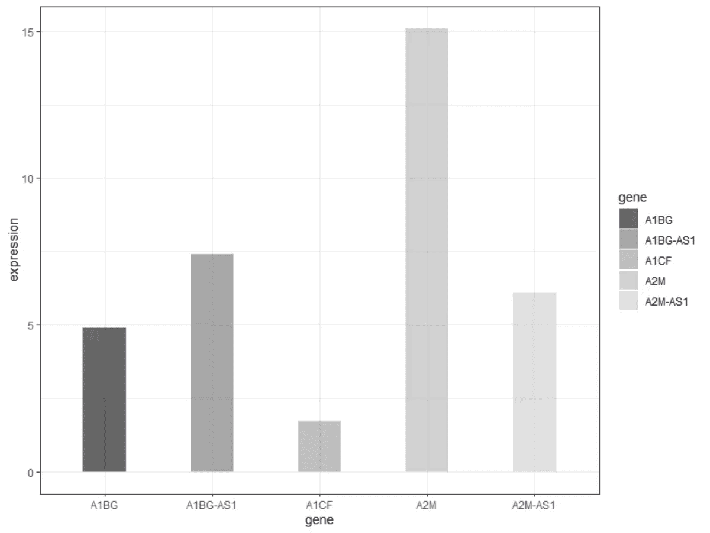
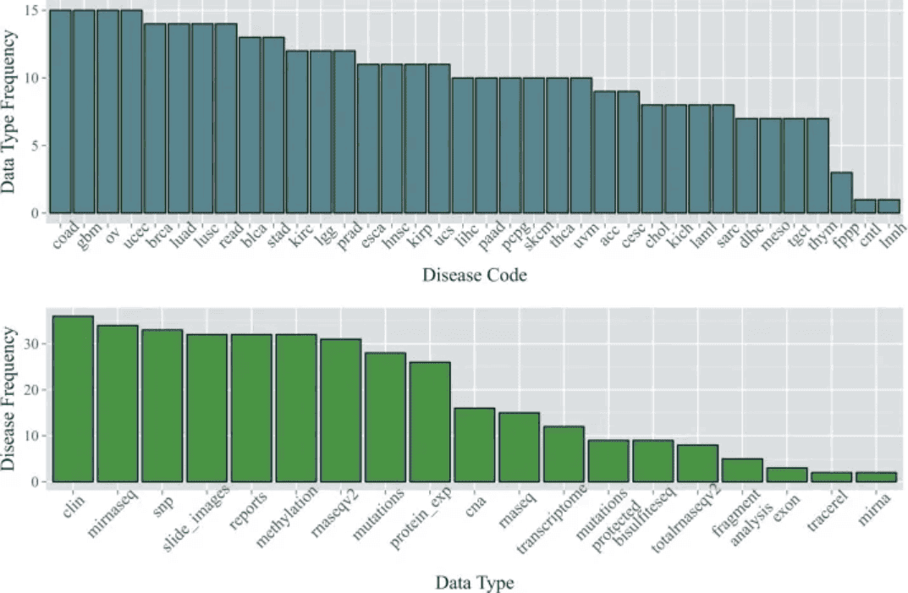
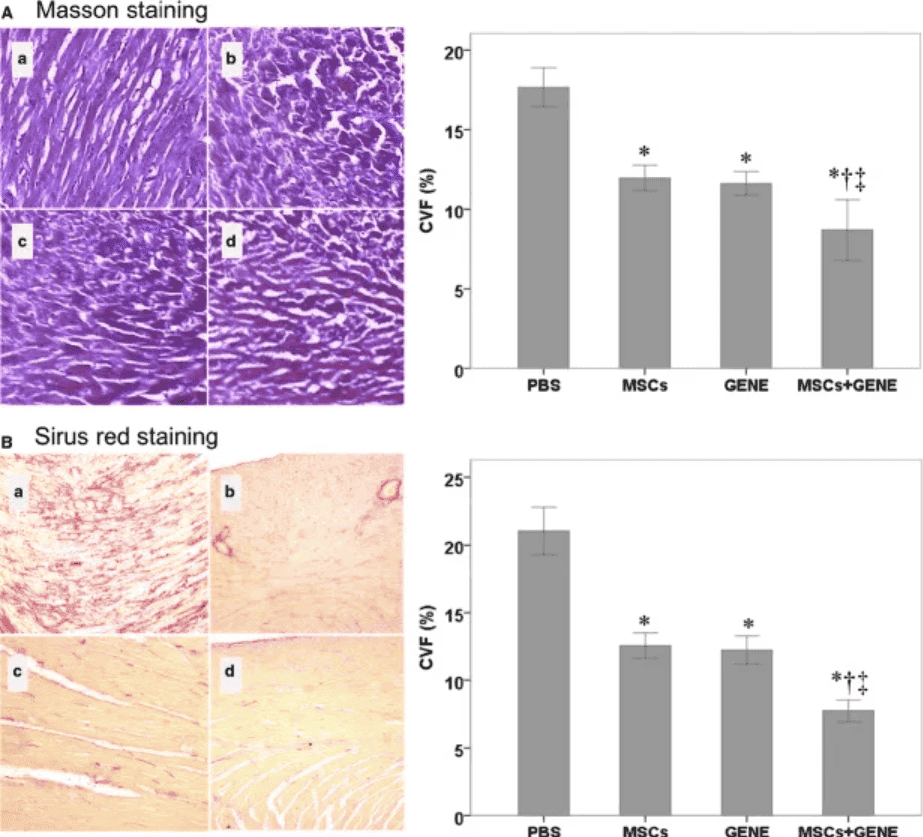
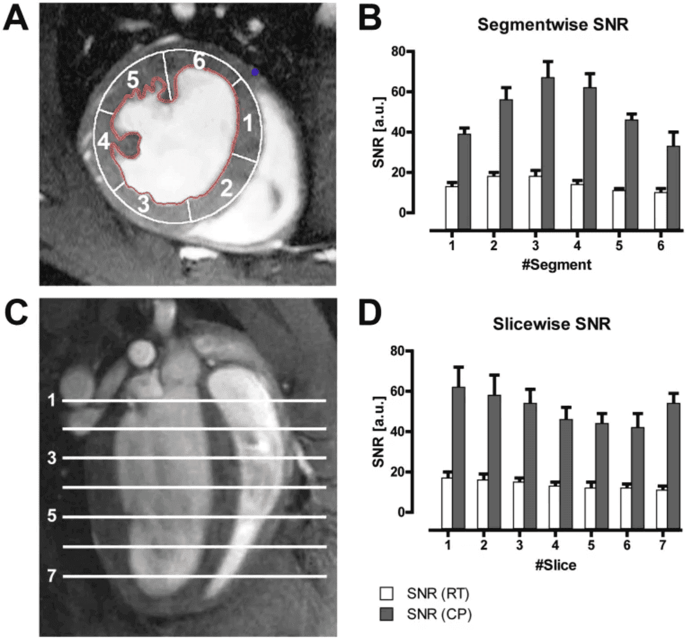

条形图是用条形的高度或长短来表示数据多少的图形。

## 示例

{fig-alt="Bar Plot DEMO" fig-align="center" width="60%"}

正如上图，各组条形分别反映了五种基因的表达情况。

## 环境配置

-   系统要求： 跨平台（Linux/MacOS/Windows）

-   编程语言：R

-   依赖包：`magrittr`; `tidyr`; `ggplot2`; `cowplot`; `forcats`; `dplyr`; `hrbrthemes`; `ggpattern`; `rstatix`; `ggpubr`

```{r packages setup, message=FALSE, warning=FALSE, output=FALSE}
# 安装包
if (!requireNamespace("magrittr", quietly = TRUE)) {
  install.packages("magrittr")
}
if (!requireNamespace("tidyr", quietly = TRUE)) {
  install.packages("tidyr")
}
if (!requireNamespace("ggplot2", quietly = TRUE)) {
  install.packages("ggplot2")
}
if (!requireNamespace("cowplot", quietly = TRUE)) {
  install.packages("cowplot")
}
if (!requireNamespace("forcats", quietly = TRUE)) {
  install.packages("forcats")
}
if (!requireNamespace("dplyr", quietly = TRUE)) {
  install.packages("dplyr")
}
if (!requireNamespace("hrbrthemes", quietly = TRUE)) {
  install.packages("hrbrthemes")
}
if (!requireNamespace("ggpattern", quietly = TRUE)) {
  install.packages("ggpattern")
}
if (!requireNamespace("ggpubr", quietly = TRUE)) {
  install.packages("ggpubr")
}
if (!requireNamespace("rstatix", quietly = TRUE)) {
  install.packages("rstatix")
}
if (!requireNamespace("palmerpenguins", quietly = TRUE)) {
  install.packages("palmerpenguins")
}

# 加载包
library(magrittr)
library(tidyr)
library(ggplot2)
library(cowplot)
library(forcats)
library(dplyr)
library(hrbrthemes)
library(ggpattern)
library(rstatix)
library(ggpubr)
library(palmerpenguins)
```

```{r}
sessioninfo::session_info("attached")
```

## 数据准备

主要利用来自`TCGA`的数据和 R 中自带的数据集进行绘图。

```{r load data}
#| message: false

data_TCGA <- readr::read_csv("https://bizard-1301043367.cos.ap-guangzhou.myqcloud.com/TCGA-BRCA.htseq_counts_processed.csv")

data_TCGA1 <- data_TCGA[1:5,] %>%
  gather(key = "sample",value = "gene_expression",3:1219)

data_tcga_mean <- aggregate(data_TCGA1$gene_expression, 
                            by=list(data_TCGA1$gene_name), mean) #均值
colnames(data_tcga_mean) <- c("gene","expression")

data_tcga_sd <- aggregate(data_TCGA1$gene_expression, 
                            by=list(data_TCGA1$gene_name), sd)
colnames(data_tcga_sd) <- c("gene","sd")

data_tcga <- merge(data_tcga_mean, data_tcga_sd, by="gene")

data_penguins <- penguins

data_penguins_flipper_length <- aggregate(data_penguins$flipper_length_mm,
                                by=list(data_penguins$species,data_penguins$sex),
                                mean)
colnames(data_penguins_flipper_length) <- c("species","sex","flipper_length_mm")

data_mpg <- mpg
```


## 可视化

### 1. 基础条形图

#### 1.1 简单条形图

这里我们以`TCGA`数据库数据为例。

```{r}
#| label: fig-BasicPlot
#| fig-cap: "基础条形图"
#| out.width: "95%"
#| warning: false

# 基础条形图
p <- ggplot(data_tcga_mean, aes(x=gene, y=expression)) + 
  geom_bar(stat = "identity")

p
```

展示了五种基因样本表达的均值。

#### 1.2 水平条形图

利用 `coord_flip()` 翻转坐标轴。

```{r}
#| label: fig-coord_flip
#| fig-cap: "水平条形图"
#| out.width: "95%"
#| warning: false

# 水平条形图
p <- data_tcga_mean %>%
  mutate(gene=fct_reorder(gene,expression)) %>% # fct_reorder排序
  ggplot(aes(x=gene, y=expression)) + 
  geom_bar(stat = "identity",width=0.5)+ # width调整宽度
  coord_flip() # 翻转坐标轴

p
```

#### 1.3 颜色设置

`ggplot2` 可以实现多种颜色设置方式，这里我们提供六个例子。

```{r}
#| label: fig-Color
#| fig-cap: "颜色设置"
#| out.width: "95%"
#| warning: false
#| fig-width: 10
#| fig-height: 8

# 颜色设置
p1 <- ggplot(data_tcga_mean, aes(x=gene, y=expression)) + 
  geom_bar(stat = "identity",color="blue", fill=rgb(0.1,0.4,0.5,0.7))+
  labs(title = "统一颜色")+
  theme(plot.title = element_text(hjust = 0.5)) +
  geom_text(aes(label=round(expression,2)),  #添加数据标签
            position = position_dodge2(width = 0.9, preserve = 'single'), 
    vjust = -0.2, hjust = 0.5) +
  scale_y_continuous(limits = c(0, 17),breaks = seq(0,17,5))

p2 <- ggplot(data_tcga_mean, aes(x=gene, y=expression, fill=gene)) + 
  geom_bar(stat = "identity")+
  scale_fill_hue(c = 40) +
  labs(title = "渐变颜色")+
  theme(plot.title = element_text(hjust = 0.5),
        legend.position="none") +
  geom_text(aes(label=round(expression,2)),  #添加数据标签
            position = position_dodge2(width = 0.9, preserve = 'single'), 
            vjust = -0.2, hjust = 0.5) +
  scale_y_continuous(limits = c(0, 17),breaks = seq(0,17,5))

p3 <- ggplot(data_tcga_mean, aes(x=gene, y=expression, fill=gene)) + 
  geom_bar(stat = "identity")+
  scale_fill_brewer(palette = "Set1")+
  labs(title = "RColorBrewer调色盘1")+
  theme(plot.title = element_text(hjust = 0.5),
        legend.position="none") +
  geom_text(aes(label=round(expression,2)),  #添加数据标签
            position = position_dodge2(width = 0.9, preserve = 'single'), 
            vjust = -0.2, hjust = 0.5) +
  scale_y_continuous(limits = c(0, 17),breaks = seq(0,17,5))

p4 <- ggplot(data_tcga_mean, aes(x=gene, y=expression, fill=gene)) + 
  geom_bar(stat = "identity")+
  scale_fill_brewer(palette = "Set2") +
  labs(title = "RColorBrewer调色盘2")+
  theme(plot.title = element_text(hjust = 0.5),
        legend.position="none") +
  geom_text(aes(label=round(expression,2)),  #添加数据标签
            position = position_dodge2(width = 0.9, preserve = 'single'), 
            vjust = -0.2, hjust = 0.5) +
  scale_y_continuous(limits = c(0, 17),breaks = seq(0,17,5))

p5 <- ggplot(data_tcga_mean, aes(x=gene, y=expression, fill=gene)) + 
  geom_bar(stat = "identity")+
  scale_fill_grey(start = 0.25, end = 0.75) +
  labs(title = "灰度")+
  theme(plot.title = element_text(hjust = 0.5),
        legend.position="none") +
  geom_text(aes(label=round(expression,2)),  #添加数据标签
            position = position_dodge2(width = 0.9, preserve = 'single'), 
            vjust = -0.2, hjust = 0.5) +
  scale_y_continuous(limits = c(0, 17),breaks = seq(0,17,5))


p6 <- ggplot(data_tcga_mean, aes(x=gene, y=expression, fill=gene)) + 
  geom_bar(stat = "identity")+
  scale_fill_manual(values = c("red", "green", "blue","pink","yellow") ) +
  labs(title = "手动设置")+
  theme(plot.title = element_text(hjust = 0.5),
        legend.position="none") +
  geom_text(aes(label=round(expression,2)),  #添加数据标签
            position = position_dodge2(width = 0.9, preserve = 'single'), 
            vjust = -0.2, hjust = 0.5) +
  scale_y_continuous(limits = c(0, 17),breaks = seq(0,17,5))

plot_grid(p1, p2, p3, p4, p5, p6, labels = LETTERS[1:6], ncol = 3)
```

#### 1.4 灰度条形图与纹理条形图

处理颜色的设置，`ggplot2`还可以绘制灰度条形图和纹理条形图。

```{r}
#| label: fig-Grey
#| fig-cap: "灰度条形图"
#| out.width: "95%"
#| warning: false

# 灰度条形图
p <- 
  ggplot(data_tcga_mean, aes(x=gene, y=expression, fill=gene)) +
  geom_bar(stat="identity", alpha=.6, width=.4) +
  scale_fill_grey(start=0, end=0.8) +  # 设置灰度范围
  theme_bw()
p
```

```{r}
#| label: fig-Pattern
#| fig-cap: "纹理条形图"
#| out.width: "95%"
#| warning: false

# 纹理条形图
p <- ggplot(data_tcga_mean, aes(x=gene, y=expression)) +
  geom_col_pattern(
    aes(pattern=gene,
        pattern_angle=gene,
        pattern_spacing=gene
    ), 
    fill            = 'white',
    colour          = 'black', 
    pattern_density = 0.5, 
    pattern_fill    = 'black',
    pattern_colour  = 'darkgrey'
  ) +
  theme_bw()
p
```

::: callout-tip
**关键参数: **

- `fill`：图案后的基础填充颜色
- `colour`：条形的边框颜色
- `pattern_density`：条形内图案的密度
- `pattern_fill`：图案颜色
- `pattern_colour`：图案的辅助色
:::

### 2. 可变宽度条形图

可变宽度条形图实现了样本数量的可视化，用条形宽度来表示样本数量。

```{r}
#| label: fig-Barwidth
#| fig-cap: "可变宽度条形图"
#| out.width: "95%"
#| warning: false

# 可变宽度条形图----
data <- data.frame(
  group=c("A ","B ","C ","D ") , 
  value=c(33,62,56,67) , 
  number_of_obs=c(100,500,459,342)
)

# 设置宽度左右界限
data$right <- cumsum(data$number_of_obs) + 30*c(0:(nrow(data)-1))
data$left <- data$right - data$number_of_obs 

# 绘图
p <- 
  ggplot(data, aes(ymin = 0)) + 
  geom_rect(aes(xmin = left, xmax = right, # 设置宽度上下限
                ymax = value, 
                colour = group, fill = group),alpha=0.8) +
  xlab("number of obs") + 
  ylab("value") +
  theme_ipsum() +
  scale_fill_brewer(palette = "Set1") +
  theme(legend.position="none") 
p
```

上图用条形宽度展示了样本量。

### 3. 误差线条形图

条形图允许添加误差线，我们可以通过 `geom_errorbar` 实现。

#### 3.1 基础误差线条形图

```{r}
#| label: fig-BasicErrorbar
#| fig-cap: "基础误差线条形图"
#| out.width: "95%"
#| warning: false

# 基础误差条形图
p <- 
  ggplot(data_tcga) +
  geom_bar( aes(x=gene, y=expression), stat="identity", fill="skyblue", alpha=0.7) +
  geom_errorbar(aes(x=gene, 
                    ymin=expression-sd, ymax=expression+sd), 
                width=0.4, colour="orange", alpha=0.9, size=1) +
  labs(title = "基础误差条形图") +
  theme(plot.title = element_text(hjust = 0.5))
p
```

上图在展示各基因表达量的同时添加了标准差误差线。

#### 3.2 多种类型误差线条形图

同时，`ggplot2`提供了多种误差线的类型，这里我们提供四种示例。

```{r}
#| label: fig-MultiErrorbar
#| fig-cap: "多种类型误差线条形图"
#| out.width: "95%"
#| warning: false
#| fig-width: 10
#| fig-height: 10

# 误差线条形图（以标准差为例）----
## 多种类型误差条形图
p1 <- ggplot(data_tcga) +
  geom_bar( aes(x=gene, y=expression), stat="identity", fill="skyblue", alpha=0.7) +
  geom_crossbar( aes(x=gene, y=expression, 
                     ymin=expression-sd, ymax=expression+sd), 
                 width=0.4, colour="orange", alpha=0.9, size=1.3) +
  labs(title = "箱形误差条形图")+
  theme(plot.title = element_text(hjust = 0.5))

p2 <- ggplot(data_tcga) +
  geom_bar( aes(x=gene, y=expression), stat="identity", fill="skyblue", alpha=0.7) +
  geom_linerange( aes(x=gene, 
                      ymin=expression-sd, ymax=expression+sd), 
                  colour="orange", alpha=0.9, size=1.3) +
  labs(title = "线形误差条形图")+
  theme(plot.title = element_text(hjust = 0.5))


p3 <- ggplot(data_tcga) +
  geom_bar( aes(x=gene, y=expression), stat="identity", fill="skyblue", alpha=0.7) +
  geom_pointrange( aes(x=gene, y=expression, 
                       ymin=expression-sd, ymax=expression+sd), 
                   colour="orange", alpha=0.9, size=1) +
  labs(title = "线+点型误差条形图")+
  theme(plot.title = element_text(hjust = 0.5))


p4 <- ggplot(data_tcga) +
  geom_bar( aes(x=gene, y=expression), stat="identity", fill="skyblue", alpha=0.7) +
  geom_errorbar( aes(x=gene, ymin=expression-sd, ymax=expression+sd), 
                 width=0.4, colour="orange", alpha=0.9, size=1.3) +
  coord_flip() +
  labs(title = "水平误差条形图")+
  theme(plot.title = element_text(hjust = 0.5))

plot_grid(p1, p2, p3, p4, labels = LETTERS[1:4], ncol = 2)
```

#### 3.3 添加差异分析

```{r}
#| label: fig-pvalue
#| fig-cap: "添加差异分析"
#| out.width: "95%"
#| warning: false

# 添加差异分析
data_tcga_p <- filter(data_TCGA1,
                      gene_name == "A1BG" | gene_name == "A1CF" | gene_name == "A2M")

data_tcga_plot <- filter(data_tcga,
                         gene == "A1BG" | gene == "A1CF" | gene == "A2M")

# 组间p值计算
df_p_val <- data_tcga_p %>% 
  wilcox_test(formula = gene_expression~gene_name) %>% 
  add_significance(p.col = 'p',cutpoints = c(0,0.001,0.01,0.05,1),symbols = c('***','**','*','ns')) %>% 
  add_xy_position()

p <- 
  ggplot(data_tcga_plot) +
  geom_bar( aes(x=gene, y=expression), stat="identity", fill="skyblue", alpha=0.7) +
  geom_errorbar( aes(x=gene, 
                     ymin=expression-sd, ymax=expression+sd), 
                 width=0.4, colour="orange", alpha=0.9, size=1) +
  stat_pvalue_manual(df_p_val,label = '{p.signif}', #添加差异分析线
                     tip.length = 0.01,
                     y.position = c(15,17,19)) +
  labs(title = "添加差异分析") +
  theme(plot.title = element_text(hjust = 0.5))
p
```

上图添加了三种基因表达数据的差异分析线。

### 4. 堆积条形图

在包含组内分组时，我们可以选择绘制堆积条形图。

以`penguins`数据集为例。

```{r}
#| label: fig-stack
#| fig-cap: "堆积条形图"
#| out.width: "95%"
#| warning: false

# 堆积条形图----
p <- 
  ggplot(data_penguins_flipper_length,aes(x=species,y=flipper_length_mm,fill=sex))+
  geom_bar(stat="identity",  
           position = position_stack(reverse = TRUE))+ #改变堆积顺序
  guides(fill=guide_legend(reverse = TRUE)) + #改变图例顺序
  scale_fill_manual(values = c("#87CEFA","#8DB6CD"))
p
```

展示了不同性别企鹅翅膀长度的堆积条形图。

### 5. 百分比条形图

同样的，在进行比例分析时还可以选择绘制百分比条形图。

```{r}
#| label: fig-percent
#| fig-cap: "百分比条形图"
#| out.width: "95%"
#| warning: false

# 百分比条图----
p <- 
  ggplot(data_mpg,aes(class))+
  geom_bar(aes(fill = drv), 
           position = 'fill') + #绘制百分占比
  scale_fill_manual(values = c("#87CEFA","#8DB6CD","#84B6BD"))
p
```

上图展示了各车型中驱动类型（四轮驱动、前轮驱动、后轮驱动）的百分比例。

### 6. 并列条形图

在包含组内分组时，我们还可以通过设置 `position` 参数来绘制并列条形图。

```{r}
#| label: fig-dodge2
#| fig-cap: "并列条形图"
#| out.width: "95%"
#| warning: false

# 并列条形图----
p <- 
  ggplot(data_mpg,aes(class)) +
  geom_bar(aes(fill = drv), 
           position = position_dodge2(preserve = 'single')) +
  scale_fill_manual(values = c("#87CEFA","#8DB6CD","#84B6BD"))
p
```

### 7. 条形图的变形

#### 7.1 金字塔图

```{r}
#| label: fig-Pyramid
#| fig-cap: "金字塔图"
#| out.width: "95%"
#| warning: false

df <- tibble(
  gene = factor(paste0("gene_", rep(1:16, 2)), levels = paste0("gene_", 16:1)),
  stat = c(seq(-10, -100, -10), seq(-90, -40, 10), seq(10, 100, 10), seq(90, 40, -10)),
  direct = rep(c("down", "up"), each=16)
)

p <- 
  ggplot(df, aes(gene, stat, fill = direct)) + 
  geom_col() +
  coord_flip() + 
  scale_y_continuous(breaks = seq(-100, 100, 20),
                     labels = c(seq(100, 0, -20), seq(20, 100, 20)))
p
```

#### 7.2 偏差图

```{r}
#| label: fig-Deviation
#| fig-cap: "偏差图"
#| out.width: "95%"
#| warning: false

# 偏差图
df <- tibble(
  gene = factor(paste0("gene_", 1:20), levels = paste0("gene_", 20:1)),
  stat = c(seq(100, 10, -10), seq(-10, -100, -10)),
  direct = factor(rep(c("up", "down"), each=10), levels = c("up", "down"))
)

p <- 
  ggplot(df, aes(gene, stat, fill = direct)) + 
  geom_col() +
  coord_flip()
p
```

### 8. 多组柱形图 + 亚组渐变色

参考图编码了**三级分组**：大组（颜色）、组内亚组（同色渐变浅色）、误差条（mean ± SE）\[13\]。渐变效果通过在每大组基色内按亚组序号赋予浅色调实现。

```{r}
#| label: fig-8.1SubgroupGradient
#| fig-cap: "多组柱形图 + 亚组渐变色填充、误差条（mean ± SE）。"
#| out.width: "85%"
#| warning: false
#| message: false
#| fig-width: 9
#| fig-height: 5.5

set.seed(2101)
major <- c("Group A", "Group B", "Group C")
subgrp <- list(c("A1", "A2", "A3"), c("B1", "B2"), c("C1", "C2", "C3"))
base_col <- c("Group A" = "#2874C5", "Group B" = "#B2182B", "Group C" = "#4D9342")

df_b <- do.call(rbind, lapply(seq_along(major), function(k) {
  do.call(rbind, lapply(seq_along(subgrp[[k]]), function(j) {
    n <- 25
    val <- rnorm(n, mean = 20 + k * 8 + j * 2, sd = 5)
    data.frame(major = major[k], subgroup = subgrp[[k]][j], value = val)
  }))
}))
summ_b <- df_b |>
  group_by(major, subgroup) |>
  summarise(mean = mean(value), se = sd(value) / sqrt(n()), .groups = "drop")

major_of <- setNames(rep(major, sapply(subgrp, length)), unlist(subgrp))
summ_b$major_col <- base_col[major_of[summ_b$subgroup]]
shade_fac <- c(0.5, 0.75, 1.0)
summ_b$idx <- as.integer(factor(summ_b$subgroup, levels = unlist(subgrp)))
summ_b$shade <- shade_fac[summ_b$idx]

subgroup_cols <- c(
  "A1" = "#7BA7D6", "A2" = "#5288CC", "A3" = "#2874C5",
  "B1" = "#CE6B6B", "B2" = "#B2182B",
  "C1" = "#7BC17B", "C2" = "#4D9342", "C3" = "#3D7A35")

ggplot(summ_b, aes(subgroup, mean, fill = subgroup)) +
  geom_col(width = 0.7) +
  geom_errorbar(aes(ymin = mean - se, ymax = mean + se), width = 0.2, linewidth = 0.5) +
  scale_fill_manual(values = subgroup_cols) +
  labs(x = NULL, y = "Mean ± SE") +
  theme_classic(base_size = 11) +
  theme(axis.text.x = element_text(angle = 30, hjust = 1))
```

::: callout-tip
**实践要点**

-   渐变浅色按亚组序号取自大组基色（此处为硬编码的显式 hex；亚组多时可用 `colorRampPalette(c(浅色, 基色))(n)` 自行派生）——将每个亚组视觉上关联到大组颜色。
-   `se = sd / sqrt(n)` 误差条是均值比较的标准；部分期刊要求用 `sd` 而非 `se`——查阅作者指南。
-   组内比较括号可用 `ggsignif::geom_signif(comparisons = list(c("A1", "A2")))` 叠加在柱上。
:::

### 9. 细胞类型比例柱形图 + 分簇 Fisher 事后检验

单细胞研究常用"每个簇在各条件中的细胞占比"概括组成变化。参考工作流 \[13\] 绘制堆积比例柱形图，对整个 簇 × 条件 列联表做 Fisher 精确检验，再用 one-vs-rest 事后检验回答*哪个*簇驱动了差异：`rstatix::row_wise_fisher_test()` 对每个簇做一次"该簇 vs 其余"的 Fisher 检验，并对 8 个 p 值做 BH 校正。

```{r}
#| label: fig-9.1CellPropSig
#| fig-cap: "各簇细胞组成（WT 与 KO，模拟数据）。星号为各簇 BH 校正后的 one-vs-rest Fisher 检验；对完整表的整体 Fisher 精确检验 p < 0.0001（Monte-Carlo，B = 10^5）。"
#| out.width: "95%"
#| warning: false
#| message: false
#| fig-width: 9.5
#| fig-height: 5.5

set.seed(2900)
clusters <- paste0("C", 1:8)
p0 <- c(0.18, 0.16, 0.14, 0.12, 0.11, 0.10, 0.10, 0.09)
# KO 比例：无效应簇严格保持 p0，仅在 C2/C6/C8 之间重新分配
p_ko <- p0
p_ko[2] <- 0.05; p_ko[6] <- 0.22; p_ko[8] <- 0.08
stopifnot(abs(sum(p_ko) - 1) < 1e-12)
n_wt <- 900; n_ko <- 900
mk_cells <- function(n, p, grp) {
  data.frame(cluster = sample(clusters, n, replace = TRUE, prob = p),
             group = grp,
             run = sample(c("R1", "R2"), n, replace = TRUE))
}
cellinfo <- rbind(mk_cells(n_wt, p0, "WT"), mk_cells(n_ko, p_ko, "KO"))
cellinfo$cluster <- factor(cellinfo$cluster, levels = clusters)

tbl <- table(cellinfo$cluster, cellinfo$group)
ft <- fisher.test(tbl, simulate.p.value = TRUE, B = 1e5)
post <- rstatix::row_wise_fisher_test(tbl)

cell.col <- c(WT = "#1A63A8", KO = "#FC6910")
prop_df <- as.data.frame(tbl, stringsAsFactors = FALSE)
colnames(prop_df) <- c("cluster", "group", "n")
prop_df$cluster <- factor(prop_df$cluster, levels = clusters)
prop_df$group <- factor(prop_df$group, levels = c("WT", "KO"))
sig_df <- as.data.frame(post)
sig_df$cluster <- factor(sig_df$group, levels = clusters)
sig_df$lab <- ifelse(sig_df$p.adj.signif == "ns", "", sig_df$p.adj.signif)

ggplot(prop_df, aes(cluster, n, fill = group)) +
  geom_col(stat = "identity", position = "fill", width = 0.72,
           colour = "grey25", linewidth = 0.2) +
  geom_text(data = sig_df, aes(x = cluster, y = 1.05, label = lab),
            inherit.aes = FALSE, size = 4.4, colour = "grey10") +
  scale_fill_manual(values = cell.col, name = NULL) +
  scale_y_continuous(breaks = seq(0, 1, 0.25), labels = scales::percent,
                     expand = expansion(mult = c(0, 0.1))) +
  labs(x = "Cluster", y = "Fraction of cells",
       title = "Cell-type composition per cluster (KO vs WT)") +
  theme_classic(base_size = 12) +
  theme(legend.position = "top", plot.title = element_text(size = 11))
```

按测序批次（重复）分面可以观察组成变化是可复现的还是单批次假象——参考图第一面板的版式 \[13\]：

```{r}
#| label: fig-9.2CellPropRep
#| fig-cap: "按测序重复分面的同一组成图：耗竭（C2）与富集（C6）在两批间保持一致。"
#| out.width: "100%"
#| warning: false
#| message: false
#| fig-width: 12
#| fig-height: 3.8

# same cells as the chunk above, now split by sequencing run
ggplot(cellinfo, aes(run, fill = group)) +
  geom_bar(position = "fill", width = 0.85, colour = "grey25", linewidth = 0.2) +
  facet_wrap(~cluster, nrow = 1) +
  scale_fill_manual(values = cell.col, name = NULL) +
  scale_y_continuous(breaks = seq(0, 1, 0.5), labels = scales::percent) +
  labs(x = "Replicate", y = "Fraction of cells") +
  theme_classic(base_size = 11) +
  theme(strip.background = element_rect(fill = "grey88", colour = NA),
        strip.text = element_text(face = "bold"),
        legend.position = "top",
        axis.text.x = element_text(angle = 45, hjust = 1))
```

::: callout-tip
**实践要点**

-   `row_wise_fisher_test()` 要求列联表以类别为行、组为列；其 `group` 列是行名，`p.adj`/`p.adj.signif` 是 BH 校正结果——绘图请用 `p.adj.signif` 的星号，不要用原始 p 值。
-   大 N 时 `fisher.test(..., simulate.p.value = TRUE)` 不可能返回小于 Monte-Carlo 地板 `1/(B + 1)` 的 p 值；此类结果应报告为 `p < 1/(B+1)`（此处 B = 10^5 即 `p < 0.0001`），不要照抄地板数值本身。
-   保持两组样本量均衡：组总量不等时，每个无效应簇都会带上微小的系统性偏移，可能被分簇检验判为显著。
:::

### 10. 渐变填充柱形图（ggpattern）

演示级图表有时用"办公软件式"渐变填充替代纯色——参考图 \[13\] 对每个区段使用双色调渐变。`ggpattern::geom_col_pattern()` 用 `pattern = "gradient"` 与两个端点色 `pattern_fill` / `pattern_fill2` 实现；`pattern_orientation = "radial"` 从区段中心向外辐射：

```{r}
#| label: fig-10.1RadialGradient
#| fig-cap: "径向渐变柱：深色的转移癌区段承载白色百分比标签；数值为模拟的患病率数据。"
#| out.width: "85%"
#| warning: false
#| message: false
#| fig-width: 7.5
#| fig-height: 5.2

set.seed(2970)
df_d <- data.frame(
  Country = c("Japan", "USA", "England", "S. Korea", "China", "France", "Germany", "Australia"),
  Metastatic = c(19, 24, 28, 33, 36, 31, 22, 27),
  Localized = c(81, 76, 72, 67, 64, 69, 78, 73))
df_d$ID <- seq_len(nrow(df_d))
maxID <- nrow(df_d)

plot.df.all <- reshape2::melt(df_d, id.var = c("Country", "ID"),
                              value.name = "Percentage", variable.name = "Type")
plot.df <- subset(plot.df.all, Type %in% c("Metastatic", "Localized"))
plot.df1 <- subset(plot.df, Type == "Metastatic")
type.color.1 <- c('#dbeffc', '#7bb8e5')   # 浅色区段（Localized）
type.color.2 <- c('#a7d7f3', '#0079bb')   # 深色区段（Metastatic）
barwidth <- 0.44

ggplot() +
  geom_col_pattern(data = plot.df, mapping = aes(ID, Percentage),
                   width = barwidth, position = "stack",
                   pattern = 'gradient', pattern_orientation = "radial",
                   pattern_fill = type.color.1[1], pattern_fill2 = type.color.1[2],
                   fill = NA) +
  geom_col_pattern(data = plot.df1, mapping = aes(ID, Percentage),
                   width = barwidth,
                   pattern = 'gradient', pattern_orientation = "radial",
                   pattern_fill = type.color.2[1], pattern_fill2 = type.color.2[2],
                   fill = NA) +
  geom_text(data = plot.df1, mapping = aes(x = ID, y = Percentage * 0.22,
                                           label = paste0(Percentage, " %")),
            size = 2.6, color = "white") +
  scale_x_continuous(breaks = seq(1, maxID, 1),
                     labels = stringr::str_wrap(plot.df1$Country, 9)) +
  scale_y_continuous(limits = c(0, 100), breaks = seq(0, 100, 10), expand = c(0, 0)) +
  labs(x = NULL, y = "Prevalence (%)") +
  theme_bw(base_size = 11) +
  theme(panel.grid.major.x = element_blank(), panel.grid.minor = element_blank(),
        panel.border = element_blank(), axis.line = element_line(colour = 'black'),
        axis.text = element_text(colour = 'black', size = 9))
```

水平渐变需要一个技巧：ggpattern 只能沿一个方向在两色间插值，因此参考图把每根柱拆成左右两半并镜像渐变，形成中心对称的浅色条纹，再用 `geom_rect()` 补黑色描边：

```{r}
#| label: fig-10.2HorizontalGradient
#| fig-cap: "水平渐变柱：由镜像的左右两半拼装，区段带黑色描边（ggpattern）。"
#| out.width: "85%"
#| warning: false
#| message: false
#| fig-width: 7.5
#| fig-height: 5.2

barwidth2 <- 0.22
ggplot() +
  geom_col_pattern(data = plot.df, mapping = aes(ID - barwidth2 / 2 + 0.002, Percentage),
                   width = barwidth2, position = "stack",
                   pattern = 'gradient', pattern_orientation = "horizontal",
                   pattern_fill = type.color.1[2], pattern_fill2 = type.color.1[1], fill = NA) +
  geom_col_pattern(data = plot.df, mapping = aes(ID + barwidth2 / 2 - 0.002, Percentage),
                   width = barwidth2, position = "stack",
                   pattern = 'gradient', pattern_orientation = "horizontal",
                   pattern_fill = type.color.1[1], pattern_fill2 = type.color.1[2], fill = NA) +
  geom_col_pattern(data = plot.df1, mapping = aes(ID - barwidth2 / 2 + 0.002, Percentage),
                   width = barwidth2,
                   pattern = 'gradient', pattern_orientation = "horizontal",
                   pattern_fill = type.color.2[2], pattern_fill2 = type.color.2[1], fill = NA) +
  geom_col_pattern(data = plot.df1, mapping = aes(ID + barwidth2 / 2 - 0.002, Percentage),
                   width = barwidth2,
                   pattern = 'gradient', pattern_orientation = "horizontal",
                   pattern_fill = type.color.2[1], pattern_fill2 = type.color.2[2], fill = NA) +
  geom_rect(data = plot.df1,
            mapping = aes(xmin = ID - barwidth2, xmax = ID + barwidth2,
                          ymin = 0, ymax = Percentage),
            linewidth = 0.3, fill = NA, color = "black") +
  geom_rect(data = df_d,
            mapping = aes(xmin = ID - barwidth2, xmax = ID + barwidth2,
                          ymin = Metastatic, ymax = 100),
            linewidth = 0.3, fill = NA, color = "black") +
  geom_text(data = plot.df1, mapping = aes(x = ID, y = Percentage * 0.22,
                                           label = paste0(Percentage, " %")),
            size = 2.6, color = "white") +
  scale_x_continuous(breaks = seq(1, maxID, 1),
                     labels = stringr::str_wrap(plot.df1$Country, 9)) +
  scale_y_continuous(limits = c(0, 100), breaks = seq(0, 100, 10), expand = c(0, 0)) +
  labs(x = NULL, y = "Prevalence (%)") +
  theme_bw(base_size = 11) +
  theme(panel.grid.major.x = element_blank(), panel.grid.minor = element_blank(),
        panel.border = element_blank(), axis.line = element_line(colour = 'black'),
        axis.text = element_text(colour = 'black', size = 9))
```

::: callout-tip
**实践要点**

-   `pattern_fill`/`pattern_fill2` 只是渐变的两个端点——三色渐变超出其能力范围；更多色阶需手动用 `colorRampPalette()` 构造。
-   渐变是纯装饰：它不编码柱高之外的任何信息。面向审稿人的图请用纯色填充，渐变留给幻灯片和封面。
-   白色标签在深色端点上清晰，在 `pattern_fill2` 的浅色中心上不行——把标签锚定在较深的部分，或给文字加描边。
:::

### 11. 参考线柱形图与发散式灰/彩柱形图

FigureYa39bar 的两种论文版式 \[13\]。第一种（NEJM 瀑布风格）给**每个癌种一种颜色**、在临床有意义的值处画虚线参考线（RECIST 边界 −30 与 +20，加零线），当一根柱远高于其余时——用 `coord_cartesian()` 裁剪 y 轴并在柱上标出真实值：

```{r}
#| label: fig-11.1ResponseBars
#| fig-cap: "模拟的各癌种最佳肿瘤响应瀑布图：每癌种一色，-30/0/+20 处的 RECIST 虚线参考线；y 轴截断于 50，超出的柱标注真实值。"
#| out.width: "85%"
#| warning: false
#| message: false
#| fig-width: 8.5
#| fig-height: 5.5

set.seed(3901)
df1 <- data.frame(ID = c("NSCLC", "CRC", "Melanoma", "RCC", "HNSCC", "Breast",
                         "Ovarian", "Prostate", "Pancreas", "HCC", "Cervix", "Sarcoma"),
                  score = c(-58, -46, -39, -33, -28, -22, -18, -12, 8, 14, 19, 62))
df1 <- df1[order(df1$score, decreasing = TRUE), ]
df1$index <- seq_len(nrow(df1))

ggplot(df1, aes(index, score, fill = ID)) +
  geom_col(width = 0.8) +
  scale_fill_brewer(type = "Qualitative", palette = "Paired") +
  scale_y_continuous(breaks = seq(-100, 100, 10), expand = c(0, 0)) +
  scale_x_continuous(expand = expansion(mult = c(0.01, 0))) +
  geom_hline(yintercept = c(-30, 0, 20), linetype = 5, linewidth = 0.3) +
  coord_cartesian(ylim = c(-90, 50)) +
  geom_text(data = subset(df1, score > 50),
            aes(index, 48, label = round(score)), size = 3.2) +
  labs(x = NULL, y = "Maximum change in tumour size (%)",
       title = "Response by tumour type (one colour per type)") +
  theme_bw(base_size = 11) +
  theme(panel.grid = element_blank(), panel.border = element_blank(),
        axis.line = element_line(colour = "black"),
        axis.line.x = element_blank(), axis.ticks.x = element_blank(),
        axis.text.x = element_blank(),
        legend.position = "bottom") +
  guides(fill = guide_legend(ncol = 4, title = NULL, override.aes = list(size = 3)))
```

第二种（Nature Medicine 富集风格）把带符号的 GSVA 风格 t 值画成**水平发散柱**，名字贴在每根柱旁，|t| 低于显著性阈值显示灰色，只有显著的才有颜色：

```{r}
#| label: fig-11.2DivergingBars
#| fig-cap: "发散式 GSVA 风格 t 值柱（内皮细胞，肿瘤 vs 非肿瘤，模拟）：超过 |t| = 4 的柱按方向着色，其余灰色；名字贴在柱旁。"
#| out.width: "65%"
#| warning: false
#| message: false
#| fig-width: 5.5
#| fig-height: 7.5

df2 <- data.frame(ID = c("VEGFA", "ANGPT2", "CXCL8", "PDGFB", "MMP9", "TNFSF15",
                         "ANGPT1", "TEK", "NID2", "COL4A1", "LAMA4", "SPARCL1",
                         "KDR", "PECAM1", "VWF", "CDH5"),
                  score = c(7.2, 5.8, 4.9, 4.1, 3.4, -2.6, -3.3, -4.2, -5.1,
                            -6.3, 2.4, 1.8, 3.1, 2.8, -1.6, 1.2))
df2$group <- cut(df2$score, breaks = c(-Inf, -4, 4, Inf), labels = c(1, 2, 3))
df2 <- df2[order(df2$score, decreasing = FALSE), ]
df2$index <- seq_len(nrow(df2))

ggplot(df2, aes(index, score, fill = group)) +
  geom_col(width = 0.8) +
  scale_fill_manual(values = c("palegreen3", "snow3", "dodgerblue4")) +
  scale_x_continuous(expand = expansion(add = 0.6)) +
  scale_y_continuous(breaks = seq(-30, 20, 5)) +
  coord_flip() +
  geom_hline(yintercept = c(-4, 4), colour = "white", linetype = 2, linewidth = 0.3) +
  geom_text(data = subset(df2, score > 0),
            aes(index, -0.3, label = ID, colour = group), size = 3, hjust = "inward") +
  geom_text(data = subset(df2, score < 0),
            aes(index, 0.3, label = ID, colour = group), size = 3, hjust = "outward") +
  scale_colour_manual(values = c("snow3", "black", "black")) +
  labs(x = NULL, y = "t value of GSVA score, tumour vs non-malignant",
       title = "Endothelial cells, tumour vs non-malignant") +
  theme_bw(base_size = 11) +
  theme(panel.grid = element_blank(),
        panel.border = element_rect(linewidth = 0.6, fill = NA),
        axis.line.y = element_blank(), axis.ticks.y = element_blank(),
        axis.text.y = element_blank()) +
  guides(fill = "none", colour = "none")
```

::: callout-tip
**实践要点**

-   `coord_cartesian(ylim = ...)` 裁的是*绘图*而非数据——高柱保持完整的 `geom_col` 高度，只有标签揭示真实值；`scale_y_continuous(limits = ...)` 则会把柱整根丢弃。
-   发散版式里名字住在柱的**空白半区**（按符号取 hjust "inward"/"outward"），无需单独的轴标签；非显著用灰色把颜色预算留给发现。
-   社区公认边界（RECIST ±30/+20）处的参考线带有网格线没有的含义——请在图注中引用其出处。
:::

## 应用场景

### 1. 基础条形图

::: {#fig-BarPlotApplications}
{fig-alt="BarPlotApp1" fig-align="center" width="60%"}

基础条形图应用
:::

数据来自TCGA数据库。顶部的条形图显示了截至2015年1月36种癌症类型中每种癌症类型的可用数据类型数量；下方的条形图显示了每种数据类型可用的癌症类型的数量。\[1\]

### 2. 误差线条形图

::: {#fig-BarPlotApplications}
{fig-alt="BarPlotApp2" fig-align="center" width="60%"}

误差线条形图应用
:::

(A)为大面积染色PBS、MSC、GENE、MSC +GENE各组胶原体积分数的条形图；(B)为天狼星红染色PBS、MSC、GENE、MSC +GENE各组胶原体积分数的条形图。\[2\]

### 3. 并列条形图

::: {#fig-BarPlotApplications}
{fig-alt="BarPlotApp3" fig-align="center" width="60%"}

并列条形图应用
:::

上图 B 展示了使用CryoProbe（CP）或 room temperature coil（RT）采集的六节段模型（A）中不同节段中所有小鼠的平均LV心肌信号噪比（SNR）；图D展示了不同切片中所有小鼠的平均LV心肌SNR。\[3\]

## 参考文献

\[1\] Kannan L, Ramos M, Re A, El-Hachem N, Safikhani Z, Gendoo DM, Davis S, Gomez-Cabrero D, Castelo R, Hansen KD, Carey VJ, Morgan M, Culhane AC, Haibe-Kains B, Waldron L. Public data and open source tools for multi-assay genomic investigation of disease. Brief Bioinform. 2016 Jul;17(4):603-15. doi: 10.1093/bib/bbv080. Epub 2015 Oct 12. PMID: 26463000; PMCID: PMC4945830.

\[2\] Yu Q, Fang W, Zhu N, Zheng X, Na R, Liu B, Meng L, Li Z, Li Q, Li X. Beneficial effects of intramyocardial mesenchymal stem cells and VEGF165 plasmid injection in rats with furazolidone induced dilated cardiomyopathy. J Cell Mol Med. 2015 Aug;19(8):1868-76. doi: 10.1111/jcmm.12558. Epub 2015 Mar 5. PMID: 25753859; PMCID: PMC4549037.

\[3\] Wagenhaus B, Pohlmann A, Dieringer MA, Els A, Waiczies H, Waiczies S, Schulz-Menger J, Niendorf T. Functional and morphological cardiac magnetic resonance imaging of mice using a cryogenic quadrature radiofrequency coil. PLoS One. 2012;7(8):e42383. doi: 10.1371/journal.pone.0042383. Epub 2012 Aug 1. PMID: 22870323; PMCID: PMC3411643.

\[4\] Bache S, Wickham H (2022). magrittr: A Forward-Pipe Operator for R. R package version 2.0.3, https://CRAN.R-project.org/package=magrittr.

\[5\] Wickham H, Vaughan D, Girlich M (2024). tidyr: Tidy Messy Data. R package version 1.3.1, https://CRAN.R-project.org/package=tidyr.

\[6\] H. Wickham. ggplot2: Elegant Graphics for Data Analysis. Springer-Verlag New York, 2016.

\[7\] Wilke C (2024). cowplot: Streamlined Plot Theme and Plot Annotations for 'ggplot2'. R package version 1.1.3, https://CRAN.R-project.org/package=cowplot.

\[8\] Wickham H (2023). forcats: Tools for Working with Categorical Variables (Factors). R package version 1.0.0, https://CRAN.R-project.org/package=forcats.

\[9\] Wickham H, François R, Henry L, Müller K, Vaughan D (2023). dplyr: A Grammar of Data Manipulation. R package version 1.1.4, https://CRAN.R-project.org/package=dplyr.

\[10\] Rudis B (2024). hrbrthemes: Additional Themes, Theme Components and Utilities for 'ggplot2'. R package version 0.8.7, https://CRAN.R-project.org/package=hrbrthemes.

\[11\] FC M, Davis T, ggplot2 authors (2024). ggpattern: 'ggplot2' Pattern Geoms. R package version 1.1.1, https://CRAN.R-project.org/package=ggpattern.

\[12\] Kassambara A (2023). rstatix: Pipe-Friendly Framework for Basic Statistical Tests. R package version 0.7.2, https://CRAN.R-project.org/package=rstatix.

\[13\] Xiaofan Lu, et al. FigureYa: A Standardized Visualization Framework for Enhancing Biomedical Data Interpretation and Research Efficiency. iMetaMed. 2025. doi:10.1002/imm3.70005
