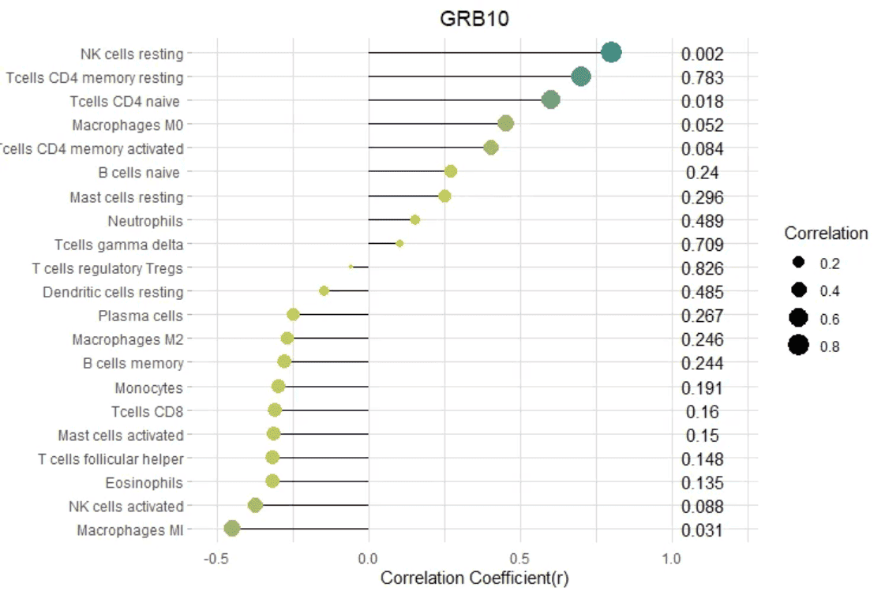
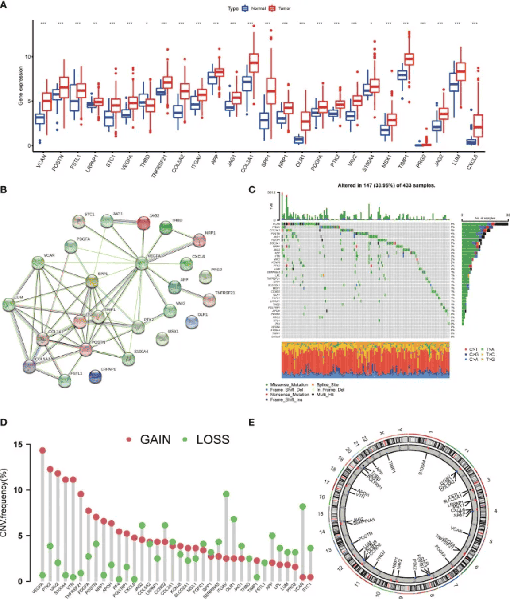
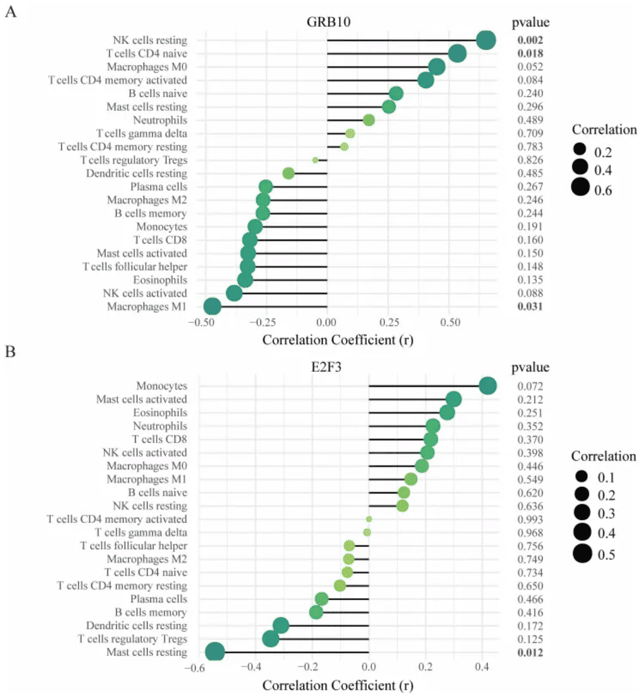

A lollipop plot is a variation of a bar chart and a scatter plot. It consists of a line segment and a point, which can clearly display data while reducing the amount of graphics. At the same time, the lollipop plot can help align values with categories and is very suitable for comparing the differences between values of multiple categories.

## Example

{fig-alt="Lollipop DEMO" fig-align="center" width="60%"}

## Setup

-   System Requirements: Cross-platform (Linux/MacOS/Windows)

-   Programming Language: R

-   Dependencies: `ggplot2`; `tidyr`; `palmerpenguins`; `cowplot`; `hrbrthemes`; `ggalt`; `rstatix`; `ggpubr`

```{r packages setup, message=FALSE, warning=FALSE, output=FALSE}
# Install packages
if (!requireNamespace("ggplot2", quietly = TRUE)) {
  install.packages("ggplot2")
}
if (!requireNamespace("tidyr", quietly = TRUE)) {
  install.packages("tidyr")
}
if (!requireNamespace("palmerpenguins", quietly = TRUE)) {
  install.packages("palmerpenguins")
}
if (!requireNamespace("cowplot", quietly = TRUE)) {
  install.packages("cowplot")
}
if (!requireNamespace("hrbrthemes", quietly = TRUE)) {
  install.packages("hrbrthemes")
}
if (!requireNamespace("ggalt", quietly = TRUE)) {
  install.packages("ggalt")
}
if (!requireNamespace("rstatix", quietly = TRUE)) {
  install.packages("rstatix")
}
if (!requireNamespace("ggpubr", quietly = TRUE)) {
  install.packages("ggpubr")
}

# Load packages
library(ggplot2)
library(tidyr)
library(palmerpenguins)
library(cowplot)
library(hrbrthemes)
library(ggalt)
library(rstatix)
library(ggpubr)
```

```{r}
sessioninfo::session_info("attached")
```

## Data Preparation

Mainly use R's own data set and the data in the `TCGA` database for drawing.

```{r load data}
data_TCGA <- read.csv("https://bizard-1301043367.cos.ap-guangzhou.myqcloud.com/TCGA-BRCA.htseq_counts_processed.csv")

data_TCGA1 <- data_TCGA[1:25,] %>%
  gather(key = "sample",value = "gene_expression",3:1219)

data_tcga_mean <- aggregate(data_TCGA1$gene_expression, 
                            by=list(data_TCGA1$gene_name), mean) # mean
colnames(data_tcga_mean) <- c("gene","expression")

data_tcga_sd <- aggregate(data_TCGA1$gene_expression, 
                          by=list(data_TCGA1$gene_name), sd)
colnames(data_tcga_sd) <- c("gene","sd")

data_tcga <- merge(data_tcga_mean, data_tcga_sd, by="gene")

data_penguins <- penguins

data_penguins_mean <- aggregate(data_penguins$flipper_length_mm, 
                                by=list(data_penguins$species,data_penguins$sex), 
                                mean)
colnames(data_penguins_mean) <- c("species","sex","flipper_length")

# Convert long format data to wide format
data_penguins_mean <- spread(data_penguins_mean, key="sex", value="flipper_length")

row_mean = apply(data_penguins_mean[,2:3],1,mean)

data_penguins_mean$mean <- row_mean
```

## Visualization

### 1. Basic Lollipop Chart

A lollipop chart consists of points and lines. It can be used to plot data for both bar charts and scatter plots.

Using `TCGA` data as an example (similar to a bar chart):

```{r}
#| label: fig-BasicPlot
#| fig-cap: "`TCGA` data"
#| out.width: "95%"
#| warning: false

# `TCGA` data
p <- ggplot(data_tcga, aes(x=gene, y=expression)) +
  geom_point() + 
  geom_segment( aes(x=gene, xend=gene, y=0, yend=expression)) +
  theme(axis.text.x = element_text(angle = 30,vjust = 0.85,hjust = 0.85))

p
```

The figure above shows the expression of different genes.

Using the `penguin` dataset as an example (similar to a scatter plot).

```{r}
#| label: fig-Basicpenguin
#| fig-cap: "`penguin` dataset"
#| out.width: "95%"
#| warning: false

# `penguin` dataset
p <- ggplot(data_penguins, aes(x=bill_length_mm, y=bill_depth_mm)) +
  geom_point() + 
  geom_segment( aes(x=0, xend=bill_length_mm, y=bill_depth_mm, yend=bill_depth_mm))
  # x=0, the line starts from the y-axis; y=0, the line starts from the x-axis; both equal to 0, the line starts from the origin

p
```

The figure above shows the distribution relationship between penguin beak length and depth.

### 2. Customize appearance

**Color and Style**

```{r}
#| label: fig-Colorstyle
#| fig-cap: "`Color and Style"
#| out.width: "95%"
#| warning: false
#| fig-width: 10
#| fig-height: 8

# point
p1 <- ggplot(data_tcga, aes(x=gene, y=expression)) +
  geom_segment( aes(x=gene, xend=gene, y=0, yend=expression)) +
  geom_point(size=5, color="red",  # circle
             fill=alpha("orange"), # fill
             alpha=0.7, shape=21, stroke=2) +
  labs(title = "point appearance")+
  theme(plot.title = element_text(hjust = 0.5),
        axis.text.x = element_text(angle = 60,vjust = 0.85,hjust = 0.75))

# segment
p2 <- ggplot(data_tcga, aes(x=gene, y=expression)) +
  geom_point() + 
  geom_segment( aes(x=gene, xend=gene, y=0, yend=expression),
                size=1, color="blue", linetype="dotdash" )+
  labs(title = "segment appearance")+
  theme(plot.title = element_text(hjust = 0.5),
        axis.text.x = element_text(angle = 60,vjust = 0.85,hjust = 0.75))

# theme
p3 <- ggplot(data_tcga, aes(x=gene, y=expression)) +
  geom_point(color="orange", size=4) + 
  geom_segment( aes(x=gene, xend=gene, y=0, yend=expression),color="grey") +
  theme_light() +
  theme(
    panel.grid.major.x = element_blank(),
    panel.border = element_blank(),
    axis.ticks.x = element_blank(),
    plot.title = element_text(hjust = 0.5),
    axis.text.x = element_text(angle = 60,vjust = 0.85,hjust = 0.75)#标题居中
  ) +
  xlab("gene") +
  ylab("expression")+
  labs(title = "theme")

plot_grid(p1,p2,p3, labels = LETTERS[1:3], ncol = 2)
```

**Flip and Baseline**

```{r}
#| label: fig-flip
#| fig-cap: "`Flip and Baseline"
#| out.width: "95%"
#| warning: false
#| fig-width: 8
#| fig-height: 6

# Flip
p4 <- ggplot(data_tcga, aes(x=gene, y=expression)) +
  geom_point(color="orange", size=4) + 
  geom_segment( aes(x=gene, xend=gene, y=0, yend=expression),color="grey") +
  theme_light() +
  labs(title = "Flip Lollipop")+
  theme(
    plot.title = element_text(hjust = 0.5), # Center the title
    panel.grid.major.x = element_blank(),
    panel.border = element_blank(),
    axis.ticks.x = element_blank()
  ) +
  xlab("gene") +
  ylab("expression") +
  coord_flip() # flip

# Change baseline
p5 <- ggplot(data_tcga, aes(x=gene, y=expression)) +
  geom_point(color="orange", size=4) + 
  geom_segment( aes(x=gene, xend=gene, y=5, # The value is the baseline position
                    yend=expression),color="grey") +
  theme_light() +
  theme(
    panel.grid.major.x = element_blank(),
    panel.border = element_blank(),
    axis.ticks.x = element_blank(),
    plot.title = element_text(hjust = 0.5), # Center the title
    axis.text.x = element_text(angle = 60,vjust = 0.85,hjust = 0.75)
  ) +
  xlab("gene") +
  ylab("expression")+
  labs(title = "Change baseline")

plot_grid(p4,p5, labels = LETTERS[1:2], ncol = 2)
```

### 3. Highlight

When you need to highlight certain data, you can use the ifelse function to filter the highlighted data.

Using `TCGA` data as an example.

```{r}
#| label: fig-highlight
#| fig-cap: "`Highlight"
#| out.width: "95%"
#| warning: false
#| fig-height: 6

# Highlight----
p6 <- 
# Drawing + Highlighting
  ggplot(data_tcga, aes(x=gene, y=expression)) +
  geom_segment(
    aes(x=gene, xend=gene, y=0, yend=expression), 
    color=ifelse(data_tcga$gene %in% c("A4GALT","A1CF"), "orange", "grey"), 
    size=ifelse(data_tcga$gene %in% c("A4GALT","A1CF"), 1.3, 0.7)
     # Filter highlight groups using ifelse statements
  ) +
  geom_point(
    color=ifelse(data_tcga$gene %in% c("A4GALT","A1CF"), "orange", "grey"), 
    size=ifelse(data_tcga$gene %in% c("A4GALT","A1CF"), 5, 2)
  ) +
  theme_ipsum() +
  coord_flip() +
  theme(
    legend.position="none"
  ) +
  xlab("gene") +
  ylab("expression") +

# Setting the label
  annotate("text", x=grep("A4GALT", data_tcga$gene), # Add text labels
           y=data_tcga$expression[which(data_tcga$gene=="A4GALT")]*1.05, # Determine label position
           label=data_tcga$expression[which(data_tcga$gene=="A4GALT")] %>% round(2), 
           color="orange", size=4 , angle=0, fontface="bold", hjust=0) +
  annotate("text", x=grep("A1CF", data_tcga$gene), # Add text labels
           y=data_tcga$expression[which(data_tcga$gene=="A1CF")]*1.2, # Determine label position
           label=data_tcga$expression[which(data_tcga$gene=="A1CF")] %>% round(2), 
           color="orange", size=4 , angle=0, fontface="bold", hjust=0)

p6
```

Highlight the specified data and add labels using the `annotate()` function.

### 4. Color differentiation

Similarly, you can use the ifelse function to categorize data, using different colors to represent data from different sources.

Using the `penguin` dataset as an example

```{r}
#| label: fig-ifelse
#| fig-cap: "`Color differentiation"
#| out.width: "95%"
#| warning: false

data_penguins1 <- na.omit(data_penguins)
data_penguins1$number <- c(1:333)
data_penguins1$number <- as.character(data_penguins1$number)
data_penguins1 <- data_penguins1[1:20,]

p <- ggplot(data_penguins1, aes(x=number, y=flipper_length_mm)) +
  geom_segment(
    aes(x=number, xend=number, y=0, yend=flipper_length_mm), 
    color=ifelse(data_penguins1$sex == "female","#FFB6C1", "#4169E1"),alpha=0.5 ,
    size=ifelse(data_penguins1$sex == "female", 1.3, 1.3))+
  geom_point(
    color=ifelse(data_penguins1$sex == "female", "#FFB6C1", "#4169E1"),
    size=ifelse(data_penguins1$sex == "female", 5, 5)
  ) +
  theme_ipsum() +
  theme(
    legend.position="none"
  ) +
  xlab("") +
  ylab("flipper length")
p
```

Use the `ifelse` function to implement classification processing of different data. In the figure above, blue represents male and pink represents female.

### 5. Dumbbell Chart (Cleveland Dot Chart)

Unlike regular lollipop charts, dumbbell charts are suitable for comparing multiple sets of data. You can also add medians, means, and other data.

Using the `pinguin` dataset as an example:

```{r}
#| label: fig-dumbbell
#| fig-cap: "Dumbbell Chart (Cleveland Dot Chart)"
#| out.width: "95%"
#| warning: false

p <- ggplot(aes(x=female,xend=male,y=species),data=data_penguins_mean) +
  geom_dumbbell(colour_x = "#FFB6C1",
                colour_xend = "#4169E1",
                size_x = 2,size_xend = 1,
                size=1,color="gray",
                dot_guide = T)+ # Add a dashed line
  geom_point(aes(x=female,y=species,size=female), # size=female The outer ring size indicates the data size
             alpha=0.5,color="#FFB6C1")+
  geom_point(aes(x=male,y=species,size=male),
             alpha=0.5,color="#4169E1")+
  theme_light()+
  theme(panel.grid.minor.x =element_blank(),
        panel.grid = element_blank(),
        legend.title = element_blank()
  ) +
  xlab("flipper length") +
  annotate("text", x=200, y=3.5, label="female",color="#FFB6C1",size=7) +
  annotate("text", x=205, y=3.5, label="VS",color="black") +
  annotate("text", x=210, y=3.5, label="male",color="#4169E1",size=7) 

p
```

The figure above shows a comparison of the mean wing lengths of three different species of penguins of different sexes, where the size of the outer circle represents the size of the data.

#### 5.1 Add Mean

Use `geom_point` to add mean points based on the original image.

```{r}
#| label: fig-Addmean
#| fig-cap: "`Add Mean"
#| out.width: "95%"
#| warning: false

# Add Mean
p <- ggplot(aes(x=female,xend=male,y=species),data=data_penguins_mean)+
  geom_dumbbell(colour_x = "#FFB6C1",
                colour_xend = "#4169E1",
                size_x = 2,size_xend = 2,
                size=1,color="gray")+ 
  geom_point(aes(x=female,y=species,size=female), # size=female The outer ring size indicates the data size
             alpha=0.7,color="#FFB6C1")+
  geom_point(aes(x=male,y=species,size=male),
             alpha=0.7,color="#4169E1")+
  geom_point(aes(x=mean,y=species,size=mean),
             alpha=0.5,color="orange")+ # Add Mean
  theme_light()+
  theme(panel.grid.minor.x =element_blank(),
        panel.grid = element_blank(),
        legend.title = element_blank()
  ) +
  xlab("flipper length") +
  annotate("text", x=200, y=3.5, label="female",color="#FFB6C1",size=7) +
  annotate("text", x=205, y=3.5, label="VS",color="black") +
  annotate("text", x=210, y=3.5, label="male",color="#4169E1",size=7) 

p
```

Add mean points based on the original data (you can also add median, range, data volume, etc. as needed).

#### 5.2 Add difference analysis

```{r}
#| label: fig-AddDef
#| fig-cap: "`Add difference analysis"
#| out.width: "95%"
#| warning: false

# Add difference analysis
p_val1_sex <- data_penguins %>%  
  group_by(species) %>% 
  wilcox_test(formula = flipper_length_mm~sex)%>%
  add_significance(p.col = 'p',cutpoints = c(0,0.001,0.01,0.05,1),symbols = c('***','**','*','ns'))

p_val1_species <- data_penguins %>% 
  wilcox_test(formula = flipper_length_mm~species) %>%
  add_significance(p.col = 'p',cutpoints = c(0,0.001,0.01,0.05,1),symbols = c('***','**','*','ns')) 

p <- ggplot(aes(x=female,xend=male,y=species),data=data_penguins_mean)+
  geom_dumbbell(colour_x = "#FFB6C1",
                colour_xend = "#4169E1",
                size_x = 2,size_xend = 2,
                size=1,color="gray")+
  geom_point(aes(x=female,y=species,size=female), # size=female The outer ring size indicates the data size
             alpha=0.7,color="#FFB6C1")+
  geom_point(aes(x=male,y=species,size=male),
             alpha=0.7,color="#4169E1")+
  geom_point(aes(x=mean,y=species,size=mean),
             alpha=0.5,color="orange")+ # Add Mean
  theme_light()+
  theme(panel.grid.minor.x =element_blank(),
        panel.grid = element_blank(),
        legend.title = element_blank()
  )+
  xlab("flipper length") +
  annotate("text", x=201.5, y=3.5, label="female",color="#FFB6C1") +
  annotate("text", x=205, y=3.5, label="VS",color="black") +
  annotate("text", x=208, y=3.5, label="male",color="#4169E1") +
# Difference Tags
# species
  annotate("text", y=1,x=216,
           label=paste("Adelie&Chinstra p=",
                       p_val1_species$p[which(p_val1_species$group1=="Adelie"& p_val1_species$group2=="Chinstrap")],
                       " ",
                       p_val1_species$p.signif[which(p_val1_species$group1=="Adelie"& p_val1_species$group2=="Chinstrap")])) +
  annotate("text", y=0.8,x=216,
           label=paste("Adelie&Gentoo p=",
                       p_val1_species$p[which(p_val1_species$group1=="Adelie"& p_val1_species$group2=="Gentoo")],
                       " ",
                       p_val1_species$p.signif[which(p_val1_species$group1=="Adelie"& p_val1_species$group2=="Gentoo")])) +
  annotate("text", y=0.6,x=216,
           label=paste("Chinstrap&Gentoo p=",
                       p_val1_species$p[which(p_val1_species$group1=="Chinstrap"& p_val1_species$group2=="Gentoo")],
                       " ",
                       p_val1_species$p.signif[which(p_val1_species$group1=="Chinstrap"& p_val1_species$group2=="Gentoo")])) +

# sex
  annotate("text", y=grep("Gentoo", data_penguins_mean$species)+0.15, # Add text labels
           x=data_penguins_mean$mean[which(data_penguins_mean$species=="Gentoo")], 
           # Determine label position
           label=p_val1_sex$p.adj.signif[which(p_val1_sex$species=="Gentoo")]) +
  annotate("text", y=grep("Chinstrap", data_penguins_mean$species)+0.15, # Add text labels
           x=data_penguins_mean$mean[which(data_penguins_mean$species=="Chinstrap")], 
           # Determine label position
           label=p_val1_sex$p.adj.signif[which(p_val1_sex$species=="Chinstrap")]) +
  annotate("text", y=grep("Adelie", data_penguins_mean$species)+0.15, # Add text labels
           x=data_penguins_mean$mean[which(data_penguins_mean$species=="Adelie")], 
           # Determine label position
           label=p_val1_sex$p.adj.signif[which(p_val1_sex$species=="Adelie")])

p
```

The results of the difference analysis on the effects of penguin species and penguin gender on wing length in the original data were significant.

### 6. Protein-Mutation Lollipop Plot

The classic "lollipop" figure from mutation papers \[11\]: a horizontal protein axis with coloured **domain boxes**, and mutation sites drawn as circles on stalks whose size encodes the mutation count. `trackViewer::lolliplot()` renders it from a `GRanges` object on real data; below we rebuild it with `ggplot2` primitives so the output is themeable and reproducible.

```{r}
#| label: fig-6.1ProteinLollipop
#| fig-cap: "Protein-mutation lollipop: TP53 hot-spots on the protein axis with domain boxes. Circle size encodes the number of samples carrying each site; stalks alternate above and below the axis to reduce crowding."
#| out.width: "95%"
#| warning: false
#| message: false
#| fig-width: 9
#| fig-height: 4.5

set.seed(4101)
# Simulated cohort mutations: one row per sample, amino-acid position 1-393
mut <- data.frame(
  position = c(175, 175, 175, 220, 220, 245, 248, 248, 273, 273, 273,
               158, 179, 196, 213, 234, 245, 280, 306, 338, 34, 72, 115,
               133, 141))
# Protein domains (e.g. from maftools::read-protein-domains or UniProt)
dom <- data.frame(
  name = c("Proline-rich", "DNA-binding", "Tetramerization"),
  start = c(60, 100, 320), end = c(80, 290, 360),
  fill = c("#EABF00", "#445EAD", "#4D9342"))

pos_tab <- table(mut$position)
lp_df <- data.frame(position = as.numeric(names(pos_tab)),
                    freq = as.numeric(pos_tab))
# Alternate stalks above/below the axis to avoid crowding
lp_df$layer <- rep(c("top", "bottom"), length.out = nrow(lp_df))
lp_df$y <- ifelse(lp_df$layer == "top", log2(lp_df$freq) + 0.6,
                  -(log2(lp_df$freq) + 0.6))

ggplot() +
  geom_rect(data = dom, aes(xmin = start, xmax = end,
                            ymin = -0.35, ymax = 0.35, fill = name),
            inherit.aes = FALSE, colour = "grey30") +
  scale_fill_manual(values = setNames(dom$fill, dom$name), name = "Domain") +
  geom_hline(yintercept = 0, colour = "grey30", linewidth = 0.5) +
  geom_segment(aes(x = position, xend = position, y = 0, yend = y),
               data = lp_df, colour = "grey50", linewidth = 0.4) +
  geom_point(aes(x = position, y = y, size = freq),
             data = lp_df, shape = 21, fill = "#B2182B", stroke = 0.8) +
  scale_size_continuous(range = c(2, 7), name = "n samples") +
  coord_cartesian(clip = "off", xlim = c(0, 400)) +
  labs(title = "TP53 mutation landscape (simulated cohort)",
       x = "Amino-acid position", y = NULL) +
  theme_classic(base_size = 11) +
  theme(axis.text.y = element_blank(), axis.ticks.y = element_blank(),
        panel.grid.major.y = element_blank(), legend.position = "bottom")
```

::: callout-tip
**Practice tips**

-   On real data, `trackViewer::lolliplot()` with a `GRanges` object (points carry a `score` for height) is the drop-in path; the `ggplot2` version above gives full theme control and vector SVG output.
-   Splitting stalks into two layers (`layer = c("top", "bottom")`) is the standard cure for crowding hot-spots; split by a clinical variable instead of randomly for a two-group contrast.
-   Take domain coordinates from `maftools::read-protein-domains()` filtered by RefSeq ID, or from the UniProt REST API.
:::

### 7. Protein Architecture with Mutation Density and Domain-Aware Lollipops

A mutation lollipop is only interpretable in front of the protein it mutates. The ProteinPaint / nightingale convention \[12,13\] stacks two tracks on one residue axis: the **domain architecture** (chain, Pfam domains, low-complexity regions) and, above it, a **Gaussian-kernel density** of the mutation positions, which turns 18 individual sticks into the two hotspot clusters a reader actually needs to see. The lollipop track below carries the same variants with class-coded colour and patient-count size \[14,15\].

```{r}
#| label: fig-7-1ProteinDomainLollipop
#| fig-cap: "Domain-aware mutation lollipop for a 1800-aa protein: top, Pfam-style domain architecture (signal peptide, domains A-E, low-complexity region) with the Gaussian-kernel mutation density (sd = 22 aa) above it; bottom, one lollipop per variant, coloured by variant class, sized by patient count, labelled by class and cancer type. The PRAD hotspot at residue 1044 (n = 62) is the peak of the density track."
#| out.width: "100%"
#| warning: false
#| message: false
#| fig-width: 9
#| fig-height: 5.6

suppressPackageStartupMessages({
  library(ggplot2)
  library(dplyr)
  library(ggrepel)
  library(patchwork)
})

set.seed(43509)
options(ggrepel.max.overlaps = Inf)

## Domain architecture of a toy protein (residues 1-1800), UniProt-style.
domains <- data.frame(
  start = c(35, 120, 410, 720, 1105, 1420, 1650),
  end   = c(112, 210, 505, 845, 1180, 1500, 1790),
  type  = c("signal", "domain", "domain", "domain", "domain", "domain",
            "low complexity"),
  name  = c("signal", "Pfam A", "Pfam B", "Pfam C", "Pfam D", "Pfam E",
            "LC region"),
  row   = c(1, 1, 1, 2, 2, 2, 3)
)

## Somatic mutations: position, class and cancer type.
mutations <- data.frame(
  pos = c(184, 245, 312, 468, 512, 604, 771, 802, 918, 1044,
          1122, 1190, 1288, 1345, 1466, 1522, 1608, 1712),
  cls = c("missense", "missense", "nonsense", "missense", "missense",
          "missense", "inframe del", "missense", "missense", "missense",
          "missense", "splice", "missense", "missense", "nonsense",
          "missense", "missense", "inframe ins"),
  cancer = c("BRCA", "LUAD", "COAD", "BRCA", "PRAD", "LUAD", "BRCA",
             "SKCM", "LUAD", "PRAD", "BRCA", "COAD", "LUAD", "BRCA",
             "SKCM", "PRAD", "LUAD", "COAD")
) |>
  mutate(n = round(exp(rnorm(n(), 2.4, 0.9))))

mut_cols <- c(missense = "#1b7837", nonsense = "#b2182b",
              `inframe del` = "#d95f02", `inframe ins` = "#7570b3",
              splice = "#8c510a")

## Gaussian-kernel density of the mutation positions, weighted by patients.
dens <- data.frame(pos = seq(1, 1800, by = 2)) |>
  rowwise() |>
  mutate(d = sum(mutations$n * dnorm(pos, mutations$pos, 22)) /
           sum(mutations$n)) |>
  ungroup()

p_arch <- ggplot() +
  annotate("segment", x = 1, xend = 1800, y = 0, yend = 0,
           linewidth = 0.4, colour = "#bdbdbd") +
  geom_rect(data = domains,
            aes(xmin = start, xmax = end, ymin = -0.13 + row * 0.3,
                ymax = 0.13 + row * 0.3, fill = type),
            colour = "#525252", linewidth = 0.2, alpha = 0.85) +
  geom_text(data = domains, aes(x = (start + end) / 2, y = row * 0.3 + 0.19,
                                label = name), size = 1.9, colour = "#252525") +
  scale_fill_manual(values = c(signal = "#a6bddb", domain = "#9ebcda",
                               `low complexity` = "#f0f0f0"),
                    guide = "none") +
  geom_area(data = dens, aes(x = pos, y = d * 650 + 1.2), fill = "#7570b3",
            alpha = 0.22, colour = NA) +
  geom_line(data = dens, aes(x = pos, y = d * 650 + 1.2), colour = "#542788",
            linewidth = 0.3) +
  annotate("text", x = 20, y = 3.2,
           label = "mutation density (Gaussian kernel, sd = 22 aa)",
           size = 2.2, colour = "#542788", hjust = 0) +
  scale_y_continuous(limits = c(-0.35, 3.3), expand = c(0, 0)) +
  scale_x_continuous(limits = c(0, 1810), expand = c(0, 0),
                     breaks = seq(0, 1800, 300)) +
  labs(x = NULL, y = NULL) +
  theme_minimal(base_size = 9) +
  theme(panel.grid.minor = element_blank(),
        panel.grid.major.x = element_blank(),
        axis.text.y = element_blank(),
        axis.text.x = element_blank(),
        plot.margin = margin(5, 5, 0, 5))

p_lol <- ggplot(mutations, aes(pos, n)) +
  geom_segment(aes(xend = pos, yend = 0, colour = cls), linewidth = 0.5) +
  geom_point(aes(colour = cls, size = n), alpha = 0.95) +
  geom_text_repel(aes(label = ifelse(n > 40,
                                    paste0(cls, "\n(", cancer, "), n = ", n),
                                    paste0(cls, "\n(", cancer, ")")),
                      colour = cls),
                  size = 1.85, show.legend = FALSE, min.segment.length = 0,
                  segment.size = 0.15, seed = 3, direction = "both",
                  box.padding = 0.28, point.padding = 0.12,
                  max.overlaps = Inf, max.time = 3, max.iter = 50000) +
  ## outline labels are placed by repel; keep the headroom for them
  coord_cartesian(clip = "off") +
  scale_colour_manual(values = mut_cols, name = "variant class") +
  scale_size_continuous(range = c(1.2, 4.2), name = "patients") +
  scale_y_continuous(limits = c(0, 92), expand = c(0, 0)) +
  scale_x_continuous(limits = c(0, 1810), expand = c(0, 0),
                     breaks = seq(0, 1800, 300)) +
  labs(x = "protein position (amino acid)",
       y = "patients carrying the variant") +
  theme_minimal(base_size = 9) +
  theme(panel.grid.minor = element_blank(),
        legend.key.size = unit(0.32, "cm"),
        legend.text = element_text(size = 6.8),
        legend.title = element_text(size = 7.4),
        plot.margin = margin(0, 5, 5, 5))

p_arch / p_lol + plot_layout(heights = c(0.6, 1))
```

::: callout-tip
**Practice tips**

-   Put the domain architecture and the mutations on **one** residue axis. A lollipop plot without domains hides the finding that matters — whether the hotspot falls inside a functional domain.
-   Add the kernel-density band above the sticks. Eighteen overlapping labels convey nothing; two density peaks and a stated bandwidth (sd = 22 aa) convey the hotspot structure at a glance.
-   Keep the class colour palette small and categorical (missense / nonsense / inframe / splice) and separate from the size channel (patients). Do not use colour for both.
-   Label the peak with its own count. Without it the reader is measuring stick height against a gridline.
-   Declare the protein length and the coordinate convention (amino acid, 1-based); a domain plot with an unstated reference isoform is not reproducible.
:::

## Applications

### 1. Lollipop plot

::: {#fig-LollipopApplications}
{fig-alt="LollipopApp1" fig-align="center" width="60%"}

Applications of lollipop plot
:::

Panel D shows the frequencies of deletion, gain, and absence of copy number variants in AAGs (angiogenesis-related genes). \[1\]

### 2. Dumbbell plot

::: {#fig-LollipopApplications}
{fig-alt="LollipopApp2" fig-align="center" width="60%"}

Applications of dumbbell plot
:::

(A) Correlation between GRB10 and infiltrating immune cells; (B) Correlation between E2F3 and infiltrating immune cells.

The size of the dot represents the strength of the correlation between the gene and immune cells; larger dots indicate stronger correlations, while smaller dots indicate weaker correlations. The color of the dot represents the p-value; greener dots indicate lower p-values, while yellower dots indicate higher p-values. \[2\]

## Reference

\[1\] Qing X, Xu W, Liu S, Chen Z, Ye C, Zhang Y. Molecular Characteristics, Clinical Significance, and Cancer Immune Interactions of Angiogenesis-Associated Genes in Gastric Cancer. Front Immunol. 2022 Feb 22;13:843077. doi: 10.3389/fimmu.2022.843077. PMID: 35273618; PMCID: PMC8901990.

\[2\] Deng YJ, Ren EH, Yuan WH, Zhang GZ, Wu ZL, Xie QQ. GRB10 and E2F3 as Diagnostic Markers of Osteoarthritis and Their Correlation with Immune Infiltration. Diagnostics (Basel). 2020 Mar 22;10(3):171. doi: 10.3390/diagnostics10030171. PMID: 32235747; PMCID: PMC7151213.

\[3\] H. Wickham. ggplot2: Elegant Graphics for Data Analysis. Springer-Verlag New York, 2016.

\[4\] Wickham H, Vaughan D, Girlich M (2024). tidyr: Tidy Messy Data. R package version 1.3.1, https://CRAN.R-project.org/package=tidyr.

\[5\] Horst AM, Hill AP, Gorman KB (2020). palmerpenguins: Palmer Archipelago (Antarctica) penguin data. R package version

\[6\] Wilke C (2024). cowplot: Streamlined Plot Theme and Plot Annotations for 'ggplot2'. R package version 1.1.3, https://CRAN.R-project.org/package=cowplot.

\[7\] Rudis B (2024). hrbrthemes: Additional Themes, Theme Components and Utilities for 'ggplot2'. R package version 0.8.7, https://CRAN.R-project.org/package=hrbrthemes.

\[8\] Rudis B, Bolker B, Schulz J (2017). ggalt: Extra Coordinate Systems, 'Geoms', Statistical Transformations, Scales and Fonts for 'ggplot2'. R package version 0.4.0, https://CRAN.R-project.org/package=ggalt.

\[9\] Kassambara A (2023). rstatix: Pipe-Friendly Framework for Basic Statistical Tests. R package version 0.7.2, https://CRAN.R-project.org/package=rstatix.

\[10\] Kassambara A (2023). ggpubr: 'ggplot2' Based Publication Ready Plots. R package version 0.6.0, https://CRAN.R-project.org/package=ggpubr.

\[11\] Xiaofan Lu, et al. FigureYa: A Standardized Visualization Framework for Enhancing Biomedical Data Interpretation and Research Efficiency. iMetaMed. 2025. doi:10.1002/imm3.70005

\[12\] Zhou X, Edmonson MN, Wilkinson MR, et al. Exploring genomic alteration in pediatric cancer using ProteinPaint. Nature Genetics. 2016;48(1):4-6. doi:10.1038/ng.3466

\[13\] Yates B, Miller D, Bragt KVD, et al. nightingale: an R package for static and interactive visualization of high-dimensional data. (Bioconductor package), https://bioconductor.org/packages/nightingale

\[14\] Cancer Genome Atlas Research Network. Comprehensive molecular characterization of gastric adenocarcinoma. Nature. 2014;513(7517):202-209. doi:10.1038/nature13480

\[15\] Gao J, Aksoy BA, Dogrusoz U, et al. Integrative analysis of complex cancer genomics and clinical profiles using the cBioPortal. Science Signaling. 2013;6(269):pl1. doi:10.1126/scisignal.2004088
