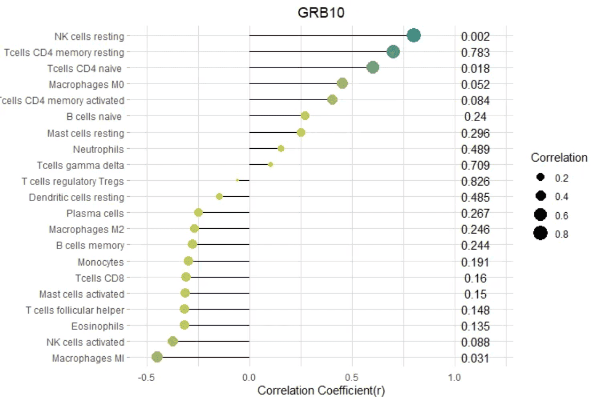
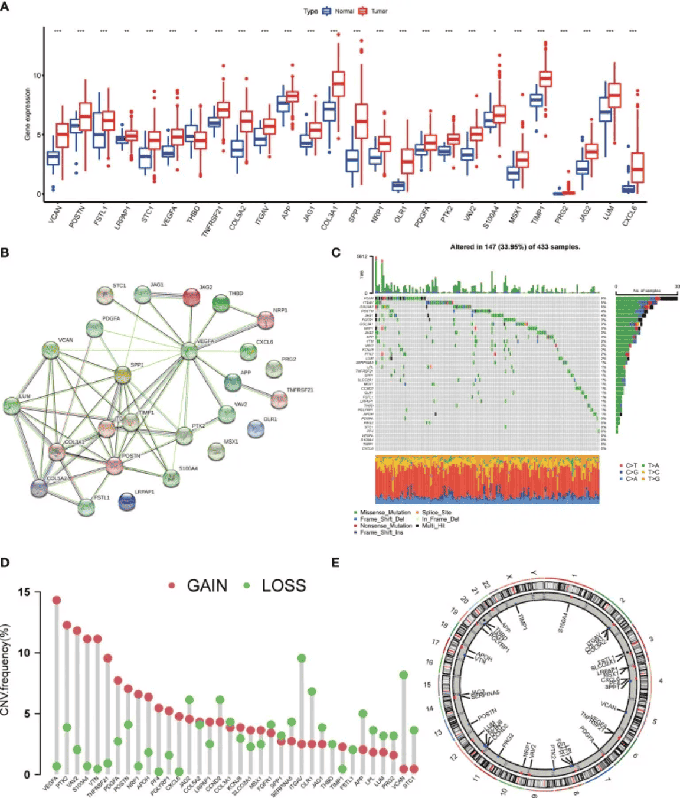
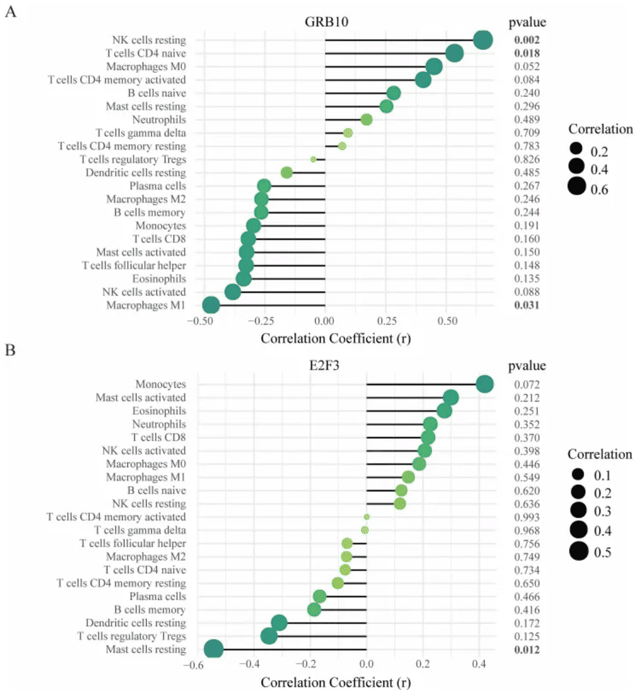

棒棒糖图（Lollipop plot）是条形图和散点图的变体，由一条线段和一个点组成，其在清晰展示数据的同时，减少了图形量。同时，棒棒糖图能够帮助将数值与类别对齐，非常适合比较多个类别的值之间的差异。

## 示例

{fig-alt="Lollipop DEMO" fig-align="center" width="60%"}

## 环境配置

-   系统要求： 跨平台（Linux/MacOS/Windows）

-   编程语言：R

-   依赖包：`ggplot2`; `dplyr`; `tidyr`; `palmerpenguins`; `cowplot`; `hrbrthemes`; `ggalt`; `rstatix`; `ggpubr`; `ggrepel`; `patchwork`

```{r packages setup, message=FALSE, warning=FALSE, output=FALSE}
# 安装包
if (!requireNamespace("ggplot2", quietly = TRUE)) {
  install.packages("ggplot2")
}
if (!requireNamespace("tidyr", quietly = TRUE)) {
  install.packages("tidyr")
}
if (!requireNamespace("palmerpenguins", quietly = TRUE)) {
  install.packages("palmerpenguins")
}
if (!requireNamespace("cowplot", quietly = TRUE)) {
  install.packages("cowplot")
}
if (!requireNamespace("hrbrthemes", quietly = TRUE)) {
  install.packages("hrbrthemes")
}
if (!requireNamespace("ggalt", quietly = TRUE)) {
  install.packages("ggalt")
}
if (!requireNamespace("rstatix", quietly = TRUE)) {
  install.packages("rstatix")
}
if (!requireNamespace("ggpubr", quietly = TRUE)) {
  install.packages("ggpubr")
}

# 加载包
library(ggplot2)
library(tidyr)
library(palmerpenguins)
library(cowplot)
library(hrbrthemes)
library(ggalt)
library(rstatix)
library(ggpubr)
```

```{r}
sessioninfo::session_info("attached")
```

## 数据准备

主要利用R自带数据集以及`TCGA`数据库中的数据进行绘图

```{r load data}
data_TCGA <- read.csv("https://bizard-1301043367.cos.ap-guangzhou.myqcloud.com/TCGA-BRCA.htseq_counts_processed.csv")

data_TCGA1 <- data_TCGA[1:25,] %>%
  gather(key = "sample",value = "gene_expression",3:1219)

data_tcga_mean <- aggregate(data_TCGA1$gene_expression, 
                            by=list(data_TCGA1$gene_name), mean) #均值
colnames(data_tcga_mean) <- c("gene","expression")

data_tcga_sd <- aggregate(data_TCGA1$gene_expression, 
                          by=list(data_TCGA1$gene_name), sd)
colnames(data_tcga_sd) <- c("gene","sd")

data_tcga <- merge(data_tcga_mean, data_tcga_sd, by="gene")

data_penguins <- penguins

data_penguins_mean <- aggregate(data_penguins$flipper_length_mm, 
                                by=list(data_penguins$species,data_penguins$sex), 
                                mean)
colnames(data_penguins_mean) <- c("species","sex","flipper_length")

##将长格式数据转化为宽格式
data_penguins_mean <- spread(data_penguins_mean, key="sex", value="flipper_length")

row_mean = apply(data_penguins_mean[,2:3],1,mean)

data_penguins_mean$mean <- row_mean
```

## 可视化

### 1. 基础棒棒糖图

棒棒糖图由点和线组成，柱形图和散点图的数据输入均可用棒棒糖图进行绘制。

以`TCGA`数据为例（类似于条形图）

```{r}
#| label: fig-BasicPlot
#| fig-cap: "`TCGA`数据"
#| out.width: "95%"
#| warning: false

# `TCGA`数据集
p <- ggplot(data_tcga, aes(x=gene, y=expression)) +
  geom_point() + 
  geom_segment( aes(x=gene, xend=gene, y=0, yend=expression)) +
  theme(axis.text.x = element_text(angle = 30,vjust = 0.85,hjust = 0.85))

p
```

上图展示了不同基因的表达情况。

以`penguin`数据集为例（类似于散点图）。

```{r}
#| label: fig-Basicpenguin
#| fig-cap: "`penguin`数据集"
#| out.width: "95%"
#| warning: false

# `penguin`数据集
p <- ggplot(data_penguins, aes(x=bill_length_mm, y=bill_depth_mm)) +
  geom_point() + 
  geom_segment( aes(x=0, xend=bill_length_mm, y=bill_depth_mm, yend=bill_depth_mm))
  ##x=0,直线从y轴发起；y=0，直线从x轴发起；均等于0，直线从原点发起

p
```

上图展示了企鹅喙长度与深度的分布关系。

### 2. 自定义外观

**颜色与样式**

```{r}
#| label: fig-Colorstyle
#| fig-cap: "`颜色与样式"
#| out.width: "95%"
#| warning: false
#| fig-width: 10
#| fig-height: 8

# 圆点
p1 <- ggplot(data_tcga, aes(x=gene, y=expression)) +
  geom_segment( aes(x=gene, xend=gene, y=0, yend=expression)) +
  geom_point( size=5, color="red",  #圈
              fill=alpha("orange"), #填充
              alpha=0.7, shape=21, stroke=2) +
  labs(title = "Point appearance")+
  theme(plot.title = element_text(hjust = 0.5),
        axis.text.x = element_text(angle = 60,vjust = 0.85,hjust = 0.75))

# 茎
p2 <- ggplot(data_tcga, aes(x=gene, y=expression)) +
  geom_point() + 
  geom_segment( aes(x=gene, xend=gene, y=0, yend=expression),
                size=1, color="blue", linetype="dotdash" )+
  labs(title = "Stem appearance")+
  theme(plot.title = element_text(hjust = 0.5),
        axis.text.x = element_text(angle = 60,vjust = 0.85,hjust = 0.75))

# theme
p3 <- ggplot(data_tcga, aes(x=gene, y=expression)) +
  geom_point(color="orange", size=4) + 
  geom_segment( aes(x=gene, xend=gene, y=0, yend=expression),color="grey") +
  theme_light() +
  theme(
    panel.grid.major.x = element_blank(),
    panel.border = element_blank(),
    axis.ticks.x = element_blank(),
    plot.title = element_text(hjust = 0.5),
    axis.text.x = element_text(angle = 60,vjust = 0.85,hjust = 0.75)#标题居中
  ) +
  xlab("gene") +
  ylab("expression")+
  labs(title = "Theme")

plot_grid(p1,p2,p3, labels = LETTERS[1:3], ncol = 2)
```

**翻转与基线**

```{r}
#| label: fig-flip
#| fig-cap: "`翻转与基线"
#| out.width: "95%"
#| warning: false
#| fig-width: 8
#| fig-height: 6

##翻转
p4 <- ggplot(data_tcga, aes(x=gene, y=expression)) +
  geom_point(color="orange", size=4) + 
  geom_segment( aes(x=gene, xend=gene, y=0, yend=expression),color="grey") +
  theme_light() +
  labs(title = "Flipped lollipop")+
  theme(
    plot.title = element_text(hjust = 0.5), #标题居中
    panel.grid.major.x = element_blank(),
    panel.border = element_blank(),
    axis.ticks.x = element_blank()
  ) +
  xlab("gene") +
  ylab("expression") +
  coord_flip() #万能翻转

##更改基线
p5 <- ggplot(data_tcga, aes(x=gene, y=expression)) +
  geom_point(color="orange", size=4) + 
  geom_segment( aes(x=gene, xend=gene, y=5, ##数值即为基线位置
                    yend=expression),color="grey") +
  theme_light() +
  theme(
    panel.grid.major.x = element_blank(),
    panel.border = element_blank(),
    axis.ticks.x = element_blank(),
    plot.title = element_text(hjust = 0.5),#标题居中
    axis.text.x = element_text(angle = 60,vjust = 0.85,hjust = 0.75)
  ) +
  xlab("gene") +
  ylab("expression")+
  labs(title = "Changing the baseline")

plot_grid(p4,p5, labels = LETTERS[1:2], ncol = 2)
```

### 3. 高亮显示

在需要特定高亮显示某些数据时，可以利用ifelse函数筛选高亮数据。

以`TCGA`数据为例

```{r}
#| label: fig-highlight
#| fig-cap: "`高亮显示"
#| out.width: "95%"
#| warning: false
#| fig-height: 6

#高亮显示----
p6 <- 
##绘图+高亮
  ggplot(data_tcga, aes(x=gene, y=expression)) +
  geom_segment(
    aes(x=gene, xend=gene, y=0, yend=expression), 
    color=ifelse(data_tcga$gene %in% c("A4GALT","A1CF"), "orange", "grey"), 
    size=ifelse(data_tcga$gene %in% c("A4GALT","A1CF"), 1.3, 0.7)
     ##用ifelse语句筛选高亮组
  ) +
  geom_point(
    color=ifelse(data_tcga$gene %in% c("A4GALT","A1CF"), "orange", "grey"), 
    size=ifelse(data_tcga$gene %in% c("A4GALT","A1CF"), 5, 2)
  ) +
  theme_ipsum() +
  coord_flip() +
  theme(
    legend.position="none"
  ) +
  xlab("gene") +
  ylab("expression") +

##设置标签
  annotate("text", x=grep("A4GALT", data_tcga$gene), #添加文字标签
           y=data_tcga$expression[which(data_tcga$gene=="A4GALT")]*1.05, #确定标签位置
           label=data_tcga$expression[which(data_tcga$gene=="A4GALT")] %>% round(2), 
           color="orange", size=4 , angle=0, fontface="bold", hjust=0) +
  annotate("text", x=grep("A1CF", data_tcga$gene), #添加文字标签
           y=data_tcga$expression[which(data_tcga$gene=="A1CF")]*1.2, #确定标签位置
           label=data_tcga$expression[which(data_tcga$gene=="A1CF")] %>% round(2), 
           color="orange", size=4 , angle=0, fontface="bold", hjust=0)

p6
```

对指定数据高亮显示，同时利用`annotate()`函数添加标签。

### 4. 颜色区分

同样的，可以使用ifelse函数分类数据，用不同的颜色表示不同来源的数据，

以`penguin`数据集为例

```{r}
#| label: fig-ifelse
#| fig-cap: "`颜色区分"
#| out.width: "95%"
#| warning: false

data_penguins1 <- na.omit(data_penguins)
data_penguins1$number <- c(1:333)
data_penguins1$number <- as.character(data_penguins1$number)
data_penguins1 <- data_penguins1[1:20,]

p <- ggplot(data_penguins1, aes(x=number, y=flipper_length_mm)) +
  geom_segment(
    aes(x=number, xend=number, y=0, yend=flipper_length_mm), 
    color=ifelse(data_penguins1$sex == "female","#FFB6C1", "#4169E1"),alpha=0.5 ,
    size=ifelse(data_penguins1$sex == "female", 1.3, 1.3))+
  geom_point(
    color=ifelse(data_penguins1$sex == "female", "#FFB6C1", "#4169E1"),
    size=ifelse(data_penguins1$sex == "female", 5, 5)
  ) +
  theme_ipsum() +
  theme(
    legend.position="none"
  ) +
  xlab("") +
  ylab("flipper length")
p
```

利用`ifelse`函数实现不同数据的分类处理，上图蓝色代表male，粉色代表female

### 5. 哑铃图（克利夫兰点图）

不同于普通棒棒糖图，哑铃图适合多组两个数据的比较,同时还可以添加中位数、均数等。

以`pinguin`数据集为例

```{r}
#| label: fig-dumbbell
#| fig-cap: "哑铃图（克利夫兰点图）"
#| out.width: "95%"
#| warning: false

p <- ggplot(aes(x=female,xend=male,y=species),data=data_penguins_mean) +
  geom_dumbbell(colour_x = "#FFB6C1",
                colour_xend = "#4169E1",
                size_x = 2,size_xend = 1,
                size=1,color="gray",
                dot_guide = T)+ #添加虚线
  geom_point(aes(x=female,y=species,size=female),#size=female 外环大小表示数据大小
             alpha=0.5,color="#FFB6C1")+
  geom_point(aes(x=male,y=species,size=male),
             alpha=0.5,color="#4169E1")+
  theme_light()+
  theme(panel.grid.minor.x =element_blank(),
        panel.grid = element_blank(),
        legend.title = element_blank()
  )+
  xlab("flipper length") +
  annotate("text", x=200, y=3.5, label="female",color="#FFB6C1",size=7) +
  annotate("text", x=205, y=3.5, label="VS",color="black") +
  annotate("text", x=210, y=3.5, label="male",color="#4169E1",size=7) 

p
```

上图展示了三种不同品种的企鹅不同性别的翅膀长度均值的比较，其中外圈的大小表示数据的大小。

#### 5.1 添加均值

利用`geom_point`在原图基础上添加均值点

```{r}
#| label: fig-Addmean
#| fig-cap: "`添加均值"
#| out.width: "95%"
#| warning: false

##添加均值
p <- ggplot(aes(x=female,xend=male,y=species),data=data_penguins_mean)+
  geom_dumbbell(colour_x = "#FFB6C1",
                colour_xend = "#4169E1",
                size_x = 2,size_xend = 2,
                size=1,color="gray")+ 
  geom_point(aes(x=female,y=species,size=female),#size=female 外环大小表示数据大小
             alpha=0.7,color="#FFB6C1")+
  geom_point(aes(x=male,y=species,size=male),
             alpha=0.7,color="#4169E1")+
  geom_point(aes(x=mean,y=species,size=mean),
             alpha=0.5,color="orange")+ #添加均值
  theme_light()+
  theme(panel.grid.minor.x =element_blank(),
        panel.grid = element_blank(),
        legend.title = element_blank()
  )+
  xlab("flipper length") +
  annotate("text", x=200, y=3.5, label="female",color="#FFB6C1",size=7) +
  annotate("text", x=205, y=3.5, label="VS",color="black") +
  annotate("text", x=210, y=3.5, label="male",color="#4169E1",size=7) 

p
```

在原数据的基础上增加均值点（还可以根据需要添加中位数、极差、数据量等）

#### 5.2 添加差异分析

```{r}
#| label: fig-AddDef
#| fig-cap: "`添加差异分析"
#| out.width: "95%"
#| warning: false

##添加差异分析
p_val1_sex <- data_penguins %>%  
  group_by(species) %>% 
  wilcox_test(formula = flipper_length_mm~sex)%>%
  add_significance(p.col = 'p',cutpoints = c(0,0.001,0.01,0.05,1),symbols = c('***','**','*','ns'))

p_val1_species <- data_penguins %>% 
  wilcox_test(formula = flipper_length_mm~species) %>%
  add_significance(p.col = 'p',cutpoints = c(0,0.001,0.01,0.05,1),symbols = c('***','**','*','ns')) 

p <- ggplot(aes(x=female,xend=male,y=species),data=data_penguins_mean)+
  geom_dumbbell(colour_x = "#FFB6C1",
                colour_xend = "#4169E1",
                size_x = 2,size_xend = 2,
                size=1,color="gray")+
  geom_point(aes(x=female,y=species,size=female),#size=female 外环大小表示数据大小
             alpha=0.7,color="#FFB6C1")+
  geom_point(aes(x=male,y=species,size=male),
             alpha=0.7,color="#4169E1")+
  geom_point(aes(x=mean,y=species,size=mean),
             alpha=0.5,color="orange")+ #添加均值
  theme_light()+
  theme(panel.grid.minor.x =element_blank(),
        panel.grid = element_blank(),
        legend.title = element_blank()
  )+
  xlab("flipper length") +
  annotate("text", x=201.5, y=3.5, label="female",color="#FFB6C1") +
  annotate("text", x=205, y=3.5, label="VS",color="black") +
  annotate("text", x=208, y=3.5, label="male",color="#4169E1") +
##差异标签
##species
  annotate("text", y=1,x=216,
           label=paste("Adelie&Chinstra p=",
                       p_val1_species$p[which(p_val1_species$group1=="Adelie"& p_val1_species$group2=="Chinstrap")],
                       " ",
                       p_val1_species$p.signif[which(p_val1_species$group1=="Adelie"& p_val1_species$group2=="Chinstrap")])) +
  annotate("text", y=0.8,x=216,
           label=paste("Adelie&Gentoo p=",
                       p_val1_species$p[which(p_val1_species$group1=="Adelie"& p_val1_species$group2=="Gentoo")],
                       " ",
                       p_val1_species$p.signif[which(p_val1_species$group1=="Adelie"& p_val1_species$group2=="Gentoo")])) +
  annotate("text", y=0.6,x=216,
           label=paste("Chinstrap&Gentoo p=",
                       p_val1_species$p[which(p_val1_species$group1=="Chinstrap"& p_val1_species$group2=="Gentoo")],
                       " ",
                       p_val1_species$p.signif[which(p_val1_species$group1=="Chinstrap"& p_val1_species$group2=="Gentoo")])) +

##sex
  annotate("text", y=grep("Gentoo", data_penguins_mean$species)+0.15, #添加文字标签
           x=data_penguins_mean$mean[which(data_penguins_mean$species=="Gentoo")], 
           #确定标签位置
           label=p_val1_sex$p.adj.signif[which(p_val1_sex$species=="Gentoo")]) +
  annotate("text", y=grep("Chinstrap", data_penguins_mean$species)+0.15, #添加文字标签
           x=data_penguins_mean$mean[which(data_penguins_mean$species=="Chinstrap")], 
           #确定标签位置
           label=p_val1_sex$p.adj.signif[which(p_val1_sex$species=="Chinstrap")]) +
  annotate("text", y=grep("Adelie", data_penguins_mean$species)+0.15, #添加文字标签
           x=data_penguins_mean$mean[which(data_penguins_mean$species=="Adelie")], 
           #确定标签位置
           label=p_val1_sex$p.adj.signif[which(p_val1_sex$species=="Adelie")])

p
```

对原数据企鹅种类和企鹅性别对翅膀长度的影响进行差异分析，其结果均具有显著性。

### 6. 蛋白突变棒棒糖图

突变论文中的经典“棒棒糖”图 \[11\]：水平蛋白坐标轴上放置带色的**结构域方块**，突变位点以带支棍的圆点表示，圆点大小编码突变例数。真实数据可用 `trackViewer::lolliplot()` 从 `GRanges` 对象直接绘制；下面用 `ggplot2` 图元重建，使输出可定制主题且可复现。

```{r}
#| label: fig-6.1ProteinLollipop
#| fig-cap: "蛋白突变棒棒糖图：TP53 热点突变分布于蛋白坐标轴上并叠加结构域方块。圆点大小编码携带该位点的样本数；支棍交替分布于轴上下以减少拥挤。"
#| out.width: "95%"
#| warning: false
#| message: false
#| fig-width: 9
#| fig-height: 4.5

set.seed(4101)
# 模拟队列突变：每行一个样本，氨基酸位点 1-393
mut <- data.frame(
  position = c(175, 175, 175, 220, 220, 245, 248, 248, 273, 273, 273,
               158, 179, 196, 213, 234, 245, 280, 306, 338, 34, 72, 115,
               133, 141))
# 蛋白结构域（可来自 maftools::pfamDomains 或 UniProt）
dom <- data.frame(
  name = c("Proline-rich", "DNA-binding", "Tetramerization"),
  start = c(60, 100, 320), end = c(80, 290, 360),
  fill = c("#EABF00", "#445EAD", "#4D9342"))

pos_tab <- table(mut$position)
lp_df <- data.frame(position = as.numeric(names(pos_tab)),
                    freq = as.numeric(pos_tab))
# 支棍交替分布于轴上下以避免拥挤
lp_df$layer <- rep(c("top", "bottom"), length.out = nrow(lp_df))
lp_df$y <- ifelse(lp_df$layer == "top", log2(lp_df$freq) + 0.6,
                  -(log2(lp_df$freq) + 0.6))

ggplot() +
  geom_rect(data = dom, aes(xmin = start, xmax = end,
                            ymin = -0.35, ymax = 0.35, fill = name),
            inherit.aes = FALSE, colour = "grey30") +
  scale_fill_manual(values = setNames(dom$fill, dom$name), name = "Domain") +
  geom_hline(yintercept = 0, colour = "grey30", linewidth = 0.5) +
  geom_segment(aes(x = position, xend = position, y = 0, yend = y),
               data = lp_df, colour = "grey50", linewidth = 0.4) +
  geom_point(aes(x = position, y = y, size = freq),
             data = lp_df, shape = 21, fill = "#B2182B", stroke = 0.8) +
  scale_size_continuous(range = c(2, 7), name = "n samples") +
  coord_cartesian(clip = "off", xlim = c(0, 400)) +
  labs(title = "TP53 mutation landscape (simulated cohort)",
       x = "Amino-acid position", y = NULL) +
  theme_classic(base_size = 11) +
  theme(axis.text.y = element_blank(), axis.ticks.y = element_blank(),
        panel.grid.major.y = element_blank(), legend.position = "bottom")
```

::: callout-tip
**实践要点**

-   真实数据上，用 `trackViewer::lolliplot()` 配 `GRanges` 对象（点带 `score` 控制高度）是即插即用的路径；上面的 `ggplot2` 版本可完全定制主题并输出矢量 SVG。
-   支棍分上下两层（`layer = c("top", "bottom")`）是热点拥挤的常用解法；按临床变量而非随机分层即可得到两组对比。
-   结构域坐标可取 `maftools::pfamDomains()` 按 RefSeq ID 过滤，或来自 UniProt REST API。
:::

### 7. 蛋白结构域架构、突变密度与结构域感知的棒棒糖图

突变棒棒糖图只有放在它所突变的蛋白之上才可解读。ProteinPaint 的规范 \[12\]，R 侧的同型实现是 maftools \[13\] 在一条残基轴上堆叠两层：**结构域架构**（肽链、Pfam 结构域、低复杂度区），以及其上方的**高斯核密度**——它把 18 根独立的杆收束成读者真正需要看到的两个热点簇。下方的棒棒糖轨道画出同一批变异，用类别编码颜色、用患者数编码点大小 \[14,15\]。

```{r}
#| label: fig-7-1ProteinDomainLollipop
#| fig-cap: "1800 aa 蛋白的结构域感知突变棒棒糖图：上方为 Pfam 风格的结构域架构（信号肽、结构域 A–E、低复杂度区）及其上的高斯核突变密度（sd = 22 aa）；下方每个变异一根棒，按变异类别着色、按患者数调整大小，并标注类别与癌种。残基 1044 处的 PRAD 热点（n = 62）正是密度轨道的峰。"
#| out.width: "100%"
#| warning: false
#| message: false
#| fig-width: 9
#| fig-height: 5.6

suppressPackageStartupMessages({
  library(ggplot2)
  library(dplyr)
  library(ggrepel)
  library(patchwork)
})

set.seed(43509)
options(ggrepel.max.overlaps = Inf)

## 一个玩具蛋白（残基 1-1800）的结构域架构，UniProt 风格。
domains <- data.frame(
  start = c(35, 120, 410, 720, 1105, 1420, 1650),
  end   = c(112, 210, 505, 845, 1180, 1500, 1790),
  type  = c("signal", "domain", "domain", "domain", "domain", "domain",
            "low complexity"),
  name  = c("signal", "Pfam A", "Pfam B", "Pfam C", "Pfam D", "Pfam E",
            "LC region"),
  row   = c(1, 1, 1, 2, 2, 2, 3)
)

## 体细胞突变：位置、类别与癌种。
mutations <- data.frame(
  pos = c(184, 245, 312, 468, 512, 604, 771, 802, 918, 1044,
          1122, 1190, 1288, 1345, 1466, 1522, 1608, 1712),
  cls = c("missense", "missense", "nonsense", "missense", "missense",
          "missense", "inframe del", "missense", "missense", "missense",
          "missense", "splice", "missense", "missense", "nonsense",
          "missense", "missense", "inframe ins"),
  cancer = c("BRCA", "LUAD", "COAD", "BRCA", "PRAD", "LUAD", "BRCA",
             "SKCM", "LUAD", "PRAD", "BRCA", "COAD", "LUAD", "BRCA",
             "SKCM", "PRAD", "LUAD", "COAD")
) |>
  mutate(n = round(exp(rnorm(n(), 2.4, 0.9))))

mut_cols <- c(missense = "#1b7837", nonsense = "#b2182b",
              `inframe del` = "#d95f02", `inframe ins` = "#7570b3",
              splice = "#8c510a")

## 突变位置的高斯核密度，按患者数加权。
dens <- data.frame(pos = seq(1, 1800, by = 2)) |>
  rowwise() |>
  mutate(d = sum(mutations$n * dnorm(pos, mutations$pos, 22)) /
           sum(mutations$n)) |>
  ungroup()

p_arch <- ggplot() +
  annotate("segment", x = 1, xend = 1800, y = 0, yend = 0,
           linewidth = 0.4, colour = "#bdbdbd") +
  geom_rect(data = domains,
            aes(xmin = start, xmax = end, ymin = -0.13 + row * 0.3,
                ymax = 0.13 + row * 0.3, fill = type),
            colour = "#525252", linewidth = 0.2, alpha = 0.85) +
  geom_text(data = domains, aes(x = (start + end) / 2, y = row * 0.3 + 0.19,
                                label = name), size = 1.9, colour = "#252525") +
  scale_fill_manual(values = c(signal = "#a6bddb", domain = "#9ebcda",
                               `low complexity` = "#f0f0f0"),
                    guide = "none") +
  geom_area(data = dens, aes(x = pos, y = 1.2 + 1.9 * d / max(d)), fill = "#7570b3",
            alpha = 0.22, colour = NA) +
  geom_line(data = dens, aes(x = pos, y = 1.2 + 1.9 * d / max(d)), colour = "#542788",
            linewidth = 0.3) +
  annotate("text", x = 20, y = 3.2,
           label = "mutation density (Gaussian kernel, sd = 22 aa)",
           size = 2.2, colour = "#542788", hjust = 0) +
  scale_y_continuous(limits = c(-0.35, 3.3), expand = c(0, 0)) +
  scale_x_continuous(limits = c(0, 1810), expand = c(0, 0),
                     breaks = seq(0, 1800, 300)) +
  labs(x = NULL, y = NULL) +
  theme_minimal(base_size = 9) +
  theme(panel.grid.minor = element_blank(),
        panel.grid.major.x = element_blank(),
        axis.text.y = element_blank(),
        axis.text.x = element_blank(),
        plot.margin = margin(5, 5, 0, 5))

p_lol <- ggplot(mutations, aes(pos, n)) +
  geom_segment(aes(xend = pos, yend = 0, colour = cls), linewidth = 0.5) +
  geom_point(aes(colour = cls, size = n), alpha = 0.95) +
  geom_text_repel(aes(label = ifelse(n > 40,
                                    paste0(cls, "\n(", cancer, "), n = ", n),
                                    paste0(cls, "\n(", cancer, ")")),
                      colour = cls),
                  size = 1.85, show.legend = FALSE, min.segment.length = 0,
                  segment.size = 0.15, seed = 3, direction = "both",
                  box.padding = 0.28, point.padding = 0.12,
                  max.overlaps = Inf, max.time = 3, max.iter = 50000) +
  ## outline labels are placed by repel; keep the headroom for them
  coord_cartesian(clip = "off") +
  scale_colour_manual(values = mut_cols, name = "Variant class") +
  scale_size_continuous(range = c(1.2, 4.2), name = "Patients") +
  scale_y_continuous(limits = c(0, 92), expand = c(0, 0)) +
  scale_x_continuous(limits = c(0, 1810), expand = c(0, 0),
                     breaks = seq(0, 1800, 300)) +
  labs(x = "Protein position (aa)", y = "Patients carrying the variant") +
  theme_minimal(base_size = 9) +
  theme(panel.grid.minor = element_blank(),
        legend.key.size = unit(0.32, "cm"),
        legend.text = element_text(size = 6.8),
        legend.title = element_text(size = 7.4),
        plot.margin = margin(0, 5, 5, 5))

p_arch / p_lol + plot_layout(heights = c(0.6, 1))
```

::: callout-tip
**实践要点**

-   把结构域架构与突变放在**同一条**残基轴上。没有结构域的棒棒糖图会隐藏最关键的发现——热点是否落在功能结构域内。
-   在杆上方加核密度带。18 个互相重叠的标签什么也没传达；一条密度带加一个声明的带宽（sd = 22 aa）即可一目了然——18 次抽样画出的带是凹凸的而非双峰，不要叙述图里不存在的峰。
-   类别配色保持小而互斥（missense / nonsense / inframe / splice），并与尺寸通道（患者数）分离。不要用颜色同时编码两件事。
-   给峰值直接标注计数。否则读者只能拿杆高去对照网格线。
-   声明蛋白全长与坐标约定（氨基酸，1-based）；未说明参考异构体的结构域图不可复现。
:::

## 关于本页跳过的实现

本页的图由 ggplot2 直接绘制，而不安装这些被跳过的工具。在 issue-435 清单中归到 Ranking/Lollipop.qmd 的工具里，2 条被标记为**跳过**，仅作为版式参考、不作为依赖：1 条超过 5 年无运维更新（截止日 2021-11-07）、1 条依赖闭包过重，不值得为一张静态图引入。沿用这些工具，等于锁定已废弃的代码；安装另一批，则要把整套分析框架拖进文档构建。本页先把这些工具的图形约定读懂，再自行重画，以便逐行核验每个面板。

| 工具 | 最近提交 | 状态 | 跳过原因 |
| --- | --- | --- | --- |
| drawProteins | — | 依赖过重 | 框架级依赖闭包过重，不值得为一张静态图引入 |
| pViz | 2016-09-13 | 陈旧 | 超过 5 年无运维更新 |

## 应用场景

### 1. 棒棒糖图

::: {#fig-LollipopApplications}
{fig-alt="LollipopApp1" fig-align="center" width="60%"}

棒棒糖图应用
:::

D图展示了AAGs（血管生成相关基因）中拷贝数变异缺失、增加和未发生变异的频率。 \[1\]

### 2. 哑铃图

::: {#fig-LollipopApplications}
{fig-alt="LollipopApp2" fig-align="center" width="60%"}

哑铃图应用
:::

(A)GRB10与渗透免疫细胞之间的相关性；(B)E2F3与渗透免疫细胞之间的相关性。

点的大小代表基因与免疫细胞之间相关性的强度;点越大，相关性越强，点越小，相关性越弱。点的颜色代表p值，颜色越绿，p值越低，颜色越黄，p值越大。\[2\]

## 参考文献

\[1\] Qing X, Xu W, Liu S, Chen Z, Ye C, Zhang Y. Molecular Characteristics, Clinical Significance, and Cancer Immune Interactions of Angiogenesis-Associated Genes in Gastric Cancer. Front Immunol. 2022 Feb 22;13:843077. doi: 10.3389/fimmu.2022.843077. PMID: 35273618; PMCID: PMC8901990.

\[2\] Deng YJ, Ren EH, Yuan WH, Zhang GZ, Wu ZL, Xie QQ. GRB10 and E2F3 as Diagnostic Markers of Osteoarthritis and Their Correlation with Immune Infiltration. Diagnostics (Basel). 2020 Mar 22;10(3):171. doi: 10.3390/diagnostics10030171. PMID: 32235747; PMCID: PMC7151213.

\[3\] H. Wickham. ggplot2: Elegant Graphics for Data Analysis. Springer-Verlag New York, 2016.

\[4\] Wickham H, Vaughan D, Girlich M (2024). tidyr: Tidy Messy Data. R package version 1.3.1, https://CRAN.R-project.org/package=tidyr.

\[5\] Horst AM, Hill AP, Gorman KB (2020). palmerpenguins: Palmer Archipelago (Antarctica) penguin data. R package version

\[6\] Wilke C (2024). cowplot: Streamlined Plot Theme and Plot Annotations for 'ggplot2'. R package version 1.1.3, https://CRAN.R-project.org/package=cowplot.

\[7\] Rudis B (2024). hrbrthemes: Additional Themes, Theme Components and Utilities for 'ggplot2'. R package version 0.8.7, https://CRAN.R-project.org/package=hrbrthemes.

\[8\] Rudis B, Bolker B, Schulz J (2017). ggalt: Extra Coordinate Systems, 'Geoms', Statistical Transformations, Scales and Fonts for 'ggplot2'. R package version 0.4.0, https://CRAN.R-project.org/package=ggalt.

\[9\] Kassambara A (2023). rstatix: Pipe-Friendly Framework for Basic Statistical Tests. R package version 0.7.2, https://CRAN.R-project.org/package=rstatix.

\[10\] Kassambara A (2023). ggpubr: 'ggplot2' Based Publication Ready Plots. R package version 0.6.0, https://CRAN.R-project.org/package=ggpubr.

\[11\] Lu X, Li K, Li Z, et al. FigureYa: a standardized visualization framework for enhancing biomedical data interpretation and research efficiency. iMetaMed. 2025;1(1). doi:10.1002/imm3.70005

\[12\] Zhou X, Edmonson MN, Wilkinson MR, et al. Exploring genomic alteration in pediatric cancer using ProteinPaint. Nat Genet. 2016;48(1):4-6. doi:10.1038/ng.3466

\[13\] Mayakonda A, Lin DC, Assenov Y, Plass C, Koeffler HP. Maftools: efficient and comprehensive analysis of somatic variants in cancer. Genome Res. 2018;28(11):1747-1756. doi:10.1101/gr.239244.118

\[14\] Cancer Genome Atlas Research Network. Comprehensive molecular characterization of gastric adenocarcinoma. Nature. 2014;513(7517):202-209. doi:10.1038/nature13480

\[15\] Gao J, Aksoy BA, Dogrusoz U, et al. Integrative analysis of complex cancer genomics and clinical profiles using the cBioPortal. Science Signaling. 2013;6(269):pl1. doi:10.1126/scisignal.2004088
