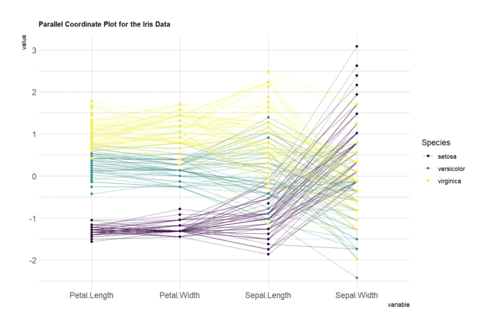
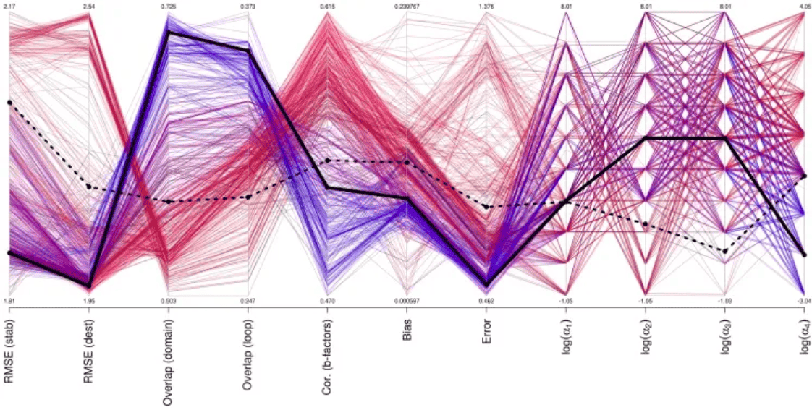
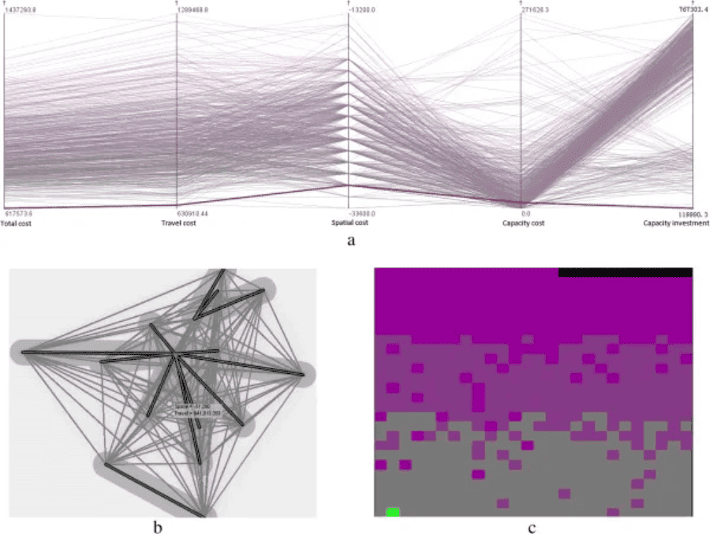
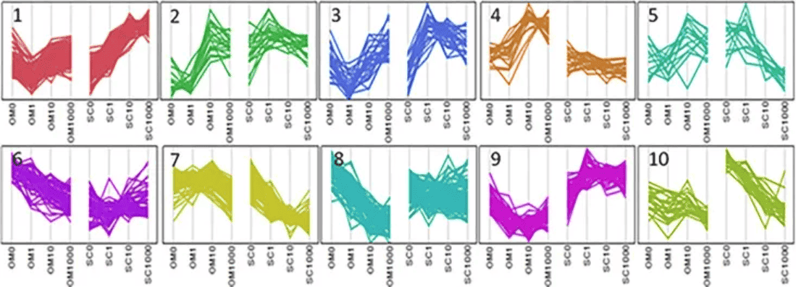

平行坐标图(parallel coordinate plot)是可视化高维多元数据的一种常用方法，为了显示多维空间中的一组对象，绘制由多条平行且等距分布的轴，并将多维空间中的对象表示为在平行轴上具有顶点的折线。虽然平行折线图属于折线图的特殊类型，但是它和普通的折线图又具有明显的区别。因为平行折线图并不局限于描述某一种或者某几种趋势的变化关系。对于时间序列的不同时间节点、不同梯度的反应浓度等等数值，都可以使用平行坐标图来进行具体数值的描述。

## 示例

{fig-alt="Parallel Plot DEMO" fig-align="center" width="60%"}

顶点在每一个轴上的位置对应了该对象在该维度上的中的变量数值。此平行坐标图基于Iris数据集，将四个变量（花萼和花瓣的长度和宽度）作为垂直轴，每条线代表一个数据点（花的样本），线条颜色表示花的类别（Setosa、Versicolor、Virginica）。线条穿过每个轴上的点，显示该样本在不同变量上的数值。通过观察这些线的趋势和交叉情况，你可以看到不同类别的花在变量上的差异或相似性。如果线条不交叉，说明组在这些变量上表现相似；如果频繁交叉，说明组在这些变量上差异较大。

## 环境配置

-   系统要求： 跨平台（Linux/MacOS/Windows）

-   编程语言：R

-   依赖包：`GGally`; `hrbrthemes`; `viridis`; `dplyr`; `tidyr`; `tibble`; `ggbump`; `RColorBrewer`; `patchwork`; `MASS`

```{r packages setup, message=FALSE, warning=FALSE, output=FALSE}
# 安装包
if (!requireNamespace("GGally", quietly = TRUE)) {
  install.packages("GGally")
}
if (!requireNamespace("hrbrthemes", quietly = TRUE)) {
  install.packages("hrbrthemes")
}
if (!requireNamespace("viridis", quietly = TRUE)) {
  install.packages("viridis")
}
if (!requireNamespace("dplyr", quietly = TRUE)) {
  install.packages("dplyr")
}
if (!requireNamespace("tidyr", quietly = TRUE)) {
  install.packages("tidyr")
}
if (!requireNamespace("tibble", quietly = TRUE)) {
  install.packages("tibble")
}
if (!requireNamespace("ggbump", quietly = TRUE)) {
  install.packages("https://cran.r-project.org/src/contrib/Archive/ggbump/ggbump_0.1.0.tar.gz")
}
if (!requireNamespace("RColorBrewer", quietly = TRUE)) {
  install.packages("RColorBrewer")
}
if (!requireNamespace("patchwork", quietly = TRUE)) {
  install.packages("patchwork")
}
if (!requireNamespace("MASS", quietly = TRUE)) {
  install.packages("MASS")
}

# 加载包
library(GGally)
library(hrbrthemes)
library(viridis)
library(dplyr)
library(tidyr)
library(tibble)
library(ggbump)
library(RColorBrewer)
library(patchwork)
library(MASS)
```

```{r}
sessioninfo::session_info("attached")
```

## 数据准备

使用R自带数据集`iris`和UCSC Xena网站(UCSC Xena (xenabrowser.net))的`TCGA-CHOL.methylation450.tsv`。

```{r load data}
#| message: false
#| warning: false

# iris
data_iris <- iris
data_iris <- data_iris %>%
  group_by(Species) %>%
  sample_n(size = 20, replace = FALSE)

# TCGA-CHOL.methylation450
methylation_raw <- readr::read_tsv("https://bizard-1301043367.cos.ap-guangzhou.myqcloud.com/TCGA-CHOL.methylation450_.tsv")
methylation_selected <- methylation_raw[c(5,7,11),c(4:6)]
rownames(methylation_selected) <- c("cg236", "cg292", "cg658")
colnames(methylation_selected) <- substr(colnames(methylation_selected), 9, 12)
data_tcga <- methylation_selected %>%
  rownames_to_column(var = "Composite") %>%
  pivot_longer(cols = -Composite, names_to = "sample", values_to = "value")
data_tcga <- data_tcga %>%
  mutate(sample = as.numeric(factor(sample))) # 把sample转换为数值
```

## 可视化

### 1. 基本绘图

使用ggplot2 包的拓展ggally包的ggparcoord()函数绘制平行图。

#### 1.1 基础平行图

输入数据集必须是具有多个数值变量的数据框，每个变量都用作图表上的垂直轴。这些变量的列数在函数的`columns`参数中指定。此处，分类变量用于为线条着色，在`groupColumn`参数中指定。

```{r}
#| label: fig-BasicPlot
#| fig-cap: "基础平行图"
#| out.width: "95%"
#| warning: false

# 基础平行图
p <- ggparcoord(data_iris, columns = 1:4, groupColumn = 5) 

p
```

此平行坐标图展示了`iris`数据集中的花萼长度、花萼宽度、花瓣长度、花瓣宽度之间的关系，每条线代表一个样本，而`groupColumn`指定的花的类别用于区分线的颜色。

#### 1.2 自定义颜色、主题、整体外观

这张图表与上一张图表基本相同，但有以下自定义：

- 使用`viridis`包改变调色板颜色
- 使用`title`添加标题，并自定义`theme`
- 使用`showPoints`添加点
- 使用`alphaLines`改变了线条透明度
- `theme_ipsum()`使用主题

```{r}
#| label: fig-CustomColor
#| fig-cap: "自定义颜色、主题、整体外观"
#| out.width: "95%"
#| warning: false

# 自定义颜色、主题、整体外观
p <- ggparcoord(data_iris,
           columns = 1:4, groupColumn = 5, order = "anyClass",
           showPoints = TRUE, 
           title = "Parallel Coordinate Plot for the Iris Data",
           alphaLines = 0.3) + 
  scale_color_viridis(discrete=TRUE) +
  theme_ipsum()+
  theme(plot.title = element_text(size=10))

p
```

此平行坐标图展示了`iris`数据集中的花萼长度、花萼宽度、花瓣长度、花瓣宽度之间的关系，自定义图片使图片更加美观易读。

#### 1.3 标准化

标准化转换原始数据，使其可以与其他变量进行比较。这是比较没有相同单位的变量的关键步骤。

`ggally`包提供了一个比例参数`scale`。下面在同一数据集上应用了四个可能的选项：

- `globalminmax` → 无标准化
- `uniminmax` → 标准化为最小值 = 0 和最大值 = 1
- `std` → 单变量标准化（减去平均值并除以标准差）
- `center` → 标准化和中心变量（变量的中心位置都被调整为零）

```{r}
#| label: fig-scale
#| fig-cap: "标准化"
#| out.width: "95%"
#| warning: false
#| fig-width: 12
#| fig-height: 8

# 无标准化
p1 <- ggparcoord(data_iris,
    columns = 1:4, groupColumn = 5, order = "anyClass",
    scale="globalminmax",
    showPoints = TRUE, 
    title = "No scaling",
    alphaLines = 0.3
    ) + 
  scale_color_viridis(discrete=TRUE) +
  theme_ipsum()+
  theme(
    legend.position="none",
    plot.title = element_text(size=13)
  ) +
  xlab("")

# 标准化为最小值 = 0 和最大值 = 1
p2 <- ggparcoord(data_iris,
    columns = 1:4, groupColumn = 5, order = "anyClass",
    scale="uniminmax",
    showPoints = TRUE, 
    title = "Standardize to Min = 0 and Max = 1",
    alphaLines = 0.3
    ) + 
  scale_color_viridis(discrete=TRUE) +
  theme_ipsum()+
  theme(
    legend.position="none",
    plot.title = element_text(size=13)
  ) +
  xlab("")

# 单变量标准化
p3 <- ggparcoord(data_iris,
    columns = 1:4, groupColumn = 5, order = "anyClass",
    scale="std",
    showPoints = TRUE, 
    title = "Normalize univariately (substract mean & divide by sd)",
    alphaLines = 0.3
    ) + 
  scale_color_viridis(discrete=TRUE) +
  theme_ipsum()+
  theme(
    legend.position="none",
    plot.title = element_text(size=13)
  ) +
  xlab("")

# 标准化和中心变量
p4 <- ggparcoord(data_iris,
    columns = 1:4, groupColumn = 5, order = "anyClass",
    scale="center",
    showPoints = TRUE, 
    title = "Standardize and center variables",
    alphaLines = 0.3
    ) + 
  scale_color_viridis(discrete=TRUE) +
  theme_ipsum()+
  theme(
    legend.position="none",
    plot.title = element_text(size=13)
  ) +
  xlab("")

p1 + p2 + p3 + p4 + plot_layout(ncol = 2)
```

这四个图展示了不同的标准化方法对`iris`数据集的影响：

1. **无标准化 (No scaling)**：展示原始数据，每个变量保留其原始范围，数值范围差异较大的变量更显著。
2. **最小值 = 0 和最大值 = 1 (Standardize to Min = 0 and Max = 1)**：所有变量的值被缩放到相同范围（0到1），便于比较不同变量的变化趋势。
3. **单变量标准化 (Normalize univariately)**：每个变量被标准化为均值为0、标准差为1，突出数据的相对差异。
4. **标准化和中心变量 (Standardize and center variables)**：数据经过均值中心化，突出不同组在每个变量上的相对差异。

这些图用颜色区分不同的花种，线条表示每个样本在不同变量上的值。

#### 1.4 突出显示组

如果对某个特定群体感兴趣，可以通过改变不同分类的颜色突出显示：

```{r}
#| label: fig-highlight
#| fig-cap: "突出显示组"
#| out.width: "95%"
#| warning: false

# 突出显示组
p <- data_iris %>%
  arrange(desc(Species)) %>%
  ggparcoord(
    columns = 1:4, groupColumn = 5, order = "anyClass",
    showPoints = TRUE, 
    title = "Original",
    alphaLines = 1
    ) + 
  scale_color_manual(values=c( "#69b3a2", "#E8E8E8", "#E8E8E8") ) + # 通过改变不同分类的颜色来突出特定群体
  theme_ipsum()+
  theme(
    legend.position="Default",
    plot.title = element_text(size=10)
  ) +
  xlab("")

p
```

这个图展示了`iris`数据集中不同花种在四个特征（花萼长度、花萼宽度、花瓣长度、花瓣宽度）上的表现。图中使用平行坐标图来显示每个样本在这些变量上的数值。通过按花种降序排列并着色，图中用绿色突出了`Setosa`花种，其余两种花种以灰色表示。线条代表样本，显示它们在不同特征上的数值变化。

### 2. MASS 包

#### 2.1 基础平行图（MASS 包）

使用`MASS`包构建平行坐标图。请注意，使用`ggplot2`可能是更好的选择。

```{r}
#| label: fig-MASS
#| fig-cap: "MASS 包"
#| out.width: "95%"
#| warning: false

my_colors <- colors()[as.numeric(data_iris$Species) * 11]
parcoord(data_iris[, c(1:4)], col = my_colors)
```

这个图是Iris数据集的平行坐标图，显示了数据集中四个变量（花萼长度、花萼宽度、花瓣长度和花瓣宽度）的分布。不同花种用不同颜色区分，通过观察不同颜色线条的走势，可以看到不同花种在这些变量上的模式差异。

#### 2.2 添加图例

使用`legend()`添加图例。 

```{r}
#| label: fig-MASSlegend
#| fig-cap: "添加图例"
#| out.width: "95%"
#| warning: false

my_colors <- colors()[as.numeric(data_iris$Species) * 11]
parcoord(data_iris[, c(1:4)], col = my_colors)

legend("topright", 
       legend = levels(data_iris$Species), 
       col = unique(my_colors), 
       pch = 1) # 添加图例
```

这个图是Iris数据集的平行坐标图，显示了数据集中四个变量（花萼长度、花萼宽度、花瓣长度和花瓣宽度）的分布。不同花种用不同颜色区分，显示了图例，通过观察不同颜色线条的走势，可以看到每个花种在这些变量上的模式差异。

#### 2.3 重新排序变量

在平行坐标图中找到最佳变量顺序非常重要。要更改它，只需更改输入数据集中的顺序即可。

```{r}
#| label: fig-MASSreorder
#| fig-cap: "重新排序变量"
#| out.width: "95%"
#| warning: false

palette <- brewer.pal(3, "Set1") 
my_colors <- palette[as.numeric(data_iris$Species)]

parcoord(data_iris[,c(1,3,4,2)] , col= my_colors)
```

这个图是Iris数据集的平行坐标图，展示了花萼长度、花瓣长度、花瓣宽度和花萼宽度这四个变量的分布。不同花种用三种不同颜色表示，通过观察颜色线条的变化，可以看出不同花种在这些变量上的差异趋势。更改输入数据集中的顺序对变量进行重新排序。

#### 2.4 突出显示组

如果对某个特定群体感兴趣，可以改变颜色，突出显示此分组。

```{r}
#| label: fig-MASShighlight
#| fig-cap: "突出显示组"
#| out.width: "95%"
#| warning: false

isSetosa <- ifelse(data_iris$Species=="setosa","red","grey")
parcoord(data_iris[,c(1,3,4,2)] , col=isSetosa)
```

这个图是Iris数据集的平行坐标图，其中setosa花种用红色显示，其他花种用灰色显示。通过这个图，可以直观地看到setosa与其他花种在花萼长度、花瓣长度、花瓣宽度和花萼宽度上的分布差异。

### 3. 凹凸图

凹凸图是一种可以直观地展示变化趋势的图表，常用于对比不同类别的数据。

#### 3.1 基础凹凸图

```{r}
#| label: fig-BasicBump
#| fig-cap: "基础凹凸图"
#| out.width: "95%"
#| warning: false

p <- ggplot(data_tcga, aes(x = sample, y = value, color = Composite)) +  
  geom_bump(size = 2) +  
  theme_minimal()
p
```

这个图展示了不同“Composite”（cg236、cg292、cg658）在不同“sample”中的甲基化数值变化趋势。通过颜色区分不同的“Composite”组，线条表示每组在不同样本中的表现。观察线条的起伏可以看出每组在各个样本中数值的变化趋势和相对差异。

#### 3.2 更改颜色

可以将单个点添加到凹凸图。这可以通过添加`geom_point()`图层来实现。使用`ggbump`包绘制凹凸图。

```{r}
#| label: fig-BumpChangeColor
#| fig-cap: "更改颜色"
#| out.width: "95%"
#| warning: false

p <- ggplot(data_tcga, aes(x = sample, y = value, color = Composite)) +  
  geom_bump(size = 2) +  
  geom_point(size = 6) +  
  scale_color_brewer(palette = "Paired") +  
  theme_minimal()
p
```

这个图展示了不同“Composite”（cg236、cg292、cg658）在不同“sample”中的甲基化数值变化趋势。通过颜色区分不同的“Composite”组，线条表示每组在不同样本中的表现。观察线条的起伏可以看出每组在各个样本中数值的变化趋势和相对差异。通过添加点和改变颜色使图片更加美观易读。

#### 3.3 添加标签和标题

`geom_text()`和函数`labs()`可用于向图表添加标签和标题。

```{r}
#| label: fig-BumpLabel
#| fig-cap: "添加标签和标题"
#| out.width: "95%"
#| warning: false

p <- ggplot(data_tcga, aes(x = sample, y = value, color = Composite)) +  
  geom_bump(size = 2) +  
  geom_point(size = 6) +  
  geom_text(aes(label = Composite), nudge_y = -0.01, fontface = "bold", size=3) + 
  scale_color_brewer(palette = "Paired") +  
  theme_minimal() +  
  labs(title = "Bump Plot of Methylation Values",    
     x = "Sample", y = "Value")
p
```

这个图展示了不同“Composite”（cg236、cg292、cg658）在不同“sample”中的甲基化值变化。线条表示每个“Composite”在不同样本中的数值趋势，点表示具体数值，标签标出“Composite”的名字。颜色区分不同的“Composite”，通过样本间的线条起伏可以看出它们的数值变化。

### 3. 元基因剖面：有序窗口上每样本一条线

FigureYa44 版式 \[12\] 是本页线条语言里的剖面图，只是轴换成了**有序基因组窗口**：每个基因压缩到固定窗口数（3 kb 上游 | 基因体 | 3 kb 下游），逐窗口 tag 计数在数千基因上取均值，每个 ChIP-seq 样本一条线。IP 与 input 的对照是经典读法。rtracklayer/bigWig 提取不在本仓库 lockfile 内，下块模拟均值窗口矩阵——换成你真实的逐窗口均值，下游一切不变：

```{r}
#| label: fig-3.1Metagene
#| fig-cap: "3,000 个模拟基因的元基因剖面：100-bp 上游窗口、压缩基因体与 3-kb 下游窗口的平均 tag 密度，每样本一条线（IP vs Input）；虚线标记 TSS 与 TTS。"
#| out.width: "95%"
#| warning: false
#| message: false
#| fig-width: 9
#| fig-height: 5

set.seed(4401)
n_gene <- 3000
resol <- 100
span <- 3000
gb_win <- 20
up_win <- span / resol
w_up <- seq_len(up_win)
w_gb <- seq_len(gb_win)
w_dn <- seq_len(up_win)
pos_lab <- c(paste0("-", seq(span, resol, -resol)),
             rep("gene body", gb_win),
             paste0("+", seq(resol, span, resol)))
axis_at <- c(1, up_win, up_win + gb_win, length(pos_lab))
axis_lab <- c("-3 kb", "TSS", "TTS", "+3 kb")
mk_profile <- function(amp_tss, amp_gb, noise) {
  up <- exp(-(w_up - max(w_up))^2 / (2 * (up_win / 2.2)^2)) * amp_tss
  gb <- (0.25 + 0.5 * seq(0, 1, length.out = gb_win)) * amp_gb
  dn <- exp(-(w_dn - 1)^2 / (2 * (up_win / 2.5)^2)) * (amp_tss * 0.35)
  pmax(0, c(up, gb, dn) + rnorm(length(up) + length(gb) + length(dn), 0, noise))
}
prof <- data.frame(
  window = seq_along(pos_lab),
  Cxxc1 = mk_profile(1.0, 0.55, 0.012),
  Input = mk_profile(0.30, 0.18, 0.010))
prof_long <- tidyr::pivot_longer(prof, cols = c(Cxxc1, Input),
                                 names_to = "sample", values_to = "signal")
ggplot(prof_long, aes(window, signal, colour = sample)) +
  geom_line(linewidth = 1) +
  geom_vline(xintercept = c(up_win + 0.5, up_win + gb_win + 0.5),
             linetype = 2, colour = "grey55") +
  annotate("rect", xmin = up_win + 0.5, xmax = up_win + gb_win + 0.5,
           ymin = -Inf, ymax = Inf, alpha = 0.06, fill = "#2166AC") +
  annotate("text", x = up_win / 2, y = max(prof_long$signal) * 1.02,
           label = "3 kb upstream", size = 2.8, colour = "grey30") +
  annotate("text", x = up_win + gb_win / 2, y = max(prof_long$signal) * 1.02,
           label = "gene body (compressed)", size = 2.8, colour = "grey30") +
  annotate("text", x = up_win + gb_win + up_win / 2, y = max(prof_long$signal) * 1.02,
           label = "3 kb downstream", size = 2.8, colour = "grey30") +
  scale_x_continuous(breaks = axis_at, labels = axis_lab,
                     expand = expansion(mult = c(0.01, 0.01))) +
  labs(x = NULL, y = "Mean tag density (simulated, 3,000 genes)",
       title = "Metagene profile: IP vs Input over extended gene bodies",
       colour = NULL) +
  theme_bw(base_size = 11) +
  theme(panel.grid = element_blank(), legend.position = "top")
```

::: callout-tip
**实践要点**

-   画的是基因间均值，绝不是逐基因线——元基因的信息就是*平均形状*；逐基因"意大利面"会毁掉它。
-   基因体压缩要保持诚实：等长 body 重采样到同一窗口数（此处 20）是标准做法，图注里写明。
-   给基因体区域上底色并用虚线标 TSS/TTS——不读图注时读者唯一能解读的两个位置就是它们。
:::

### 4. 单样本、多区域类别：单 bigWig 剖面图

§3 的姊妹版式（FigureYa57profile_1bw \[13\]）：**一份 bigWig 样本**、若干*区域类别*——例如按 CpG 含量分组的启动子（HCP / ICP / LCP）——每类用自己的 BED 平均，每类一条彩色线。对比的是基因组背景之间而非样本之间；高 CpG 启动子与低 CpG 启动子的 H3K4me3 差异是参考文档的经典示例。与 §3 一样，均值窗口矩阵在此模拟，替代 bigWig 提取：

```{r}
#| label: fig-4.1RegionProfile
#| fig-cap: "按启动子类别的单样本元基因剖面（模拟）：高（HCP）、中（ICP）、低 CpG（LCP）启动子在 TSS ±2 kb 的平均 H3K4me3 密度；虚线标记 TSS 与基因体末端。"
#| out.width: "95%"
#| warning: false
#| message: false
#| fig-width: 9
#| fig-height: 5

set.seed(5701)
resol <- 10
span <- 2000
up_win <- span / resol
body_win <- 40
amp <- c(HCP = 1.0, ICP = 0.45, LCP = 0.15)
prof108 <- do.call(rbind, lapply(names(amp), function(cl) {
  a <- amp[[cl]]
  up <- exp(-(seq_len(up_win) - max(seq_len(up_win)))^2 / (2 * (up_win / 2.0)^2)) * a
  body <- rep(0.15 * a + 0.1, body_win)
  dn <- rep(0.08 * a, up_win)
  data.frame(window = seq_len(up_win + body_win + up_win),
             signal = pmax(0, c(up, body, dn) +
                             rnorm(length(up) + body_win + up_win, 0, 0.015)),
             region = cl)
}))
prof108$region <- factor(prof108$region, levels = c("HCP", "ICP", "LCP"))
ggplot(prof108, aes(window, signal, colour = region)) +
  geom_line(linewidth = 1.1) +
  geom_vline(xintercept = c(up_win + 0.5, up_win + body_win + 0.5),
             linetype = 2, colour = "grey55") +
  annotate("text", x = up_win / 2, y = 1.05, label = "-2 kb", size = 2.9, colour = "grey30") +
  annotate("text", x = up_win + body_win / 2, y = 1.05, label = "TSS + gene body", size = 2.9, colour = "grey30") +
  annotate("text", x = up_win + body_win + up_win / 2, y = 1.05, label = "+2 kb", size = 2.9, colour = "grey30") +
  scale_x_continuous(breaks = c(1, up_win, up_win + body_win, length(unique(prof108$window))),
                     labels = c("-2 kb", "TSS", "TTS", "+2 kb"),
                     expand = expansion(mult = c(0.01, 0.01))) +
  scale_colour_manual(values = c(HCP = "darkorange", ICP = "navy", LCP = "darkgreen"), name = NULL) +
  labs(x = NULL, y = "H3K4me3 tag density (simulated)",
       title = "One sample, three CpG classes: promoter signal by region type") +
  theme_bw(base_size = 11) +
  theme(panel.grid = element_blank(), legend.position = "top")
```

::: callout-tip
**实践要点**

-   先按类别划分区域再提取信号，每类一个 BED（参考文档的 `mm9_HCP_tss.bed` / ICP / LCP 命名）；跨类平均会抹掉这张图要展示的对比本身。
-   多类别时线条更细、靠顶部图例承载身份——三条曲线互不相交，颜色即身份；打印前检查灰度可分性。
-   `span` 与基因体窗口数必须是 `resolution` 的整数倍，否则压缩 body 重采样会错位 TSS/TTS。
:::

## 应用场景## 应用场景

### 1. 基础平行图

::: {#fig-ParallelApplications}
{fig-alt="ParallelApp1" fig-align="center" width="60%"}

基础平行图应用1
:::

不同参数集对突变、b 因子和运动预测的性能。 \[1\]

::: {#fig-ParallelApplications}
{fig-alt="ParallelApp2" fig-align="center" width="60%"}

基础平行图应用2
:::

使用 （a） 平行坐标图、（b） 二元地理地图和 （c） 空间填充栅格在混合交通网络中选择最佳医疗保健中心。（注：两个变量，即总成本和差旅成本，在空间填充栅格中可视化。总成本用从灰色到紫色的色带表示，差旅成本用扫描线从左到右、从下到上升序排序。 \[2\]

### 2. 分面平行图

::: {#fig-ParallelApplications}
{fig-alt="ParallelApp3" fig-align="center" width="60%"}

分面平行图应用
:::

平行图说明了表现出 Depot*[Dex] 相互作用的基因的聚类分析。\[3\]

## 参考文献

\[1\] Frappier V, Najmanovich RJ. A coarse-grained elastic network atom contact model and its use in the simulation of protein dynamics and the prediction of the effect of mutations. PLoS Comput Biol. 2014 Apr 24;10(4):e1003569. doi: 10.1371/journal.pcbi.1003569. PMID: 24762569; PMCID: PMC3998880.

\[2\] Jia T, Tao H, Qin K, Wang Y, Liu C, Gao Q. Selecting the optimal healthcare centers with a modified P-median model: a visual analytic perspective. Int J Health Geogr. 2014 Oct 22;13:42. doi: 10.1186/1476-072X-13-42. PMID: 25336302; PMCID: PMC4293817.

\[3\] Pickering RT, Lee MJ, Karastergiou K, Gower A, Fried SK. Depot Dependent Effects of Dexamethasone on Gene Expression in Human Omental and Abdominal Subcutaneous Adipose Tissues from Obese Women. PLoS One. 2016 Dec 22;11(12):e0167337. doi: 10.1371/journal.pone.0167337. PMID: 28005982; PMCID: PMC5179014.

\[4\] Schloerke, B., Crowley, J., Cook, D., Hofmann, H., Wickham, H. (2021). GGally: Extension to 'ggplot2'. https://cran.r-project.org/package=GGally

\[5\] Rudis, B. (2020). hrbrthemes: Additional Themes and Theme Components for 'ggplot2'. https://cran.r-project.org/package=hrbrthemes

\[6\] Garnier, S. (2018). viridis: Colorblind-Friendly Color Maps for R. https://cran.r-project.org/package=viridis

\[7\] Wickham, H., François, R., Henry, L., Müller, K. (2023). dplyr: A Grammar of Data Manipulation. https://cran.r-project.org/package=dplyr

\[8\] Wickham, H., Henry, L. (2023). tidyr: Tidy Messy Data. https://cran.r-project.org/package=tidyr

\[9\] Müller, K. (2023). tibble: Simple Data Frames. https://cran.r-project.org/package=tibble

\[10\] Aumayr, A., & Münch, B. (2022). ggbump: Bump Charts with ggplot2. https://cran.r-project.org/package=ggbump

\[11\] Neuwirth, E. (2023). RColorBrewer: ColorBrewer Palettes. https://cran.r-project.org/package=RColorBrewer

\[12\] Xiaofan Lu, et al. FigureYa: A Standardized Visualization Framework for Enhancing Biomedical Data Interpretation and Research Efficiency. iMetaMed. 2025. doi:10.1002/imm3.70005

\[13\] Xiaofan Lu, et al. FigureYa: A Standardized Visualization Framework for Enhancing Biomedical Data Interpretation and Research Efficiency. iMetaMed. 2025. doi:10.1002/imm3.70005
