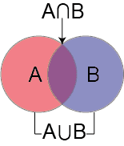
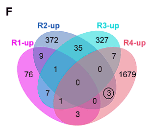

For the visualization of Venn diagrams, the commonly used R packages are ggVennDiagram and VennDiagram. Compared with the VennDiagram package, ggVennDiagram has the advantages of being applicable to more groups, adapting to ggplot2 syntax, and flexibly setting output formats, and is easier to learn and post-process. However, the set color of ggVennDiagram can only be set to a continuous gradient color related to the number of elements, and cannot be set to a discrete color with one color for each set. VennDiagram is just the opposite, so you can choose which R package to use for drawing according to specific needs.

## Example

{fig-alt="VeenPlot DEMO" fig-align="center" width="60%"}

## Setup

-   System Requirements: Cross-platform (Linux/MacOS/Windows)

-   Programming language: R

-   Dependent packages: `ggplot2`; `ggVennDiagram`; `VennDiagram`

```{r packages setup, message=FALSE, warning=FALSE, output=FALSE}
# Installing necessary packages
if (!requireNamespace("ggplot2", quietly = TRUE)) {
  install.packages("ggplot2")
}
if (!requireNamespace("ggVennDiagram", quietly = TRUE)) {
  install.packages("ggVennDiagram")
}
if (!requireNamespace("VennDiagram", quietly = TRUE)) {
  install.packages("VennDiagram")
}

# Load packages
library(ggplot2)
library(ggVennDiagram)
library(VennDiagram)
```

```{r}
sessioninfo::session_info("attached")
```

## Data Preparation

The data uses a simulated gene set. Assume that we have multiple groups of different treatments A~D, each of which produces a certain number of differentially expressed genes under different treatments.
The input format required by ggVennDiagram is a list. Each element in the list needs to have a corresponding name and the sub-elements it contains.

```{r load data, message=FALSE}
genes <- paste("gene",1:1000,sep="")
set.seed(123)
x <- list(A=sample(genes,300),
          B=sample(genes,525),
          C=sample(genes,440),
          D=sample(genes,350))
```

## Visualization

::: callout-tip
**ggVennDiagram basic parameters:**

- `x`: list collection data to be input
- `category.names`: collection name, default is the name defined in list
- `show_intersect`: when set to TRUE, output interactive images
- `set_color`: the stroke color of the collection, you can enter one or the same number of colors as the collection
- `set_size`: the size of the collection label
- `label`: the type of the numeric label in the collection, you can select an input from "both", "count", "percent", "none", the default is "both"
- `label_alpha`: the background transparency of the numeric label
- `label_geom`: the layer position of the numeric label, you can select one from "label", "text", the default is "label", when "text" is entered, the label will be located below the collection color block
- `label_color`: the color of the numeric label
- `label_size`: the size of the numeric label
- `label_percent_digit`: the number of decimal places reserved for the numeric label
- `label_txtWidth`: In interactive mode, the width of the text box showing the intersection element
- `edge_lty`: The line type of the set stroke, the default is "solid", other line types that can be set are: "blank", "solid", "dashed", "dotted", "dotdash", "longdash", "twodash"
- `edge_size`: The line width of the set stroke
- `force_upset`: Whether to use the upset graph to show the intersection
- `nintersects`: The number of sets used for drawing, if NULL, all sets are used
- `order.intersect.by`: The arrangement of intersections when drawing the upset graph
- `order.set.by`: The arrangement of sets when drawing the upset graph
- `relative_height`: The relative height of the upper bar graph when drawing the upset graph
- `relative_width`: The relative width of the left bar graph when drawing the upset graph
:::

### 1. Basic Venn Diagram

```{r}
#| label: fig-1.1BasicVeen
#| fig-cap: "Basic Venn Diagram"
#| out.width: "95%"
#| warning: false
#| message: false

# Basic Venn Diagram
ggVennDiagram(x)
```

This figure shows the intersection of differentially expressed genes under different treatments.

### 2. Beautify the Venn diagram

The color of the set in ggVennDiagram is a continuous variable set according to the number of elements contained in the set. The set color can be modified by functions such as `scale_fill_gradient` or `scale_fill_gradient2` in ggplot2. For example, the following code can be used to implement continuous color setting:

```{r}
#| label: fig-2.1Color1
#| fig-cap: "Color settings"
#| out.width: "95%"
#| warning: false
#| message: false

# Color settings
ggVennDiagram(x) + scale_fill_gradient(low="grey90",high = "red")
```

You can also use `scale_fill_gradient2` to define the colors more freely:

```{r}
#| label: fig-2.2Color2
#| fig-cap: "Color settings"
#| out.width: "95%"
#| warning: false
#| message: false

# Color settings
ggVennDiagram(x) + scale_fill_gradient2(low="grey90",mid = "yellow",midpoint = 100,high = "red")
```

More complex color settings can be accomplished by calling the palette:

```{r}
#| label: fig-2.3Color3
#| fig-cap: "Color settings"
#| out.width: "95%"
#| warning: false
#| message: false

# Color settings
ggVennDiagram(x) + scale_fill_distiller(palette = "Set1") 
```

It's also very easy to customize the palette:

```{r}
#| label: fig-2.4Color4
#| fig-cap: "Color settings"
#| out.width: "95%"
#| warning: false
#| message: false

# Color settings
cols <- c('#E64E00','#65B48E','#E6EB00','#E64E00')
pal <- colorRampPalette(cols)
ggVennDiagram(x) + scale_fill_gradientn(colors = pal(10)) # Numbers are the number of color levels
```

ggVennDiagram can also customize the border of the collection through `edge_lty`, `edge_size`, and `set_color`.

```{r}
#| label: fig-2.5edge
#| fig-cap: "edge settings"
#| out.width: "95%"
#| warning: false
#| message: false

# edge settings
ggVennDiagram(x, set_color=c("blue","red","green","purple"), edge_lty="dashed", edge_size=2)
```

The font settings can be modified via the following parameters:

```{r}
#| label: fig-2.6font
#| fig-cap: "Font Settings"
#| out.width: "95%"
#| warning: false
#| message: false

# Font Settings
# The most special parameter among the following is label. Among the four optional inputs of label, "percent" means only displaying percentage, "count" means only displaying quantity, and "none" means not displaying.
ggVennDiagram(x, set_size = 5, label = "percent", label_alpha = 0, 
              label_color = "red", label_size = 5, label_percent_digit = 2)
```

### 3. VennDiagram

We can also draw Venn diagrams using the VennDiagram package.

::: callout-tip
**venn.diagram basic parameters:**

- `x`: list collection data to be input
- `filename`: output file name
- `imagetype`: output file type can be selected from "tiff", "png", "svg"
- `units`: image size unit can be selected from "cm", "px", "unit"
- `height`: image height
- `width`: image width
- `resolution`: image resolution
- `compression`: image compression algorithm
- `scaled`: display collection size according to proportion
- `alpha`: collection transparency
- `fill`: collection color
- `col`: line color
- `lwd`: line thickness
- `lty`: line shape, 1 is solid line, 2 is dotted line, blank is no line
- `label.col`: number color
- `cex`: number size
- `cat.dist`: distance between label and collection
- `cat.pos`: angle of label relative to collection
- `cat.cex`: Label font size
- `cat.col`: Label color
:::

The core function of the VennDiagram package is `venn.diagram`. This function cannot draw images directly to the drawing board. You can draw images to the drawing board by cooperating with the `grid::grid.draw()` function.

```{r}
#| label: fig-3.1venn.diagram
#| fig-cap: "venn.diagram"
#| out.width: "95%"
#| warning: false
#| message: false

p <- venn.diagram(x,filename = NULL);grid::grid.draw(p)
```

The biggest difference between VennDiagram set color settings and ggVennDiagram is that the colors are set as discrete colors according to different sets. The setting method is as follows:

```{r}
#| label: fig-3.2Color
#| fig-cap: "Color settings"
#| out.width: "95%"
#| warning: false
#| message: false

# When only one color is entered, all sets display the same color. When the number of entered colors matches the number of sets, each set has its own color. You can also use a specific naming method to accurately set the color of the set.
p <- venn.diagram(
  x, filename = NULL,
  fill = c("A"="#2E75A2","B"="#FBD75F","C"="#379337","D"="#C13A3C"),
  alpha= 0.3);grid::grid.draw(p)
```

Line settings:

```{r}
#| label: fig-3.3line
#| fig-cap: "Line settings"
#| out.width: "95%"
#| warning: false
#| message: false

p <- venn.diagram(
  x, filename = NULL,
  col = c("A"="#2E75A2","B"="#FBD75F","C"="#379337","D"="#C13A3C"),
  lwd = 0.3, lty = 2);grid::grid.draw(p)
```

Font settings. If you need to adjust the position, please use the `cat.dist`, `cat.pos` parameters:

```{r}
#| label: fig-3.4font
#| fig-cap: "Font Settings"
#| out.width: "95%"
#| warning: false
#| message: false

p <- venn.diagram(
  x, filename = NULL, 
  cat.col =c("A"="#2E75A2","B"="#FBD75F","C"="#379337","D"="#C13A3C"),
  label.col = "red");grid::grid.draw(p)
```

Display the size of the collection in proportion. This mode is only applicable to two collections:

```{r}
#| label: fig-3.5scaled
#| fig-cap: "scaled"
#| out.width: "95%"
#| warning: false
#| message: false

p <- venn.diagram(
  x[c("A","B")], filename = NULL, fill= c("A"="#2E75A2","B"="#FBD75F"),
  scaled = T
);grid::grid.draw(p)
```

### 4. Working with Real DE Result Tables

In practice the input is not a ready-made list but several differential-expression result tables (from DESeq2/edgeR/limma or different contrasts). The recurring workflow \[2\] is: filter each table by FDR (and direction), collect the significant IDs into a **named list**, draw the Venn diagram, and export the genes of each overlap region as a supplementary table.

```{r}
#| label: fig-4.1RealDEG
#| fig-cap: "Venn diagram built from three simulated DE result tables after FDR filtering."
#| out.width: "95%"
#| warning: false
#| message: false

# Simulate three DE result tables (id, log2FC, FDR)
set.seed(123)
mk_deg <- function(n) {
  data.frame(id = sample(genes, n),
             log2FC = rnorm(n, sd = 2),
             FDR = runif(n))
}
deg_deseq2 <- mk_deg(400)
deg_edger  <- mk_deg(400)
deg_limma  <- mk_deg(400)

adjcutoff <- 0.05
sig_list <- list(
  DESeq2 = deg_deseq2$id[deg_deseq2$FDR <= adjcutoff & deg_deseq2$log2FC > 0],
  edgeR  = deg_edger$id[deg_edger$FDR <= adjcutoff & deg_edger$log2FC > 0],
  limma  = deg_limma$id[deg_limma$FDR <= adjcutoff & deg_limma$log2FC > 0]
)
sapply(sig_list, length)

ggVennDiagram(sig_list, label_alpha = 0) +
  scale_fill_gradient(low = "white", high = "lightblue")
```

The fill gradient now encodes region size across methods — regions shared by more methods (or with more genes) are darker, making method agreement readable at a glance. To export the genes of each region, extract the region data from the set object and write it to an Excel workbook (a convenient supplementary file):

```{r}
#| label: fig-4.2RegionItems
#| warning: false
#| message: false

region_data <- process_region_data(Venn(sig_list))

region_export <- data.frame(
  region = region_data$name,
  count  = lengths(region_data$item),
  items  = sapply(region_data$item, paste, collapse = ", ")
)
region_export
openxlsx::write.xlsx(region_export, file.path(tempdir(), "venn_regions.xlsx"), rowNames = FALSE)
```

For exploration in the browser, `ggVennDiagram(sig_list, show_intersect = TRUE)` opens an interactive HTML table listing the members of each region (requires a suitable viewer; not rendered in this static tutorial).

### 5. Percent Labels with Count-Scaled Fill

The classic *venny* web tool popularised a fill convention: **colour depth scales with region size** and labels can show percentages \[3\]. ggVennDiagram reproduces both: the fill gradient is already driven by the per-region count, and `label = "percent"` switches the labels to shares of the union. This combination on a four-set diagram mirrors the `colorfulVennPlot::plotVenn4d()` reference workflow without hand-computing the 15 region counts.

```{r}
#| label: fig-5.1PercentFill
#| fig-cap: "Four-set Venn diagram: fill depth scales with the region count, labels show each region's share of the union."
#| out.width: "80%"
#| warning: false
#| message: false

set.seed(7)
sets4 <- list(
  G1 = sample(genes, 260),
  G2 = sample(genes, 320),
  G3 = sample(genes, 210),
  G4 = sample(genes, 280)
)

ggVennDiagram(sets4, label = "percent", label_alpha = 0,
              label_percent_digit = 1) +
  scale_fill_gradient(low = "#F7FCF5", high = "#4D9342") +  # YlGn-style ramp
  theme(legend.position = "bottom")
```

::: callout-tip
**Practice tips**

- The gradient maps the **count in each region** across the whole diagram, so the darkest region is simply the largest one — with very unbalanced set sizes most regions sit at the pale end; bin the scale (`scale_fill_binned()`) if that hurts readability.
- `label = "both"` shows count and percent together when the caption needs exact numbers.
- Beyond four sets the circle layout degenerates — switch to UpSet (see [UpSet Plot](UpSetPlot.html)), as the reference workflow also recommends.
:::


### 6. Venn Diagram With an Exact Multiset-Intersection p Value

When a Venn diagram carries an argument (which pathways are *shared* across three PDX models?), the triple overlap needs a statistic: a P value under the null of independent sets, printed under the diagram \[4\]. The MSET test of Wang et al. generalises it to many sets; for the common three-set case the exact upper-tail binomial test below is self-contained and dependency-free.


```{r}
#| label: fig-6.1MultisetP
#| fig-cap: "Three PDX-model pathway sets with the exact multiset-intersection test below: the 52-member planted core makes the triple overlap astronomically richer than independent sampling allows (P < 1e-30)."
#| out.width: "85%"
#| warning: false
#| message: false
#| fig-width: 6.5
#| fig-height: 6

set.seed(1639)
n_bg  <- 800                                    # background: pathway universe
bg    <- paste0("P", sprintf("%04d", seq_len(n_bg)))
core  <- sample(bg, 52)                          # pathways shared by all three models
sz    <- c(158, 172, 141)
S1 <- unique(c(core, sample(setdiff(bg, core), sz[1] - length(core))))
S2 <- unique(c(core, sample(setdiff(bg, core), sz[2] - length(core))))
S3 <- unique(c(core, sample(setdiff(bg, core), sz[3] - length(core))))
dat <- list(PDX_95 = S1, PDX_112 = S2, PDX_207 = S3)

## exact upper-tail test of the triple intersection under independent sets:
## the observed triple-overlap count vs Binomial(n, p1*p2*p3)
t3 <- length(intersect(intersect(S1, S2), S3))
pval <- binom.test(t3, n = n_bg, p = prod(sz / n_bg),
                   alternative = "greater")$p.value

venn <- venn.diagram(x = dat, filename = NULL,
                     fill = c("red", "steelblue", "yellow"))
grid::grid.newpage()
grid::grid.draw(venn)
grid::grid.text(sprintf("Exact test of multiset intersections:  P = %.2e", pval),
                x = unit(0.5, "npc"), y = unit(0.05, "npc"),
                gp = gpar(fontsize = 11, col = "#B2182B"))
cat(sprintf("Triple overlap: %d pathways (sizes %s), P = %.2e\n",
            t3, paste(sz, collapse = "/"), pval))
```

::: callout-tip
**Practice tips**

-   The p-value must come from the **same null** the reader assumes: background size = the pathway/gene universe you sampled *from*, not the union of the drawn sets; a wrong n inflates significance silently.
-   Check the test against a Monte-Carlo null once per new design: draw independent sets with the same sizes and confirm the observed overlap never occurs by chance - if it does, your p-value is lying.
-   Packages such as SuperExactTest implement the full multiset exact test (Wang et al. 2015); the binomial tail here is its independent-sets special case - sufficient for the usual "is this overlap more than expected?" question.
:::

## Application

::: {#fig-HistApplications}
{fig-alt="VeenPlotApp1" fig-align="center" width="60%"}

Applications of Venn Diagram
:::

In this figure, R1-R4 are four different genotypes. Since R2 and R4 have exactly the same genotype at the target gene, the differentially expressed genes shared by R2 and R4 may be the downstream of the target gene \[1\].

## Reference

\[1\] Yu Y, Li W, Liu Y, Liu Y, Zhang Q, Ouyang Y, Ding W, Xue Y, Zou Y, Yan J, Jia A, Yan J, Hao X, Gou Y, Zhai Z, Liu L, Zheng Y, Zhang B, Xu J, Yang N, Xiao Y, Zhuo L, Lai Z, Yin P, Liu HJ, Fernie AR, Jackson D, Yan J. A Zea genus-specific micropeptide controls kernel dehydration in maize. Cell. 2025 Jan 9;188(1):44-59.e21. doi: 10.1016/j.cell.2024.10.030. Epub 2024 Nov 12. PMID: 39536747.

\[2\] Xiaofan Lu, et al. FigureYa: A Standardized Visualization Framework for Enhancing Biomedical Data Interpretation and Research Efficiency. iMetaMed. 2025. doi:10.1002/imm3.70005

\[3\] venny 2.1.0 interactive web tool. <http://bioinfogp.cnb.csic.es/tools/venny/>

\[4\] Xiaofan Lu, et al. FigureYa283vennyPvalue reference figure: Venn diagram with exact multiset-intersection P value. FigureYapy/FigureYa documentation. <https://ying-ge.github.io/FigureYa/>

