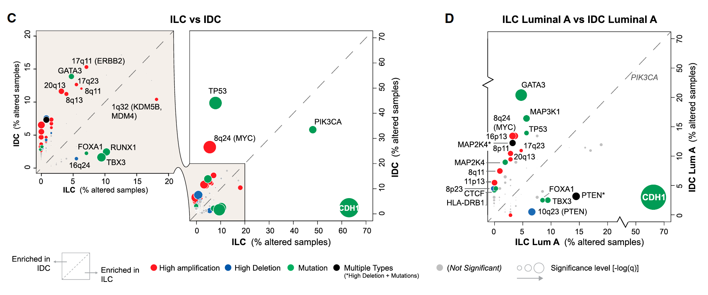

When points pile up, the reference's trick is to draw the same bubble scatter **twice**: a zoomed panel covering the crowded region and a full-extent panel beside it, both in base R — bubbles are coloured by functional group, sized by significance, and offset from the y = x diagonal shows which group each gene is shifted in \[1\]. The example reads mutation percentages of breast-cancer genes in two histological types (ILC vs IDC) from the Cell paper's Table 1 \[1\]. Pure base R, so the whole figure — including the base-graphics zoom mechanics (`par`, `rect`, `axis(4)`) — runs in-page on simulated data:

## Example

{fig-alt="Bubble Scatter with Base-Plot Zoom Panel DEMO" fig-align="center" width="70%"}

## Setup

-   System Requirements: Cross-platform (Linux/MacOS/Windows)

-   Programming language: R

-   Dependent packages: none (base R)

```{r packages setup, message=FALSE, warning=FALSE, output=FALSE}
# base graphics only — no external packages
```

```{r}
sessioninfo::session_info("attached")
```

## Data Preparation

60 breast-cancer genes with mutation percentages in ILC (lobular) and IDC (ductal) cohorts, a functional grouping (PI3K, chromatin, cell-cycle, DNA-repair, other) and a Fisher-style p-value per gene. Planted biology — PI3K genes shift toward ILC, cell-cycle genes toward IDC:

```{r load data}
set.seed(52333)
n_gene <- 60
genes <- sprintf("GENE%02d", seq_len(n_gene))
grp <- c(rep("PI3K pathway", 12), rep("Chromatin", 10), rep("Cell cycle", 8),
         rep("DNA repair", 10), rep("Other", 20))

## mutation percentages: correlated baseline + group-specific shifts
base <- rbeta(n_gene, 1.2, 8) * 60
ilc <- base + ifelse(grp == "PI3K pathway", 8, 0) + rnorm(n_gene, 0, 3)
idc <- base + ifelse(grp == "Cell cycle", 9, 0) + rnorm(n_gene, 0, 3)
ilc <- pmin(pmax(ilc, 0.4), 65); idc <- pmin(pmax(idc, 0.4), 65)

pval <- 10^(-runif(n_gene, 0.5, 6))
pval[grp == "Other"] <- 10^(-runif(sum(grp == "Other"), 0.2, 1.2))  # mostly n.s.

dat <- data.frame(Gene = genes, group = grp, ILC = ilc, IDC = idc, pvalue = pval)
dat$group[dat$pvalue > 0.001] <- "notsig"

mycol <- c("red", "navy", "forestgreen", "black", "#6A3D9A")
cols.names <- unique(dat$group)
cols.code <- setNames(c(mycol[seq_len(length(cols.names) - 1)], "grey"), cols.names)
sizes <- -log10(dat$pvalue) / 5
names(sizes) <- dat$Gene
```

## Visualization

### 1. Zoomed Panel and Full View Side by Side

The reference's base-graphics zoom: left panel limits both axes to 0-15% (the crowded corner, with a translucent highlight); right panel shows the full 0-70% extent with its own right-hand axis — labels are placed per panel so they never collide:

```{r}
#| label: fig-1.1BasezoomPanel
#| fig-cap: "Mutation-percentage bubbles in ILC vs IDC, base-plot zoom design: left panel enlarges the 0-15% corner (translucent highlight) where most genes pile up, right panel shows the full extent with a right-side axis; bubbles are coloured by functional group, sized by -log10(p), and significant genes are labelled, one side per gene."
#| out.width: "100%"
#| fig-width: 10
#| fig-height: 6.6

add.alpha <- function(col, alpha = 1) {
  apply(sapply(col, col2rgb) / 255, 2,
        function(x) rgb(x[1], x[2], x[3], alpha = alpha))
}
gray.alpha <- add.alpha("orange", alpha = 0.1)

par(mfrow = c(1, 2), mar = par()$mar + c(6.5, 0, 0, 3))

## zoomed panel (0-15%)
plot(dat$ILC, dat$IDC, col = cols.code[as.character(dat$group)],
     xlim = c(0, 15), ylim = c(0, 15), pch = 16,
     ylab = "IDC (% altered samples)", xlab = "ILC (% altered samples)",
     cex = sizes, main = "Zoom: 0-15% corner")
abline(a = 0, b = 1, col = "gray60", lwd = 1, lty = 5)
points(dat$ILC, dat$IDC, pch = 1, col = "white", cex = sizes)
## one label per gene, inside the zoom window only: genes with IDC>6 but
## ILC<=6 label left (pos=2), ILC>6 but IDC<=6 label right (pos=4)
lab_side <- ifelse(dat$IDC > 6 & dat$ILC <= 6, 2,
                   ifelse(dat$ILC > 6 & dat$IDC <= 6, 4, 0))
lab_ix <- which(lab_side != 0 & dat$pvalue <= 0.001)   # significant genes only
par(xpd = TRUE)
text(dat$ILC[lab_ix], dat$IDC[lab_ix], dat$Gene[lab_ix],
     pos = lab_side[lab_ix], cex = 0.72)
rect(par("usr")[1], par("usr")[3], par("usr")[2], par("usr")[4], col = gray.alpha)
legend("bottom", inset = c(0, -0.42), ncol = 3, pch = 16,
       col = cols.code, legend = cols.names, bty = "n", cex = 0.85)

## full view (0-70%)
plot(dat$ILC, dat$IDC, col = cols.code[as.character(dat$group)],
     xlim = c(0, 70), ylim = c(0, 70), ylab = "", xlab = "ILC (% altered samples)",
     yaxt = "n", pch = 16, cex = sizes, main = "Full extent")
points(dat$ILC, dat$IDC, pch = 1, col = "white", cex = sizes)
axis(side = 4)
suppressWarnings(title(ylab = "IDC (% altered samples)", mgp = c(-20, 1, 0)))
## full view: label only the 4 largest outliers, alternating left/right so
## adjacent labels never share a side
w <- order(pmax(dat$ILC, dat$IDC), decreasing = TRUE)[1:4]
text(dat$ILC[w], dat$IDC[w], dat$Gene[w],
     pos = ifelse(seq_along(w) %% 2 == 1, 4, 2), cex = 0.75)
u <- par("usr")
f <- c(1, 2.5, 5, 10, 20)
s <- sqrt(f / 3)
legend("bottom", inset = c(0, -0.42), legend = rep("", length(f)),
       title = "Significance level [-log10(p)]", pch = 1, pt.cex = s,
       bty = "n", horiz = TRUE)
par(xpd = FALSE)
abline(a = 0, b = 1, col = "gray60", lwd = 1, lty = 2)
```

::: callout-tip
**Practice tips**
-   The zoom panel is for **density**, the full panel for **extent** — label different points in each panel (crowded-region points left of the zoom, outliers above the full view) so the two panels complement rather than repeat.
-   `axis(side = 4)` + a negative `mgp` ylab puts the full panel's y-axis on the right — the shared visual scale reads as one continuous figure.
-   Bubble size needs a **legend in the same units** (`pt.cex = sqrt(f/3)` matching the size mapping `-log10(p)/5`) — an unexplained size axis hides the significance dimension.
-   White outline rings (`pch = 1`) over solid bubbles keep overlapping bubbles countable — pure base-R solution to overplotting.
-   `par(xpd = TRUE)` lets labels and legends escape the plot region; reset it after, or later panels inherit the setting.
:::

## Application

::: {#fig-AxisZoomApplications1}
{fig-alt="Bubble Scatter with Base-Plot Zoom Panel" fig-align="center" width="70%"}

Bubble scatter with base-plot zoom panel
:::

The paired zoom design applies to any crowded bubble comparison: variant frequencies across subtypes, drug-response percentages across lineages, or pathway- enrichment percentages across cell types.

## Reference

\[1\] Xiaofan Lu, et al. FigureYa: A Standardized Visualization Framework for Enhancing Biomedical Data Interpretation and Research Efficiency. iMetaMed. 2025. doi:10.1002/imm3.70005
