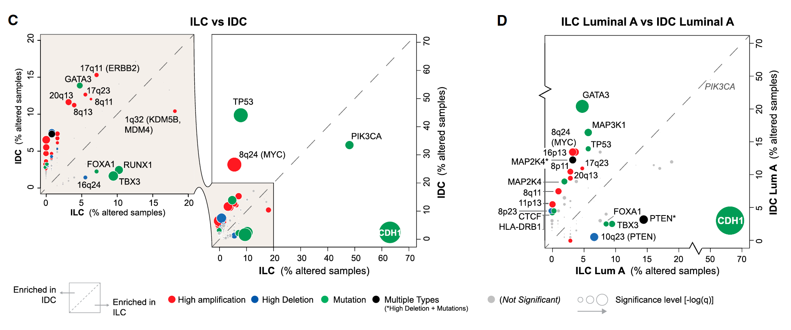

当点堆在一起时，参考的技巧是把同一个泡泡散点画**两遍**：一个覆盖拥挤区域的放大面板、旁边一个全域面板，两者都是 base 图——泡泡按功能分组着色、按显著性定大小，相对 y = x 对角线的偏移指示每个基因向哪一组偏移 \[1\]。例文读取 Cell 论文表 1 中乳腺癌基因在两种组织学类型（ILC vs IDC）的突变百分比 \[1\]。纯 base R，整张图——包括 base 图的放大机制（`par`、`rect`、`axis(4)`）——都在页内以模拟数据运行：

## Example

{fig-alt="泡泡散点的 base 图放大面板 DEMO" fig-align="center" width="70%"}

## Setup

-   系统要求：跨平台（Linux/MacOS/Windows）

-   编程语言：R

-   依赖包：无（base R）

```{r packages setup, message=FALSE, warning=FALSE, output=FALSE}
# base graphics only — no external packages
```

```{r}
sessioninfo::session_info("attached")
```

## 数据准备

60 个乳腺癌基因在 ILC（小叶）与 IDC（导管）队列中的突变百分比、功能分组（PI3K、染色质、细胞周期、DNA 修复、其他）与每基因 Fisher 式 p 值。植入生物学——PI3K 组基因向 ILC 偏移、细胞周期组向 IDC 偏移：

```{r load data}
set.seed(52333)
n_gene <- 60
genes <- sprintf("GENE%02d", seq_len(n_gene))
grp <- c(rep("PI3K pathway", 12), rep("Chromatin", 10), rep("Cell cycle", 8),
         rep("DNA repair", 10), rep("Other", 20))

## mutation percentages: correlated baseline + group-specific shifts
base <- rbeta(n_gene, 1.2, 8) * 60
ilc <- base + ifelse(grp == "PI3K pathway", 8, 0) + rnorm(n_gene, 0, 3)
idc <- base + ifelse(grp == "Cell cycle", 9, 0) + rnorm(n_gene, 0, 3)
ilc <- pmin(pmax(ilc, 0.4), 65); idc <- pmin(pmax(idc, 0.4), 65)

pval <- 10^(-runif(n_gene, 0.5, 6))
pval[grp == "Other"] <- 10^(-runif(sum(grp == "Other"), 0.2, 1.2))  # mostly n.s.

dat <- data.frame(Gene = genes, group = grp, ILC = ilc, IDC = idc, pvalue = pval)
dat$group[dat$pvalue > 0.001] <- "notsig"

mycol <- c("red", "navy", "forestgreen", "black", "#6A3D9A")
cols.names <- unique(dat$group)
cols.code <- setNames(c(mycol[seq_len(length(cols.names) - 1)], "grey"), cols.names)
sizes <- -log10(dat$pvalue) / 5
names(sizes) <- dat$Gene
```

## Visualization

### 1. 放大面板与全域视图并排

参考的 base 图放大：左面板双轴限制在 0-15%（拥挤角落，加半透明高亮）；右面板展示完整 0-70% 范围并自带右侧 y 轴——每个面板独立放标签，永不碰撞：

```{r}
#| label: fig-1.1BasezoomPanel
#| fig-cap: "ILC vs IDC 突变百分比泡泡、base 图放大设计：左面板放大 0-15% 角落（半透明高亮）——多数基因堆在这里，右面板展示全域并带右侧轴；泡泡按功能分组着色、按 -log10(p) 定大小，显著基因按侧标注。"
#| out.width: "100%"
#| fig-width: 10
#| fig-height: 6.6

add.alpha <- function(col, alpha = 1) {
  apply(sapply(col, col2rgb) / 255, 2,
        function(x) rgb(x[1], x[2], x[3], alpha = alpha))
}
gray.alpha <- add.alpha("orange", alpha = 0.1)

par(mfrow = c(1, 2), mar = par()$mar + c(6.5, 0, 0, 3))

## zoomed panel (0-15%)
plot(dat$ILC, dat$IDC, col = cols.code[as.character(dat$group)],
     xlim = c(0, 15), ylim = c(0, 15), pch = 16,
     ylab = "IDC (% altered samples)", xlab = "ILC (% altered samples)",
     cex = sizes, main = "Zoom: 0-15% corner")
abline(a = 0, b = 1, col = "gray60", lwd = 1, lty = 5)
points(dat$ILC, dat$IDC, pch = 1, col = "white", cex = sizes)
## 每个基因只标一次、且仅标窗口内的点：IDC>6 且 ILC<=6 标左侧（pos=2），
## ILC>6 且 IDC<=6 标右侧（pos=4）
lab_side <- ifelse(dat$IDC > 6 & dat$ILC <= 6, 2,
                   ifelse(dat$ILC > 6 & dat$IDC <= 6, 4, 0))
lab_ix <- which(lab_side != 0 & dat$pvalue <= 0.001)   # significant genes only
par(xpd = TRUE)
text(dat$ILC[lab_ix], dat$IDC[lab_ix], dat$Gene[lab_ix],
     pos = lab_side[lab_ix], cex = 0.72)
rect(par("usr")[1], par("usr")[3], par("usr")[2], par("usr")[4], col = gray.alpha)
legend("bottom", inset = c(0, -0.42), ncol = 3, pch = 16,
       col = cols.code, legend = cols.names, bty = "n", cex = 0.85)

## full view (0-70%)
plot(dat$ILC, dat$IDC, col = cols.code[as.character(dat$group)],
     xlim = c(0, 70), ylim = c(0, 70), ylab = "", xlab = "ILC (% altered samples)",
     yaxt = "n", pch = 16, cex = sizes, main = "Full extent")
points(dat$ILC, dat$IDC, pch = 1, col = "white", cex = sizes)
axis(side = 4)
suppressWarnings(title(ylab = "IDC (% altered samples)", mgp = c(-20, 1, 0)))
## full view: label only the 4 largest outliers, alternating left/right so
## adjacent labels never share a side
w <- order(pmax(dat$ILC, dat$IDC), decreasing = TRUE)[1:4]
text(dat$ILC[w], dat$IDC[w], dat$Gene[w],
     pos = ifelse(seq_along(w) %% 2 == 1, 4, 2), cex = 0.75)
u <- par("usr")
f <- c(1, 2.5, 5, 10, 20)
s <- sqrt(f / 3)
legend("bottom", inset = c(0, -0.42), legend = rep("", length(f)),
       title = "Significance level [-log10(p)]", pch = 1, pt.cex = s,
       bty = "n", horiz = TRUE)
par(xpd = FALSE)
abline(a = 0, b = 1, col = "gray60", lwd = 1, lty = 2)
```

::: callout-tip
**实践要点**
-   放大面板管**密度**，全域面板管**范围**——两个面板标不同的点（放大面板标拥挤区点、全域面板标离群点）让两者互补而非重复。
-   `axis(side = 4)` + 负 `mgp` 的 ylab 把全域面板的 y 轴放到右侧——共享的视觉刻度读作一张连续的图。
-   泡泡大小需要**同单位图例**（`pt.cex = sqrt(f/3)` 对应大小映射 `-log10(p)/5`）——没有解释的大小轴会隐藏显著性维度。
-   实心泡泡外圈白环（`pch = 1`）让重叠泡泡可数——纯 base R 的抗叠画法。
-   `par(xpd = TRUE)` 让标签与图例画出绘图区；画完记得恢复，否则后续面板继承该设置。
:::

## 应用场景

::: {#fig-AxisZoomApplications1}
{fig-alt="泡泡散点的 base 图放大面板" fig-align="center" width="70%"}

泡泡散点的 base 图放大面板
:::

成对放大设计适用于任何拥挤的泡泡比较：跨亚型的变异频率、跨谱系的药物应答百分比、或跨细胞类型的通路富集百分比。

## 参考文献

\[1\] Xiaofan Lu, et al. FigureYa: A Standardized Visualization Framework for Enhancing Biomedical Data Interpretation and Research Efficiency. iMetaMed. 2025. doi:10.1002/imm3.70005
